Open a half-gigabyte log file with `cat` in a typical terminal and the interface starts to melt: keystrokes echo late, the scrollbar fights back, and a CPU core saturates. Run the same command in Alacritty and it stays smooth. The difference is not shell trickery or clever output buffering — it is an architectural decision made in 2017 and refined since: keep terminal *state* on the CPU, but let the GPU composite every frame.

"GPU-accelerated terminal" sounds like marketing, so it is worth pinning down what it actually means. A terminal's job is to turn program bytes into a grid of styled characters, then put that grid on screen. Most of the cost is bookkeeping: parsing escape sequences, maintaining scrollback, and redrawing the visible slice. When that bookkeeping is paired with a renderer that uploads rasterized glyphs once into a GPU texture and afterwards only pushes a few thousand textured quads per frame, the parser and the paint loop stop competing for the same resources. Everything in Alacritty's design follows from that separation.

Between the moment your shell writes a byte to the pseudoterminal and the moment a pixel lights up, the data crosses five stages: PTY read, escape-sequence parsing, grid mutation, damage collection, and GPU draw. This article walks each stage through Alacritty's actual source on `master` — every symbol and line number below links into the upstream repo at the version current when written (binary crate 0.18.0-dev). It is all [Rust](/rust/), using the 2024 edition with a toolchain floor of 1.85.

<em>Alacritty's data flow: the binary crate wires windows and input; a dedicated "PTY reader" thread parses shell bytes into the shared <code>Term</code>; the grid stores cells; the renderer turns damaged cells into GPU draws. Click any node to open the file on GitHub.</em>

Reading the overview from left to right:

- **Two crates, one screen.** The workspace holds four members [members, L2](https://github.com/alacritty/alacritty/blob/master/Cargo.toml#L2-L7): the GUI binary, the window-free `alacritty_terminal` library, and two config helper crates. The library gates its `tty` and `event_loop` modules off for wasm targets [wasm gates, L8](https://github.com/alacritty/alacritty/blob/master/alacritty_terminal/src/lib.rs#L8-L18), which is why its terminal logic can be tested headlessly against recorded byte streams.
- **The main thread owns windows, not I/O.** Startup builds a winit event loop whose user events are Alacritty's own `Event` type [EventLoop::with_user_event, L138](https://github.com/alacritty/alacritty/blob/master/alacritty/src/main.rs#L138), then one `WindowContext` per window creates the shell's PTY [tty::new, L201](https://github.com/alacritty/alacritty/blob/master/alacritty/src/window_context.rs#L201) and spawns the I/O thread [event_loop.spawn, L227](https://github.com/alacritty/alacritty/blob/master/alacritty/src/window_context.rs#L227).
- **Bytes are parsed straight into state.** `pty_read` leases the shared `FairMutex`, reads chunks from the PTY, and calls `parser.advance` to mutate `Term` in place [pty_read, L103](https://github.com/alacritty/alacritty/blob/master/alacritty_terminal/src/event_loop.rs#L103), [parser.advance, L153](https://github.com/alacritty/alacritty/blob/master/alacritty_terminal/src/event_loop.rs#L153).
- **One Wakeup per burst.** After a parse burst the loop sends a single `Event::Wakeup` [Wakeup, L166](https://github.com/alacritty/alacritty/blob/master/alacritty_terminal/src/event_loop.rs#L166) instead of one per write — so a fast prompt like [Starship](/starship/) redrawing on every command coalesces into one frame.
- **The grid is a ring buffer.** Scrollback rotates by moving an index, not memory [Storage, L33](https://github.com/alacritty/alacritty/blob/master/alacritty_terminal/src/grid/storage.rs#L33).
- **Damage before pixels.** `Display::draw` pulls per-line damage [damage(), L458](https://github.com/alacritty/alacritty/blob/master/alacritty_terminal/src/term/mod.rs#L458) and merges it into the frame's `DamageTracker` before any GL call [Display::draw, L775](https://github.com/alacritty/alacritty/blob/master/alacritty/src/display/mod.rs#L775).
- **Two shader backends.** GLSL3 versus GLES2 is chosen at startup from the context's shader version [backend selection, L146](https://github.com/alacritty/alacritty/blob/master/alacritty/src/renderer/mod.rs#L146-L151) — the same "detect the hardware, pick the cheapest correct path" philosophy that tools like [ripgrep](/ripgrep/) apply to CPU work.

<em>A closer cut: the I/O loop's read and write paths around the <code>FairMutex</code>, <code>Term</code>'s escape-sequence handler callbacks, the ring-buffer <code>Storage</code>, and the renderer's backend selection feeding the glyph atlas.</em>

## The Workspace: a Library That Happens to Ship a GUI

The first thing worth understanding is the crate boundary. `alacritty_terminal` contains the entire terminal state machine — grid, cells, scrollback, selection, vi-mode cursor — with zero knowledge of windows, GPUs, or keyboard events. The `alacritty` binary crate then adds the platform layers: winit for windows, glutin for the OpenGL context [glutin, L31](https://github.com/alacritty/alacritty/blob/master/alacritty/Cargo.toml#L31), crossfont for rasterizing fonts, and an input `Processor` [Processor, L77](https://github.com/alacritty/alacritty/blob/master/alacritty/src/input/mod.rs#L77) that maps key and mouse events onto bindings or PTY writes.

That boundary pays off twice. First, the library ships reference tests that replay raw byte recordings into a `Term` and diff the resulting grid snapshot — dozens of `.recording` plus `grid.json` pairs live under `alacritty_terminal/tests/ref/`, covering VT cases from tab stops to 24-bit color. Second, the state machine cannot drift toward UI concerns: if a feature needs a window, it must live in the binary crate and talk to the library through the event proxy — `EventProxy` wraps a winit `EventLoopProxy` and implements the library's `EventListener` trait [EventProxy, L2072](https://github.com/alacritty/alacritty/blob/master/alacritty/src/event.rs#L2072).

## Stage One: Shell Bytes Become Terminal State

A pseudoterminal (PTY) is a kernel object: the shell runs on the slave side while the emulator holds the master, reading bytes programs print and writing bytes you type. On Unix the master is an openpty with a child-exit watcher [unix Pty, L102](https://github.com/alacritty/alacritty/blob/master/alacritty_terminal/src/tty/unix.rs#L102); on Windows the same trait set is implemented over ConPTY [ConPTY, L110](https://github.com/alacritty/alacritty/blob/master/alacritty_terminal/src/tty/windows/conpty.rs#L110). Both backends expose `EventedReadWrite`, so either can be polled without busy-waiting.

The I/O thread's heart is `EventLoop::pty_read` [pty_read, L103](https://github.com/alacritty/alacritty/blob/master/alacritty_terminal/src/event_loop.rs#L103). Its speed trick is a lock protocol: the thread first *leases* the terminal lock [lease, L116](https://github.com/alacritty/alacritty/blob/master/alacritty_terminal/src/event_loop.rs#L116) and only escalates to a blocking lock when its read buffer is full [try_lock, L139](https://github.com/alacritty/alacritty/blob/master/alacritty_terminal/src/event_loop.rs#L139-L145). The renderer holds the same `FairMutex` only for the microseconds it takes to snapshot cells. Under a `cat` flood, the parser can churn through megabytes while the UI thread still wins the lock regularly — the reason the interface stays responsive.

Parsing itself is delegated to the external `vte` crate, re-exported from the library root [pub use vte, L23](https://github.com/alacritty/alacritty/blob/master/alacritty_terminal/src/lib.rs#L23). `Term` implements the `Handler` trait for every escape family [impl Handler, L1059](https://github.com/alacritty/alacritty/blob/master/alacritty_terminal/src/term/mod.rs#L1059): cursor moves, SGR color changes, scrolling regions, insert and delete lines. The parser never allocates strings it doesn't need; it just drives those callbacks over the incoming bytes.

Output to the shell flows the other way through a `Notifier` [Notifier, L333](https://github.com/alacritty/alacritty/blob/master/alacritty_terminal/src/event_loop.rs#L333), which funnels the terminal-side `Event` enum [Event enum, L14](https://github.com/alacritty/alacritty/blob/master/alacritty_terminal/src/event.rs#L14) — `PtyWrite`, `Resize`, `Shutdown` — into the I/O loop's channel, where `pty_write` drains it toward the PTY. The terminal pushes UI-relevant events like title changes through its event proxy; grid changes wake the renderer once per burst.

## The Grid: Scrollback as a Ring Buffer

Everything the handler mutates lands in a `Grid<Cell>` [Grid, L110](https://github.com/alacritty/alacritty/blob/master/alacritty_terminal/src/grid/mod.rs#L110): a cursor, a `display_offset` for how far you've scrolled back, and the raw rows. `Term` actually holds two grids — the primary screen and the alternate screen [Term, L268](https://github.com/alacritty/alacritty/blob/master/alacritty_terminal/src/term/mod.rs#L268) — because that is how full-screen TUI programs work. When [fzf](/fzf/) takes over your terminal, it activates the alternate grid [Term struct grids, L281](https://github.com/alacritty/alacritty/blob/master/alacritty_terminal/src/term/mod.rs#L281); when it exits, the primary grid — and your scrollback — reappears untouched.

The storage behind the grid is the quiet highlight. Naive scrolling memmoves thousands of rows; Alacritty's `Storage<T>` [Storage, L33](https://github.com/alacritty/alacritty/blob/master/alacritty_terminal/src/grid/storage.rs#L33) instead keeps rows in a plain `Vec<Row<T>>` plus a `zero` field marking which element is currently the bottommost line [zero field, L41](https://github.com/alacritty/alacritty/blob/master/alacritty_terminal/src/grid/storage.rs#L41). Rotation becomes a modular index update — the comments call it out explicitly against `slice::rotate_left`'s memory rearrangement [rotate doc, L17](https://github.com/alacritty/alacritty/blob/master/alacritty_terminal/src/grid/storage.rs#L17) — and shrinking scrollback only trims the logical length, deferring reallocation. Each row is a fixed-width `Row<T>` [Row, L17](https://github.com/alacritty/alacritty/blob/master/alacritty_terminal/src/grid/row.rs#L17).

Each `Cell` is deliberately tiny: a `char`, foreground and background colors, and a `Flags` bitmask [Cell, L141](https://github.com/alacritty/alacritty/blob/master/alacritty_terminal/src/term/cell.rs#L141) packed as u16 bitflags [Flags, L22](https://github.com/alacritty/alacritty/blob/master/alacritty_terminal/src/term/cell.rs#L22). Wide characters, zerowidth marks, hyperlinks, and underline colors are rare, so they hide behind an `Option<Arc<CellExtra>>` — the common cell stays flat, and grids copy cheaply. Scrollback defaults to 10,000 lines [scrolling_history, L359](https://github.com/alacritty/alacritty/blob/master/alacritty_terminal/src/term/mod.rs#L359), adjustable from config.

Finally, mutation and rendering communicate through damage. `Term` accumulates a `TermDamageState`: a "fully damaged" flag plus per-line (left, right) column ranges. `damage()` [damage(), L458](https://github.com/alacritty/alacritty/blob/master/alacritty_terminal/src/term/mod.rs#L458) hands those out — always adding both the old and new cursor positions — and `reset_damage()` [reset_damage(), L489](https://github.com/alacritty/alacritty/blob/master/alacritty_terminal/src/term/mod.rs#L489) clears the slate. A fast full-screen rewrite marks everything; a single printed character damages one line segment.

## Stage Two: Damage-Aware GPU Rendering

`Display` [Display, L342](https://github.com/alacritty/alacritty/blob/master/alacritty/src/display/mod.rs#L342) owns the OpenGL context, the glyph cache, and the `DamageTracker` [DamageTracker, L16](https://github.com/alacritty/alacritty/blob/master/alacritty/src/display/damage.rs#L16). Each `draw()` begins by snapshotting `RenderableContent` [RenderableContent, L27](https://github.com/alacritty/alacritty/blob/master/alacritty/src/display/content.rs#L27) — the visible slice of the grid resolved into `RenderableCell` values with final colors [RenderableCell, L189](https://github.com/alacritty/alacritty/blob/master/alacritty/src/display/content.rs#L189) — then merges the terminal's damage into the frame tracker, plus UI overlays like search or the visual bell. A telling detail: the `Term` lock is dropped *before* any GL work [drop lock, L815](https://github.com/alacritty/alacritty/blob/master/alacritty/src/display/mod.rs#L815), so parsing resumes while the frame is being built.

Which shader backend runs is decided once at context creation: GLSL3 when the context offers shader version 3.3 or newer on desktop GL, GLES2 otherwise [backend selection, L146](https://github.com/alacritty/alacritty/blob/master/alacritty/src/renderer/mod.rs#L146-L151), overridable from config. Both implement the same `TextRenderer` trait [TextRenderer, L48](https://github.com/alacritty/alacritty/blob/master/alacritty/src/renderer/text/mod.rs#L48); the difference is subpixel antialiasing, which the GLES2 path must split across three shader passes.

Text is drawn as textured quads over one GPU resource: the glyph atlas [Atlas, L33](https://github.com/alacritty/alacritty/blob/master/alacritty/src/renderer/text/atlas.rs#L33). It is a square RGBA texture where glyphs are packed row by row, tracking `row_extent`, `row_baseline`, and `row_tallest` as the allocator state. `Atlas::insert` [Atlas::insert, L119](https://github.com/alacritty/alacritty/blob/master/alacritty/src/renderer/text/atlas.rs#L119) either fits the glyph or returns `Full`/`GlyphTooLarge` [AtlasInsertError, L64](https://github.com/alacritty/alacritty/blob/master/alacritty/src/renderer/text/atlas.rs#L64), and the cache above it rasterizes on demand [GlyphCache, L46](https://github.com/alacritty/alacritty/blob/master/alacritty/src/renderer/text/glyph_cache.rs#L46) — first use of a glyph costs a CPU rasterization; every later frame is just a texture lookup. Cells are batched by atlas texture; a batch flushes when the texture changes or the batch fills [batch flush, L119](https://github.com/alacritty/alacritty/blob/master/alacritty/src/renderer/text/mod.rs#L119-L131), keeping draw calls low on dense output. Underlines, strikes, and the cursor are layered on afterward as rectangle geometry [cursor rects, L896](https://github.com/alacritty/alacritty/blob/master/alacritty/src/display/mod.rs#L896).

## From Cargo Build to First Prompt

The fastest path is `cargo install alacritty` — platform libraries still apply. From a source checkout, the build is `cargo build --release` [cargo build --release, L242](https://github.com/alacritty/alacritty/blob/master/INSTALL.md#L242), producing `target/release/alacritty` [binary path, L256](https://github.com/alacritty/alacritty/blob/master/INSTALL.md#L256). The release profile enables thin LTO.

System dependencies are the usual suspects for GUI code in Rust: on Debian/Ubuntu, `cmake g++ pkg-config libfontconfig1-dev libxcb-xfixes0-dev libxkbcommon-dev python3` [deps, L86](https://github.com/alacritty/alacritty/blob/master/INSTALL.md#L86); on Windows, the MSVC toolchain plus Clang 3.9 or newer [Windows, L229](https://github.com/alacritty/alacritty/blob/master/INSTALL.md#L229-L230). On Linux/BSD the windowing backends are compile-time features — default `["wayland", "x11"]` [default features, L88](https://github.com/alacritty/alacritty/blob/master/alacritty/Cargo.toml#L88-L89) — and you can force just one with `--no-default-features --features=wayland` (or `x11`) [feature flags, L250](https://github.com/alacritty/alacritty/blob/master/INSTALL.md#L250-L253). On macOS, `make app` produces an app bundle, with `make app-universal` for an x86+ARM binary.

Two post-build steps complete the setup: installing the terminfo entry with `sudo tic -xe alacritty,alacritty-direct extra/alacritty.info` [terminfo, L298](https://github.com/alacritty/alacritty/blob/master/INSTALL.md#L298) so programs emit sequences Alacritty understands, and dropping the binary onto your `PATH`. Launch it and the `WindowContext` machinery from the first diagram runs: PTY spawned, I/O thread started, the first `Wakeup` turns into your prompt.

## Honest Limits

- **No tabs, no splits — by design.** The README FAQ states plainly that you won't find "tabs or splits (which are best left to a window manager or terminal multiplexer)" nor a GUI config editor [tabs FAQ, L104](https://github.com/alacritty/alacritty/blob/master/README.md#L104-L106). Multiplexing is delegated to tools like tmux.
- **"GPU-accelerated" is not a benchmark claim.** The README itself says throughput is quantified with vtebench while latency and frame consistency are "more difficult to quantify," and that some terminals intentionally slow down to save resources — test your own workloads [vtebench, L86](https://github.com/alacritty/alacritty/blob/master/README.md#L86-L98).
- **OpenGL only.** Rendering sits on glutin with EGL/WGL and two GL shader backends; there is no wgpu or Vulkan backend in this tree [glutin, L31](https://github.com/alacritty/alacritty/blob/master/alacritty/Cargo.toml#L31).
- **Version state.** The checkout behind this article is 0.18.0-dev, an unreleased development snapshot, so cited line numbers will drift as development continues.

