Every developer knows the ritual: you want the file named `foo`, and out comes `find . -iname "*foo*" -not -path "*/node_modules/*"`. Quotes because find's argument order is a trap, `-iname` because you do not remember the casing, and a `-not -path` filter because find happily descends into directories you told git to forget. Then you run `fd foo` — no quotes, no flags — and the answers scroll by instantly, case-insensitively, already skipping everything your `.gitignore` covers. The difference is not cosmetic; it is architectural.

What actually happens in the milliseconds between pressing Enter and the first path appearing? Most people imagine a single loop: walk the tree, test each name against the pattern, print. fd's real answer is a small distributed system: a clap-derived option parser, a smart-case decision, a compiled matcher, a configurable `WalkBuilder`, a pool of worker threads pushing batches through a bounded channel, and a receiver thread that silently chooses between "sort everything" and "stream now" modes.

This post walks fd's actual source (v10.5.2, the `master` branch) to explain how each stage works and why the stages are ordered the way they are. If you have read [our ripgrep deep dive](/ripgrep/), some of the machinery will look familiar — fd borrows the same `ignore` crate that powers ripgrep's walker, and the borrowing is explicit in the code.

<em>Overview: fd splits into a CLI layer, a matcher builder, the parallel walk core, shared data types, and the printing stage. One bounded channel connects walkers to the receiver.</em>

Reading the overview from left to right:

- Startup is a single function: [run, L83](https://github.com/sharkdp/fd/blob/master/src/main.rs#L83) parses [Opts, L39](https://github.com/sharkdp/fd/blob/master/src/cli.rs#L39) via clap derive, translates flags into one immutable [Config, L14](https://github.com/sharkdp/fd/blob/master/src/config.rs#L14), and ends by calling `walk::scan` — fd has no long-lived state between these stages.
- Pattern mode is decided up front by [determine_pattern_type, L226](https://github.com/sharkdp/fd/blob/master/src/main.rs#L226): regex by default, `--glob`, `--exact`, or `--fixed-strings`; the same routine also powers smart case at [L106](https://github.com/sharkdp/fd/blob/master/src/main.rs#L106), where a pattern containing any uppercase character silently re-enables case sensitivity.
- [build_patterns, L73](https://github.com/sharkdp/fd/blob/master/src/patterns.rs#L73) compiles your strings once into a `RegexSet`, a `GlobSet`, or the trivial `MatchAll`; for multiple `--and` patterns a name must satisfy *every* regex, enforced by the count check at [L30](https://github.com/sharkdp/fd/blob/master/src/patterns.rs#L30).
- [build_walker, L345](https://github.com/sharkdp/fd/blob/master/src/walk.rs#L345) is where speed policy lives: hidden files, ignore rules, depth limits, symlink handling and the thread count are wired into `ignore`'s `WalkBuilder`, finishing with `build_parallel()` at [L400](https://github.com/sharkdp/fd/blob/master/src/walk.rs#L400).
- [spawn_senders, L441](https://github.com/sharkdp/fd/blob/master/src/walk.rs#L441) registers one filtering closure per worker thread; results are grouped into pointer-sized [BatchSender, L73](https://github.com/sharkdp/fd/blob/master/src/walk.rs#L73) batches so the channel moves `Arc<Mutex<Vec>>` handles rather than one message per entry.
- Backpressure is a single line: [bounded(2 * config.threads), L621](https://github.com/sharkdp/fd/blob/master/src/walk.rs#L621). When the receiver falls behind, the channel fills and the walker threads simply block — no unbounded memory growth on huge trees.
- The receiver is a [ReceiverBuffer, L128](https://github.com/sharkdp/fd/blob/master/src/walk.rs#L128) that waits on [recv_deadline, L186](https://github.com/sharkdp/fd/blob/master/src/walk.rs#L186): if 100 ms pass without completion it flips to streaming, and if the walk finished inside the window, [stop, L280](https://github.com/sharkdp/fd/blob/master/src/walk.rs#L280) sorts the buffer first.
- Thread count defaults to [default_num_threads, L804](https://github.com/sharkdp/fd/blob/master/src/cli.rs#L804) — `available_parallelism()` capped at 64 so fd does not spawn 128 threads on a big build server for a search that finishes in 20 ms.

<em>Detail view: the startup stages on the left feed the walk core; the filter closure in the middle orders checks from cheapest to most expensive before anything is sent across the channel.</em>

## From Cargo Build to First Search

fd is a single small crate, which makes the build story unusually legible. The package is named `fd-find` ([Cargo.toml, L16](https://github.com/sharkdp/fd/blob/master/Cargo.toml#L16)) while the binary it installs is `fd` ([L29](https://github.com/sharkdp/fd/blob/master/Cargo.toml#L29)) — that split is why the install command is `cargo install fd-find` even though you type `fd` afterwards. The crate targets edition 2024 and requires Rust 1.90.0 ([L20](https://github.com/sharkdp/fd/blob/master/Cargo.toml#L20)), so a current stable toolchain (see [our Rust tour](/rust/)) is enough: `cargo build --release` produces the binary directly, or `cargo build` for a fast debug build that only records line tables for dependencies.

The release profile is tuned for a CLI tool: `lto = true`, `strip = true`, `codegen-units = 1` ([L90](https://github.com/sharkdp/fd/blob/master/Cargo.toml#L90)) — smaller binary, fewer jumps, no symbol table for a tool whose entire job is to start fast. Feature flags matter too: the default set is `["use-jemalloc", "completions"]` ([L95](https://github.com/sharkdp/fd/blob/master/Cargo.toml#L95)), and `use-jemalloc` swaps in the tikv-jemallocator global allocator, but only behind a long `cfg` gate in [main.rs, L48](https://github.com/sharkdp/fd/blob/master/src/main.rs#L48) that excludes Windows, macOS, Android and a few embedded targets — macOS is disabled on purpose due to a jemalloc bug ([Cargo.toml, L66](https://github.com/sharkdp/fd/blob/master/Cargo.toml#L66)). A `base` feature exists for packagers who want just the allocator. The heavy lifting comes from the dependency list: `ignore = "0.4.28"` ([L37](https://github.com/sharkdp/fd/blob/master/Cargo.toml#L37)), `crossbeam-channel` ([L45](https://github.com/sharkdp/fd/blob/master/Cargo.toml#L45)), `regex`, `globset` and `memchr` — the same BurntSushi crates you would find under the hood of ripgrep, which is no coincidence given the [shared flag heritage documented in cli.rs, L109](https://github.com/sharkdp/fd/blob/master/src/cli.rs#L109).

## The Parallel Walk: One WalkBuilder, N Threads

The heart is `ignore::WalkParallel`. [scan, L602](https://github.com/sharkdp/fd/blob/master/src/walk.rs#L602) opens the channel, then spawns the receiver and lets `walker.run(...)` occupy the remaining threads. There is no manual work distribution: `WalkParallel` hands each thread directory entries as it discovers them, and every thread runs the same closure built inside [spawn_senders, L441](https://github.com/sharkdp/fd/blob/master/src/walk.rs#L441). Two atomic flags — `quit_flag` and `interrupt_flag` ([WorkerState, L304](https://github.com/sharkdp/fd/blob/master/src/walk.rs#L304)) — let a Ctrl-C handler or an early exit (a `--quiet` match, a full `--max-results` quota) tell every worker to return `WalkState::Quit` on its next entry ([L458](https://github.com/sharkdp/fd/blob/master/src/walk.rs#L458)).

The closure's first lines are micro-decisions that add up. The depth-0 root entry is skipped ([L478](https://github.com/sharkdp/fd/blob/master/src/walk.rs#L478)) so `fd` lists contents, not the directory itself. A `--ignore-contain` check tests for sentinel files *before* any other work, explicitly to save syscalls ([L462](https://github.com/sharkdp/fd/blob/master/src/walk.rs#L462)). And when the walker hands over an `Err` for a broken symlink, fd does not give up: [broken_symlink_from_err, L643](https://github.com/sharkdp/fd/blob/master/src/walk.rs#L643) unwraps the error chain, confirms the target was a symlink via `symlink_metadata`, and rebuilds it into a printable entry — so broken links still show up in results.

## Filtering: Cheap Checks Before Expensive Syscalls

The worker closure is essentially an ordered gauntlet, and the order is the optimization. First [patterns.matches_path, L507](https://github.com/sharkdp/fd/blob/master/src/walk.rs#L507) tests the file name against the compiled matcher — pure CPU, zero syscalls, so most junk entries are rejected before the OS is ever asked a question. Only then come the filters that need metadata, each gated behind an `Option` so a search without `-e`, `-t`, `-S` or `--changed-within` pays nothing for them.

The extension filter checks `entry_path.file_name()` against a `RegexSet` of patterns like `\.rs$`, built once during startup ([main.rs, L330](https://github.com/sharkdp/fd/blob/master/src/main.rs#L330), case-insensitive). File-type selection delegates to [FileTypes::should_ignore, L50](https://github.com/sharkdp/fd/blob/master/src/filetypes.rs#L50), which implements `-t d/f/l/x/e/s`. Owner (Unix-only) comes next, then size, where [SizeFilter::is_within, L69](https://github.com/sharkdp/fd/blob/master/src/filter/size.rs#L69) compares against `+500m`/`-2g`-style bounds parsed with SI *and* binary prefixes at startup ([L35](https://github.com/sharkdp/fd/blob/master/src/filter/size.rs#L35)). Time filters run last before output: [TimeFilter::applies_to, L57](https://github.com/sharkdp/fd/blob/master/src/filter/time.rs#L57) accepts durations (`2h`), dates, or `@epoch` seconds, and all supplied constraints must pass. Crucially, the metadata each of these needs is not fetched repeatedly: `DirEntry` caches it in a `OnceCell` ([dir_entry.rs, L91](https://github.com/sharkdp/fd/blob/master/src/dir_entry.rs#L91)), so a size filter followed by a time filter costs one `stat`, not two. A surviving entry is colored *in the worker thread* ([L578](https://github.com/sharkdp/fd/blob/master/src/walk.rs#L578)) — even LS_COLORS styling is moved off the single receiver.

## .gitignore Rules and --unrestricted

The reason fd "just works" in a repository is that `build_walker` configures the `ignore` crate to interpret git's own ignore machinery: `.git_ignore`, `.git_global`, `.git_exclude` ([walk.rs, L355](https://github.com/sharkdp/fd/blob/master/src/walk.rs#L355)) plus parent-directory rules — the same semantics git uses when deciding what to commit, which our [git internals tour](/git/) covers from git's side. One subtlety is `require_git`: by default fd only honors `.gitignore` files when it is inside an actual git repository ([L358](https://github.com/sharkdp/fd/blob/master/src/walk.rs#L358)), a deliberate choice to avoid surprising ignore behavior in plain folders. fd adds two custom layers git does not have: `.fdignore` registered via `add_custom_ignore_filename` ([L366](https://github.com/sharkdp/fd/blob/master/src/walk.rs#L366)) and a global ignore file at `~/.config/fd/ignore` ([L369](https://github.com/sharkdp/fd/blob/master/src/walk.rs#L369)).

All of it is switchable. `--no-ignore` (`-I`) disables the ignore stack, and `-u`/`--unrestricted` ([cli.rs, L137](https://github.com/sharkdp/fd/blob/master/src/cli.rs#L137)) is a single-keystroke alias for `--no-ignore --hidden`, mirroring ripgrep's `-u`. The `--exclude` globs are implemented separately from ignore files, as a gitignore-style `Override` built with a `!` prefix per pattern ([build_overrides, L328](https://github.com/sharkdp/fd/blob/master/src/walk.rs#L328)) — so excludes compose with, rather than replace, repository rules.

## The 100 Milliseconds That Sort Your Results

Printing has a hidden decision you never see. The receiver starts in `Buffering` mode ([ReceiverMode, L26](https://github.com/sharkdp/fd/blob/master/src/walk.rs#L26)) and accumulates entries up to `MAX_BUFFER_LENGTH` = 1000 ([L123](https://github.com/sharkdp/fd/blob/master/src/walk.rs#L123)). Each `recv` call carries a deadline of 100 ms ([DEFAULT_MAX_BUFFER_TIME, L125](https://github.com/sharkdp/fd/blob/master/src/walk.rs#L125)); if the deadline fires first, the mode flips to `Streaming` and the buffer is dumped unsorted — for a huge tree you get results immediately, sorted-ness be damned. But if the *entire* walk completes inside the window, `stop()` sorts the buffer before printing ([L282](https://github.com/sharkdp/fd/blob/master/src/walk.rs#L282)). That is why small searches come out alphabetically ordered and multi-second ones do not: fd bets that most searches finish faster than a human notices, and pays sorting only when it is free.

Everything downstream is also batch- and lock-aware. `receive` wraps stdout in a `BufWriter` ([L433](https://github.com/sharkdp/fd/blob/master/src/walk.rs#L433)), flushes opportunistically when the channel runs dry, and [print_entry, L17](https://github.com/sharkdp/fd/blob/master/src/output.rs#L17) handles hyperlinks, colors, custom separators and `--format` templates. For `--exec`, the receiving side changes shape entirely: with per-result execution fd clones the receiver onto every thread ([L414](https://github.com/sharkdp/fd/blob/master/src/walk.rs#L414)) and the sender drops its batch size to 1 ([L447](https://github.com/sharkdp/fd/blob/master/src/walk.rs#L447)) to spread commands evenly, while batch-mode `--exec` keeps big batches.

## Honest Limits

fd is a filename finder, and it does not pretend otherwise. Nothing in `src/` reads file contents — there is no content-search module — so greping inside files is out of scope by design; pair fd with a content tool, which is exactly the division of labor between fd and ripgrep. Consequences follow from that scope: a pattern containing `/` cannot match a bare file name, so fd raises a friendly error suggesting `--full-path` instead of silently returning nothing ([main.rs, L176](https://github.com/sharkdp/fd/blob/master/src/main.rs#L176)).

Default behavior has sharp edges worth knowing. Ignore rules apply only inside git repositories unless you pass `--no-require-git` ([cli.rs, L96](https://github.com/sharkdp/fd/blob/master/src/cli.rs#L96)); hidden files mean only leading-dot names ([cli.rs, L40](https://github.com/sharkdp/fd/blob/master/src/cli.rs#L40)) — macOS's resource forks or Windows system attributes are not "hidden" to fd; and smart case is evaluated per-pattern, with fixed/exact strings falling back to a plain uppercase scan ([patterns.rs, L118](https://github.com/sharkdp/fd/blob/master/src/patterns.rs#L118)). Platform quirks are documented in the tree: `--list-details` shells out to `ls` and errors on Windows without GNU ls installed ([main.rs, L453](https://github.com/sharkdp/fd/blob/master/src/main.rs#L453)), and the jemalloc allocator is compiled out on macOS and Windows entirely ([Cargo.toml, L66](https://github.com/sharkdp/fd/blob/master/Cargo.toml#L66)). None of these are bugs — they are the cost of the single-crate, do-one-thing design that makes the source above worth reading in an afternoon.

