Open fish for the first time, type `git che`, and a gray ghost of a full command appears at the end of your line — a real suggestion pulled from your history, not a canned prefix. Press the right-arrow key and it lands in your buffer. No plugin manager, no `~/.fishrc` incantation, no four-hour rabbit hole. That "it just works" feeling is the surface of a very deep machine, and the machine is worth opening.

The moment you press Enter, that friendly line editor transforms into something closer to a compiler backend: the buffer is tokenized, parsed into a typed tree, expanded through five distinct stages, packaged into a `Job` of `Process` structs, assigned a process group, and handed to `posix_spawn` or `fork`. A piped command like `grep error log/**.log | wc -l` is not "run" — it is *assembled*, piece by piece, from data structures fish has been mutating since before you finished typing.

One more reason this tour is timely: fish was famously a C++ codebase for two decades, but fish 4.0 ported the core to Rust (the changelog tracks it as [issue #9512](https://github.com/fish-shell/fish-shell/blob/master/CHANGELOG.rst#L786)). Today's `master` contains no C++ sources at all — just Rust crates, a workspace `Cargo.toml` declaring version 4.9.3, and the [Rust 1.85 MSRV](https://github.com/fish-shell/fish-shell/blob/master/Cargo.toml#L7). Reading the source now means reading Rust.

<div style="overflow-x:auto;"></div>

<p><em>The whole journey at a glance: the interactive reader on the left feeds the parser, expansion turns strings into candidates, and the execution layer turns the AST into real processes — all backed by layered shell state.</em></p>

Reading the overview from left to right:

- **Startup is tiny.** The binary entry point [main, L349](https://github.com/fish-shell/fish-shell/blob/master/src/bin/fish.rs#L349) parses flags, decides whether the session is interactive, and calls [reader_read, L549](https://github.com/fish-shell/fish-shell/blob/master/src/bin/fish.rs#L549) on stdin. Everything users associate with fish — prompt, suggestions, colors — hangs off that single call.
- **The reader parses while you type, not just after Enter.** `read_i` builds a config with `syntax_check_ok: true` ([read_i, L824](https://github.com/fish-shell/fish-shell/blob/master/src/reader/reader.rs#L824)), so the buffer is continuously parsed for live highlighting and error marking — the dashed edge from the reader back into the parse tree in the diagram.
- **One parse function serves everything.** Interactive evaluation, `fish -c`, config files, and even the highlighter all funnel through [parse_source, L257](https://github.com/fish-shell/fish-shell/blob/master/src/parse_tree.rs#L257), which calls [ast::parse, L1400](https://github.com/fish-shell/fish-shell/blob/master/src/ast.rs#L1400) to build a `JobList` tree and wraps it in a [`ParsedSource`, L109](https://github.com/fish-shell/fish-shell/blob/master/src/parse_tree.rs#L109) that keeps the original string alive for source ranges.
- **Expansion is a stage machine, not a regex soup.** [expand_string, L201](https://github.com/fish-shell/fish-shell/blob/master/src/expand.rs#L201) drives separate stages for tilde, variables, braces, command substitution, and wildcards — each stage can multiply the candidate list.
- **A Job is built before anything runs.** [run_1_job, L1546](https://github.com/fish-shell/fish-shell/blob/master/src/parse_execution.rs#L1546) creates the job object ([Job::new, L1665](https://github.com/fish-shell/fish-shell/blob/master/src/parse_execution.rs#L1665)) and only then calls [exec_job, L1695](https://github.com/fish-shell/fish-shell/blob/master/src/parse_execution.rs#L1695). Construction and execution are cleanly separated.
- **Process groups are a first-class concept.** Every job carries a [JobGroup, L59](https://github.com/fish-shell/fish-shell/blob/master/src/job_group.rs#L59) holding the pgid, terminal-ownership flags, and a cancel signal — this is what makes Ctrl-C hit the whole piped command and not fish itself.
- **Universal state sits at the bottom of the stack.** [EnvStack, L212](https://github.com/fish-shell/fish-shell/blob/master/src/env/environment.rs#L212) layers variable scopes; the [EnvUniversal, L41](https://github.com/fish-shell/fish-shell/blob/master/src/env_universal_common.rs#L41) database feeds the universal layer, which is why `set -U` survives restarts and crosses fish instances.

<div style="overflow-x:auto;"></div>

<p><em>The detail view: each group in the overview unpacks into the real modules — the readline event loop, the parse tree, the five expansion stages, the spawn path, and the state stores.</em></p>

## Tokenize, Parse, and the Rust AST

Fish's grammar is unusual among shells because it is *typed* rather than ad hoc, and the Rust rewrite doubled down on that. The [Tokenizer, L238](https://github.com/fish-shell/fish-shell/blob/master/src/tokenizer.rs#L238) first turns raw source into a flat stream of [TokenType, L18](https://github.com/fish-shell/fish-shell/blob/master/src/tokenizer.rs#L18) values — strings, pipes, redirections, ends — handling quoting and escape rules that date back two decades.

Then the interesting part happens. Instead of an interpreter wandering over tokens, [ast::parse, L1400](https://github.com/fish-shell/fish-shell/blob/master/src/ast.rs#L1400) runs a `Populator` that directly fills Rust structs: a [`JobPipeline`, L767](https://github.com/fish-shell/fish-shell/blob/master/src/ast.rs#L767) is one chain of piped commands, [`AndorJob`, L1007](https://github.com/fish-shell/fish-shell/blob/master/src/ast.rs#L1007) captures `and`/`or` chaining, and a [`DecoratedStatement`, L954](https://github.com/fish-shell/fish-shell/blob/master/src/ast.rs#L954) is one command with its `sudo`-style decorators. The result is a strongly-typed tree rooted at `JobList` ([`Ast`, L1445](https://github.com/fish-shell/fish-shell/blob/master/src/ast.rs#L1445)) — there is no `void *` node soup, so the compiler itself rejects malformed tree walks.

The [`Parser`, L390](https://github.com/fish-shell/fish-shell/blob/master/src/parser.rs#L390) then does evaluation. Its [eval_with, L524](https://github.com/fish-shell/fish-shell/blob/master/src/parser.rs#L524) parses the string and hands the tree to [eval_node, L630](https://github.com/fish-shell/fish-shell/blob/master/src/parser.rs#L630), which constructs an [ExecutionContext, L119](https://github.com/fish-shell/fish-shell/blob/master/src/parse_execution.rs#L119) and dispatches: job lists to [run_job_list, L1795](https://github.com/fish-shell/fish-shell/blob/master/src/parse_execution.rs#L1795), `if`/`while`/`for` to their dedicated `run_*` methods. Syntax errors are therefore impossible past this point — the doc comment on [eval_parsed_source, L561](https://github.com/fish-shell/fish-shell/blob/master/src/parser.rs#L561) says exactly that: "Because the source has been parsed, a syntax error is impossible."

## Expansion: Five Stages Before Anything Runs

A fish argument like `~/$project/*.{rs,toml}` is not a string — it is a *plan* that explodes into dozens of real arguments. The expansion layer implements that plan as an ordered stage machine inside [expand.rs](https://github.com/fish-shell/fish-shell/blob/master/src/expand.rs): [stage_cmdsubst, L1389](https://github.com/fish-shell/fish-shell/blob/master/src/expand.rs#L1389), [stage_variables, L1436](https://github.com/fish-shell/fish-shell/blob/master/src/expand.rs#L1436), [stage_braces, L1476](https://github.com/fish-shell/fish-shell/blob/master/src/expand.rs#L1476), home-directory expansion at [stage_home_and_self, L1480](https://github.com/fish-shell/fish-shell/blob/master/src/expand.rs#L1480), and finally [stage_wildcards, L1497](https://github.com/fish-shell/fish-shell/blob/master/src/expand.rs#L1497).

The stages are honest about their jobs. [expand_tilde, L348](https://github.com/fish-shell/fish-shell/blob/master/src/expand.rs#L348) consults the environment for `$HOME` and `~user`. [expand_variables, L608](https://github.com/fish-shell/fish-shell/blob/master/src/expand.rs#L608) implements fish's signature list semantics — one variable can expand to many arguments, with slices like `$list[1..3]`. [expand_braces, L845](https://github.com/fish-shell/fish-shell/blob/master/src/expand.rs#L845) does the Cartesian product. Command substitution ([expand_cmdsubst, L969](https://github.com/fish-shell/fish-shell/blob/master/src/expand.rs#L969)) is special because it must *execute code*, so it calls into the execution layer — you can see the edge from expansion to `exec_subshell_for_expand` in the detail diagram.

Wildcards get their own module because they are the only stage that touches the filesystem. [wildcard_expand_string, L1021](https://github.com/fish-shell/fish-shell/blob/master/src/wildcard.rs#L1021) walks directory trees to materialize matches for `*` and the recursive `**`, while [wildcard_match, L1078](https://github.com/fish-shell/fish-shell/blob/master/src/wildcard.rs#L1078) does the filtering and [wildcard_has, L1165](https://github.com/fish-shell/fish-shell/blob/master/src/wildcard.rs#L1165) decides whether a string is a glob at all. If you like this layer, the fast path-friendly sibling tool in this series — [ripgrep](/ripgrep/) for searching — solves adjacent problems with the same rigor.

## From a Job to a Living Process

Execution begins as bookkeeping. [run_1_job, L1546](https://github.com/fish-shell/fish-shell/blob/master/src/parse_execution.rs#L1546) checks `--no-execute`, records the executing node for profiling, and applies per-job variable assignments before [Job::new, L1665](https://github.com/fish-shell/fish-shell/blob/master/src/parse_execution.rs#L1665) assembles a [`Job`, L613](https://github.com/fish-shell/fish-shell/blob/master/src/proc.rs#L613) — a sequence of [`Process`, L365](https://github.com/fish-shell/fish-shell/blob/master/src/proc.rs#L365) structs, each tagged with a [ProcessType, L55](https://github.com/fish-shell/fish-shell/blob/master/src/proc.rs#L55) of external, builtin, function, or block. Only when the whole job is described does [exec_job, L86](https://github.com/fish-shell/fish-shell/blob/master/src/exec.rs#L86) start it.

`exec_job` is where the pipe plumbing lives. Its comment explains that up to three pipes can be "in flight" — the one to read from, the one to write to, and the one for the next process — and the loop over processes wires them up, passing each to [exec_process_in_job, L1222](https://github.com/fish-shell/fish-shell/blob/master/src/exec.rs#L1222). That dispatcher routes to [exec_builtin_process, L1187](https://github.com/fish-shell/fish-shell/blob/master/src/exec.rs#L1187) for builtins and [exec_block_or_func_process, L1054](https://github.com/fish-shell/fish-shell/blob/master/src/exec.rs#L1054) for functions, both of which run *inside* the fish process, recursively re-entering the parser.

External commands take the spawn path. [exec_external_command, L861](https://github.com/fish-shell/fish-shell/blob/master/src/exec.rs#L861) builds argv/envv, computes a `PgroupPolicy` (lead a new group, join the job's pgid, or inherit fish's), and prefers `posix_spawn` via [PosixSpawner, L96](https://github.com/fish-shell/fish-shell/blob/master/src/fork_exec/spawn.rs#L96) because it is faster than fork on systems like macOS; otherwise [fork_child_for_process, L692](https://github.com/fish-shell/fish-shell/blob/master/src/exec.rs#L692) takes over. Meanwhile the [JobGroup, L59](https://github.com/fish-shell/fish-shell/blob/master/src/job_group.rs#L59) tracks whether the job wants the terminal and who is foreground, so job control — suspending, resuming, Ctrl-C — behaves. Finished jobs are collected by [job_reap, L983](https://github.com/fish-shell/fish-shell/blob/master/src/proc.rs#L983), and `wait` waits through [proc_wait_any, L1115](https://github.com/fish-shell/fish-shell/blob/master/src/proc.rs#L1115). The pairing of a shell with a fast terminal emulator — [alacritty](/alacritty/), for instance — only matters because fish is this careful about who owns the tty.

## The Reader: Autosuggestions and Highlighting

The interactive layer is the part you actually see. The event loop is [Reader::readline, L2570](https://github.com/fish-shell/fish-shell/blob/master/src/reader/reader.rs#L2570): it consumes `CharEvent`s, applies key bindings resolved through [BindingSet, L298](https://github.com/fish-shell/fish-shell/blob/master/src/input/binding.rs#L298), and repaints the screen. Every edit triggers [update_autosuggestion, L5591](https://github.com/fish-shell/fish-shell/blob/master/src/reader/reader.rs#L5591), which asks the persistent [History, L1191](https://github.com/fish-shell/fish-shell/blob/master/src/history/history.rs#L1191) store for a matching prefix and then *validates* it — [autosuggest_validate_from_history, L355](https://github.com/fish-shell/fish-shell/blob/master/src/highlight/highlight.rs#L355) re-runs the suggestion through the highlighter to avoid proposing commands that would fail. Pressing right-arrow calls [accept_autosuggestion, L5670](https://github.com/fish-shell/fish-shell/blob/master/src/reader/reader.rs#L5670). Tab completions flow from [complete, L2534](https://github.com/fish-shell/fish-shell/blob/master/src/complete.rs#L2534) into the [Pager, L90](https://github.com/fish-shell/fish-shell/blob/master/src/pager.rs#L90), and the coloring itself is produced by [highlight_shell, L96](https://github.com/fish-shell/fish-shell/blob/master/src/highlight/highlight.rs#L96), which is why invalid commands turn red before you press Enter. If you enjoy that interactive-selection workflow, [fzf](/fzf/) composes beautifully with fish's history pager, and [starship](/starship/) plugs into the same prompt-event hook fish exposes.

## Universal Variables: State That Follows You

`set -U EDITOR vim` works across every open fish and every future fish. The keeper of that promise is [EnvUniversal, L41](https://github.com/fish-shell/fish-shell/blob/master/src/env_universal_common.rs#L41), which tracks modified keys in a dirty set and writes them via [sync, L162](https://github.com/fish-shell/fish-shell/blob/master/src/env_universal_common.rs#L162) to a single file resolved by [default_vars_path, L627](https://github.com/fish-shell/fish-shell/blob/master/src/env_universal_common.rs#L627) — the `fish_variables` file in your config directory. Cross-instance awareness comes from a small family of notifier backends; on Linux the notifyd-based [NotifydNotifier, L28](https://github.com/fish-shell/fish-shell/blob/master/src/universal_notifier/notifyd.rs#L28) watches that file so a second fish session picks up changes without polling. Exported universal variables additionally bump an export generation count, visible right in the struct's fields.

## From Cargo Build to First Prompt

Building fish from source is a standard Rust workflow wrapped in a thin CMake shell, and the [README, L116](https://github.com/fish-shell/fish-shell/blob/master/README.rst#L116) states the requirements plainly: Rust 1.85 or later with cargo, CMake 3.15+, a C compiler for feature detection, and a network connection since dependencies download automatically. The canonical install path ([README, L140](https://github.com/fish-shell/fish-shell/blob/master/README.rst#L140)) is:

```
mkdir build; cd build
cmake ..
cmake --build .
sudo cmake --install .
```

CMake exists because fish needs system feature detection, but underneath it drives cargo: the workspace root [Cargo.toml](https://github.com/fish-shell/fish-shell/blob/master/Cargo.toml#L185) declares the `fish` binary at `src/bin/fish.rs`, alongside `fish_indent` and `fish_key_reader`, and pins the workspace to edition 2024. The compiled binary needs no runtime interpreter — the AST machinery above is compiled in.

## Honest Limits

Fish's friendliness is a deliberate trade, documented rather than hidden. The design document lists POSIX conformance only as its third goal, to be followed "whenever possible without breaking the above goals" ([design.rst, L10](https://github.com/fish-shell/fish-shell/blob/master/doc_src/design.rst#L10)), and the bash-migration doc opens with the blunter sentence: "fish is intentionally not POSIX-compatible" ([fish_for_bash_users.rst, L4](https://github.com/fish-shell/fish-shell/blob/master/doc_src/fish_for_bash_users.rst#L4)). Practically: variables never word-split, there are no heredocs, string manipulation replaces `${foo%bar}`, and only `*` and `**` are glob syntax — a non-matching glob fails the command rather than passing a literal `*` ([fish_for_bash_users.rst, L114](https://github.com/fish-shell/fish-shell/blob/master/doc_src/fish_for_bash_users.rst#L114)). Scripts written for `sh`/`bash` need porting; fish is not a drop-in `/bin/sh` replacement. The Rust port is real but young by shell standards — the C++ era left twenty years of optimization history, and the port notes in the changelog are candid that packaging and build dependencies changed wholesale. None of this is instability so much as a stated identity: fish optimizes for the interactive human first, and the source makes that choice visible at every layer.

<script type="application/ld+json">
{
  "@context": "https://schema.org",
  "@type": "TechArticle",
  "headline": "Inside the fish Shell: How Typed Characters Become Running Jobs",
  "description": "A source tour of the fish shell's Rust rewrite: the parser, expansion stages, job groups, universal variables, and the reader that make fish feel magic.",
  "datePublished": "2026-11-11",
  "dateModified": "2026-11-11",
  "author": { "@type": "Person", "name": "PyShine" },
  "publisher": { "@type": "Organization", "name": "PyShine" },
  "mainEntityOfPage": "https://pyshine.com/fish/",
  "keywords": "fish shell internals, fish shell source code, rust shell, fish parser, universal variables",
  "image": "https://pyshine.com/assets/img/diagrams/fish/fish-shell-fish-overview-architecture.svg"
}
</script>
