Type three characters into fzf while a million lines stream through it, and the best match appears before your finger leaves the key. That is not a shortcut: every keystroke triggers a full pass over every candidate, scoring each one against the query. A typical shell history of 100,000 entries, or a recursive file walk over half a million paths, gets re-ranked from scratch, repeatedly, at human typing speed. Most tools fake this by throttling input or building indexes up front; fzf does neither.

The trick is that nothing in the design is slow enough to need faking. Input arrives in fixed-size chunks that can be matched independently, matching is spread across every CPU core, each core reuses pre-allocated memory arenas so the garbage collector never stalls the loop, and the final ranking compresses into a single 64-bit integer comparison per item. The result is a flow with no stage slower than the one before it, so the perceived latency is just the sum of a few cheap passes.

So what actually happens between the moment `fzf` starts and the instant the first keystroke produces a ranked list? In this post we walk the Go source of [junegunn/fzf](https://github.com/junegunn/fzf) and trace the whole journey: the concurrent reader, the chunked store, the scoring algorithm behind the fuzziness, the parallel matcher, and the terminal loop that ties it together. The two diagrams below are generated directly from the repository tree.

<em>The fzf architecture as five collaborating components. Everything left of the matcher runs continuously in the background; everything right of it reacts to your keystrokes. Click any node to open the exact source file on GitHub.</em>

Reading the overview from left to right:

- **Everything is coordinated through one event box.** The entire runtime is documented in a comment block: the reader pushes `EvtReadNew`, the terminal pushes `EvtSearchNew`, the matcher answers with `EvtSearchProgress` and `EvtSearchFin` — see [core.go, L16](https://github.com/junegunn/fzf/blob/master/src/core.go#L16). The coordinator wakes, reacts, and then sleeps on a back-off that grows from 10 ms to a 100 ms ceiling, which is how bursts of keystrokes get batched into fewer searches — [core.go, L635](https://github.com/junegunn/fzf/blob/master/src/core.go#L635).
- **The reader never blocks matching.** `Run` spawns the reader and matcher as bare goroutines around a mutex-guarded chunk list: [core.go, L204](https://github.com/junegunn/fzf/blob/master/src/core.go#L204) wires the reader's `pusher` straight into `ChunkList.Push`, [core.go, L210](https://github.com/junegunn/fzf/blob/master/src/core.go#L210) starts ingestion, and [core.go, L360](https://github.com/junegunn/fzf/blob/master/src/core.go#L360) starts the matcher loop before the terminal even exists.
- **Input is chopped into fixed 1024-item chunks.** A `Chunk` is literally a `[chunkSize]Item` array — [constants.go, L40](https://github.com/junegunn/fzf/blob/master/src/constants.go#L40) and [chunklist.go, L6](https://github.com/junegunn/fzf/blob/master/src/chunklist.go#L6). Fixed size is what makes per-chunk caching and work-stealing matching possible later; variable-length lists would break both.
- **Reader→matcher feedback is a CAS on one int.** The reader's poller loop does a compare-and-swap from `EvtReadNew` to `EvtReady` before broadcasting into the shared `EventBox`, and backs its poll interval off from 10 ms toward 50 ms while the stream is quiet — [reader.go, L51](https://github.com/junegunn/fzf/blob/master/src/reader.go#L51). No channel storms while a slow command dribbles out bytes.
- **Matching is per-chunk, per-CPU.** The matcher sizes its worker pool to `runtime.NumCPU()` — [matcher.go, L61](https://github.com/junegunn/fzf/blob/master/src/matcher.go#L61) — and each worker steals chunks off an atomic counter, so adding a core linearly scales the scan — [matcher.go, L194](https://github.com/junegunn/fzf/blob/master/src/matcher.go#L194).
- **Scores become one machine word.** A `Result` packs the item plus four `uint16` ranking slots — [result.go, L27](https://github.com/junegunn/fzf/blob/master/src/result.go#L27) — and on x86 the comparison casts those slots into a single `uint64` equality check — [result_x86.go, L7](https://github.com/junegunn/fzf/blob/master/src/result_x86.go#L7). Sorting a million items is then just an O(n) radix pass — [result.go, L354](https://github.com/junegunn/fzf/blob/master/src/result.go#L354).
- **The terminal loop is the only renderer.** Keystrokes, repaints, the spinner and the previewer all funnel through a priority-sorted request box inside `Terminal.Loop` — [terminal.go, L6669](https://github.com/junegunn/fzf/blob/master/src/terminal.go#L6669). Every query change ends up as `EvtSearchNew` — [terminal.go, L8733](https://github.com/junegunn/fzf/blob/master/src/terminal.go#L8733) — which is the whole user-facing interface to the matcher.

<em>The detail view follows one query byte-for-byte: ingestion paths on top, storage in the middle, the scoring engine and its fast paths below, and ranking plus the terminal loop on the right.</em>

## The Scoring Engine: Greedy V1 Versus Optimal V2

The file that gives fzf its character opens with a forty-line essay on its own algorithm. `FuzzyMatchV1` finds the first fuzzy occurrence in O(n) with a forward scan, then walks backwards to shrink the matched window; it is fast but provably suboptimal because it never reconsiders an earlier alignment — the trade-off is spelled out at [algo.go, L8](https://github.com/junegunn/fzf/blob/master/src/algo/algo.go#L8). `FuzzyMatchV2` implements a modified Smith-Waterman dynamic program that examines all occurrences and returns the highest-scoring one, at O(nm) cost when a match exists and O(n) when it does not — [algo.go, L23](https://github.com/junegunn/fzf/blob/master/src/algo/algo.go#L23).

V2 runs in four phases. Phase 1 runs a byte-level prefilter, `asciiFuzzyIndex`, which skips through the text with SIMD-friendly byte searches to find the narrowest window that can contain the pattern — [algo.go, L420](https://github.com/junegunn/fzf/blob/master/src/algo/algo.go#L420). Phase 2 computes a bonus per character position and the first DP row — [algo.go, L778](https://github.com/junegunn/fzf/blob/master/src/algo/algo.go#L778). Phase 3 fills the score matrix row by row, tracking gap runs and consecutive-match streaks — [algo.go, L848](https://github.com/junegunn/fzf/blob/master/src/algo/algo.go#L848). Phase 4 is an optional backtrace that reconstructs the exact matched positions for highlight rendering — [algo.go, L920](https://github.com/junegunn/fzf/blob/master/src/algo/algo.go#L920).

The scoring constants are the personality of the tool. A matched character is worth 16 points, opening a gap costs 3 and extending one costs 1, matching at a word boundary or after a slash earns 8 (the bonus is tuned to die out once the gap grows past 8 characters), camelCase humps earn 7, and consecutive streaks earn 4 — all defined together at [algo.go, L112](https://github.com/junegunn/fzf/blob/master/src/algo/algo.go#L112). The first pattern character gets its bonus doubled, because what you type first predicts what you want most.

Two fast paths short-circuit the general machinery. A single ASCII character never allocates a matrix; the code jumps occurrence to occurrence and stops early once it hits a boundary bonus — [algo.go, L514](https://github.com/junegunn/fzf/blob/master/src/algo/algo.go#L514). A two-character query collapses DP rows zero and one into scalar running state in a single fused pass — [algo.go, L562](https://github.com/junegunn/fzf/blob/master/src/algo/algo.go#L562). These are not heuristics: equivalence tests in `algo_test.go` force the general path and assert identical results, and `make fuzz` actively fuzzes the fast paths against the reference implementation.

## Ranking: A 64-Bit Key and a Radix Sort

fzf ranks by *relevance*, never by recency — but the nuance is worth unpacking. The `--tiebreak` criteria compile into a fixed `sortCriteria` slice that is set once at startup and never changes — [result.go, L120](https://github.com/junegunn/fzf/blob/master/src/result.go#L120). When each match is built, every criterion is folded into one of four `uint16` slots: score (inverted so smaller wins), whole-word chunk length, trimmed item length, and begin/end offsets — [result.go, L59](https://github.com/junegunn/fzf/blob/master/src/result.go#L59). The first criterion lands in the most significant slot, so "tiebreak" is really a compound primary key.

On 386/amd64/arm64, `compareRanks` reads those four slots as one `uint64` through an unsafe pointer cast and does a single integer compare — [result_x86.go, L7](https://github.com/junegunn/fzf/blob/master/src/result_x86.go#L7). Every worker sorts its own partial results with a stable LSD radix sort over that key: eight byte-passes, with any all-zero byte position skipped entirely — [result.go, L354](https://github.com/junegunn/fzf/blob/master/src/result.go#L354). Lists under 128 items fall back to a plain comparison sort because setup overhead dominates. The merge across workers is lazy: `Merger.mergedGet` advances per-list cursors and always emits the smallest remaining rank, so the user can read the first page of results before the whole merge finishes — [merger.go, L155](https://github.com/junegunn/fzf/blob/master/src/merger.go#L155).

Where does *time* fit? Only after acceptance. When you multi-select items, the output order is re-sorted by the moment you picked each one, via `byTimeOrder` — [terminal.go, L500](https://github.com/junegunn/fzf/blob/master/src/terminal.go#L500) — so `--multi` output reflects your intent sequence, not the search ranking. Scheme presets reshape the criteria instead: `--scheme=path` ranks by score, then pathname, then length — [options.go, L1342](https://github.com/junegunn/fzf/blob/master/src/options.go#L1342) — and fzf auto-selects that scheme when stdin is a TTY and it is walking files — [options.go, L3952](https://github.com/junegunn/fzf/blob/master/src/options.go#L3952).

## One Million Lines Without a Stutter

Ingestion is deliberately boring. The reader scans a reusable 128 KB slab, splits on newlines (or NUL bytes with `--read0`), and pushes each record — reader buffers and slab sizes are constants at [constants.go, L16](https://github.com/junegunn/fzf/blob/master/src/constants.go#L16), and the split loop is [reader.go, L153](https://github.com/junegunn/fzf/blob/master/src/reader.go#L153). With stdin a TTY and no `FZF_DEFAULT_COMMAND`, fzf instead walks directories in parallel through the fastwalk library — [reader.go, L270](https://github.com/junegunn/fzf/blob/master/src/reader.go#L270). A single mutex guards the chunk list; the writer appends chunks while matchers work only on immutable snapshots, duplicated at the boundary so a mid-chunk append can never race a scan — [chunklist.go, L118](https://github.com/junegunn/fzf/blob/master/src/chunklist.go#L118).

The real anti-stutter weapon is caching at two granularities. Per chunk, matching indexes are stored as bitmaps keyed by query string, and on a miss the cache hands back the longest cached *prefix or suffix* of the current query, so typing "foob" after "foo" only diffs the last character — [cache.go, L72](https://github.com/junegunn/fzf/blob/master/src/cache.go#L72). Whole results are memoized too: an unchanged item count plus a repeat query returns the previous merger outright — [matcher.go, L126](https://github.com/junegunn/fzf/blob/master/src/matcher.go#L126). Both caches refuse low-selectivity queries: chunks with more than 512 matches are never bitmap-cached and mergers above 100,000 matches are never memoized — [constants.go, L48](https://github.com/junegunn/fzf/blob/master/src/constants.go#L48).

Pattern parsing is its own mini-language: `^prefix`, `suffix$`, `'exact`, `!inverse`, `"quoted exact"`, and `|` for OR-groups, all parsed into term sets that AND across sets and OR within — [pattern.go, L168](https://github.com/junegunn/fzf/blob/master/src/pattern.go#L168). The common case gets a dedicated bypass: a single non-inverse fuzzy term calls the algorithm function directly, skipping the generic term machinery — [pattern.go, L340](https://github.com/junegunn/fzf/blob/master/src/pattern.go#L340). Even memory churn is engineered away: every match scratch buffer comes from per-worker `Slab` arenas of pre-allocated `int16`/`int32` slices, sized once — [slab.go, L8](https://github.com/junegunn/fzf/blob/master/src/util/slab.go#L8) and [constants.go, L44](https://github.com/junegunn/fzf/blob/master/src/constants.go#L44) — so steady-state searching performs close to zero allocations. It is the same allocation discipline you see in other hot Go tools like [ripgrep](/ripgrep/)'s mmap-heavy search loop, and it pairs beautifully with pipe sources such as [fd](/fd/) — `fd | fzf` is the canonical combo — or with [git](/git/) output for interactive branch and stash pickers.

## From Make Build to First Search

The build is refreshingly plain. `BUILD.md` requires only Go 1.23 or newer; `make` builds a binary for your platform into `target/`, and `make install` copies it to `bin/` — the targets live at [Makefile, L88](https://github.com/junegunn/fzf/blob/master/Makefile#L88) and [Makefile, L126](https://github.com/junegunn/fzf/blob/master/Makefile#L126). The Makefile detects your architecture via `uname` and stamps version and revision into the binary through `-ldflags "-X main.version=..."` — [Makefile, L37](https://github.com/junegunn/fzf/blob/master/Makefile#L37). `make build` hands off to goreleaser for all-platform archives — [Makefile, L131](https://github.com/junegunn/fzf/blob/master/Makefile#L131).

The module is nearly dependency-free: [go.mod](https://github.com/junegunn/fzf/blob/master/go.mod) pulls in tcell for fullscreen TUI, fastwalk for the directory walker, uniseg for Unicode segmentation, and a handful of terminal helpers. Entry is `main.go`, which embeds the shell key-binding scripts and man page into the binary via `go:embed` and then calls `fzf.Run(options)` — [main.go, L113](https://github.com/junegunn/fzf/blob/master/main.go#L113). From there, the pieces you now know assemble in one function: chunk list, terminal, reader goroutine, matcher loop, coordinator. The first keystroke you type lands in a system that has already been ingesting data the whole time.

## Honest Limits

fzf is fast, but the source is candid about trade-offs. V2's optimality has a cap: when the product of text and pattern length exceeds the slab capacity, or the pattern runs past 1000 runes, fzf silently falls back to greedy V1 — [algo.go, L740](https://github.com/junegunn/fzf/blob/master/src/algo/algo.go#L740). Scores accumulate in 16-bit slots, so extreme scores saturate rather than overflow. Queries containing inverse terms or OR-groups are excluded from chunk-scope caching — [pattern.go, L115](https://github.com/junegunn/fzf/blob/master/src/pattern.go#L115) — and a query with only inverse terms can't be sorted at all, only filtered. The interactive UI leans on tcell as an optional fullscreen backend chosen at startup — [terminal.go, L1017](https://github.com/junegunn/fzf/blob/master/src/terminal.go#L1017) — while the default `LightRenderer` hand-parses ANSI escape sequences; and `terminal.go` itself is a single file of roughly 8,400 lines, a deliberate monolith that contains the previewer, jump mode, and every action in the keymap. None of these are bugs — they are the visible edges of the same obsession: keep every keystroke cheap enough to pay for a million times per second.

