Run `git status` in a huge repository — say the [CPython](/cpython/) tree after its move to GitHub — and it answers instantly, while some other tools on the same machine take seconds. Run `git log` in two repos of comparable history and one may finish in a blink while the other churns. Nothing about your files changed; what differs is how git models what is on disk. Git is not a database of diffs or snapshots in the way most people assume — it is a content-addressed filesystem with three fast bookkeeping layers stacked on top, and nearly every command you type is a walk over that filesystem.

The evidence is sitting in `.git/objects` right now. Open it and you find 256 two-hex-character directories (`ab/`, `c3/`, …), each holding small zlib-compressed files named by a 40-character hash. Those files are your files — but not stored per-branch or per-commit. They are stored once, globally, keyed by the hash of their own content. Nothing inside a loose object ever mentions a branch or even a filename. That single design decision explains deduplication, cheap branches, and why `git gc` matters.

It also explains why clone sizes surprise people. Two repositories with a similar amount of history can unpack to very different sizes on disk, because git does not store history as a fixed format — it *recomputes* a compressed representation of it at pack time, using delta heuristics that depend on which objects were chosen as compression bases. Understanding git's internals means understanding that trade-off, and the heuristics live in plain sight in the C source. This post walks the actual implementation: how object ids are computed and looked up, how the index and refs work, how delta compression squeezes a pack, and how a commit walk finds what you asked for.

<em>Git's core as one graph: commands touch the index, write into the object database through <code>odb_write_object_ext</code>, resolve names through refs, decode packfiles on demand, and traverse history through the revision machinery.</em>

Reading the overview from left to right:

- A commit is made by [cmd_commit, L1696](https://github.com/git/git/blob/master/builtin/commit.c#L1696), whose real work happens in [prepare_to_commit, L762](https://github.com/git/git/blob/master/builtin/commit.c#L762): load staged state, run hooks, get a message — then write objects and move refs.
- Every write goes through [odb_write_object_ext, L696](https://github.com/git/git/blob/master/odb.c#L696), which hashes the content first; if the object already exists, [odb_freshen_object, L566](https://github.com/git/git/blob/master/odb.c#L566) just refreshes its mtime and skips the write entirely.
- Loose objects land at a path derived from their own hash: [odb_loose_path, L60](https://github.com/git/git/blob/master/object-file.c#L60) builds `objects/ab/cdef…`, with the fanout directory added by [fill_loose_path, L46](https://github.com/git/git/blob/master/object-file.c#L46).
- Naming is its own subsystem: [repo_get_oid, L1538](https://github.com/git/git/blob/master/object-name.c#L1538) accepts hex, ref names, `@{…}` expressions and `:path` forms via [get_oid_basic, L667](https://github.com/git/git/blob/master/object-name.c#L667), while [repo_find_unique_abbrev_r, L585](https://github.com/git/git/blob/master/object-name.c#L585) computes the shortest prefix that stays unambiguous.
- Refs are resolved symbolically by [refs_resolve_ref_unsafe, L2136](https://github.com/git/git/blob/master/refs.c#L2136), which follows `HEAD` → `refs/heads/master` → an oid, bounded by `SYMREF_MAXDEPTH`.
- The index is a single mmapped file, read by [do_read_index, L2222](https://github.com/git/git/blob/master/read-cache.c#L2222) after [verify_hdr, L1725](https://github.com/git/git/blob/master/read-cache.c#L1725) checks the `DIRC` signature and version.
- Packed objects are decoded by [unpack_entry, L1515](https://github.com/git/git/blob/master/packfile.c#L1515), which walks a delta chain back to a real base while paging bytes in through [use_pack, L608](https://github.com/git/git/blob/master/packfile.c#L608) — sliding mmap windows, not full-file reads.
- Walks begin at [prepare_revision_walk, L4019](https://github.com/git/git/blob/master/revision.c#L4019), which sorts tips by date, runs [limit_list, L1446](https://github.com/git/git/blob/master/revision.c#L1446) to prune excluded ancestors, and applies topological order only when asked.

<em>The detail view: from <code>cmd_commit</code> through hash verification and ref backends, down to delta window search in <code>try_delta</code> and the commit-graph-aware traversal in <code>prepare_revision_walk</code>.</em>

## The Object Model: Everything Is a Hash

Git's four object types — blob, tree, commit, tag — share one storage format. To store an object, git first builds a header of the form `<type> <size>\0` in [format_object_header, L102](https://github.com/git/git/blob/master/object-file.c#L102), then concatenates it with the payload. The SHA-1 (or SHA-256) of those bytes *is* the object's name, and that is why identical files across a million commits share a single blob: the name depends only on content.

What lands on disk is that payload, zlib-compressed, at the fanout path described above. The compression call itself is a plain [git_deflate, L784](https://github.com/git/git/blob/master/object-file.c#L784) in the loose-object writer. Reading is the mirror image: [check_object_signature, L113](https://github.com/git/git/blob/master/object-file.c#L113) re-hashes the decompressed bytes and compares them to the name the object was fetched under — integrity checking is free because the address *is* the hash.

Once loaded, every object lives in a typed in-memory representation. [parse_object, L398](https://github.com/git/git/blob/master/object.c#L398) reads the object, verifies its hash, and dispatches to [parse_object_buffer, L261](https://github.com/git/git/blob/master/object.c#L261), which understands each type's grammar — trees as `(mode, name, oid)` triples, commits as headers plus a message. Nothing is parsed twice if it can be avoided; parsed objects are cached on the repository.

The clever part is lookup. Given `git show abc123`, git does not need all 40 characters — [repo_get_oid, L1538](https://github.com/git/git/blob/master/object-name.c#L1538) and [get_oid_basic, L667](https://github.com/git/git/blob/master/object-name.c#L667) scan candidates matching the prefix and apply type hints, so an ambiguous abbreviation that could be a commit or a tag prefers the commit via [disambiguate_commit_only, L138](https://github.com/git/git/blob/master/object-name.c#L138). The same logic in reverse, [repo_find_unique_abbrev_r, L585](https://github.com/git/git/blob/master/object-name.c#L585), is why your short hashes occasionally grow longer: git widens them until they are unique again. The hash family itself is an abstraction ([`hash.h`](https://github.com/git/git/blob/master/hash.h)), so the object database can compute a second, compat hash during writes as visible in [odb_write_object_ext, L696](https://github.com/git/git/blob/master/odb.c#L696).

## The Index and Refs: Git's Fast Layers

The index is not a diff and not a patch — it is a flat, ordered list of `(path, mode, oid, stat)` records, and it is the only file `git status` must consult to separate "what changed" from "what is staged". The format is documented in [`gitformat-index.adoc`](https://github.com/git/git/blob/master/Documentation/gitformat-index.adoc): a `DIRC` magic header, a version, entry count, then entries. Reads are an mmap plus a signature check ([do_read_index, L2222](https://github.com/git/git/blob/master/read-cache.c#L2222), [verify_hdr, L1725](https://github.com/git/git/blob/master/read-cache.c#L1725)); writes serialize entries back with path compression in [ce_write_entry, L2663](https://github.com/git/git/blob/master/read-cache.c#L2663), all under a `.lock` file via [write_locked_index, L3384](https://github.com/git/git/blob/master/read-cache.c#L3384). Each entry records the file's stat data, which is why status can trust most files without hashing them — and why touching timestamps forces a re-hash.

Refs are even cheaper. A branch is a 41-byte text file containing an oid. [refs_resolve_ref_unsafe, L2136](https://github.com/git/git/blob/master/refs.c#L2136) implements the resolution loop: read the raw ref; if it starts with `ref: `, recurse into the pointed-to name, up to `SYMREF_MAXDEPTH` — that is how `HEAD` resolves to your branch to a commit. The generic API sits above swappable backends: the classic files backend reads loose refs and falls through to the mmapped `packed-refs` file ([files_read_raw_ref, L657](https://github.com/git/git/blob/master/refs/files-backend.c#L657), [packed_read_raw_ref, L835](https://github.com/git/git/blob/master/refs/packed-backend.c#L835)), while the newer reftable backend keeps refs in a log-structured, sorted table ([reftable_be_read_raw_ref, L881](https://github.com/git/git/blob/master/refs/reftable-backend.c#L881)). Updates go through [refs_update_ref, L1579](https://github.com/git/git/blob/master/refs.c#L1579), which verifies the old value before swapping — the foundation of compare-and-swap semantics. Reflogs are written alongside, which is why "deleted" commits stay reachable until expiry.

## Packfiles and Delta Compression

Loose objects are for small, recent history. Scale demands compression, and git's answer is the packfile — a single append-mostly file plus a `.idx` index, documented in [`gitformat-pack.adoc`](https://github.com/git/git/blob/master/Documentation/gitformat-pack.adoc). The index maps oid → offset with a binary-searchable table ([find_pack_entry_one, L1815](https://github.com/git/git/blob/master/packfile.c#L1815)); the pack itself stores objects either whole or as deltas against other objects in the same pack.

Two kinds of delta exist: OFS_DELTA, which points backward by offset, and REF_DELTA, which names a base object. Decoding is the job of [unpack_entry, L1515](https://github.com/git/git/blob/master/packfile.c#L1515): it drills down through delta headers to the innermost base — consulting a small in-memory delta base cache first — then applies deltas on the way back up. Byte access goes through [use_pack, L608](https://github.com/git/git/blob/master/packfile.c#L608), which hands out mmap windows and unmaps old ones behind a fixed window count, so reading a 2 GB pack never requires 2 GB of address space.

Packing is where the real money is saved, and it is heuristic. [cmd_pack_objects, L5113](https://github.com/git/git/blob/master/builtin/pack-objects.c#L5113) sorts candidate objects — by type, name-hash, and size, so similar filenames are adjacent in the window — then [try_delta, L2802](https://github.com/git/git/blob/master/builtin/pack-objects.c#L2802) diffs each candidate against neighbors until the delta stops improving, bounded by `--depth` and a max-size rule that rejects deltas larger than half the target. On write, existing deltas from source packs are copied verbatim when valid ([write_reuse_object, L635](https://github.com/git/git/blob/master/builtin/pack-objects.c#L635)), falling back to encoding from scratch in [write_no_reuse_object, L516](https://github.com/git/git/blob/master/builtin/pack-objects.c#L516) when the reuse checks fail. The heuristics are explained further in [`pack-heuristics.adoc`](https://github.com/git/git/blob/master/Documentation/technical/pack-heuristics.adoc). This is why histories that look similar can pack differently: window contents and base selection differ per repository.

## How a Commit Walk Actually Traverses

Every `git log`, `rev-list`, and merge-base computation funnels through one engine. [setup_revisions, L3048](https://github.com/git/git/blob/master/revision.c#L3048) parses arguments like `A..B` into object flags; then [prepare_revision_walk, L4019](https://github.com/git/git/blob/master/revision.c#L4019) takes the pending tips, sorts them by commit date, and chooses a strategy: if the request is "limited" — anything with exclusions or bounds — it runs [limit_list, L1446](https://github.com/git/git/blob/master/revision.c#L1446), which pops commits in date order and, upon hitting an UNINTERESTING commit, floods that mark over its ancestors via [mark_parents_uninteresting, L278](https://github.com/git/git/blob/master/revision.c#L278). That flood is what makes `git log main..feature` terminate at the merge base instead of walking to the dawn of time.

Parsing each commit is [parse_commit_buffer, L516](https://github.com/git/git/blob/master/commit.c#L516): validate the `tree ` line, collect every `parent ` line, and attach them — with graft and shallow-clone substitutions applied where configured. The two orderings git offers fall out cleanly: date order needs nothing extra, while topological order is a post-pass, [sort_in_topological_order, L938](https://github.com/git/git/blob/master/commit.c#L938). The big optimization is the commit-graph file: [parse_commit_in_graph, L1075](https://github.com/git/git/blob/master/commit-graph.c#L1075) supplies parent lists and generation numbers straight from a binary index, without inflating or parsing a single commit object — which is exactly why large histories, like the [Rust](/rust/) and [TypeScript](/typescript-source/) monorepos, stay fast to walk once the graph file is written.

## From Clone to First Commit

Building git from source is pleasantly old-school, and the tree verifies it. The canonical instructions in [`INSTALL`](https://github.com/git/git/blob/master/INSTALL) are simply `make` followed by `make install` — the top-level [`Makefile`](https://github.com/git/git/blob/master/Makefile) drives everything, with build knobs overridable via a `config.mak`. If you prefer autoconf, `make configure` regenerates the `./configure` script from [`configure.ac`](https://github.com/git/git/blob/master/configure.ac), then `./configure --prefix=/usr && make all doc` produces binaries and man pages. There is also a second build system: [`meson.build`](https://github.com/git/git/blob/master/meson.build) is present and documented in [`build-systems.adoc`](https://github.com/git/git/blob/master/Documentation/technical/build-systems.adoc), and a profile-feedback build (`make profile`) exists that rebuilds git after running the test suite as training data — the INSTALL notes it buys a few percent on CPU-bound work at the cost of building twice.

You can run the freshly built git without installing: the build tree ships `bin-wrappers/`, and INSTALL documents prepending it to `PATH`. First commit is then `git commit` through the very code path traced above. Notably, the tree now also contains [`contrib/libgit-rs`](https://github.com/git/git/blob/master/contrib/libgit-rs/Cargo.toml) — early Rust bindings — showing the project slowly exposing its object database beyond C.

## Honest Limits

The object model is stable but the hash beneath it is not final. The migration plan from SHA-1 lives in [`hash-function-transition.adoc`](https://github.com/git/git/blob/master/Documentation/technical/hash-function-transition.adoc): since v2.13.0 git ships a hardened SHA-1 (collision detection, vendored under [`sha1collisiondetection/`](https://github.com/git/git/blob/master/sha1collisiondetection/)), but SHA-1 remains the default algorithm, and the transition is implemented as plumbing — the compat-algo hashing visible in [odb_write_object_ext, L696](https://github.com/git/git/blob/master/odb.c#L696) — rather than a done deal. Repositories like [Go](/go/) that moved hosting around have felt similar storage-format transitions; git's is still in progress.

Delta compression is also heuristic, not optimal: the window/depth bounds in [try_delta, L2802](https://github.com/git/git/blob/master/builtin/pack-objects.c#L2802) trade pack size for CPU, and the design doc admits the search is approximate. The index's stat-based freshness means it can mark clean files dirty after timestamp churn (the `racy-git` problem, described in [`racy-git.adoc`](https://github.com/git/git/blob/master/Documentation/technical/racy-git.adoc)). And the ref layer is in mid-migration too: files, packed-refs, and reftable backends all coexist, selected per-repository. Finally, the commit-graph is strictly an accelerator — [parse_commit_in_graph, L1075](https://github.com/git/git/blob/master/commit-graph.c#L1075) only applies when the file exists and covers your commits; without it, walks inflate every commit object the old way.

