If you have ever spent a weekend assembling a modal editor out of parts — a plugin manager, an LSP config, a tree-sitter setup, a colorscheme written in a DSL — you know the failure mode. The editor itself is fine; the *project* of making it usable is the problem. Vim and [Neovim](/neovim/) both solve editing brilliantly, but they ship as kernels: language servers, syntax trees, file pickers, fuzzy finders, all bolted on by configuration or plugins.

Helix, written in [Rust](/rust/), is the opposite bet. It ships the batteries: tree-sitter parsing for every bundled language, an LSP client, a fuzzy picker, theme support, all compiled into a single `hx` binary with zero plugin ecosystem required. You launch it and a modern editing stack is simply there.

The interesting question is architectural: what actually happens between pressing a key and the buffer changing? We cloned the repository at `master` (commit `57d864129eb5`, workspace version 25.7.1) and traced the whole path. Helix is a Cargo workspace — `helix-core` (text primitives), `helix-view` (editor state), `helix-term` (the application), `helix-lsp` (language servers), plus smaller crates like `helix-event` and `helix-loader`. The diagram below is the map; the rest of this post walks it left to right.

<em>Overview: four crates and one loop. Key presses enter helix-term, become commands, build Transactions in helix-core, land in Documents owned by helix-view, and echo out through the helix-lsp client pool.</em>

Reading the overview from left to right:

- A `Transaction` is not just a text diff — it bundles a `ChangeSet` with the `Selection` that should exist after the edit, [Transaction, L574](https://github.com/helix-editor/helix/blob/master/helix-core/src/transaction.rs#L574). Undo therefore restores your cursors too, not just your text.
- The `ChangeSet` is a list of `Retain`/`Delete`/`Insert` operations over the whole buffer, [ChangeSet, L73](https://github.com/helix-editor/helix/blob/master/helix-core/src/transaction.rs#L73). That invariant makes two change sets composable, which is what lets history, syntax, and LSP all consume the same delta.
- A `Selection` is a `SmallVec<[Range; 1]>` of non-overlapping ranges plus a `primary_index`, [Selection, L417](https://github.com/helix-editor/helix/blob/master/helix-core/src/selection.rs#L417). Multi-cursor is not an add-on; it is the default state of the editor.
- Each `Range` stores an `anchor` and a `head`, [Range, L55](https://github.com/helix-editor/helix/blob/master/helix-core/src/selection.rs#L55). Motions move the head; the anchor is why Kakoune-style "select, then act" works without visual-mode state machines.
- `Document::apply` is the single funnel where a transaction hits the buffer, updating history, syntax, and change tracking in one place, [Document::apply, L1671](https://github.com/helix-editor/helix/blob/master/helix-view/src/document.rs#L1671).
- The application loop is a `tokio::select!` over six event sources — signals, terminal input, job callbacks, status messages, background futures, and editor events, [event_loop_until_idle, L307](https://github.com/helix-editor/helix/blob/master/helix-term/src/application.rs#L307). There is no UI thread in the classic sense; there is one async loop and a redraw request channel.
- Keystrokes resolve through the default keymap into a `MappableCommand`, [MappableCommand, L214](https://github.com/helix-editor/helix/blob/master/helix-term/src/commands.rs#L214). Every key binding, macro, and typable command funnels through this one enum's `execute`.
- Language servers live behind a `Registry` that owns a `SlotMap<LanguageServerId, Arc<Client>>` and merges every server's incoming calls into one stream, [Registry, L581](https://github.com/helix-editor/helix/blob/master/helix-lsp/src/lib.rs#L581). The loop never talks to a raw LSP process; it talks to that merged stream.

Now zoom into the detail graph, which adds the internal stages: how operations merge, how syntax updates incrementally, and how a server request round-trips.

<em>Detail view: the core editing chain (operations to changesets to transactions), the tree-house syntax stack, the six-branch select! loop, and the LSP registry's client lifecycle.</em>

## Ropes, Transactions, and the Selection Model

Helix never edits strings. Buffers are `ropey` ropes — the workspace pins `ropey = "1.6.1"` with the `simd` feature in the root [Cargo.toml](https://github.com/helix-editor/helix/blob/master/Cargo.toml#L48) — because a rope makes an insertion at byte 2,000,000 a cheap local splice instead of a full-copy. On top of ropes sits the change machinery in `helix-core/src/transaction.rs`.

The `Operation` enum has exactly three variants — `Retain(usize)`, `Delete(usize)`, and `Insert(Tendril)`, [Operation, L13](https://github.com/helix-editor/helix/blob/master/helix-core/src/transaction.rs#L13). A `ChangeSet` is a run-length list of these ops covering the entire buffer; adjacent same-kind ops are merged as they are pushed, and the ops must re-sum to the original rope length. That discipline is what enables `ChangeSet::invert`, which rebuilds the opposite change set for undo, [invert, L609](https://github.com/helix-editor/helix/blob/master/helix-core/src/transaction.rs#L609).

Applying is one walk: `ChangeSet::apply` iterates the rope once, retaining, deleting, and splicing per op, and returns `false` if the base text does not match what the change set was built against, [apply, L342](https://github.com/helix-editor/helix/blob/master/helix-core/src/transaction.rs#L342). `Transaction::apply` wraps that and short-circuits empty change sets, [Transaction::apply, L599](https://github.com/helix-editor/helix/blob/master/helix-core/src/transaction.rs#L599). The subtle part is the second field: every `Transaction` carries an optional `Selection`, so a command like "insert a newline" also states where your cursors end up.

The selection model in `helix-core/src/selection.rs` is deliberately tiny. A `Selection` is a `SmallVec<[Range; 1]>` — one range is inline, no heap allocation for single-cursor editing — plus the index of the primary range, which `Selection::primary` returns, [primary, L428](https://github.com/helix-editor/helix/blob/master/helix-core/src/selection.rs#L428). Adding a range with `push` makes the new range primary and re-normalizes overlaps. Normalization is what keeps the invariant documented above the struct: a selection can never be empty and ranges never overlap, so consumers never write defensive branches. Motions live in `helix-core/src/movement.rs` as functions over these ranges, which is why the same motion code serves one cursor or two hundred. On the way into the editor, `Document::set_selection` stores one selection per view id, [set_selection, L1396](https://github.com/helix-editor/helix/blob/master/helix-view/src/document.rs#L1396), so two splits on one buffer keep independent cursors.

## Syntax: tree-house Instead of Raw tree-sitter

Here the source diverges from most blog folklore about Helix: `helix-core` no longer depends on `tree-sitter` directly. Its `Cargo.toml` pulls in `tree-house`, the maintained wrapper crate the team factored the syntax engine into, [helix-core/Cargo.toml, L35](https://github.com/helix-editor/helix/blob/master/helix-core/Cargo.toml#L35). Everything below that is still classic tree-sitter: grammars compiled to shared libraries, queries for highlights, injections, and locals.

The `Syntax` type wraps a `tree_house::Syntax` — a stack of language layers, one per injection (Markdown inside code fences, HTML inside Rust doc comments), with a hard `PARSE_TIMEOUT` of 500 milliseconds so a pathological file cannot stall the UI, [Syntax, L514](https://github.com/helix-editor/helix/blob/master/helix-core/src/syntax.rs#L514). The clever bit is `Syntax::update`: it converts the very same `ChangeSet` from the last edit into tree-sitter `InputEdit`s and reparses incrementally, [Syntax::update, L526](https://github.com/helix-editor/helix/blob/master/helix-core/src/syntax.rs#L526). One data structure — the change set — serves undo, LSP sync, and syntax.

The `Loader` compiles each language's highlight, injection, and locals queries once behind `OnceLock` caches and is shared across the app through an `ArcSwap`, so a theme or grammar refresh can swap it atomically, [Loader, L275](https://github.com/helix-editor/helix/blob/master/helix-core/src/syntax.rs#L275). For painting, a `Highlighter` walks the layer stack and emits `HighlightEvent` spans, [Highlighter, L704](https://github.com/helix-editor/helix/blob/master/helix-core/src/syntax.rs#L704) — the renderer consumes spans without ever holding a lock on the tree.

## The Event Loop and the LSP Back Channel

`helix-term/src/application.rs` is where async Rust gets interesting. The `Application` owns the terminal, the compositor, the `Editor`, and the job pool, [Application, L70](https://github.com/helix-editor/helix/blob/master/helix-term/src/application.rs#L70). Its `render` method draws the compositor tree into a terminal buffer and positions a block cursor on the head side of the primary range, [render, L261](https://github.com/helix-editor/helix/blob/master/helix-term/src/application.rs#L261).

The loop itself is one `tokio::select!` marked `biased` over six streams, [tokio::select!, L318](https://github.com/helix-editor/helix/blob/master/helix-term/src/application.rs#L318): OS signals, terminal input, job callbacks, status messages, completed futures, and editor events. The `biased` flag matters: branches are polled in order, so input is never starved by a chattering background stream. A keypress lands in `handle_terminal_events`, which routes through the keymap and executes the matched command, [handle_terminal_events, L700](https://github.com/helix-editor/helix/blob/master/helix-term/src/application.rs#L700). Redraws are requested, not immediate — `helix-event` coalesces them so a burst of edits costs one frame.

Editor-internal traffic arrives as an `EditorEvent`: `DocumentSaved`, `LanguageServerMessage`, `DebuggerEvent`, `IdleTimer`, `Redraw`, or config updates, [EditorEvent, L1351](https://github.com/helix-editor/helix/blob/master/helix-view/src/editor.rs#L1351). Server messages specifically go through `handle_language_server_message`, which dispatches diagnostics, completions, and edit proposals, [handle_language_server_message, L777](https://github.com/helix-editor/helix/blob/master/helix-term/src/application.rs#L777).

The LSP side in `helix-lsp` is a study in async plumbing. `Client` is one server process with reader and writer tasks and a pending-request map, [Client, L56](https://github.com/helix-editor/helix/blob/master/helix-lsp/src/client.rs#L56). `Client::call` allocates a request id, registers a oneshot responder, and returns a future, [call, L440](https://github.com/helix-editor/helix/blob/master/helix-lsp/src/client.rs#L440), while `notify` fires fire-and-forget notifications, [notify, L505](https://github.com/helix-editor/helix/blob/master/helix-lsp/src/client.rs#L505). The `Registry::get` iterator resolves the right servers for a language and reuses clients whose workspace roots already match the document path, spawning only when needed, [get, L705](https://github.com/helix-editor/helix/blob/master/helix-lsp/src/lib.rs#L705).

## From Cargo Build to First Buffer

Building from source is straightforward if you have a recent toolchain — the workspace requires Rust 1.90 ([Cargo.toml, L74](https://github.com/helix-editor/helix/blob/master/Cargo.toml#L74)). Clone the repo and run `cargo build --release`; the workspace's `default-members` is just `helix-term`, so that single command produces the `hx` binary.

Three things trip people up. First, the runtime: `hx` searches for its `runtime` directory — queries, themes, grammars — at fixed locations, and `HELIX_RUNTIME` overrides the search path, [runtime_dirs, L85](https://github.com/helix-editor/helix/blob/master/helix-loader/src/lib.rs#L85). When you build from source you must make the repo's `runtime/` visible to the binary (the book documents the copy and `hx --health` shows what was actually found, [book/src/install.md, L24](https://github.com/helix-editor/helix/blob/master/book/src/install.md#L24)). Second, grammars are not vendored binaries: run `hx --grammar fetch` to clone grammar sources listed in `languages.toml` and `hx --grammar build` to compile them, [main.rs, L55](https://github.com/helix-editor/helix/blob/master/helix-term/src/main.rs#L55). Skip that step and opening a Rust file silently falls back to regex highlighting. Third, pairing it with a fast terminal matters — the TUI redraws full frames, so something like [Alacritty](/alacritty/) keeps latency honest. If you prefer tools that compose — [ripgrep](/ripgrep/) for search — Helix's philosophy of small, sharp crates in one workspace will feel familiar.

## Honest Limits

- **No plugin system.** The book says extension points for diff providers will come from "a future plugin system", [book/src/editor.md, L431](https://github.com/helix-editor/helix/blob/master/book/src/editor.md#L431). Today, customization means keymaps, themes, language configs, and hook registration — not runtime plugins. If you need editor-level scripting, that is a real gap.
- **Syntax can silently downgrade.** If a grammar's shared library is missing, the loader logs "Skipping syntax config" and you get no tree-sitter features for that language, [syntax.rs, L73](https://github.com/helix-editor/helix/blob/master/helix-core/src/syntax.rs#L73). The failure is quiet by design.
- **The terminal backend is mid-migration.** `application.rs` currently gates `termina` against `crossterm` per platform ([application.rs, L64](https://github.com/helix-editor/helix/blob/master/helix-term/src/application.rs#L64)) — a transition visibly in flight in the tree, worth knowing before you build crates against unstable internals.
- **Highlighting has a budget.** Parsing stops after the 500 ms `PARSE_TIMEOUT` noted above; enormous files may render stale spans rather than block, which is the right trade, but it is a cap, not magic.

None of these change the verdict: Helix is the clearest codebase we have toured for seeing how a modern editor *actually* works — every edit a composable transaction, every keystroke a command, every language feature a message over one merged stream.

