Run `nvim --headless +'lua print(vim.api.nvim_buf_line_count(0))' +qa` on a file and you get an answer with no window, no terminal, no user. That is a strange property for an editor: the same binary you use interactively is also a scriptable service that speaks a binary protocol. It works because Neovim was restructured into something Vim never was — an event-loop core with an API surface, rather than a tangle of modal code with scripts bolted on.

The second oddity shows up in plugin behavior. Vimscript execution was famously blocking: call a job, wait, freeze the UI. In Neovim, plugins fire timers, watch jobs, and react to RPC notifications without the editor ever stalling. That is not magic either — it falls out of one design decision: everything, including your plugin callbacks, runs as events on a single libuv loop that the editor itself lives on.

So what actually happens between `:lua vim.api.nvim_buf_set_lines(0, 0, 1, false, {"x"})` and a buffer changing on screen? This post walks the C source of `src/nvim` on `master` and traces that path end to end: bootstrap, the loop, the msgpack channel, the two scripting hosts, the buffer data model, and the redraw pass. Every symbol and line anchor below was verified against the tree.

<em>Neovim from boot to redraw: the libuv loop, the msgpack-RPC channel, the two scripting hosts, the buffer data model, and the UI layer. Rendered from src/nvim on master.</em>

Reading the overview from left to right:

- Bootstrap is a strict sequence: [main, L255](https://github.com/neovim/neovim/blob/master/src/nvim/main.c#L255) parses argv, runs [early_init, L193](https://github.com/neovim/neovim/blob/master/src/nvim/main.c#L193) for the first option pass, then calls [event_init, L158](https://github.com/neovim/neovim/blob/master/src/nvim/main.c#L158) at [L284](https://github.com/neovim/neovim/blob/master/src/nvim/main.c#L284) to bring up the loop before any UI or user config exists.
- There is exactly one loop object: the global [Loop main_loop, L146](https://github.com/neovim/neovim/blob/master/src/nvim/main.c#L146), initialized by `loop_init(&main_loop)` at [L160](https://github.com/neovim/neovim/blob/master/src/nvim/main.c#L160). Input, jobs, timers, signals, and RPC all multiplex through it.
- Waiting is bounded: [loop_poll_events, L78](https://github.com/neovim/neovim/blob/master/src/nvim/event/loop.c#L78) delegates to [loop_uv_run, L41](https://github.com/neovim/neovim/blob/master/src/nvim/event/loop.c#L41), which invokes libuv `uv_run` at [L59](https://github.com/neovim/neovim/blob/master/src/nvim/event/loop.c#L59) in `UV_RUN_ONCE` mode — process one batch of I/O, then return so queued work executes promptly.
- Events queue up through [multiqueue_put_event, L134](https://github.com/neovim/neovim/blob/master/src/nvim/event/multiqueue.c#L134) into queues built by [multiqueue_new, L86](https://github.com/neovim/neovim/blob/master/src/nvim/event/multiqueue.c#L86); child queues from [multiqueue_new_child, L92](https://github.com/neovim/neovim/blob/master/src/nvim/event/multiqueue.c#L92), like the `resize_events` queue created at [L162](https://github.com/neovim/neovim/blob/master/src/nvim/main.c#L162), flush along with their parent.
- Remote clients attach because [server_init, L35](https://github.com/neovim/neovim/blob/master/src/nvim/msgpack_rpc/server.c#L35) binds `--listen` addresses; each accepted channel flips to RPC mode in [rpc_start, L80](https://github.com/neovim/neovim/blob/master/src/nvim/msgpack_rpc/channel.c#L80), and decoded requests land in [handle_request, L322](https://github.com/neovim/neovim/blob/master/src/nvim/msgpack_rpc/channel.c#L322).
- One request can drive either scripting host: `nvim_eval`/`nvim_exec2` from [vimscript.c, L152](https://github.com/neovim/neovim/blob/master/src/nvim/api/vimscript.c#L152), or `nvim_exec_lua`, whose real entry is [nlua_exec, L1721](https://github.com/neovim/neovim/blob/master/src/nvim/lua/executor.c#L1721) in the Lua host.
- Buffer edits from any client go through [nvim_buf_set_lines, L326](https://github.com/neovim/neovim/blob/master/src/nvim/api/buffer.c#L326), which splices lines, re-anchors extmarks via `extmark_splice` at [L447](https://github.com/neovim/neovim/blob/master/src/nvim/api/buffer.c#L447), notifies watchers with `changed_lines` at [L451](https://github.com/neovim/neovim/blob/master/src/nvim/api/buffer.c#L451), and repairs cursors with `fix_cursor` at [L455](https://github.com/neovim/neovim/blob/master/src/nvim/api/buffer.c#L455).
- Redraw is two-phase: [redraw_all_later, L2715](https://github.com/neovim/neovim/blob/master/src/nvim/drawscreen.c#L2715) only flags work, and the single pass [update_screen, L483](https://github.com/neovim/neovim/blob/master/src/nvim/drawscreen.c#L483) turns flags into grid events that attached UIs consume.

## The Event Loop That Runs Everything

Neovim's core claim to modularity is that the editor and your plugins share one scheduler. `event_init` wires `main_loop`, and from then on every subsystem registers libuv handles on it: streams for channels, processes for `:terminal` and `jobstart`, timers for delayed work, signal watchers for `SIGWINCH`. When `main()` finishes bootstrapping, it settles into polling this loop and processing queues until teardown.

The mechanics matter. [loop_poll_events, L78](https://github.com/neovim/neovim/blob/master/src/nvim/event/loop.c#L78) takes a timeout in milliseconds, runs `UV_RUN_ONCE`, and then drains the queue that pairs with it. Because each poll handles at most one I/O batch before yielding to queued callbacks, no single subsystem can starve the others indefinitely — the editor interleaves RPC traffic, key handling, and redraw work in small slices. Events themselves are tiny structs: a function pointer plus an argument, appended with [multiqueue_put_event, L134](https://github.com/neovim/neovim/blob/master/src/nvim/event/multiqueue.c#L134) and invoked when their queue is processed. Child queues matter for correctness: `resize_events` exists precisely so resize handling can be prioritized relative to the parent queue instead of being interleaved arbitrarily.

This loop is also why `:terminal` is honest about what it is — a real PTY child process streaming through the same loop, so an interactive shell such as [fish](/fish/) runs in a split pane with the editor never blocking on it. If you know how event loops power language runtimes, the shape will feel familiar; it is the same idea Neovim imported, in C, with libuv.

## msgpack-RPC: How Clients Talk to the Core

The API surface is reachable from inside (`vim.api`) and from outside over msgpack-RPC, and both paths converge on the same dispatch. Outbound-facing, [server_init, L35](https://github.com/neovim/neovim/blob/master/src/nvim/msgpack_rpc/server.c#L35) accepts `--listen` addresses (pipes and TCP sockets). When a client connects, [rpc_start, L80](https://github.com/neovim/neovim/blob/master/src/nvim/msgpack_rpc/channel.c#L80) marks the channel as RPC and registers its read stream. Bytes are incrementally decoded by the msgpack unpacker (`src/nvim/msgpack_rpc/unpacker.c`), which emits either requests or notifications; requests carry a message id so the response, encoded by `src/nvim/msgpack_rpc/packer.c`, can be correlated.

[handle_request, L322](https://github.com/neovim/neovim/blob/master/src/nvim/msgpack_rpc/channel.c#L322) resolves the method name to the generated handler for it — the same handlers `vim.api` calls in-process. That is the whole trick behind ecosystem tooling: an LSP client, a GUI, a test harness, or a plugin host built on [Node](/node/) all speak to identical API functions (`nvim_eval` at [L152](https://github.com/neovim/neovim/blob/master/src/nvim/api/vimscript.c#L152), `nvim_exec2` at [L54](https://github.com/neovim/neovim/blob/master/src/nvim/api/vimscript.c#L54), and so on). Nothing about "remote" changes semantics.

One rule trips up new plugin authors: handlers that run as events on the loop may execute in a *fast* context where blocking calls are forbidden. Lua can detect this with [nlua_in_fast_event, L1300](https://github.com/neovim/neovim/blob/master/src/nvim/lua/executor.c#L1300), and the `vim.call` bridge [nlua_call, L1317](https://github.com/neovim/neovim/blob/master/src/nvim/lua/executor.c#L1317) actively rejects deferred-unsafe Vimscript functions with a hard error rather than deadlocking. This is why async plugins use `vim.schedule`/`vim.defer_fn` to hop back onto a safe queue slot — the guard rail lives right there in the bridge.

## Hosting Lua and Vimscript Side by Side

Two interpreters share one process. The Vimscript evaluator is classic C: [eval_expr, L594](https://github.com/neovim/neovim/blob/master/src/nvim/eval.c#L594) parses an expression into a `typval_T`, descending through [eval1, L1915](https://github.com/neovim/neovim/blob/master/src/nvim/eval.c#L1915) — a recursive-descent grammar whose atom level is [eval7, L2650](https://github.com/neovim/neovim/blob/master/src/nvim/eval.c#L2650). Compound assignment operators like `+=` route through [eexe_mod_op, L201](https://github.com/neovim/neovim/blob/master/src/nvim/eval/executor.c#L201). Values stay in Vimscript's own type system all the way down.

The Lua host is a different beast: a `lua_State` (`global_lstate`) embedded in the C process. Executing a chunk is three steps in [nlua_exec, L1721](https://github.com/neovim/neovim/blob/master/src/nvim/lua/executor.c#L1721): compile with `luaL_loadbuffer` at [L1728](https://github.com/neovim/neovim/blob/master/src/nvim/lua/executor.c#L1728), push the arguments as API `Object`s, and run under [nlua_pcall, L330](https://github.com/neovim/neovim/blob/master/src/nvim/lua/executor.c#L330), which converts Lua errors into proper API errors instead of unwinding the editor. Values cross the boundary through conversion glue in `src/nvim/lua/converter.c`; buffers, windows, and tabpages surface in Lua as thin integer handles that call straight back into the API layer.

The bridges run both ways, which is what makes the dual-host model coherent. Vimscript reaches Lua via `luaeval()` and `v:lua`; Lua reaches Vimscript via `vim.call`/`vim.fn` through `nlua_call`. And the crossover is not just for callers: you can write a whole module in Lua and have Vimscript invoke it — [nlua_call_typval, L1758](https://github.com/neovim/neovim/blob/master/src/nvim/lua/executor.c#L1758) synthesizes a `require('module').func(...)` call with `typval_T` arguments, and Lua-implemented user commands execute through [nlua_do_ucmd, L2405](https://github.com/neovim/neovim/blob/master/src/nvim/lua/executor.c#L2405). The callable-bridging variant [nlua_exec_typval_callable, L1691](https://github.com/neovim/neovim/blob/master/src/nvim/lua/executor.c#L1691) handles calling a Lua function reference directly from Vimscript code. If you have ever embedded an interpreter in C — the way [CPython](/cpython/) embeds into C extensions — the pattern is the same; Neovim just applies it to a live editor instead of a REPL.

## Buffers, Windows, and Change Propagation

The data model has three anchors. `buf_T` from [buflist_new, L1984](https://github.com/neovim/neovim/blob/master/src/nvim/buffer.c#L1984) is the text container; its contents live in memline structures, opened by [open_buffer, L250](https://github.com/neovim/neovim/blob/master/src/nvim/buffer.c#L250) — whose comment is refreshingly literal: "open the memfile and read the file into memory." Lazy loading exists too: [buf_ensure_loaded, L222](https://github.com/neovim/neovim/blob/master/src/nvim/buffer.c#L222) opens the buffer only when needed, at [L236](https://github.com/neovim/neovim/blob/master/src/nvim/buffer.c#L236). Windows (`win_T`) and tab pages are laid out by `window.c`, starting from [win_alloc_first, L4345](https://github.com/neovim/neovim/blob/master/src/nvim/window.c#L4345); a window never owns text, it views a buffer, which is why splits are cheap and why cursor repair after edits is per-window.

That repair step is visible right inside the API edit path. `nvim_buf_set_lines` performs a precise sequence: splice the requested line range, then [extmark_splice, L447](https://github.com/neovim/neovim/blob/master/src/nvim/api/buffer.c#L447) re-anchors extmarks so decorations, LSP diagnostics, and plugin marks survive the edit with their semantics intact; [changed_lines, L451](https://github.com/neovim/neovim/blob/master/src/nvim/api/buffer.c#L451) notifies every attached watcher — including remote RPC clients subscribed via `nvim_buf_attach`; and [fix_cursor, L455](https://github.com/neovim/neovim/blob/master/src/nvim/api/buffer.c#L455) adjusts cursor positions in the affected windows. Editor events fire alongside: [apply_autocmds, L1375](https://github.com/neovim/neovim/blob/master/src/nvim/autocmd.c#L1375) is the general entry for firing autocommand groups, and the grouped variant at [L1481](https://github.com/neovim/neovim/blob/master/src/nvim/autocmd.c#L1481) does the matching work.

Redraw closes the loop. Editing code flags the screen via [redraw_all_later, L2715](https://github.com/neovim/neovim/blob/master/src/nvim/drawscreen.c#L2715) — it does not draw. The actual pass, [update_screen, L483](https://github.com/neovim/neovim/blob/master/src/nvim/drawscreen.c#L483), runs later on the loop and turns accumulated flags into grid-level events. Because the UI layer (`src/nvim/ui.c`) abstracts the client protocol — [ui_refresh, L189](https://github.com/neovim/neovim/blob/master/src/nvim/ui.c#L189) reconciles which UI capabilities are active and pushes `ui_call_option_set` at [L217](https://github.com/neovim/neovim/blob/master/src/nvim/ui.c#L217) — the same core can serve the built-in TUI and external clients like a GUI or a GPU terminal such as [alacritty](/alacritty/). Scheduling respects the loop: [ui_schedule_refresh, L288](https://github.com/neovim/neovim/blob/master/src/nvim/ui.c#L288) puts a refresh event on `resize_events` with `multiqueue_put` at [L290](https://github.com/neovim/neovim/blob/master/src/nvim/ui.c#L290), so even redraw scheduling goes through the queue machinery rather than redrawing inline.

## From Make Build to First Buffer

Building from source is deliberately boring. The repo uses CMake as its build system; `BUILD.md` documents the canonical steps: run `make CMAKE_BUILD_TYPE=Release`, and `INSTALL.md` shows installing with `make install` (optionally with `CMAKE_INSTALL_PREFIX`, or plain `sudo make install`). You do not hand-install the tricky dependencies — libuv, LuaJIT, tree-sitter and friends are fetched automatically into `.deps/` by the deps build. Ninja is not required but is picked up automatically if present, which the docs recommend for faster builds. Building "PUC Lua" instead of LuaJIT is a supported variant via `-DPREFER_LUA=ON`, confirming LuaJIT is the default runtime, not a hard requirement.

Trace what happens when that freshly built binary starts: `main()` bootstraps options, `event_init` starts the loop, UI attaches, and the first buffer for your file materializes through `open_buffer` — memfile allocated, file read. From there the loop owns everything until `+qa` tears it down. That is the entire architecture in one breath: loop first, editor as events on the loop.

## Honest Limits

The source is candid about its boundaries. The editor core — evaluator, buffer internals, redraw — is still C, and large C at that: `eval.c` is several thousand lines ([eval_call_provider, L6602](https://github.com/neovim/neovim/blob/master/src/nvim/eval.c#L6602) sits near the end), `drawscreen.c` passes 2,700 lines, and `main.c` mixes CLI parsing with boot logic past the 2,000-line mark ([do_user_initialization, L2131](https://github.com/neovim/neovim/blob/master/src/nvim/main.c#L2131)). Lua hosts the runtime layer (`runtime/lua/vim/...`) and calls into C through the API; it does not replace the C internals.

Vim9 script is not part of Neovim, and the tree says so directly: the lone `Vim9` reference in `src/nvim/runtime.c` at [L2728](https://github.com/neovim/neovim/blob/master/src/nvim/runtime.c#L2728) is a comment noting Vim9 autoload is "not applicable to Nvim." Neovim's scripting story remains legacy Vimscript plus Lua, with Lua positioned as the forward path.

Also worth stating plainly: RPC requests execute on the main loop, single-threaded with the editor — the fast-context guards exist precisely because there is no worker thread to hide blocking calls in. And line anchors here are pinned to `master` on the date of this post; C files this active will drift.

