You type `rg 'fn walk_builder'` in a checkout of ripgrep itself and the answer is on screen before your finger has left the Enter key. Run `grep -r 'fn walk_builder' .` on the same tree and you can hear the disk working: grep happily descends into `target/`, `.git/`, and every generated artifact your `.gitignore` exists to forget about. The speed gap is not one clever trick. It is a stack of small decisions — skip the right files, search the right way, use the right engine — wired together by an unusually disciplined crate architecture.

And ripgrep is honest about the second thing people notice: it respects `.gitignore` without being asked, skips hidden files and binary blobs, and still manages to be the fastest line-oriented searcher most of us have used. That combination sounds contradictory — filtering is work, and work costs time — until you read the source and see that every filter pays for itself by deleting future work.

This post walks that architecture in the actual tree (ripgrep 15.2.0, `master`). Between the moment you press Enter on `rg pattern` and the moment matches appear, roughly ten crates cooperate: a CLI front-end parses flags, a parallel walker streams candidate files while honoring gitignore rules, a layered regex engine stack matches text, and printers format the results. Two diagrams anchor the tour — an overview you can read left to right, and a detail graph for the internals. Every link below points at a real file and line in the upstream repository.

<em>The full path of a single <code>rg</code> invocation: flags become a <code>HiArgs</code> config, the parallel walker yields gitignore-aware haystacks, the Searcher applies the regex engine to each one, and printers sink the matches. Left to right is the life of one search.</em>

Reading the overview from left to right:

- **The driver is thin on purpose.** [run, L77](https://github.com/BurntSushi/ripgrep/blob/master/crates/core/main.rs#L77) dispatches by mode: single-threaded `search` when `-j 1`, otherwise `search_parallel` — which never spawns threads itself; it just feeds a visitor closure to the walker at [search_parallel, L175](https://github.com/BurntSushi/ripgrep/blob/master/crates/core/main.rs#L175).
- **Flags become factories.** [walk_builder, L874](https://github.com/BurntSushi/ripgrep/blob/master/crates/core/flags/hiargs.rs#L874) in `HiArgs` turns CLI options into a configured `WalkBuilder`, wiring `-g` globs, `-t` types, and the custom `.rgignore` filename.
- **The walker is the concurrency engine.** [WalkParallel::run, L1430](https://github.com/BurntSushi/ripgrep/blob/master/crates/ignore/src/walk.rs#L1430) executes traversal on a worker pool whose size defaults to `min(ncpu, 12)` at [threads, L1539](https://github.com/BurntSushi/ripgrep/blob/master/crates/ignore/src/walk.rs#L1539) — parallelism sits exactly where the filesystem syscalls are.
- **Gitignore state is persistent.** [Ignore, L94](https://github.com/BurntSushi/ripgrep/blob/master/crates/ignore/src/dir.rs#L94) links each directory's compiled matchers to its parent's, so descending the tree never re-parses an ignore file.
- **Globs never match one by one.** [GlobSetMatchStrategy, L685](https://github.com/BurntSushi/ripgrep/blob/master/crates/globset/src/lib.rs#L685) dispatches an entire set of patterns to specialized literal, extension, prefix/suffix or regex strategies in a single pass.
- **The engine probes with literals first.** [RegexMatcher, L367](https://github.com/BurntSushi/ripgrep/blob/master/crates/regex/src/matcher.rs#L367) bundles the full regex with an optional `fast_line_regex` — a cheaper matcher that never misses but may false-positive — used at [find_candidate_line, L490](https://github.com/BurntSushi/ripgrep/blob/master/crates/regex/src/matcher.rs#L490).
- **Each file gets a strategy.** [search_path, L643](https://github.com/BurntSushi/ripgrep/blob/master/crates/searcher/src/searcher/mod.rs#L643) opens the haystack and tries a memory map first at [mmap, L689](https://github.com/BurntSushi/ripgrep/blob/master/crates/searcher/src/searcher/mod.rs#L689), falling back to buffered streaming.
- **The hot loop is line-shaped.** [match_by_line_fast, L385](https://github.com/BurntSushi/ripgrep/blob/master/crates/searcher/src/searcher/core.rs#L385) jumps straight to the next candidate match and sinks whole lines — no per-line allocation on the fast path.

<em>The detail view: how flags become matchers, how the <code>Ignore</code> chain layers <code>.gitignore</code>/<code>.ignore</code>/<code>.rgignore</code> through <code>GlobSet</code>, how <code>ConfiguredHIR</code> compiles the engine, and where the 64 KB line buffer feeds the fast match loop.</em>

## A Workspace, Not a Monolith

The root [Cargo.toml](https://github.com/BurntSushi/ripgrep/blob/master/Cargo.toml) defines a single binary target — `name = "rg"` with `path = "crates/core/main.rs"` — plus nine workspace libraries: `globset`, `grep`, `cli`, `matcher`, `pcre2`, `printer`, `regex`, `searcher`, and `ignore`. `crates/core` is the only place that knows about a terminal; everything else is a plain library with a narrow job. `matcher` holds just the engine-agnostic `Matcher` trait, `globset` knows nothing about gitignore semantics, and the `grep` facade crate exists only to re-export the others under one name.

This shape has a practical payoff: the internals are reusable. Any tool can take the walker, the searcher and a matcher and assemble its own search command without inheriting a single CLI flag. It also keeps the crates individually benchmarkable — when a regression appears, the layer that caused it is visible in the structure, not buried in a 10,000-line `main.rs`. The workspace builds against Rust edition 2024 with a pinned `rust-version` of 1.96, which matters because the crates lean on recent regex-crate APIs. If you have read our [Rust compiler source tour](/rust/), this is the same workspace philosophy that the language's own repo uses: many small crates, one thin binary shell.

## The Regex Engine Stack: Literals Before Regex

When `HiArgs::matcher()` builds a matcher, the default path is `grep-regex`. Patterns are parsed into a [`ConfiguredHIR`](https://github.com/BurntSushi/ripgrep/blob/master/crates/regex/src/config.rs#L158) — an AST translated to a HIR that still remembers its configuration — and then compiled by [`to_regex`](https://github.com/BurntSushi/ripgrep/blob/master/crates/regex/src/config.rs#L242) with limits tuned for a CLI: a 10 MB one-pass DFA cap, a 1 MB full-DFA cap, and a 1,000-state limit. A pathological pattern fails to compile instead of hanging the search.

The interesting part is what wraps the compiled regex. [`RegexMatcher`](https://github.com/BurntSushi/ripgrep/blob/master/crates/regex/src/matcher.rs#L367) holds three fields: the real regex, an optional `fast_line_regex`, and a set of bytes that can never appear in a match. The fast regex is extracted from the pattern's literals — for alternations like `cat|dog|bird`, it is just the alternation of those literals, which the underlying engine can match with memchr-class speed. During the line loop, `find_candidate_line` runs the probe first; only lines that survive go through the full regex. With `-F/--fixed-strings`, the builder skips regex parsing entirely and assembles the HIR from the literal bytes themselves. PCRE2 is optional behind the `pcre2` feature: the `PatternMatcher` enum holds either a Rust regex or a PCRE2 matcher, `-P` selects it, and on 64-bit targets the builder enables the PCRE2 JIT with a 10 MB stack.

## The Walker: Parallelism Where the Filesystem Is

ripgrep does not use a thread-pool crate. [`WalkParallel::run`](https://github.com/BurntSushi/ripgrep/blob/master/crates/ignore/src/walk.rs#L1430) hands directories around a hand-rolled `Message::Work`/`Quit` loop — closer to the channel idioms you would write by hand in [Go](/go/) than to a generic scheduler. Each visitor callback runs on a worker thread that owns a clone of the `SearchWorker`, so searching is shared-nothing except for the output buffer.

Correctness lives in the `Ignore` chain. Every directory gets an `IgnoreInner` carrying matchers for custom ignore files, `.ignore`, `.gitignore`, and `.git/info/exclude`, plus a `has_git` flag. [`matched_ignore`](https://github.com/BurntSushi/ripgrep/blob/master/crates/ignore/src/dir.rs#L578) walks the parent chain and applies them in git's precedence order, gated by `require_git` so gitignore rules only apply inside repositories. Each [`Gitignore`](https://github.com/BurntSushi/ripgrep/blob/master/crates/ignore/src/gitignore.rs#L81) wraps a `GlobSet`; [`matched`](https://github.com/BurntSushi/ripgrep/blob/master/crates/ignore/src/gitignore.rs#L202) strips the directory prefix and queries it with a reusable match pool. The semantics intentionally mirror [git's own implementation](/git/) of these files — negations, directory-only patterns, anchoring — so a file git ignores is a file ripgrep skips, without shelling out to git.

Glob matching itself is where `globset` earns its keep. A `GlobSet` compiles its patterns once and dispatches on [`GlobSetMatchStrategy`](https://github.com/BurntSushi/ripgrep/blob/master/crates/globset/src/lib.rs#L685): exact literals go into a hash map guarded by a 64-bit length bitmap, basename literals match only the file name, and extension/prefix/suffix strategies cover the shapes gitignore files actually contain. Only genuinely regex-shaped globs fall back to a `RegexSet`, and even then a required-extension prefilter can reject a candidate before any pattern runs.

## Memory Maps, Streaming and the 64 KB Line Buffer

For each haystack, [`Searcher::search_path`](https://github.com/BurntSushi/ripgrep/blob/master/crates/searcher/src/searcher/mod.rs#L643) opens the file and checks the mmap choice. The library default is `never`; the `rg` binary enables `auto`, and even then [the heuristic](https://github.com/BurntSushi/ripgrep/blob/master/crates/core/flags/hiargs.rs#L235) only permits maps when searching at most ten explicit file paths, all of them regular files. macOS is excluded outright — a documented performance regression — and on Unix a successful map gets `madvise(SEQUENTIAL)`. A memory map means zero copies: the kernel pages the file in and the regex engine scans the mapping directly.

Everything else streams. [`ReadByLine`](https://github.com/BurntSushi/ripgrep/blob/master/crates/searcher/src/searcher/glue.rs#L11) drives a fill/match loop over a `LineBufferReader` backed by a 64 KB [`LineBuffer`](https://github.com/BurntSushi/ripgrep/blob/master/crates/searcher/src/line_buffer.rs#L6), which also handles BOM sniffing and encoding transcoding. The rolling buffer lets ripgrep search files of any size with constant memory — including stdin and process output. [`Core::match_by_line`](https://github.com/BurntSushi/ripgrep/blob/master/crates/searcher/src/searcher/core.rs#L170) picks the fast path only when the matcher itself is line-aware (`is_line_by_line_fast` checks that the matcher's line terminator matches the searcher's); that is exactly why single-line patterns get `line_terminator(Some(b'\n'))` at build time. Binary detection is folded into the same loop: a NUL byte in the buffer either stops the search or flags the file, so binary blobs cost one buffer fill, not a full scan.

## From Cargo Build to First Search

Building is ordinary Cargo. Clone the repo, run `cargo build --release`, and you get one artifact: `target/release/rg`. There are no example binaries or daemons — the workspace's other crates are libraries consumed by that single binary. The default build compiles without PCRE2; the optional engine is declared as `features = { pcre2 = ["grep/pcre2"] }`, so opting in means `cargo build --release --features pcre2` on a machine with the PCRE2 C library available. The Debian packaging metadata enables that feature for release artifacts, and the `release-lto` profile ships with fat LTO, `codegen-units = 1`, and symbol stripping.

First search needs no setup: run `rg TODO` in any git checkout and the walker applies the repository's `.gitignore`, skips hidden paths, and refuses to print binary garbage. Two flags change the plumbing rather than the results: `-j` controls walker threads, and `--no-mmap` forces the streaming path. `--debug` logs which layer made each decision, which is the fastest way to see the architecture in action.

## Honest Limits

- **There is no index and no cache.** Every invocation re-walks the tree. Speed comes from skipping work — ignored files, binary data, non-matching lines — not from remembering previous answers.
- **The default engine is Rust's regex.** Lookaround and backreferences require `-P` plus a build with the `pcre2` feature and the native PCRE2 library installed.
- **Memory maps are best-effort.** They are off on macOS, unused for directory walks or stdin, and a file truncated mid-search can abort the process — the reason the API is `unsafe`.
- **Sorting costs parallelism.** Requesting `--sort` forces single-threaded traversal, so a sorted run is inherently slower on big trees.
- **Hidden and binary files stay hidden.** The gitignore-aware defaults that make ripgrep pleasant can also surprise you; `--hidden`, `--no-ignore`, and `-a` exist precisely to undo them layer by layer.

