Open a terminal inside a huge monorepo and watch a traditional prompt choke: the git-status segment shells out to `git status`, the directory scan blocks, and every draw costs hundreds of milliseconds. Starship's problem is harsher than most, because in zsh its `PROMPT` is literally a command substitution that re-invokes the binary on every redraw, so slow draw logic compounds. It stays fast anyway because of an architecture in which every expensive probe is optional, cached, and time-boxed.

The second thing worth explaining is why the prompt behaves identically in bash, zsh, fish, PowerShell, and nushell. Starship does not reimplement itself per shell: it ships one binary plus a per-shell init script that reduces every shell to the same contract — install a hook, call `starship prompt` with fixed arguments, print the ANSI output.

So what happens between hook call and pixels on screen? In between sit a clap CLI, a context builder probing environment and filesystem state, a registry of roughly one hundred modules, a pest-driven format engine, and a final ANSI pass that papers over shell quirks. This post walks that path through the actual source at `main` (version 1.27.0).

<em>Overview: the life of one prompt draw — from shell init scripts to the module dispatch and the segment-based render flow.</em>

Reading the overview from left to right:

- The prompt is bootstrapped by `starship init`, which emits a per-shell script where the token `::STARSHIP::` is replaced with the resolved binary path ([print_script, L242](https://github.com/starship/starship/blob/main/src/init/mod.rs#L242)).
- The shell hook reduces to one invocation: `main()` parses `starship prompt` with clap and maps `--right`/`--profile`/`--continuation` onto a `Target` enum before calling into the print layer ([Commands::Prompt, L226](https://github.com/starship/starship/blob/main/src/main.rs#L226)).
- `print::prompt` builds a `Context` and immediately writes the result of `get_prompt` to a locked stdout — one write per draw ([prompt, L72](https://github.com/starship/starship/blob/main/src/print.rs#L72)).
- The `Context` struct is a bundle of `OnceLock` caches: directory contents, git repo info, and Jujutsu info are all computed lazily, at most once per draw ([Context, L46](https://github.com/starship/starship/blob/main/src/context/mod.rs#L46)).
- Configuration comes from `STARSHIP_CONFIG` or `~/.config/starship.toml`, resolved while the context is constructed ([get_config_path_os, L557](https://github.com/starship/starship/blob/main/src/context/mod.rs#L557)).
- The module engine dispatches on a static registry of names, `ALL_MODULES`, whose default display order lives in a separate `PROMPT_ORDER` constant ([ALL_MODULES, L9](https://github.com/starship/starship/blob/main/src/module.rs#L9)).
- Each module receives `&Context` and returns an `Option<Module>`; the dispatch wrapper records per-module elapsed time as a side effect ([handle, L127](https://github.com/starship/starship/blob/main/src/modules/mod.rs#L127)).
- On the render side, a `StringFormatter` maps every variable in the format string to module output, turns it into styled `Segment`s, and hands the buffer back to `get_prompt` ([get_prompt, L93](https://github.com/starship/starship/blob/main/src/print.rs#L93)).

The detail diagram below zooms into each stage, including the two config paths (reading `starship.toml` and editing it) and the lazy state probes that keep redraws cheap.

<em>Detail: shell-specific hook scripts, the OnceLock-cached context probes, the TOML config layer, module implementations, and the pest-based formatter.</em>

## First Contact: The Two-Phase Init

Shell integration is the part users touch, and the source is candid about why it is complicated. Starship uses a two-phase init: the first phase prints a short bootstrap line, and that bootstrap evaluates the full script produced by the second phase. The rationale, documented at the top of [init/mod.rs, L8](https://github.com/starship/starship/blob/main/src/init/mod.rs#L8), is that a naive `eval` of a multi-line script collapses it onto one line, breaking comments and requiring semicolon spam; `source` with process substitution works, but bash 3.2 on macOS does not support it, so the bash bootstrap became `eval -- "$(starship init bash --print-full-init)"` ([init_stub, L165](https://github.com/starship/starship/blob/main/src/init/mod.rs#L165)).

The second phase, `init_main`, prints one of nine shell scripts embedded with `include_str!` from `src/init/` ([init_main, L262](https://github.com/starship/starship/blob/main/src/init/mod.rs#L262)). A small token-replacement pass swaps `::STARSHIP::` for the real binary path, discovered by asking `which` for the executable and falling back to the current executable ([StarshipPath::init, L27](https://github.com/starship/starship/blob/main/src/init/mod.rs#L27)). That substitution is why the emitted scripts contain no hard-coded paths.

## One Contract, Every Shell

Each shell script implements the same contract with shell-specific plumbing. In bash, `starship_precmd` is installed into `PROMPT_COMMAND`; because prepending breaks command-duration measurement and appending breaks exit-status checking, the existing `PROMPT_COMMAND` is preserved and re-executed by the hook ([bash init, L131](https://github.com/starship/starship/blob/main/src/init/starship.bash#L131)). The script exports `STARSHIP_SHELL="bash"` ([starship.bash, L148](https://github.com/starship/starship/blob/main/src/init/starship.bash#L148)) — the variable the Rust side later reads to pick shell-specific escape handling ([get_shell, L441](https://github.com/starship/starship/blob/main/src/context/mod.rs#L441)) — and records command start time for the `cmd_duration` module via a DEBUG-trap/PS0 arrangement ([starship.bash, L120](https://github.com/starship/starship/blob/main/src/init/starship.bash#L120)).

In zsh, the same contract is expressed with `add-zsh-hook precmd/preexec` ([starship.zsh, L64](https://github.com/starship/starship/blob/main/src/init/starship.zsh#L64)) and, crucially, the prompt itself is a command substitution carrying terminal width, status, pipestatus, duration, and job count as flags ([starship.zsh, L100](https://github.com/starship/starship/blob/main/src/init/starship.zsh#L100)). Fish defines `fish_prompt` as a function ([starship.fish, L13](https://github.com/starship/starship/blob/main/src/init/starship.fish#L13)) and deliberately deletes `fish_mode_prompt`. The binary stays shell-agnostic; escape quirks that survive into the output are patched at the last moment by `wrap_colorseq_for_shell` ([wrap_colorseq_for_shell, L702](https://github.com/starship/starship/blob/main/src/utils/mod.rs#L702)).

## Building the Context: Probes and Caches

`Context::new` resolves the working directory from the `--path` argument, then `env::current_dir()`, then `PWD`, and canonicalizes it with `dunce` to avoid Windows extended-path oddities ([Context::new, L112](https://github.com/starship/starship/blob/main/src/context/mod.rs#L112)). Around that it fills the three `OnceLock` slots mentioned earlier — nothing is scanned until some module asks.

Three probes deserve attention. The directory scan, `DirContents::from_path_with_timeout`, spawns a worker thread that streams directory entries over a channel while the consumer stops after `scan_timeout` milliseconds — 30 by default ([from_path_with_timeout, L585](https://github.com/starship/starship/blob/main/src/context/mod.rs#L585); defaults at [StarshipRootConfig, L162](https://github.com/starship/starship/blob/main/src/configs/starship_root.rs#L162)) — and builds HashSets of files, folders, and extensions, including multi-part ones like `tar.gz` ([extension extraction, L641](https://github.com/starship/starship/blob/main/src/context/mod.rs#L641)). Git discovery is delegated to `gix`, the pure-Rust Git implementation from the same ecosystem as the newer [git](/git/) tooling: `get_git_repo` discovers the repository with trust-aware options, then caches the branch, workdir, state, and whether `core.fsmonitor` is enabled ([get_git_repo, L337](https://github.com/starship/starship/blob/main/src/context/mod.rs#L337)). Finally, every subprocess a module might want — `node --version`, `python --version`, and so on — goes through `Context::exec_cmd`, wrapped in `exec_timeout` using `command_timeout`, 500 ms by default ([exec_cmd, L489](https://github.com/starship/starship/blob/main/src/context/mod.rs#L489)).

## The Module Engine: A Match Statement and a Timer

The heart of the dispatch is refreshingly low-tech. `modules::handle` is one giant `match` over roughly one hundred module names, each arm calling that module's `module(context)` function ([handle, L130](https://github.com/starship/starship/blob/main/src/modules/mod.rs#L130)). The wrapper times every call and, if it took at least a millisecond, records the duration on the module — even when the module produced no output, so `starship timings` can rank the slow ones ([duration tracking, L259](https://github.com/starship/starship/blob/main/src/modules/mod.rs#L259); formatted as `<1ms` at [format_duration, L418](https://github.com/starship/starship/blob/main/src/print.rs#L418)).

Above that sit two resolution rules in `handle_module`. A name must be in `ALL_MODULES` and not disabled in config; and the pseudo-variables `custom.*` and `env_var.*` expand implicitly from the user's TOML tables, in parallel via rayon ([handle_module, L364](https://github.com/starship/starship/blob/main/src/print.rs#L364)). The special `$all` variable expands to every module not already referenced, ordered by the canonical `PROMPT_ORDER` ([all_modules_uniq, L428](https://github.com/starship/starship/blob/main/src/print.rs#L428)).

The git-status module shows how the design pays off in big repositories. It returns early if there is no repo ([git_status::module, L37](https://github.com/starship/starship/blob/main/src/modules/git_status.rs#L37)), defers status computation into `OnceLock` fields ([GitStatusInfo, L197](https://github.com/starship/starship/blob/main/src/modules/git_status.rs#L197)), and shares the result through a process-global mutex holding an `Arc<RepoStatus>`, so `git_status` and `git_metrics` can render in parallel while the expensive status is computed only once ([get_static_repo_status, L306](https://github.com/starship/starship/blob/main/src/modules/git_status.rs#L306); rationale stated in [Cargo.toml, L65](https://github.com/starship/starship/blob/main/Cargo.toml#L65)). Depending on configuration it either runs `git status --porcelain=2` — omitting flags the user's format does not need, like untracked files ([porcelain call, L337](https://github.com/starship/starship/blob/main/src/modules/git_status.rs#L337)) — or uses gix's native status with a watchdog thread that interrupts the walk after `command_timeout` ([watchdog, L367](https://github.com/starship/starship/blob/main/src/modules/git_status.rs#L367)).

Language modules follow the same lazy pattern. The nodejs module first checks the scan cache for detect files, extensions, and folders such as `package.json` or `.nvmrc`, and only then resolves `node --version` behind a `LazyLock`, so the binary is invoked at most once per draw and only if the format string references it ([nodejs::module, L17](https://github.com/starship/starship/blob/main/src/modules/nodejs.rs#L17)) — relevant if you track Node internals via our [node](/node/) tour. The python module (paired with our [cpython](/cpython/) internals post) adds a `detect_env_vars` gate on top of the same scan ([python::module, L11](https://github.com/starship/starship/blob/main/src/modules/python.rs#L11)).

## Format Strings to Pixels

The format engine is a small PEG grammar compiled from `spec.pest` by pest. `StringFormatter::new` parses a format string into elements and pre-caches every variable name it contains — exactly the list the dispatcher will iterate ([StringFormatter::new, L67](https://github.com/starship/starship/blob/main/src/formatter/string_formatter.rs#L67)). `get_prompt` selects the right format source — `format`, `right_format`, a named profile, or the continuation prompt ([load_formatter_and_modules, L441](https://github.com/starship/starship/blob/main/src/print.rs#L441)) — then `map_variables_to_segments` fills each variable slot, running the mappers in parallel ([map, L120](https://github.com/starship/starship/blob/main/src/formatter/string_formatter.rs#L120)); any variable no mapper handled is silently dropped rather than printed.

The filled values become `Segment`s — `Text`, `Fill` (which cycles a pad string to the terminal width), and `LineTerm` ([Segment, L91](https://github.com/starship/starship/blob/main/src/segment.rs#L91)). The root module renders segments to ANSI strings, computes widths grapheme-aware so emoji count correctly, applies `add_newline`, strips newlines for right prompts, and passes the buffer through the shell wrapper before one final write ([get_prompt, L145](https://github.com/starship/starship/blob/main/src/print.rs#L145)).

## From Cargo Build to First Prompt

Starship is a single Rust crate (not a workspace) at version 1.27.0, using the 2024 edition with an MSRV hint of 1.95 — and the manifest notes that only the latest Rust is officially supported ([Cargo.toml, L25](https://github.com/starship/starship/blob/main/Cargo.toml#L25)). Building it yourself is the standard `cargo build --release`; the README lists `cargo install starship --locked` from crates.io as the universal route ([README, L130](https://github.com/starship/starship/blob/main/README.md#L130)) — written, naturally, in [Rust](/rust/).

Two build-time choices matter for understanding the binary. The default feature set is `battery` and `notify`; both are optional because their crates fail to build in specific environments (Termux for battery, Darwin-with-Nix for notifications), documented right at the feature declarations ([features, L31](https://github.com/starship/starship/blob/main/Cargo.toml#L31)). A `config-schema` feature gates JSON-schema generation behind clap ([ConfigSchema, L163](https://github.com/starship/starship/blob/main/src/main.rs#L163)). The `gix` dependency is pinned with `max-performance` and `status` features — the ones that make the in-process status walk fast ([gix, L44](https://github.com/starship/starship/blob/main/Cargo.toml#L44)). At startup, `main` sizes the global rayon thread pool from the CPU count before any module runs ([init_global_threadpool, L319](https://github.com/starship/starship/blob/main/src/main.rs#L319)). After installation, `eval "$(starship init bash)"` (or the fish/zsh/PowerShell equivalent from the stub) completes the setup — the shell-side half of everything described above.

## Honest Limits

Shell support is exactly the set of scripts in `src/init/`: bash, zsh, fish, PowerShell, ion, elvish, tcsh, nushell, xonsh, and cmd — asking for anything else prints that list and a link to the issue tracker ([unsupported shell, L193](https://github.com/starship/starship/blob/main/src/init/mod.rs#L193)). Without the hook, `STARSHIP_SHELL` is unset and shell detection degrades to `Shell::Unknown`, disabling shell-specific escape fixes. There is no daemon and no caching between draws: every `starship prompt` re-reads config and re-probes state, fast only because each probe is lazy and bounded.

Config behavior is forgiving to a fault: a `starship.toml` that fails TOML parsing is logged and then ignored entirely, so the whole configuration silently falls back to defaults ([config_from_file, L144](https://github.com/starship/starship/blob/main/src/config.rs#L144)) — starship will not crash on a broken file, but it also will not complain on the prompt itself. The directory scan's timeout is a hard break with a drained channel, so pathological directories can yield a partial extension set, and the code logs a warning suggesting a higher `scan_timeout` ([timeout break, L667](https://github.com/starship/starship/blob/main/src/context/mod.rs#L667)). On macOS, gix status caps its thread count at three by default ([thread limit, L400](https://github.com/starship/starship/blob/main/src/modules/git_status.rs#L400)). Editing config is equally bounded: `starship config` uses `toml_edit` to preserve formatting and opens `$VISUAL`, `$EDITOR`, or a last-resort default of `vi` (Notepad on Windows) ([edit_configuration, L255](https://github.com/starship/starship/blob/main/src/configure.rs#L255)).

None of this is exotic in isolation. The millisecond prompt is the sum of small, verifiable decisions: lazy `OnceLock` probes instead of eager scans, timeouts on everything that touches the disk or spawns a process, shared `Arc` state between sibling modules, rayon for parallel fills, and a grammar-driven formatter that drops what it cannot resolve. That is a playbook worth borrowing for any tool that must answer fast on every keystroke.

