You know the moment: the hotel Wi-Fi hiccups, your SSH connection freezes, and the shell you spent an hour setting up dies with it. Except — if you had started that shell inside tmux, nothing died. You reconnect, type `tmux attach`, and your editor, your logs, and your test runs are all still there, mid-sentence. That survival is not an accident of buffering; it is the entire point of tmux's architecture. The programs in your panes are not children of your SSH session. They are children of a daemon that lives on the machine, and your terminal is merely one client among many.

Or consider a stranger trick: one window, four programs, all live. A [fish](/fish/) shell on the left, a log tail on the right, [neovim](/neovim/) up top, an [fzf](/fzf/) picker at the bottom — each believing it owns the whole terminal. tmux hands every pane its own pseudo-terminal, its own in-memory screen, and its own escape-sequence parser. The programs run unchanged because, as far as they can tell, they really are talking to a terminal.

The bridge between those two experiences is the same mechanism: what happens between a program writing bytes to its pty and pixels appearing in your pane. In tmux that path runs through a fork-per-server process model, a small forest of C data structures, a textbook state machine for VT-style output, and a redraw layer that talks terminal capabilities twice — once inbound from programs, once outbound to your emulator like [alacritty](/alacritty/). This post walks the [tmux source tree](https://github.com/tmux/tmux) to show how each stage actually works.

<em>The whole system in one flow: a client process connects (or forks a server), commands allocate sessions, windows and panes, pane output is parsed into a grid, and a redraw layer pushes cells to attached terminals.</em>

Reading the overview from left to right:

- **The client is deliberately thin.** [`client_main`, L232](https://github.com/tmux/tmux/blob/master/client.c#L232) sets up an event base and hands off to the connect logic; everything user-visible — commands, key input, rendering — happens server-side or in the terminal itself.
- **Connecting is optimistic, with a lock for the rare case.** [`client_connect`, L105](https://github.com/tmux/tmux/blob/master/client.c#L105) creates an `AF_UNIX` socket and calls `connect()`. On `ECONNREFUSED` it falls into [`client_get_lock`, L78](https://github.com/tmux/tmux/blob/master/client.c#L78), which `flock()`s a `<socket>.lock` file so exactly one client gets to start a server — then it retries the connect, because a competing client may have won.
- **The server is fork-per-connection-point, not fork-per-connection.** [`server_start`, L177](https://github.com/tmux/tmux/blob/master/server.c#L177) is called *from the client's address space* at [`client.c`, L164](https://github.com/tmux/tmux/blob/master/client.c#L164); inside, [`proc_fork_and_daemon`, L375](https://github.com/tmux/tmux/blob/master/proc.c#L375) daemonizes. The parent returns a socket, the child becomes the server. One fork per server lifetime, one process for all clients.
- **Global state is two RB trees and a TAILQ.** [`server.c`, L213](https://github.com/tmux/tmux/blob/master/server.c#L213) initializes `windows` and `all_window_panes` as red-black trees and `clients` as a linked list; sessions get their own tree. Sorted trees are what make `cmd-find.c` lookups by id, name or index cheap.
- **Clients speak `imsg`, not function calls.** [`server_client_dispatch`, L2766](https://github.com/tmux/tmux/blob/master/server-client.c#L2766) receives framed messages (identify, command, shell), and [`server_client_dispatch_command`, L2922](https://github.com/tmux/tmux/blob/master/server-client.c#L2922) turns a command string into execution. This framing is why a client can detach without the server caring: the socket is the session boundary, not the process boundary.
- **Command strings go through a real yacc grammar.** [`cmd-parse.y`, L158](https://github.com/tmux/tmux/blob/master/cmd-parse.y#L158) defines `lines : statements` plus tokens for `if`/`elif`/`else`/`endif` — tmux config files are a small language with conditions, not just key-value lines.
- **`new-session` spawns the object tree.** [`cmd_new_session_exec`, L70](https://github.com/tmux/tmux/blob/master/cmd-new-session.c#L70) creates or reuses a session, then [`spawn_window`, L114](https://github.com/tmux/tmux/blob/master/spawn.c#L114) and [`spawn_pane`, L244](https://github.com/tmux/tmux/blob/master/spawn.c#L244) allocate panes and fork the pane's command onto a fresh pty.
- **Every pane owns a screen backed by a grid.** [`screen_init`, L77](https://github.com/tmux/tmux/blob/master/screen.c#L77) sizes the screen; [`grid_create`, L331](https://github.com/tmux/tmux/blob/master/grid.c#L331) allocates the cell arrays with scrollback history.
- **Output flows one byte-loop in, many terminals out.** [`window_pane_read_callback`, L1699](https://github.com/tmux/tmux/blob/master/window.c#L1699) feeds pty bytes to [`input_parse`, L975](https://github.com/tmux/tmux/blob/master/input.c#L975); later, [`redraw_draw`, L1939](https://github.com/tmux/tmux/blob/master/screen-redraw.c#L1939) walks a cached scene and [`tty_write`, L1571](https://github.com/tmux/tmux/blob/master/tty.c#L1571) fans the result out to every attached client.

<em>The detail view: same left-to-right story, but with the structs and per-pane machinery named — including the two-stage scene build that keeps redraws cheap.</em>

## The Client-Server Split

The design constraint that shapes everything: a server must outlive any number of clients, including zero. tmux solves this with one long-lived process per user (per socket), and short-lived client processes that exist only for the duration of your `tmux` invocation. When the last client detaches, the server keeps running headless — that is your hotel-Wi-Fi insurance.

Why a single server for all sessions rather than one per session? Because state must be shared and arbitrated centrally: the `windows` tree, the global options, the buffer paste ring, and the client list all live in one address space ([`server.c`, L213](https://github.com/tmux/tmux/blob/master/server.c#L213)). The server accepts connections forever via [`server_accept`, L379](https://github.com/tmux/tmux/blob/master/server.c#L379), registers each client as an `imsg` peer, and processes everything through one libevent loop. Client and server share most code in `tmux.c`/`proc.c`; the role a process plays is decided by flags, which is why `tmux attach` and `tmux new-session` are the same binary doing very different things.

Named sockets (`tmux -L work`) create parallel server instances; the lock dance in `client_connect` matters more than it looks — it stops two simultaneous first-connections from both forking a server.

## Sessions, Windows, Panes: the Object Tree

Three nested objects carry the model. A `struct session` ([`tmux.h`, L1672](https://github.com/tmux/tmux/blob/master/tmux.h#L1672)) owns a red-black tree of winlinks, its own options and environment. [`session_create`, L111](https://github.com/tmux/tmux/blob/master/session.c#L111) allocates it, generates a unique `$N` name by probing the tree ([`session.c`, L148](https://github.com/tmux/tmux/blob/master/session.c#L148)), and inserts it. A `struct window` ([`tmux.h`, L1486](https://github.com/tmux/tmux/blob/master/tmux.h#L1486)) is the shared content: it belongs to the global tree, and sessions reference it through winlinks — which is why one window can appear in two sessions. A `struct window_pane` ([`tmux.h`, L1347](https://github.com/tmux/tmux/blob/master/tmux.h#L1347)) is the unit of truth for content: its pty fd, its screen, its modes, and flag bits like `PANE_REDRAW`.

The attach/detach trick falls out of the reference graph. Sessions hold references to windows, not to clients. [`window_create`, L410](https://github.com/tmux/tmux/blob/master/window.c#L410) and [`window_add_pane`, L1164](https://github.com/tmux/tmux/blob/master/window.c#L1164) build the tree once; clients come and go. Pane creation ([`window_pane_create`, L1462](https://github.com/tmux/tmux/blob/master/window.c#L1462)) opens the pty pair and wires a bufferevent — after that, the pane's shell runs with no client involved.

Commands are the write API to this tree. They arrive as strings, get parsed by the grammar in `cmd-parse.y`, and dispatch to `cmd-*.c` files — one file per verb. Note what the split buys you: `split-window` from a keybinding and `split-window` typed over SSH exercise identical code — both reduce to the same parsed command list hitting the same tree.

## The Grid and the State Machine

A pane's screen is a logical model, not a passthrough. `struct screen` ([`tmux.h`, L1118](https://github.com/tmux/tmux/blob/master/tmux.h#L1118)) tracks size, cursor, and two grids: the visible one and the history one, each an array of `struct grid_cell` ([`tmux.h`, L920](https://github.com/tmux/tmux/blob/master/tmux.h#L920)) — attribute bits plus UTF-8 data. Programs write; the model updates; nothing touches a real terminal.

Updating that model is the job of `input.c` — and it is the clearest state machine you will read this year. [`input_init`, L879](https://github.com/tmux/tmux/blob/master/input.c#L879) builds a per-pane parser context. [`input_parse`, L975](https://github.com/tmux/tmux/blob/master/input.c#L975) walks the byte stream one character at a time, looking up a transition table per state: ground, esc, csi, osc, dcs and friends are declared as tables at [`input.c`, L378](https://github.com/tmux/tmux/blob/master/input.c#L378), and [`input_state_ground`, L397](https://github.com/tmux/tmux/blob/master/input.c#L397) is where normal text lives. A printable character triggers [`input_print`, L1247](https://github.com/tmux/tmux/blob/master/input.c#L1247); `ESC [` pushes the machine into CSI states that accumulate parameters until a final byte selects a handler.

The performance-conscious detail is at [`input.c`, L1013](https://github.com/tmux/tmux/blob/master/input.c#L1013): any non-printing transition ends the current collection, flushing accumulated runs of same-style text through [`screen_write_collect_end`, L2713](https://github.com/tmux/tmux/blob/master/screen-write.c#L2713) instead of paying per-character bookkeeping. So `cat`-ing a large file is cheap; a color-frenzy prompt is where the machinery actually earns its keep. The trigger for all of it is [`window_pane_read_callback`, L1699](https://github.com/tmux/tmux/blob/master/window.c#L1699): libevent says the pty has bytes, the callback drains them, and [`input_parse_pane`, L1722](https://github.com/tmux/tmux/blob/master/window.c#L1722) feeds them to the parser.

## From Grid to Glass: the Redraw Path

Dirty cells alone do nothing; something must compare server-side truth with what each terminal shows. That reconciliation happens in `server-client.c`'s tick: [`server_client_loop`, L1963](https://github.com/tmux/tmux/blob/master/server-client.c#L1963) checks resizes, then walks clients and calls the redraw check for any client with a session.

The redraw itself was recently rebuilt around scenes. The comment block at [`screen-redraw.c`, L27](https://github.com/tmux/tmux/blob/master/screen-redraw.c#L27) explains the model: build one build-cell per visible position ([`redraw_build_cells`, L988](https://github.com/tmux/tmux/blob/master/screen-redraw.c#L988)), join adjacent same-kind cells into spans ([`redraw_make_scene`, L1021](https://github.com/tmux/tmux/blob/master/screen-redraw.c#L1021)), then redraw by walking spans — and until something invalidates the scene, redraws skip the build entirely. Panes, borders, status lines and scrollbars become typed spans rather than ad-hoc drawing.

The last hop is `tty.c`. [`tty_write`, L1571](https://github.com/tmux/tmux/blob/master/tty.c#L1571) fans an operation out to every ready client, and each client's tty layer translates the operation into terminfo capabilities — or fakes them when the terminal lacks them (see the fallback paths in `tty_cmd_insertcharacter`). [`tty_start_tty`, L358](https://github.com/tmux/tmux/blob/master/tty.c#L358) puts your real terminal into raw mode at attach time; [`tty_update_mode`, L929](https://github.com/tmux/tmux/blob/master/tty.c#L929) adjusts it as panes request mouse or focus events. Your emulator receives the result as ordinary escape sequences — which is exactly what tmux parsed inbound a moment earlier. The same protocol, consumed and re-emitted.

## From autoreconf to First Session

The build story matches the dependency story. The README's from-source instructions are four commands: `sh autogen.sh`, `./configure && make`, `sudo make install` (the tarball route skips autogen: plain `./configure && make`). Hard dependencies are libevent 2.x and ncurses, plus a C compiler, make, pkg-config and a yacc — bison or byacc, because `cmd-parse.y` and the key tables need real grammar processing. `configure.ac` in the tree generates the platform glue for the `osdep-*.c` family.

First session, then: run `tmux`. The binary connects, finds no server, takes the lock, forks the daemon, and sends `new-session`. That command allocates the session, window and first pane, forks your shell onto a pty, and the event loop starts drawing. For debugging this exact handshake, the README points at `-v`/`-vv`, which drops server and client log files in the current directory — a useful window into `imsg` traffic. The manpage is in-tree (`nroff -mdoc tmux.1`), and `example_tmux.conf` is a minimal config to mutate. When `configure` or the grammar step complains, yacc and libevent versions are the usual suspects.

## Honest Limits

- **Platform list is Unix-shaped.** The README claims OpenBSD, FreeBSD, NetBSD, Linux, macOS and Solaris — no Windows. An `osdep-cygwin.c` exists in the tree, but you are building on POSIX pty and unix-socket semantics; there is no native Windows server here.
- **Not a terminal emulator.** tmux parses and emits escape sequences; panes smaller than their content, copy-mode, and multiplexed clients mean the redraw layer does genuine translation, not replay.
- **The tree is mid-refactor.** `screen-redraw.c` now carries a 2026 copyright and the scene/span architecture described above; CHANGES documents 3.8's floating and modal panes as recent additions. Line numbers in a fast-moving repo are a snapshot, not a promise.
- **Names can mislead.** `window-panes.c` sounds like pane lifecycle, but it implements a view mode; pane allocation lives in `window.c`. Similarly the parser is `cmd-parse.y`, not a `.c` — if you grep for `cmd-parse.c` you will not find it.
- **UTF-8 is first-class, combining characters are the hard part.** Cells carry UTF-8 data, with a dedicated `utf8-combined.c` and width caches warmed at startup; wide/combining edge cases remain the classic terminal-model complexity, and `screen_write_cell` is where those decisions concentrate.

