Every engine built around a god-object eventually hits the same wall. A `GameObject` grows a transform, a mesh, a collider, a health value, a script slot, and suddenly every subsystem walks a pointer-chasing object graph, and "can this object move during this phase?" becomes a tribal-knowledge question. Bevy — the data-oriented game engine written in Rust — refuses that design. State lives in flat tables, behavior lives in plain functions, and the compiler enforces who may read or write what. If you have read our tour of [Godot](/godot/), this is the opposite philosophy: no scene tree as the center of the world, just entities and component sets.

So what actually happens on one frame tick? A runner wakes up, a handful of labeled schedules execute in order, each schedule fans its systems out across worker threads, then the render side extracts what it needs and submits GPU commands. Every step is ordinary Rust code you can read in the repository, and the interesting parts are all struct-level decisions: how storage is laid out, how queries cache their results, and where the scheduler inserts synchronization points.

The third question is the boldest: how can thousands of systems mutate the same world concurrently without locks? Bevy's answer is that it never needs a global lock, because each system declares its data access up front. The scheduler computes disjoint borrows from those declarations and only runs systems in parallel when their accesses provably do not conflict — much friendlier to multicore than, say, a GC runtime where everything shares one heap, like the GIL situation we covered for [CPython](/cpython/).

<em>Bevy at a glance: the App drives labeled schedules over a World; archetypal storage feeds cached queries; the executor runs systems in parallel; a render sub-app and the asset server run beside the main loop.</em>

Reading the overview from left to right:

- The whole engine is one builder object. [App, L85](https://github.com/bevyengine/bevy/blob/main/crates/bevy_app/src/app.rs#L85) owns the main World and the plugin registry; when you call [App::run, L185](https://github.com/bevyengine/bevy/blob/main/crates/bevy_app/src/app.rs#L185) the App hands *itself* to a runner function, which for windowed apps is the winit event loop and never returns.
- A frame is not one function call but a sequence of labeled schedules. [Update, L173](https://github.com/bevyengine/bevy/blob/main/crates/bevy_app/src/main_schedule.rs#L173) sits between `PreUpdate` and `PostUpdate`, with `Startup` and `First`/`Last` bookending the loop — all defined in one readable file.
- The [World struct, L96](https://github.com/bevyengine/bevy/blob/main/crates/bevy_ecs/src/world/mod.rs#L96) is the only place state lives. Spawning [takes a Bundle, L1243](https://github.com/bevyengine/bevy/blob/main/crates/bevy_ecs/src/world/mod.rs#L1243) — a tuple of components — and returns a handle.
- Storage is archetypal: [Archetypes, L777](https://github.com/bevyengine/bevy/blob/main/crates/bevy_ecs/src/archetype.rs#L777) keeps exactly one archetype per unique component combination, so entities with the same shape sit in contiguous memory.
- Each archetype points into columnar [Tables, L203](https://github.com/bevyengine/bevy/blob/main/crates/bevy_ecs/src/storage/table/mod.rs#L203); components that churn get parked in [SparseSets, L780](https://github.com/bevyengine/bevy/blob/main/crates/bevy_ecs/src/storage/sparse_set.rs#L780) instead.
- Queries do not scan the World each frame. [QueryState, L85](https://github.com/bevyengine/bevy/blob/main/crates/bevy_ecs/src/query/state.rs#L85) caches the matched archetype list once and reuses it, which is why iteration cost stays proportional to live matches.
- The [Schedule struct, L413](https://github.com/bevyengine/bevy/blob/main/crates/bevy_ecs/src/schedule/schedule.rs#L413) turns your `.before()`/`.after()` hints into an ordering graph, then [Schedule::run, L596](https://github.com/bevyengine/bevy/blob/main/crates/bevy_ecs/src/schedule/schedule.rs#L596) executes it — on native platforms via the [MultiThreadedExecutor, L86](https://github.com/bevyengine/bevy/blob/main/crates/bevy_ecs/src/schedule/executor/multi_threaded.rs#L86).
- Rendering is a sub-app, not a phase inside the main loop: [RenderApp, L381](https://github.com/bevyengine/bevy/blob/main/crates/bevy_render/src/lib.rs#L381) gets its own World, and the [RenderGraph schedule, L48](https://github.com/bevyengine/bevy/blob/main/crates/bevy_render/src/renderer/mod.rs#L48) chains Begin → Render → Submit → Finish inside it.
- Assets stream in without blocking: [AssetServer::load, L364](https://github.com/bevyengine/bevy/blob/main/crates/bevy_asset/src/server/mod.rs#L364) returns a typed handle immediately and fills the `Assets<T>` resource when bytes arrive.

<em>The detail view: how spawning moves entities between archetypes, how the executor splits world borrows, and how the render sub-app and asset server plug into the same World primitives.</em>

## One Frame in Bevy: Runner, Sub-Apps, and Schedules

Bevy's entry point looks deceptively small: `App::new().add_plugins(DefaultPlugins).run()`. The magic is that a plugin is just data plus a build function — the [Plugin trait, L57](https://github.com/bevyengine/bevy/blob/main/crates/bevy_app/src/plugin.rs#L57) requires exactly one `build(&mut App)` method — so "adding a plugin" means "run its registrations against the App now", not registering a factory for later.

`App::run` does something unusual: it `mem::replace`s the App with an empty one and passes the real App to the stored runner closure. The default runner is the [ScheduleRunnerPlugin, L50](https://github.com/bevyengine/bevy/blob/main/crates/bevy_app/src/schedule_runner.rs#L50), a headless loop; winit swaps it for a platform event loop. Either way, each tick calls [App::update, L158](https://github.com/bevyengine/bevy/blob/main/crates/bevy_app/src/app.rs#L158), which simply calls `update()` on every [SubApp, L66](https://github.com/bevyengine/bevy/blob/main/crates/bevy_app/src/sub_app.rs#L66) — the main app first, then the render app.

Why sub-apps? Because the main world and the render world must never fight over the same borrow. [App::add_systems, L321](https://github.com/bevyengine/bevy/blob/main/crates/bevy_app/src/app.rs#L321) targets the main app's schedules, while render systems live in the RenderApp's separate schedule set, each side holding a `World` that is structurally independent.

## Archetypes and Queries: Storage as Columns

Spawning a `Bundle` does not allocate a heap object. The World finds (or creates) the archetype for that exact component combination, appends each component to its table column, and records the entity's row location. Adding or removing a component moves the entity to a different archetype — a copy of a few dozen bytes plus an index fix-up, not a rebuild. Hot component data therefore streams through memory like a database scan, which is precisely what makes the ECS fast; this is the data-oriented design that only a language with explicit ownership, like [Rust](/rust/), can hand you without a garbage collector pausing mid-frame.

Archetypes and tables are deliberately decoupled: multiple archetypes can share one table when they differ only in sparse-set components. One quirk worth knowing: archetypes are never cleaned up. The module docs in [archetype.rs, L14](https://github.com/bevyengine/bevy/blob/main/crates/bevy_ecs/src/archetype.rs#L14) note that empty archetypes persist until the World is dropped — so code that rapidly creates unique component combinations accumulates empty shells rather than freeing them. The World even exposes a convenience method that builds and caches a query in one call at [World::query, L1862](https://github.com/bevyengine/bevy/blob/main/crates/bevy_ecs/src/world/mod.rs#L1862).

The query side is where most engines waste cycles. Bevy's [Query, L488](https://github.com/bevyengine/bevy/blob/main/crates/bevy_ecs/src/system/query.rs#L488) parameter is paired with a cached state object, initialized once via [QueryState::new, L249](https://github.com/bevyengine/bevy/blob/main/crates/bevy_ecs/src/query/state.rs#L249). That state remembers which archetypes and tables match, so per-frame iteration ([QueryState::iter, L1223](https://github.com/bevyengine/bevy/blob/main/crates/bevy_ecs/src/query/state.rs#L1223)) walks precomputed lists instead of re-filtering every entity. When a new archetype appears mid-run, the state picks it up and revalidates — an incremental update, not a full rebuild.

## The Parallel Scheduler, Sync Points, and Change Ticks

When a schedule builds, each system's declared `Query` parameters produce an access fingerprint. Systems whose accesses overlap get ordered relative to each other; systems with disjoint accesses become candidates for parallel execution. At run time the [default_executor, L48](https://github.com/bevyengine/bevy/blob/main/crates/bevy_ecs/src/schedule/executor/mod.rs#L48) picks the multi-threaded path on native platforms, and the executor spawns one task per ready system — you can see the task-per-system pattern at [spawn_system_task, L638](https://github.com/bevyengine/bevy/blob/main/crates/bevy_ecs/src/schedule/executor/multi_threaded.rs#L638). No mutex guards the World; instead, systems receive an `UnsafeWorldCell` whose disjoint-borrow contract the scheduler has already proven.

Two subtleties keep this honest. First, structural changes (spawn, despawn, component add) are deferred: a system queues Commands and applies them later, and Bevy auto-inserts sync points for this — the [auto_insert_apply_deferred setting, L1913](https://github.com/bevyengine/bevy/blob/main/crates/bevy_ecs/src/schedule/schedule.rs#L1913) controls it, and [apply_deferred, L722](https://github.com/bevyengine/bevy/blob/main/crates/bevy_ecs/src/schedule/schedule.rs#L722) is the flush. A sync point is a barrier: systems after it can observe the new state, systems before it ran in parallel underneath.

Second, change detection is just counters. Every component carries [Tick, L23](https://github.com/bevyengine/bevy/blob/main/crates/bevy_ecs/src/change_detection/tick.rs#L23) stamps for when it was added and last changed, and the [DetectChanges trait, L11](https://github.com/bevyengine/bevy/blob/main/crates/bevy_ecs/src/change_detection/mod.rs#L11) exposes `is_changed()`. Filters like [Changed&lt;T&gt;, L1092](https://github.com/bevyengine/bevy/blob/main/crates/bevy_ecs/src/query/filter.rs#L1092) compare those stamps, so "run only when input changed" costs one integer comparison per entity.

## The Render Sub-App and Streaming Assets

Rendering runs on its own clock. The [RenderPlugin, L161](https://github.com/bevyengine/bevy/blob/main/crates/bevy_render/src/lib.rs#L161) creates the render sub-app, initializes GPU resources in a `RenderStartup` schedule, and every frame the extraction step — now factored into its own crate, [bevy_extract, L16](https://github.com/bevyengine/bevy/blob/main/crates/bevy_extract/src/lib.rs#L16) — copies just what this frame needs from the main world into the render world. The GPU work itself rides on [wgpu, L27](https://github.com/bevyengine/bevy/blob/main/crates/bevy_render/src/renderer/mod.rs#L27), so Vulkan, Metal, and DirectX share one code path; the same backend powers GPU-terminal projects like [Alacritty](/alacritty/).

Assets follow the same "don't block" logic. `AssetServer::load` hands back a [Handle, L115](https://github.com/bevyengine/bevy/blob/main/crates/bevy_asset/src/handle.rs#L115) immediately; loaders run through a pluggable IO layer (filesystem, embedded, memory, web), and the [Assets&lt;A&gt;, L288](https://github.com/bevyengine/bevy/blob/main/crates/bevy_asset/src/assets.rs#L288) resource resolves handles to loaded data. Any type implementing the [Asset trait, L456](https://github.com/bevyengine/bevy/blob/main/crates/bevy_asset/src/lib.rs#L456) gets the whole machinery for free. Because entities hold handles rather than asset data, a texture can still be loading while gameplay code runs — systems simply observe an empty slot until the load completes.

## From Cargo Build to First Frame

The repo is a Cargo workspace whose members are declared as `crates/*` — the ECS, the renderer, and every subsystem are independent crates you can read in isolation. To try it: clone the repo, `git checkout latest` (a moving tag pointing at the newest release), then `cargo run --example breakout` — the full arcade game lives at `examples/showcase/breakout.rs`. For something minimal, `examples/3d/3d_scene.rs` draws a lit 3D scene in roughly sixty lines. The README's "hello window" is exactly four statements: `App::new().add_plugins(DefaultPlugins).run()`.

Two build knobs matter in practice. The `dynamic_linking` feature (declared in `crates/bevy_internal/Cargo.toml`) turns each crate into a dylib so incremental rebuilds skip relinking the engine; and the `multi_threaded` feature is what selects the parallel executor — on Wasm the build falls back to the single-threaded one, per `default_executor`. The full feature matrix is documented in `docs/cargo_features.md` in the repo root. A plain `cargo run --example breakout` on a modern desktop takes a few minutes the first time (wgpu and its backends are heavy), then seconds per example afterward.

## Honest Limits

Bevy's README states plainly that it is in the early stages of development, with important features missing, sparse documentation, and breaking changes roughly every three months via the "train" release schedule. The `main` branch we toured is development code: a large part of the renderer was being reorganized around the render-graph-as-schedule design described in `renderer/mod.rs`, and extraction was recently pulled into the separate `bevy_extract` crate — expect churn if you follow along on `main`.

The engine is also honest about platform gaps: without the `multi_threaded` feature, or on Wasm, the executor degrades to single-threaded, and `App::run` never returns on iOS and Web because the platform event loop owns the thread. There is no stable plugin marketplace story and no built-in editor; you compose crates by hand. Development questions route to GitHub Discussions and the Contributor's Guide in the repo root rather than a formal RFC board, which tells you how young the project still is. None of that blocks studying the code — it just means the architecture you read today may look different next release, and the migration guides at bevy.org are the companion reading this tour assumes.

