You write a small `func _process(delta)` in GDScript, press play, and a character moves across the screen at a smooth sixty frames per second. It feels like magic, but the whole thing is a precisely choreographed C++ routine that runs inside `main/main.cpp` on every tick: it splits elapsed wall-clock time into fixed physics steps and one fractional render step, walks your scene tree, drains a queue of rendering commands, swaps GPU buffers, and only then sleeps until the next frame. This post walks that exact path through the engine's master branch (version 4.8.0, status `beta`, per `version.py`), because the best way to stop treating an engine as a black box is to read the loop that never stops running.

The first thing that confuses newcomers is the word "server" everywhere in the tree: `RenderingServer`, `PhysicsServer3D`, `AudioServer`, `XRServer`, even an `AccessibilityServer` under `servers/display/`. For an engine with no networking in sight, that naming looks wrong — until you see what it buys. Nodes never hold GPU handles or solver state. They push opaque resource IDs (RIDs) plus commands into a queue owned by the server, and the server decides when, and on which thread, that work actually executes. It is a client-server split drawn inside one process, which is why the engine can move rendering off the main thread with a boolean instead of a rewrite.

The second surprise is GDScript itself. There is no compile button and no separate build step for your scripts, yet scripts do not run as interpreted text trees either. When a `.gd` file loads, it is tokenized, parsed into an AST, type-checked, and lowered to a compact bytecode that a register-less Variant-stack VM executes — an interpreter loop in the same spirit as the C eval loop behind [/cpython/](/cpython/), except it lives inside the game process and talks directly to engine singletons. Understanding those three mechanisms — the frame loop, the server layer, and the VM — explains almost every "why is it built this way" question you will have about Godot.

<div style="overflow-x:auto;"></div>

<p><em>Overview of a Godot frame: boot hands control to Main::iteration, which drives the scene tree and the server layer; GDScript bytecode runs inside node callbacks, and physics backends plug in behind an abstract server.</em></p>

Reading the overview from left to right:

- Boot happens in two phases: [Main::setup, L986](https://github.com/godotengine/godot/blob/master/main/main.cpp#L986) parses arguments and registers types, then [Main::start, L4056](https://github.com/godotengine/godot/blob/master/main/main.cpp#L4056) creates the main loop and loads your project's main scene.
- Every frame is one call to [Main::iteration, L4967](https://github.com/godotengine/godot/blob/master/main/main.cpp#L4967) — physics ticks first, one process pass, then sync and draw.
- [MainTimerSync, L4984](https://github.com/godotengine/godot/blob/master/main/main.cpp#L4984) decides how many fixed physics steps this frame owes and what fraction of a step the render pass gets.
- The scene side is a single `SceneTree` object whose [physics_process, L640](https://github.com/godotengine/godot/blob/master/scene/main/scene_tree.cpp#L640) and [process, L689](https://github.com/godotengine/godot/blob/master/scene/main/scene_tree.cpp#L689) methods fan work out to nodes through process groups.
- [PhysicsServer3D, L391](https://github.com/godotengine/godot/blob/master/servers/physics_3d/physics_server_3d.h#L391) is a pure abstract interface — `step`, `sync`, `flush_queries` — with the default implementation living in a module.
- The default solver, [GodotPhysicsServer3D::step, L1693](https://github.com/godotengine/godot/blob/master/modules/godot_physics_3d/godot_physics_server_3d.cpp#L1693), is registered as a plugin; a Jolt backend sits beside it.
- On the render side, [RenderingServerDefault::_draw, L76](https://github.com/godotengine/godot/blob/master/servers/rendering/rendering_server_default.cpp#L76) is the only place where the frame actually becomes pixels.
- Script behavior enters the loop at [GDScriptFunction::call, L465](https://github.com/godotengine/godot/blob/master/modules/gdscript/gdscript_vm.cpp#L465), the bytecode interpreter that every `_process` override ultimately runs on.

<div style="overflow-x:auto;"></div>

<p><em>The same frame in detail: how SceneTree groups and dispatches notifications, how the rendering command queue is drained and executed, and how a GDScript file becomes bytecode before it ever runs.</em></p>

## The Frame: What Happens in One Main::iteration

`Main::iteration` is the heartbeat, and its ordering is deliberate. After [MainTimerSync::advance, L4984](https://github.com/godotengine/godot/blob/master/main/main.cpp#L4984) converts elapsed microseconds into an integer count of physics steps plus a fractional `process_step`, a loop at [L5016](https://github.com/godotengine/godot/blob/master/main/main.cpp#L5016) runs once per physics tick: it flushes buffered input, syncs the physics servers and flushes their queries ([L5036](https://github.com/godotengine/godot/blob/master/main/main.cpp#L5036)), calls into the main loop's `physics_process` ([L5047](https://github.com/godotengine/godot/blob/master/main/main.cpp#L5047)), and finally steps both 2D and 3D solvers ([L5081](https://github.com/godotengine/godot/blob/master/main/main.cpp#L5081)). Physics runs zero, one, or several times per frame — whatever keeps simulation time aligned with real time — while `_process` runs exactly once.

Then comes the visible half. A single `main_loop->process()` call at [L5108](https://github.com/godotengine/godot/blob/master/main/main.cpp#L5108) walks the idle pass, after which `RenderingServer::sync()` at [L5123](https://github.com/godotengine/godot/blob/master/main/main.cpp#L5123) drains queued commands and `draw()` at [L5139](https://github.com/godotengine/godot/blob/master/main/main.cpp#L5139) produces the frame. Housekeeping follows: GDExtensions tick at [L5154](https://github.com/godotengine/godot/blob/master/main/main.cpp#L5154), each registered script language gets its per-frame hook at [L5158](https://github.com/godotengine/godot/blob/master/main/main.cpp#L5158), and [AudioServer::update, L1359](https://github.com/godotengine/godot/blob/master/servers/audio/audio_server.cpp#L1359) mixes the audio graph at [L5162](https://github.com/godotengine/godot/blob/master/main/main.cpp#L5162). Only at the very end does [OS::add_frame_delay, L5228](https://github.com/godotengine/godot/blob/master/main/main.cpp#L5228) sleep or spin to hit the target frame rate. If you have ever wondered why a slow `_physics_process` cascades worse than a slow `_process`, this order is the answer: physics debt accumulates in fixed chunks, capped by `max_physics_steps_per_frame` right before the loop.

## The Scene Tree Dispatches Notifications, Not Magic

`SceneTree` is just the `MainLoop` implementation the engine installs by default, and it does not call your methods directly. It owns `ProcessGroup` structures; [SceneTree::_process, L1260](https://github.com/godotengine/godot/blob/master/scene/main/scene_tree.cpp#L1260) reorders dirty groups, and [SceneTree::_process_group, L1193](https://github.com/godotengine/godot/blob/master/scene/main/scene_tree.cpp#L1193) does the real work: it sorts nodes by their configured priority, takes a defensive copy of the node list ([L1217](https://github.com/godotengine/godot/blob/master/scene/main/scene_tree.cpp#L1217)) so nodes can add or remove themselves mid-iteration, then walks the copy sending notifications — `NOTIFICATION_PHYSICS_PROCESS` at [L1239](https://github.com/godotengine/godot/blob/master/scene/main/scene_tree.cpp#L1239) or `NOTIFICATION_PROCESS` at [L1246](https://github.com/godotengine/godot/blob/master/scene/main/scene_tree.cpp#L1246). Nodes that pause or leave the tree are skipped via a `can_process()` check, which is how the pause menu freezes your game for free.

At the node end, everything funnels through one switch. [Node::_notification, L68](https://github.com/godotengine/godot/blob/master/scene/main/node.cpp#L68) maps `NOTIFICATION_PROCESS` to a virtual script call at [L100](https://github.com/godotengine/godot/blob/master/scene/main/node.cpp#L100) — and if your script does not override `_process`, nothing was ever registered for it, so the cost is a sorted array scan, not a function call. Scene entry works the same way: [Node::_propagate_ready, L323](https://github.com/godotengine/godot/blob/master/scene/main/node.cpp#L323) walks children depth-first and only then fires `NOTIFICATION_READY` at [L336](https://github.com/godotengine/godot/blob/master/scene/main/node.cpp#L336), which is why parents are always ready before children fire. Groups are also the engine's unit of threading: a node can set its process group to sub-thread, and [_process_groups_thread, L1254](https://github.com/godotengine/godot/blob/master/scene/main/scene_tree.cpp#L1254) runs whole groups on worker threads while the main thread handles the rest.

## Why Godot Calls Its Backends "Servers"

The server layer is the engine's firewall between scene code and hardware state. When a `Sprite2D` changes position, it does not render anything; it updates an RID the renderer already knows about. Those updates accumulate in a command queue, and [RenderingServerDefault::sync, L439](https://github.com/godotengine/godot/blob/master/servers/rendering/rendering_server_default.cpp#L439) is the drain point. When threading is on, [init, L276](https://github.com/godotengine/godot/blob/master/servers/rendering/rendering_server_default.cpp#L276) spawns a pump task on the worker pool whose loop at [L419](https://github.com/godotengine/godot/blob/master/servers/rendering/rendering_server_default.cpp#L419) keeps flushing the queue, and [draw, L447](https://github.com/godotengine/godot/blob/master/servers/rendering/rendering_server_default.cpp#L447) merely pushes `_draw` onto that same queue — the main thread never touches the GPU API. The draw implementation then runs a fixed sequence: begin the rasterizer frame, update scene and canvas state ([L96](https://github.com/godotengine/godot/blob/master/servers/rendering/rendering_server_default.cpp#L96)), draw viewports ([L109](https://github.com/godotengine/godot/blob/master/servers/rendering/rendering_server_default.cpp#L109)), end the frame ([L115](https://github.com/godotengine/godot/blob/master/servers/rendering/rendering_server_default.cpp#L115)).

The same pattern repeats for physics, and here the abstraction is load-bearing. [PhysicsServer3D, L391](https://github.com/godotengine/godot/blob/master/servers/physics_3d/physics_server_3d.h#L391) declares three pure-virtual methods every backend must implement, and a small manager picks the implementation from project settings at boot. The default solver ships as a module, and the Jolt integration registers itself as an alternative at [register_types, L60](https://github.com/godotengine/godot/blob/master/modules/jolt_physics/register_types.cpp#L60) — swapping physics engines is a settings change, not a code change. This thin-scene-over-fat-backends design is the same instinct behind the Rust ecosystem's [/rust/](/rust/) approach of keeping engine systems behind data-oriented boundaries; Godot just expresses the boundary as singletons and RIDs instead of traits.

## GDScript: A Bytecode VM Living in the Engine

Loading a script runs a miniature compiler inside the engine. [GDScript::reload, L737](https://github.com/godotengine/godot/blob/master/modules/gdscript/gdscript.cpp#L737) drives the whole flow: it feeds the source to [GDScriptParser::parse, L448](https://github.com/godotengine/godot/blob/master/modules/gdscript/gdscript_parser.cpp#L448), where a hand-written tokenizer at [L482](https://github.com/godotengine/godot/blob/master/modules/gdscript/gdscript_parser.cpp#L482) streams tokens into a recursive-descent parser. The AST then goes through an analyzer that resolves types and flags invalid expressions, and finally through [GDScriptCompiler::compile, L3283](https://github.com/godotengine/godot/blob/master/modules/gdscript/gdscript_compiler.cpp#L3283), which walks each class ([L3016](https://github.com/godotengine/godot/blob/master/modules/gdscript/gdscript_compiler.cpp#L3016)) and every expression ([L255](https://github.com/godotengine/godot/blob/master/modules/gdscript/gdscript_compiler.cpp#L255)) while a byte-code generator emits opcodes into a `GDScriptFunction`. This is why typing a script in the editor feels instant — parsing and analysis run incrementally for diagnostics long before you press play.

Execution is a Variant-stack interpreter with a distinctive trick. [GDScriptFunction::call, L465](https://github.com/godotengine/godot/blob/master/modules/gdscript/gdscript_vm.cpp#L465) allocates the stack, then dispatches each instruction through `DISPATCH_OPCODE` — on GCC and Clang this is a computed `goto *switch_table_ops[...]` at [L394](https://github.com/godotengine/godot/blob/master/modules/gdscript/gdscript_vm.cpp#L394), the same threaded-code technique that keeps interpreter loops fast; MSVC falls back to a plain switch at [L409](https://github.com/godotengine/godot/blob/master/modules/gdscript/gdscript_vm.cpp#L409). Everything on the stack is a `Variant`, engine values are called directly rather than boxed, and a thread-local depth counter at [L477](https://github.com/godotengine/godot/blob/master/modules/gdscript/gdscript_vm.cpp#L477) turns infinite recursion into an error. Awaited functions serialize their stack into a state object and resume from a saved instruction pointer, so `await` works without OS threads. If you have read the interpreter loops behind [/php-src/](/php-src/) or browsed how [/node/](/node/) embeds V8 as a script host, the shape is familiar — Godot just fused the host and the guest into one binary.

## From SCons Build to First Scene

Godot builds with SCons, and the entry point is a plain Python `SConstruct` at the repo root. The two options that matter most are declared there: `platform` (also `-p`, auto-detected from your host, at [L161](https://github.com/godotengine/godot/blob/master/SConstruct#L161)) and `target`, whose choices are `editor`, `template_release`, and `template_debug` with `editor` as the default ([L164](https://github.com/godotengine/godot/blob/master/SConstruct#L164)). So a local build is:

```bash
git clone --depth 1 https://github.com/godotengine/godot.git
cd godot
scons platform=linux target=editor
```

The README defers platform specifics to the [official compiling docs](https://docs.godotengine.org/en/latest/engine_details/development/compiling) ([README.md, L44](https://github.com/godotengine/godot/blob/master/README.md#L44)), and `scu_builders.py` reveals a build optimization worth knowing: "single compilation unit" batches translate units per module to cut link times. Every feature module — GDScript, Jolt, Mono, WebRTC — plugs in through its own `SCsub` and `register_types.cpp`. Once the binary runs, `Main::setup` registers server types ([L757](https://github.com/godotengine/godot/blob/master/main/main.cpp#L757)) then scene types ([L789](https://github.com/godotengine/godot/blob/master/main/main.cpp#L789)), `Main::start` parses `project.godot`, instantiates your main scene under the tree root, and the ready propagation from the previous section fires — first scene alive.

## Honest Limits

- Master is `4.8.0` with `status = "beta"` in `version.py`; symbols and line numbers in this post will drift as development continues.
- GDScript has no JIT: it is an opcode interpreter over Variants, with a computed-goto fast path on GCC/Clang only. The intended escape hatch for hot loops is moving them into C++ behind a server API — the engine's own code does exactly that.
- Two full 3D physics backends ship in-tree (`godot_physics_3d`, `jolt_physics`), selected by project settings through the manager; their behavior is not identical, and results differ between them.
- The server split adds a one-frame latency shape: scene changes are queued, and only `sync`/`draw` make them visible, which matters when mixing direct server calls with node APIs.
- The engine carries 59 module directories and a `servers/` tree spanning 12 subsystems (audio, camera, debugger, display, movie_writer, navigation, physics, rendering, text, xr) — the source tour here covers the spine, not the skin.

<script type="application/ld+json">
{
  "@context": "https://schema.org",
  "@type": "TechArticle",
  "headline": "Inside Godot: How the Scene Tree, Servers, and GDScript VM Actually Work",
  "description": "Source-level tour of Godot's frame loop, scene tree dispatch, server architecture, and GDScript bytecode VM.",
  "datePublished": "2026-11-12",
  "dateModified": "2026-11-12",
  "author": { "@type": "Person", "name": "PyShine" },
  "keywords": "godot engine internals, godot source code, scene tree, gdscript vm, rendering server architecture"
}
</script>
