A complete LÖVE game fits in a single `main.lua` that is often shorter than this article. You define `love.load()`, `love.update(dt)`, and `love.draw()`, run `love`, and a window opens with a running game. After configuring scenes and build settings in bigger engines before anything appears on screen, that economy feels almost suspicious. Something has to be doing the real work — so where is it?

The answer is stranger than tutorials admit: the "main loop" of a LÖVE game is itself Lua code. When your `main.lua` never defines `love.run`, the loop your game lives inside is `boot.lua` and `callbacks.lua` — two Lua scripts that are compiled into the native binary as C string literals, executed by a Lua state that the C++ `main()` creates and then serves as a coroutine host. Your callbacks are not hooking into C++; they are being called from another Lua script that C++ merely resumes.

And the `.love` file your game gets packaged into? It is an ordinary zip archive that the engine mounts as a virtual filesystem at boot, before your code has even loaded. This post walks the actual source of the [love2d/love](https://github.com/love2d/love) repository (the `main` branch, currently version 12.0, codename "Bestest Friend") to show how each stage really works.

<em>Overview: from the native executable, through the embedded Lua boot scripts, down to the SDL3 window, PhysFS filesystem, and renderer backends.</em>

Reading the overview from left to right:

- The executable's `main()` is almost trivial: it checks version consistency, then runs `runlove()` in a do/while loop so the engine can restart the entire Lua state on demand — [runlove, L168](https://github.com/love2d/love/blob/main/src/love.cpp#L168).
- Inside, `luaL_newstate()` creates a stock Lua VM and `luaL_openlibs` opens the standard libraries — no engine-specific Lua fork involved, just [luaL_newstate, L190](https://github.com/love2d/love/blob/main/src/love.cpp#L190).
- `luaopen_love` in the love module preloads a big table of `love.*` module loaders plus the boot scripts, all driven from one static [modules table, L182](https://github.com/love2d/love/blob/main/src/modules/love/love.cpp#L182).
- The boot scripts are not files on disk: `boot.lua`, `callbacks.lua`, `arg.lua`, and `jitsetup.lua` are `#include`d as raw string literals at [arg_lua, L90](https://github.com/love2d/love/blob/main/src/modules/love/love.cpp#L90) and loaded with `luaL_loadbuffer`.
- `love.boot()` finds the game source — the exe path itself for fused games — by attempting `love.filesystem.setSource` inside a pcall, see [setSource call, L77](https://github.com/love2d/love/blob/main/src/modules/love/boot.lua#L77).
- `love.init()` builds a default config table, then lets your game's `conf.lua` mutate it through `love.conf(c)` before any module is loaded — [conf.lua loading, L249](https://github.com/love2d/love/blob/main/src/modules/love/boot.lua#L249).
- Only after config does it require the enabled modules in a fixed order and open the window with `love.window.setMode` — [module require loop, L348](https://github.com/love2d/love/blob/main/src/modules/love/boot.lua#L348).
- The default [love.run, L168](https://github.com/love2d/love/blob/main/src/modules/love/callbacks.lua#L168) is a returned closure: pump events, dispatch them through the `love.handlers` table, step the timer, call `love.update(dt)`, clear, call `love.draw()`, then `present()` — [draw and present, L199](https://github.com/love2d/love/blob/main/src/modules/love/callbacks.lua#L199).
- Crashes never hit the OS dialog: `love.errorhandler` builds the famous blue error screen and returns its own event loop — [errorhandler, L221](https://github.com/love2d/love/blob/main/src/modules/love/callbacks.lua#L221).

<em>Detail view: the boot chain from main() to main.lua, the CMake feature switches, and how each module wrapper reaches its native backend.</em>

## The Boot Script Is Compiled Into the Binary

LÖVE inverts the usual embedding story. [Neovim](/neovim/) loads its Lua files from disk at startup, and embedding a Python interpreter — as in our [CPython](/cpython/) source tour — means marshalling your own initialization sequence in C. LÖVE instead bakes its Lua scaffolding directly into the executable. In `src/modules/love/love.cpp`, four Lua files become `static const char[]` arrays via `#include`, so `luaopen_love_boot` just calls `luaL_loadbuffer` over an in-memory string — [luaopen_love_boot, L813](https://github.com/love2d/love/blob/main/src/modules/love/love.cpp#L813). There is no filesystem lookup that could fail or be tampered with; the boot process is literally part of the binary image.

The C++ side then drives the boot script as a coroutine. In `src/love.cpp`, after `require "love.boot"`, the returned function is moved onto a new Lua thread and resumed in a loop until it stops yielding — [luax_resume loop, L265](https://github.com/love2d/love/blob/main/src/love.cpp#L265). That yields-while-running structure is what lets the boot sequence suspend itself: `love.boot()` and `love.init()` run first, then the boot script hands control to whatever `love.run` returns, and the C++ loop keeps resuming that closure every frame until it returns an exit code. If the boot script returns the string `"restart"` instead, `main()` throws the whole Lua state away and calls `runlove()` again, which is how `love.event.quit("restart")` achieves a clean hot reset — [restart value check, L280](https://github.com/love2d/love/blob/main/src/love.cpp#L280).

One more preload happens before arguments are even parsed: `love.jitsetup`. The script checks whether the `jit` table exists and silently returns if it does not, then tunes the JIT compiler with doubled trace limits — [jit.opt.start, L30](https://github.com/love2d/love/blob/main/src/modules/love/jitsetup.lua#L30). It is a no-op on plain Lua builds, and its existence tells you LÖVE treats the Lua runtime as a swappable dependency rather than an identity.

## love.run: The Loop Every Game Inherits

The event plumbing explains LÖVE's whole programming model. `love.createhandlers()` builds a metatable-guarded table where each entry — `keypressed`, `mousemoved`, `resize`, dozens more — wraps the corresponding user callback in a nil check, and indexing an unknown event name raises immediately via `__index` — [createhandlers, L27](https://github.com/love2d/love/blob/main/src/modules/love/callbacks.lua#L27). The SDL backend's `Event::pump` polls the native queue and converts each `SDL_Event` into a typed message — [Event::pump, L127](https://github.com/love2d/love/blob/main/src/modules/event/sdl/Event.cpp#L127) — which the Lua loop iterates and dispatches by name. So `love.keypressed` in your game is three indirections deep: SDL callback data, a Lua message object, then the handler table.

The frame itself is five lines of policy. `love.timer.step()` computes dt from the previous frame, your `love.update(dt)` runs, then — only if `love.graphics.isActive()` — the loop resets the transform, clears with the background color, calls `love.draw()`, and presents. `Timer::step` in the timer module is where that dt comes from — [Timer::step, L58](https://github.com/love2d/love/blob/main/src/modules/timer/Timer.cpp#L58). A 1 ms sleep keeps the loop from spinning the CPU when vsync is off — [timer.sleep, L204](https://github.com/love2d/love/blob/main/src/modules/love/callbacks.lua#L204). Nothing here is magic; every documented LÖVE behavior is one readable Lua function.

## One Graphics API, Three Backends

The 12.x series restructured `love.graphics` into a backend-agnostic core with three implementations. The abstract `Graphics::createInstance` walks a static `rendererOrder` array and asks each compiled-in backend to create itself: `vulkan::createInstance()`, `opengl::createInstance()`, or `metal::createInstance()` — [Graphics::createInstance, L165](https://github.com/love2d/love/blob/main/src/modules/graphics/Graphics.cpp#L165). The preference list is platform-shaped — Metal, Vulkan, OpenGL, with Metal first on Apple and Vulkan first elsewhere — defined in [rendererOrder, L118](https://github.com/love2d/love/blob/main/src/modules/graphics/Graphics.cpp#L118). Games can override it from `conf.lua` via `t.graphics.renderers`, which `love.init` forwards into C++ before any window exists — [renderer selection, L282](https://github.com/love2d/love/blob/main/src/modules/love/boot.lua#L282).

Crucially, the window module and graphics module negotiate at creation time. `Window::setWindow` maps the chosen renderer to SDL window flags (`SDL_WINDOW_OPENGL`, `SDL_WINDOW_METAL`, `SDL_WINDOW_VULKAN`), calls `createWindowAndContext`, and then hands the native context to `graphics->setMode` — [graphics->setMode, L673](https://github.com/love2d/love/blob/main/src/modules/window/sdl/Window.cpp#L673). For OpenGL that means `SDL_GL_CreateContext` on the fresh window — [SDL_GL_CreateContext, L342](https://github.com/love2d/love/blob/main/src/modules/window/sdl/Window.cpp#L342) — followed by the GL backend's own `setMode`, which queries the driver with `glGetString(GL_VERSION)` and initializes capabilities — [opengl::Graphics::setMode, L285](https://github.com/love2d/love/blob/main/src/modules/graphics/opengl/Graphics.cpp#L285). The same `love.graphics` calls your game makes end up as command buffers on Metal, Vulkan submissions, or GL state changes, depending on which backend won the negotiation. If you have read our SDL article, you will recognize how much of the platform layer LÖVE simply delegates to [SDL3](/sdl/) — CMake even pins the dependency at version 3.1.3 or newer — [find_package(SDL3), L178](https://github.com/love2d/love/blob/main/CMakeLists.txt#L178).

## From Makefile Build to First Window

The historical Makefile-based build is gone from the tree; the repository is now CMake-first, and the project's readme is explicit that *nix in-tree builds are not allowed — you generate into a separate directory with `cmake -B build -S .` and `cmake --build build --target install` — per the official [compilation instructions](https://github.com/love2d/love/blob/main/readme.md#compilation). On Windows the supported path is the separate [megasource](https://github.com/love2d/love/blob/main/readme.md) dependency repository, which vendors every library so MSVC users avoid DLL hunting. macOS builds go through the checked-in Xcode project at `platform/xcode/love.xcodeproj` with Apple frameworks supplied from the love-apple-dependencies repo, and `platform/unix/debian/` carries the Debian packaging rules.

The dependency picture is visible in CMake itself: SDL3 3.1.3+, OpenAL, FreeType, and HarfBuzz, plus a `LOVE_JIT` option that controls the Lua runtime — [option(LOVE_JIT), L91](https://github.com/love2d/love/blob/main/CMakeLists.txt#L91). The first window appears through the chain the diagram shows: `love.init` calls `love.window.setMode` with your conf table, `w_setMode` in the wrapper parses a `WindowSettings` struct and forwards to the SDL implementation — [w_setMode, L130](https://github.com/love2d/love/blob/main/src/modules/window/wrap_Window.cpp#L130) — `Window::setWindow` creates the window and context — [Window::setWindow, L471](https://github.com/love2d/love/blob/main/src/modules/window/sdl/Window.cpp#L471) — and only after the graphics backend accepts the context does `love.init` finally `require` your `main.lua` — [require main.lua, L444](https://github.com/love2d/love/blob/main/src/modules/love/boot.lua#L444). By the time your first line of game code runs, the window is open and a frame budget is already ticking. For a comparable "small framework, big surface" design, see also our raylib source tour — [raylib](/raylib/) makes the opposite trade, owning its windowing instead of delegating it.

## The .love File Is Just a PhysFS Mount

Packaging a LÖVE game means zipping `main.lua` and friends into a `.love` archive, and the runtime treats it exactly that way. `Filesystem::setSource` in the PhysFS backend canonicalizes the path and calls `PHYSFS_mount` on it — [PHYSFS_mount, L323](https://github.com/love2d/love/blob/main/src/modules/filesystem/physfs/Filesystem.cpp#L323). PhysFS abstracts directories and zip archives behind the same interface, so `love.filesystem.read("main.lua")` works identically whether the game is a folder or an archive. PhysFS searches the game source mount first, then the writable identity directory for saves.

Fused games — executables with a game appended — use a cleverer trick. If a plain `PHYSFS_mount` of the executable fails, the code builds a `StripSuffixIo` wrapper that scans the tail of the file to find where the appended zip begins, then mounts via `PHYSFS_mountIo` with that offset — [StripSuffixIo, L330](https://github.com/love2d/love/blob/main/src/modules/filesystem/physfs/Filesystem.cpp#L330). That is how a single `.exe` contains both engine and game. The Lua surface is thin: `w_setSource` in the wrapper forwards one string argument — [w_setSource, L97](https://github.com/love2d/love/blob/main/src/modules/filesystem/wrap_Filesystem.cpp#L97) — and `love.boot`'s fused detection at startup simply pcalls it against the exe path. Audio and physics slot into the same pattern: the OpenAL backend opens a device and context and spawns a dedicated mixer thread — [PoolThread, L203](https://github.com/love2d/love/blob/main/src/modules/audio/openal/Audio.cpp#L203) — while the Box2D world wrapper scales pixels down to meters and steps the simulation with the classic 8/3 velocity/position iterations — [World::update, L307](https://github.com/love2d/love/blob/main/src/modules/physics/box2d/World.cpp#L307).

## Honest Limits

The Lua runtime story has real wrinkles. LuaJIT is the default on Windows and Linux, but the build explicitly disables it on Apple platforms — `LOVE_DEFAULT_JIT` is false when CMake detects `APPLE`, with a "JIT not supported yet on Mac" warning — [LOVE_DEFAULT_JIT, L85](https://github.com/love2d/love/blob/main/CMakeLists.txt#L85). Builds without `LOVE_JIT` link plain Lua instead, and the tree vendors a Lua 5.3 copy under `src/libraries/lua53` used for the `utf8` library preload. The source is candid about LuaJIT's failure modes too: `luaopen_love` installs a `lua_atpanic` handler specifically because LuaJIT can abort on out-of-memory rather than raise, and the comment warns it is "not foolproof" — [lua_atpanic, L676](https://github.com/love2d/love/blob/main/src/modules/love/love.cpp#L676).

Two more caveats belong here. First, the `main` branch is the development line for the next major release — the readme states plainly it "should not be considered stable" — so line numbers cited here describe 12.0 development, and the 11.x series you probably have installed differs significantly (it has no Vulkan or Metal backends and uses LuaJIT everywhere). Second, the framework trusts the platform delegate for windowing and input, so LÖVE inherits SDL3's behavior on obscure platforms rather than papering over it; the C++ `main()` even special-cases iOS to convert every quit into a restart because programmatic exit is disallowed there. None of this diminishes the design achievement: one readable Lua loop, a binary-baked boot chain, and clean seams where SDL3, PhysFS, OpenAL, and Box2D plug in.

