Stardew Valley, Celeste, Streets of Rage 4, and Carrion were all built on MonoGame — an open-source re-implementation of Microsoft's discontinued XNA Framework. The deal XNA offered is seductive: you subclass `Game`, override `Update` and `Draw`, call `base.Run()`, and a window opens with your game running at 60 frames per second. The framework disappears. That is exactly the problem when something goes wrong — a frame hitch, an audio stutter, a load that takes twice as long on Android — and the answer lives seven hundred lines deep in a file you never wrote.

So what actually happens in one tick? The engine accumulates `Stopwatch` ticks since the last frame, runs as many fixed-length `Update` calls as the accumulator allows, then draws exactly once and presents the back buffer. And why does `SpriteBatch` exist as a concept at all? Because drawing 5,000 sprites as 5,000 individual GPU calls would drown the driver in state changes; instead every sprite becomes a pooled quad in a queue that gets sorted, sliced into 16-bit-index-sized chunks, and flushed as triangle lists. Neither behavior is magic — it is all in the tree.

This post walks the `develop` branch of the MonoGame repository file by file. The two diagrams below were generated from the actual repo tree, and every source link goes to the exact line cited. If you have read our tour of [raylib](/raylib/), this is the heavier, class-shaped counterpart: an XNA-shaped framework rather than a flat C API.

<em>Overview of MonoGame's architecture on the develop branch: the Game core talks to an abstract platform host, which on desktop is the SDL backend; SpriteBatch funnels quads through SpriteBatcher into GraphicsDevice, while Content, Input, and Audio hang off the same Game object.</em>

Reading the overview from left to right:

- The `Game` constructor does not just set fields — it builds a `ContentManager`, then asks `GamePlatform.PlatformCreate(this)` for a platform host and stores it in the `Platform` field ([Game, L64](https://github.com/MonoGame/MonoGame/blob/develop/MonoGame.Framework/Game.cs#L64), [Game, L73](https://github.com/MonoGame/MonoGame/blob/develop/MonoGame.Framework/Game.cs#L73)).
- `PlatformCreate` is a compile-time switch: desktop builds bound to `DESKTOPGL` or `ANGLE` get `SdlGamePlatform`; the Windows DirectX build gets `WinFormsGamePlatform` ([GamePlatform.Desktop, L11](https://github.com/MonoGame/MonoGame/blob/develop/MonoGame.Framework/Platform/GamePlatform.Desktop.cs#L11)).
- `Game.Run()` delegates to the platform's `DefaultRunBehavior`; the synchronous path calls one `DoUpdate` before the window even shows, then blocks in `Platform.RunLoop()` ([Game, L454](https://github.com/MonoGame/MonoGame/blob/develop/MonoGame.Framework/Game.cs#L454), [Game, L486](https://github.com/MonoGame/MonoGame/blob/develop/MonoGame.Framework/Game.cs#L486)).
- The SDL run loop is a plain `while (true)`: poll SDL events, call `Game.Tick()`, run queued cross-thread callbacks, dispose stale GL contexts ([SDLGamePlatform, L84](https://github.com/MonoGame/MonoGame/blob/develop/MonoGame.Framework/Platform/SDL/SDLGamePlatform.cs#L84)).
- Inside `Tick`, the fixed timestep sleeps in 1 ms slices until a full 60 fps slot has accumulated, then runs catch-up `Update` calls — and flags `IsRunningSlowly` once lag exceeds five frames ([Game, L512](https://github.com/MonoGame/MonoGame/blob/develop/MonoGame.Framework/Game.cs#L512), [Game, L579](https://github.com/MonoGame/MonoGame/blob/develop/MonoGame.Framework/Game.cs#L579)).
- `SpriteBatch.End()` is the flush point: it applies render state, then hands the whole queue to `SpriteBatcher.DrawBatch` ([SpriteBatch, L115](https://github.com/MonoGame/MonoGame/blob/develop/MonoGame.Framework/Graphics/SpriteBatch.cs#L115), [SpriteBatch, L125](https://github.com/MonoGame/MonoGame/blob/develop/MonoGame.Framework/Graphics/SpriteBatch.cs#L125)).
- The batcher sorts queued quads, flushes whenever the texture changes, and issues `DrawUserIndexedPrimitives` triangle lists capped at `short.MaxValue / 6` quads per call ([SpriteBatcher, L167](https://github.com/MonoGame/MonoGame/blob/develop/MonoGame.Framework/Graphics/SpriteBatcher.cs#L167), [SpriteBatcher, L204](https://github.com/MonoGame/MonoGame/blob/develop/MonoGame.Framework/Graphics/SpriteBatcher.cs#L204)).
- `ContentManager.Load<T>` normalizes the asset name to a `/`-separated key, serves repeat loads from a dictionary cache, and opens the stream by appending `.xnb` ([ContentManager, L341](https://github.com/MonoGame/MonoGame/blob/develop/MonoGame.Framework/Content/ContentManager.cs#L341), [ContentManager, L385](https://github.com/MonoGame/MonoGame/blob/develop/MonoGame.Framework/Content/ContentManager.cs#L385)).
- Input and audio plug into the same event stream: SDL controller events feed `GamePad`, while `FrameworkDispatcher.Update` — called inside every `DoUpdate` — pumps the audio system ([GamePad, L42](https://github.com/MonoGame/MonoGame/blob/develop/MonoGame.Framework/Input/GamePad.cs#L42), [Game, L821](https://github.com/MonoGame/MonoGame/blob/develop/MonoGame.Framework/Game.cs#L821)).

<em>The detail view expands each group: the GamePlatform family (SDL, WinForms, Web, Android), the SpriteBatch-to-GraphicsDevice flush path with its OpenGL and DirectX partials, the build-time tools behind XNB assets, and the OpenAL/XAudio audio split.</em>

## The Game Class: One Tick at a Time

`Game` is a `partial` class — a single logical object spread across one shared file plus per-platform partials. The constructor wires the essentials: a `GameServiceContainer`, a `ContentManager` registered against it, and the `GamePlatform` host ([Game, L64](https://github.com/MonoGame/MonoGame/blob/develop/MonoGame.Framework/Game.cs#L64)). Two defaults matter more than people realize: `_isFixedTimeStep = true` and `_targetElapsedTime = TimeSpan.FromTicks(166667)` — 60 fps, written as a literal comment in the source ([Game, L51](https://github.com/MonoGame/MonoGame/blob/develop/MonoGame.Framework/Game.cs#L51)).

The interesting code is `Tick()`. The word "sensitive" appears in a comment above it, and the comment is not joking. Each call first adds elapsed `Stopwatch` ticks to an accumulator ([Game, L532](https://github.com/MonoGame/MonoGame/blob/develop/MonoGame.Framework/Game.cs#L532)). If fixed-step mode is on and less than one target slot has elapsed, the loop sleeps — Windows uses a precision timer helper, other platforms fall back to 1 ms sleeps — and jumps back to a `RetryTick` label rather than re-entering the method ([Game, L536](https://github.com/MonoGame/MonoGame/blob/develop/MonoGame.Framework/Game.cs#L536)). That is why a MonoGame idle frame costs almost nothing on Windows.

Once a slot is ready, a `while` loop drains the accumulator in 60 fps increments, calling `DoUpdate` per step ([Game, L561](https://github.com/MonoGame/MonoGame/blob/develop/MonoGame.Framework/Game.cs#L561)). This is the classic "catch-up" pattern: if a frame took 100 ms, you get six updates and still exactly one draw. Extra catch-up steps increment a frame-lag counter; five or more lagging frames flips `IsRunningSlowly` to true, which your code can observe through `GameTime` ([Game, L579](https://github.com/MonoGame/MonoGame/blob/develop/MonoGame.Framework/Game.cs#L579)). Variable timestep mode is the degenerate case: one update, accumulator zeroed.

Both update and draw funnel through internal wrappers. `DoUpdate` consults `Platform.BeforeUpdate` (a hook platforms can use to veto), then calls `FrameworkDispatcher.Update()` before your override — that call is what keeps audio queues flowing without any action from you ([Game, L816](https://github.com/MonoGame/MonoGame/blob/develop/MonoGame.Framework/Game.cs#L816)). `DoDraw` requires both `Platform.BeforeDraw` and `BeginDraw` to pass; afterward `EndDraw` calls `Platform.Present()`, handing the finished frame to the OS compositor ([Game, L830](https://github.com/MonoGame/MonoGame/blob/develop/MonoGame.Framework/Game.cs#L830), [Game, L645](https://github.com/MonoGame/MonoGame/blob/develop/MonoGame.Framework/Game.cs#L645)).

## The Platform Wall: GamePlatform and SDL

Everything OS-specific sits behind [GamePlatform, L13](https://github.com/MonoGame/MonoGame/blob/develop/MonoGame.Framework/GamePlatform.cs#L13), an abstract class whose contract is small but strict: a `DefaultRunBehavior`, `RunLoop()` that blocks until exit, and `BeforeUpdate`/`BeforeDraw` veto hooks ([GamePlatform, L47](https://github.com/MonoGame/MonoGame/blob/develop/MonoGame.Framework/GamePlatform.cs#L47), [GamePlatform, L156](https://github.com/MonoGame/MonoGame/blob/develop/MonoGame.Framework/GamePlatform.cs#L156)). The desktop factory is four lines long: `DESKTOPGL || ANGLE` yields `SdlGamePlatform`, `WINDOWS && DIRECTX` yields the WinForms host ([GamePlatform.Desktop, L14](https://github.com/MonoGame/MonoGame/blob/develop/MonoGame.Framework/Platform/GamePlatform.Desktop.cs#L14)). That means the "DesktopGL" NuGet package and the mobile builds share the exact same SDL windowing path — the same library our [SDL](/sdl/) source tour covered from the C side.

`SdlGamePlatform.RunLoop` is refreshingly honest about what a game loop is. Each iteration drains SDL's event queue through `Sdl.PollEvent` — quit events become `Game.Exit()`, controller hot-plugs rebuild device lists, key events translate scancodes into XNA `Keys` ([SDLGamePlatform, L84](https://github.com/MonoGame/MonoGame/blob/develop/MonoGame.Framework/Platform/SDL/SDLGamePlatform.cs#L84), [SDLGamePlatform, L120](https://github.com/MonoGame/MonoGame/blob/develop/MonoGame.Framework/Platform/SDL/SDLGamePlatform.cs#L120)) — then calls `Game.Tick()`, pumps `Threading.Run()` (the queue that lets background threads schedule work onto the game thread), and disposes contexts the graphics device no longer needs. The window itself is an `SdlGameWindow`, created with a literal `Sdl.Window.Create` call ([SDLGameWindow, L14](https://github.com/MonoGame/MonoGame/blob/develop/MonoGame.Framework/Platform/SDL/SDLGameWindow.cs#L14), [SDLGameWindow, L133](https://github.com/MonoGame/MonoGame/blob/develop/MonoGame.Framework/Platform/SDL/SDLGameWindow.cs#L133)).

How many platforms is this wall fronting? The `MonoGamePlatform` enum in Utilities enumerates fourteen: Android, iOS, tvOS, DesktopGL, Windows, WebGL, XboxOne, WindowsDX12, XboxSeries, PlayStation4, PlayStation5, NintendoSwitch, DesktopVK, and NintendoSwitch2 ([MonoGamePlatform, L10](https://github.com/MonoGame/MonoGame/blob/develop/MonoGame.Framework/Utilities/MonoGamePlatform.cs#L10)). Each gets its own `GamePlatform` subclass; the SDL class is merely the one most desktop players ever touch.

## SpriteBatch: Why 2D Games Don't Talk to the GPU One Sprite at a Time

`SpriteBatch` looks like a convenience API, but it is really a performance contract. Its constructor builds two collaborators: a `SpriteEffect` (the built-in shader every sprite goes through) and a `SpriteBatcher` (the queue) with a capacity rounded up in chunks of 64 ([SpriteBatch, L49](https://github.com/MonoGame/MonoGame/blob/develop/MonoGame.Framework/Graphics/SpriteBatch.cs#L49)).

`Begin` records render state — blend, sampler, depth, rasterizer, an optional transform — and by default defers all GPU work to `End`; if you pass `SpriteSortMode.Immediate`, it flips the model and applies state right away ([SpriteBatch, L79](https://github.com/MonoGame/MonoGame/blob/develop/MonoGame.Framework/Graphics/SpriteBatch.cs#L79)). Every `Draw` call between the two does almost nothing: it leases a pooled `SpriteBatchItem` from the batcher, computes a `SortKey` depending on the sort mode (texture sorting for draw-call coalescing, layer depth for front-to-back), and writes texture coordinates into the quad ([SpriteBatch, L179](https://github.com/MonoGame/MonoGame/blob/develop/MonoGame.Framework/Graphics/SpriteBatch.cs#L179), [SpriteBatch, L195](https://github.com/MonoGame/MonoGame/blob/develop/MonoGame.Framework/Graphics/SpriteBatch.cs#L195)). Rotation-zero sprites even take a hand-inlined fast path that skips the matrix math.

`End` is where the queue becomes triangles ([SpriteBatch, L115](https://github.com/MonoGame/MonoGame/blob/develop/MonoGame.Framework/Graphics/SpriteBatch.cs#L115)). `DrawBatch` sorts eligible modes with a plain `Array.Sort`, then walks the items in chunks of `short.MaxValue / 6` — 5,461 quads, because the index buffer is 16-bit ([SpriteBatcher, L30](https://github.com/MonoGame/MonoGame/blob/develop/MonoGame.Framework/Graphics/SpriteBatcher.cs#L30)). The inner loop keeps a "current texture" pointer; the moment the next item's texture differs, it flushes what it has and rebinds ([SpriteBatcher, L204](https://github.com/MonoGame/MonoGame/blob/develop/MonoGame.Framework/Graphics/SpriteBatcher.cs#L204)). That is the real reason texture atlases matter in MonoGame: fewer texture changes means fewer flushes, and fewer flushes means fewer draw calls.

The flush itself, `FlushVertexArray`, copies quad vertices into a flat array and calls `DrawUserIndexedPrimitives` with a `TriangleList`, passing `(vertexCount / 4) * 2` triangles ([SpriteBatcher, L242](https://github.com/MonoGame/MonoGame/blob/develop/MonoGame.Framework/Graphics/SpriteBatcher.cs#L242), [SpriteBatcher, L261](https://github.com/MonoGame/MonoGame/blob/develop/MonoGame.Framework/Graphics/SpriteBatcher.cs#L261)). `GraphicsDevice.Present` then closes the frame — it refuses to run while a render target is bound, resets the metrics counters, and delegates to the platform partial ([GraphicsDevice, L741](https://github.com/MonoGame/MonoGame/blob/develop/MonoGame.Framework/Graphics/GraphicsDevice.cs#L741)). The same device object carries OpenGL and DirectX implementation partials behind `partial` methods, which is how one API spans both backends ([GraphicsDevice, L748](https://github.com/MonoGame/MonoGame/blob/develop/MonoGame.Framework/Graphics/GraphicsDevice.cs#L748)).

## From dotnet Build to First Window

Everything above is buildable from source in a few commands, straight from the repo's own instructions. Clone with submodules — the native libraries are submodules, not subdirectories — then initialize them: `git clone --recurse-submodules https://github.com/MonoGame/MonoGame.git` followed by `git submodule update --init` ([README, L103](https://github.com/MonoGame/MonoGame/blob/develop/README.md#L103)). There is no root-wide solution to open; instead the repo ships per-target solutions (`MonoGame.Framework.DesktopGL.sln`, `MonoGame.Framework.WindowsDX.sln`, a native console solution) plus separate tool solutions per OS ([README, L105](https://github.com/MonoGame/MonoGame/blob/develop/README.md#L105)). The DesktopGL project targets `net8.0` ([DesktopGL.csproj, L4](https://github.com/MonoGame/MonoGame/blob/develop/MonoGame.Framework/MonoGame.Framework.DesktopGL.csproj#L4)), so any modern `dotnet build` restores and compiles it, and `build.ps1`/`build.sh` at the root wrap the full matrix.

The build-time side of content lives in its own project. `ContentBuilder` is the abstract entry point: a queue of content requests, parameters from CLI args, and a `BuildAndWriteContent` method that processes one asset and writes the compiled result ([ContentBuilder, L17](https://github.com/MonoGame/MonoGame/blob/develop/MonoGame.Framework.Content.Pipeline/Builder/ContentBuilder.cs#L17), [ContentBuilder, L79](https://github.com/MonoGame/MonoGame/blob/develop/MonoGame.Framework.Content.Pipeline/Builder/ContentBuilder.cs#L79)). Three tools front it: `mgcb` for the command line, `mgcb-editor` as a GUI, and `mgfxc` for compiling effects ([README, L115](https://github.com/MonoGame/MonoGame/blob/develop/README.md#L115)). With the framework built, the first window is a dozen lines: subclass `Game`, override `Initialize`/`Update`/`Draw`, call `Run()`. The host chain does the rest — `PlatformCreate` constructs the SDL host, whose constructor immediately creates the `SdlGameWindow` ([SDLGamePlatform, L61](https://github.com/MonoGame/MonoGame/blob/develop/MonoGame.Framework/Platform/SDL/SDLGamePlatform.cs#L61)); `DoInitialize` creates the actual device through the `GraphicsDeviceManager` before your `Initialize` override runs ([Game, L843](https://github.com/MonoGame/MonoGame/blob/develop/MonoGame.Framework/Game.cs#L843)); and the first `Tick` blocks in the sleep-accumulator until frame one is due.

## Honest Limits

- Console support is real but gated: the README lists PlayStation 4/5, Xbox, and Switch 1/2, all explicitly "for registered developers" — you cannot clone your way onto a Switch ([README, L39](https://github.com/MonoGame/MonoGame/blob/develop/README.md#L39)).
- Vulkan and DirectX 12 are marked preview for 3.8.5 in the README ([README, L46](https://github.com/MonoGame/MonoGame/blob/develop/README.md#L46)); the enum carries `DesktopVK` and `WindowsDX12` entries, but the shipping desktop backends remain OpenGL and DirectX 11.
- The desktop factory covers exactly two paths — SDL and WinForms ([GamePlatform.Desktop, L11](https://github.com/MonoGame/MonoGame/blob/develop/MonoGame.Framework/Platform/GamePlatform.Desktop.cs#L11)). Mobile, web, and console hosts are separate partials, so a "platform" is a compile target, not a runtime setting.
- The batcher's doc comment promises support for `int.MaxValue` sprites but processes them in `short.MaxValue` vertex groups ([SpriteBatcher, L11](https://github.com/MonoGame/MonoGame/blob/develop/MonoGame.Framework/Graphics/SpriteBatcher.cs#L11)) — a hard 16-bit index ceiling per draw call, not an implementation detail you can tune.
- The in-repo Templates folder contains the Visual Studio extension project (`MonoGame.Templates.VSExtension`); the C# starter templates themselves ship separately via NuGet ([README, L112](https://github.com/MonoGame/MonoGame/blob/develop/README.md#L112), [README, L127](https://github.com/MonoGame/MonoGame/blob/develop/README.md#L127)).
- The new `ContentBuilder` console framework is labeled preview by the README ([README, L118](https://github.com/MonoGame/MonoGame/blob/develop/README.md#L118)), and the class is abstract — the stabilized build path is the `mgcb` tool.
- MonoGame is deliberately engine-less: no editor, no scene graph, no physics. If you want those prebuilt, that is a reason to look at [Godot](/godot/) instead; if you want the same SDL-plus-simplicity philosophy in Lua, [LÖVE](/love2d/) is the closest cousin.

