A Phaser game ships as one JavaScript bundle and then runs on a five-year-old Android phone, a school Chromebook, and a desktop browser at 144 Hz. That is a strange engineering target for a game engine: no install step, no runtime download, and a memory budget smaller than a single Unity texture atlas. Most engine projects solve this by being small at the core, and Phaser's answer is visible immediately in its dependency list — the entire runtime depends on exactly one package, an event emitter. Everything else you think of as "the engine" is plain code in one tree that you can read in an afternoon.

So what actually happens in one tick? A browser callback fires, Phaser computes a clamped delta value, runs your scene's update, steps every physics body, sorts the display list by depth, walks each camera, and flushes the GPU or 2D-context commands — then throws it all away and does it again next frame. The order is not incidental. It is a fixed sequence of events written into a single ~50-line method, and once you see it, every Phaser bug you have met ("my physics are one frame behind", "my sprite flickers behind the UI") becomes readable in terms of which stage of the tick ran first.

The other organizing idea is the Scene. If you come from a native engine like [Godot](/godot/), a Phaser Scene is closest to a tree node plus its own update loop, but Phaser generalizes it: every screen, menu, and overlay is a Scene with the same lifecycle — init, preload, create, update — and the engine itself is just a scheduler that steps scenes in one order and renders them in another. This post walks that whole loop through the actual source of the phaserjs/phaser repository, from boot to first pixel.

<em>Overview of the Phaser architecture as built by <code>Game.boot</code>: the TimeStep loop drives <code>Game.step</code>, which fans out to the SceneManager, the renderers, and the manager plugins that hang off each scene's <code>Systems</code> bundle.</em>

Reading the overview from left to right:

- Boot is event-gated. [Game.boot, L350](https://github.com/phaserjs/phaser/blob/master/src/core/Game.js#L350) creates the renderer, the DOM container, and the canvas, but the game loop does not start here — it waits for the Texture Manager to emit READY, then calls start.
- The renderer is chosen once, at boot. [CreateRenderer, L44](https://github.com/phaserjs/phaser/blob/master/src/core/CreateRenderer.js#L44) resolves the default renderType with `Features.webGL ? CONST.WEBGL : CONST.CANVAS` and throws if the explicitly requested context cannot be created.
- [TimeStep.step, L718](https://github.com/phaserjs/phaser/blob/master/src/core/TimeStep.js#L718) is where the browser hands control over: it clamps negative deltas (a Chrome quirk), optionally smooths the delta to kill frame-time spikes, and only then calls the Game callback.
- [Game.step, L454](https://github.com/phaserjs/phaser/blob/master/src/core/Game.js#L454) is the frame contract: PRE_STEP, user STEP, scene update, POST_STEP, renderer preRender, scene render, postRender — always in that order, every frame.
- Scenes update in reverse list order and render in forward list order. [SceneManager.update, L558](https://github.com/phaserjs/phaser/blob/master/src/scene/SceneManager.js#L558) walks the array backwards so an overlay launched later steps after (and can freeze) the scene beneath it.
- A scene is a status machine, not just a class: [bootScene, L473](https://github.com/phaserjs/phaser/blob/master/src/scene/SceneManager.js#L473) calls init, resets the loader, runs preload, and only flips the status to RUNNING after create finishes.
- Rendering is not incremental. [Systems.render, L374](https://github.com/phaserjs/phaser/blob/master/src/scene/Systems.js#L374) depth-sorts the display list and hands it to the cameras on every single frame.
- Physics and input are not special-cased in the loop — they are scene plugins that subscribe to the same events. [ArcadePhysics.start, L130](https://github.com/phaserjs/phaser/blob/master/src/physics/arcade/ArcadePhysics.js#L130) wires the World to the scene's UPDATE and POST_UPDATE events and nothing more.

<em>The detail view follows one tick through the call graph: from the TimeStep tick, through <code>Game.step</code>, into the scene status machine, the display list sort, both renderer implementations, the arcade World step, and the input dispatch path.</em>

## One Tick: PreStep, Update, Render

The loop begins in `Game.start`, which binds `Game.step` into the TimeStep's animation-frame runner. Each browser tick, [TimeStep.step, L718](https://github.com/phaserjs/phaser/blob/master/src/core/TimeStep.js#L718) computes `Math.max(0, time - lastTime)` — the clamp matters because browsers occasionally report negative deltas — and passes the result through a smoothing step before invoking the callback. This is the only place Phaser cares about real wall-clock time; everything downstream works in the smoothed delta it is handed.

`Game.step` then emits its event sequence. The interesting decision is what lives where. Global managers like Input and Sound update on PRE_STEP, before any scene logic, so a pointer position is fresh for the frame. Your own `game.events` handlers get STEP, and only after that does the SceneManager receive `update(time, delta)`. Rendering is deliberately outside the update phase: `renderer.preRender` clears buffers and applies background colors, then `scene.render` walks scenes, then `postRender` handles snapshots. If you have ever written a `postrender` handler and wondered why the canvas is already "final", this order is why.

## Scenes: Boot, Preload, Create, Update

A Scene instance itself is nearly empty — its constructor just builds a `Systems` bundle and stores it as `this.sys`. Everything you actually use in a scene class (add, load, cameras, input, physics, tweens) is a plugin injected into that bundle at init time. That is why the API surface feels huge while the Scene class stays tiny: the class is a namespace, the plugin registry is the engine.

The lifecycle lives in the SceneManager. [bootScene, L473](https://github.com/phaserjs/phaser/blob/master/src/scene/SceneManager.js#L473) calls `scene.init` if it exists, resets the loader, and branches: if the scene defines `preload`, the loader is started and the scene waits; otherwise it jumps straight to create. On loader completion, create runs, the scene's own `update` method is bound as the step hook, and the status finally becomes RUNNING — the gate checked by the update loop. Queued scenes are drained by `processQueue` at the top of every frame, which is how `scene.start` and `scene.launch` stay safe to call from inside a running scene.

The update/render asymmetry is the detail most Phaser developers eventually meet. Updates run in reverse list order so that scenes launched later step first — an overlay UI updates before the paused world under it. Rendering runs in forward order so that base scenes paint first and overlays composite on top. Nothing enforces this beyond the two loop directions; it is a pure index-ordering trick that substitutes for a layer system.

## Game Objects, Depth Sort, and Two Renderers

Every visible thing is a Game Object registered in the scene's DisplayList, a typed wrapper over an array. There is no scene graph to traverse by default: draw order is literally list order, and the depth value you set on a sprite is a sort key, not a tree position. Each frame, [Systems.render, L374](https://github.com/phaserjs/phaser/blob/master/src/scene/Systems.js#L374) calls `displayList.depthSort()` before any drawing happens, so changing a depth mid-update takes effect the same frame — but the sort is a full pass over the list, which is one reason deep scenes get expensive.

Position data follows the same "compute on demand" philosophy. A sprite's transform component stores x, y, rotation, and scale, and [Transform, L494](https://github.com/phaserjs/phaser/blob/master/src/gameobjects/components/Transform.js#L494) composes those into a matrix via `applyITRS` only when something asks for it. Nested containers multiply that through a parent matrix, which is how transforms accumulate without per-object matrix caching.

The two renderers implement the same contract — preRender, render per camera, postRender — from boot time. The WebGL side batches sprite draws into GPU calls and routes each camera's visible children through render nodes; if you have read how [three.js](/three-js/) organizes its scene graph for GPU submission, the camera-to-renderer handoff will look familiar, just with 2D batching instead of mesh trees. The Canvas fallback is an immediate-mode 2D-context implementation of the identical interface, which is what lets the same game code run on devices without WebGL support.

## From npm Install to First Scene

The repository is a plain Node-style package, and [Node](/node/) tooling is all it needs. `package.json` declares exactly one runtime dependency (`eventemitter3`) and builds with webpack: `npm run build` runs `webpack --config config/webpack.config.js`, a separate `dist` script produces the minified release bundle, and `npm test` runs vitest. The published `main` entry points at `src/phaser.js` while the `browser` field points at the webpack-built `dist/phaser.js`, so consuming the source directly and the bundle behave differently by design.

TypeScript support is generated rather than hand-maintained: the `tsgen` script runs jsdoc over the source tree and emits `types/phaser.d.ts`, then compiles a test project against those types. Unlike reading a compiler that is written in its own language, such as the [TypeScript source](/typescript-source/), the JSDoc comments here are not optional flavor — the same comments are the shipped API documentation and the type surface.

Your first scene, from the engine's perspective: the config's `scene` array is passed to the SceneManager constructor, which immediately queues the class; the first update drains the queue, boots the scene, runs its init and preload, waits for the loader, calls create, and marks it RUNNING. From then on your `update(time, delta)` is called once per tick until the scene is stopped or sleeps.

## Physics and Input: Just Scene Events

The clearest architectural statement in the codebase is that physics does not appear anywhere in `Game.step`. Instead, [ArcadePhysics.start, L130](https://github.com/phaserjs/phaser/blob/master/src/physics/arcade/ArcadePhysics.js#L130) subscribes the World to the scene's UPDATE event, and the World maintains its own fixed-step accumulator: it integrates velocity into position only when accumulated elapsed time crosses the frame budget, which keeps simulation speed independent of render rate. The step itself ([World.step, L1019](https://github.com/phaserjs/phaser/blob/master/src/physics/arcade/World.js#L1019)) updates every enabled body, reloads the collision tree, and runs the active collider pairs — in that order, so collisions resolve against freshly integrated positions.

The Body-object dance explains the classic "one frame behind" feeling. Each frame, the UpdateList calls `preUpdate` on registered sprites, and [Body.preUpdate, L1127](https://github.com/phaserjs/phaser/blob/master/src/physics/arcade/Body.js#L1127) first syncs the body to wherever its GameObject was placed, then integrates. After collision resolution, the body writes positions back to the GameObjects during POST_UPDATE. Reading input positions happens even earlier, in the PRE_STEP phase handled by the global InputManager, which captures DOM events once and forwards them to per-scene InputPlugins for hit testing.

## Honest Limits

The tree is Phaser 4 — `package.json` reports version 4.2.1 (release "Giedi") — and Phaser 4's structure is visible in the source: renderer-side effects live under `src/filters` and operate on WebGL texture wrappers, so the Canvas fallback path cannot run them; that split is inherent to the two-renderer design, not a missing feature. The CanvasRenderer also describes itself with batching methods that end in immediate 2D-context calls, so performance parity with WebGL is not the goal.

Two more limits worth naming. First, the "engine" is a plugin registry assembled at scene init, which makes the API surface discoverable only through the generated type definitions and JSDoc — the source comments are the documentation, and there is no separate spec to check them against. Second, the fixed-step physics accumulator applies to the arcade World; other scene plugins are driven purely by the frame delta, so mixing subsystems means mixing time models. None of this is hidden — it is all readable in the four files this post linked to — but it is the kind of thing you only learn by reading the source, which is exactly the point of walking it.

