Thousands of moving sprites are where naive canvas-2D code goes to die. A loop of `drawImage` calls crosses the JavaScript-to-native boundary thousands of times per frame, re-sends state on every call, and gives the GPU nothing it can chew on in parallel. Particle fields, tile maps, and bullet-hell wave patterns all hit that wall somewhere between a couple thousand images and whatever fps you promised your designer. PixiJS draws the same workload at 60 fps, and the reason is unglamorous: it almost never draws things one at a time. Sprites that share state get merged into shared geometry buffers and submitted as a single draw call, so the GPU sees one object where your code sees ten thousand.

To find where that merging happens, follow one tick. PixiJS's [Ticker](https://github.com/pixijs/pixijs/blob/dev/src/ticker/Ticker.ts#L71) wraps `requestAnimationFrame`, and once per frame it walks a chained listener list. The Application's [TickerPlugin](https://github.com/pixijs/pixijs/blob/dev/src/app/TickerPlugin.ts#L139) registers a low-priority listener that calls `renderer.render(stage)`, which raises five runners, forces the stage into a render group, and lets per-type "pipes" flatten the tree into an instruction list. The batch pipe then packs every quad-shaped element into shared attribute and index buffers, and the backend — WebGL by default, WebGPU on request — uploads and executes them. Every stage in that chain exists to make the next stage's work trivial.

This design is also why v8 was a rewrite rather than a patch. The renderer layer was rebuilt so that one scene graph, one set of pipes, and one batcher could talk to either a WebGL or a WebGPU device, with the backend picked at startup and loaded through a dynamic import so unused backends never enter your bundle. The diagrams below were generated from the actual source tree on the `dev` branch; the first shows the high-level loop, the second zooms into the batcher and both backends.

<div style="overflow-x:auto;"></div>

<p><em>PixiJS v8 at a glance: the frame loop (left) drives the scene graph, which is flattened by pipes into batches executed by the selected renderer backend.</em></p>

Reading the overview from left to right:

- Everything starts with [Ticker, L71](https://github.com/pixijs/pixijs/blob/dev/src/ticker/Ticker.ts#L71). Its `update` method at [L643](https://github.com/pixijs/pixijs/blob/dev/src/ticker/Ticker.ts#L643) computes the frame delta, clamps it with `minFPS`/`maxFPS`, and walks the listener chain in a plain linked-list loop — no event dispatch, no allocations.
- The Application bootstrap is thin. [Application, L168](https://github.com/pixijs/pixijs/blob/dev/src/app/Application.ts#L168) mostly forwards options, and its `init` at [L254](https://github.com/pixijs/pixijs/blob/dev/src/app/Application.ts#L254) simply awaits `autoDetectRenderer`; frame scheduling comes from the TickerPlugin, which adds itself at [UPDATE_PRIORITY.LOW](https://github.com/pixijs/pixijs/blob/dev/src/app/TickerPlugin.ts#L179) so user logic always runs before rendering.
- Backend selection happens once, at startup. [renderPriority, L42](https://github.com/pixijs/pixijs/blob/dev/src/rendering/renderers/autoDetectRenderer.ts#L42) in `autoDetectRenderer.ts` is literally `['webgl', 'webgpu', 'canvas']` — WebGL first — and the chosen backend is pulled in with a [dynamic import, L127](https://github.com/pixijs/pixijs/blob/dev/src/rendering/renderers/autoDetectRenderer.ts#L127).
- [Container, L655](https://github.com/pixijs/pixijs/blob/dev/src/scene/container/Container.ts#L655) is the display-tree base: a `children` array plus dirty flags like `didChange`. Positioning a sprite flips a flag; nothing recomputes until the frame actually renders.
- [RenderGroupSystem, L25](https://github.com/pixijs/pixijs/blob/dev/src/scene/container/RenderGroupSystem.ts#L25) is the heart of the walk: its `render` at [L44](https://github.com/pixijs/pixijs/blob/dev/src/scene/container/RenderGroupSystem.ts#L44) validates renderables, updates transforms, rebuilds instructions only when structure changed, then uploads and executes.
- Sprites never draw themselves. [SpritePipe.addRenderable, L29](https://github.com/pixijs/pixijs/blob/dev/src/scene/sprite/SpritePipe.ts#L29) wraps each sprite's data into a [BatchableSprite, L15](https://github.com/pixijs/pixijs/blob/dev/src/scene/sprite/BatchableSprite.ts#L15) — 4 attributes, 6 indices, `packAsQuad: true` — and hands it to the batch pipe.
- [Batcher, L297](https://github.com/pixijs/pixijs/blob/dev/src/rendering/batcher/shared/Batcher.ts#L297) accumulates elements into one growing `ViewableBuffer`; [Batcher.add, L430](https://github.com/pixijs/pixijs/blob/dev/src/rendering/batcher/shared/Batcher.ts#L430) just records index and attribute offsets for each element.
- Assets stay out of the hot loop entirely. [Assets.load, L573](https://github.com/pixijs/pixijs/blob/dev/src/assets/Assets.ts#L573) resolves aliases against a cache first, so `Sprite.from('bunny')` after load is a dictionary hit, not an I/O.

<div style="overflow-x:auto;"></div>

<p><em>The detail view: how sprites flow through SpritePipe into BatcherPipe, how DefaultBatcher packs quads, and which systems are shared versus backend-specific.</em></p>

## One Ticker Tick, Start to Finish

The ticker is deliberately boring, which is exactly what you want from a 60 Hz heartbeat. The `_tick` closure at [L273](https://github.com/pixijs/pixijs/blob/dev/src/ticker/Ticker.ts#L273) clears the pending animation-frame id, invokes `update`, and only re-arms `requestAnimationFrame` if listeners still exist — an empty ticker stops asking the browser for frames. Inside [Ticker.update, L643](https://github.com/pixijs/pixijs/blob/dev/src/ticker/Ticker.ts#L643), the raw elapsed time is stored separately from the capped delta, `elapsedMS` is clamped by `_maxElapsedMS` (your `maxFPS` setting) and scaled by `speed`, and a `minFPS` floor prevents huge deltas from teleporting your physics after a tab switch. Listeners are then emitted by walking the [TickerListener](https://github.com/pixijs/pixijs/blob/dev/src/ticker/TickerListener.ts) chain directly, and the [FPS getter, L733](https://github.com/pixijs/pixijs/blob/dev/src/ticker/Ticker.ts#L733) derives its number from those raw measurements. Two singleton instances — [Ticker.shared, L880](https://github.com/pixijs/pixijs/blob/dev/src/ticker/Ticker.ts#L880) and `Ticker.system` — keep visual and internal bookkeeping on separate clocks, which is why background loading does not stutter your animation. The design also rewards restraint: the ticker only measures time and schedules callbacks, so a listener that finishes in a microsecond costs exactly as much as the slot it occupies — every expensive decision in PixiJS deliberately belongs to the render stage downstream, where it can be batched, pooled, or skipped.

## From npm Install to First Sprite

Runtime install is two steps: `npm install pixi.js`, then:

```js
import { Application, Assets, Sprite } from 'pixi.js';

const app = new Application();
await app.init({ preference: 'webgpu' }); // or leave the default
await Assets.load('assets/bunny.png');
app.stage.addChild(Sprite.from('bunny'));
```

`app.init` resolves the renderer through `autoDetectRenderer`, and `Assets.load` runs the resolver/parser/cache machinery visible in the assets group of the diagram — [loadBundle, L753](https://github.com/pixijs/pixijs/blob/dev/src/assets/Assets.ts#L753) does the same for named groups of assets, which is how games preload a level in one await.

If you want to build PixiJS itself, clone [pixijs/pixijs](https://github.com/pixijs/pixijs) and check `package.json`. The build runs through Node scripts (`npm run build` executes `node ./scripts/build.mts`), with `build:lib` producing the library variant in dev mode. Development iteration uses `watch:lib`, a nodemon process that rebuilds whenever `src/**` changes (`-e ts,js,vert,frag,wgsl,d.ts` — note the shader extensions; vertex, fragment, and WGSL files are first-class build inputs). Testing is also script-driven: `test` delegates to `scripts/test.mts`, with `test:unit`, `test:visual` (screenshot comparison), `test:types`, `test:dts`, and `test:lint` as targeted entry points. That is a typical modern TypeScript setup — if you enjoy reading language internals, the [TypeScript source](/typescript-source/) itself is a similar rabbit hole, and the tooling all runs on [Node](/node/).

## The Scene Graph Is Not the Draw List

The most important architectural fact in PixiJS is that the thing you manipulate and the thing the GPU consumes are two different data structures. Your `Container` tree ([children at L717](https://github.com/pixijs/pixijs/blob/dev/src/scene/container/Container.ts#L717)) is a mutable scene graph optimized for authoring. At render time, subtrees are attached to RenderGroups, each of which owns an [InstructionSet, L17](https://github.com/pixijs/pixijs/blob/dev/src/rendering/renderers/shared/instructions/InstructionSet.ts#L17) — a flat, reusable array of instructions.

[RenderGroupSystem._updateRenderGroups, L170](https://github.com/pixijs/pixijs/blob/dev/src/scene/container/RenderGroupSystem.ts#L170) runs three phases. Phase one validates renderables (for sprites, [validateRenderable, L48](https://github.com/pixijs/pixijs/blob/dev/src/scene/sprite/SpritePipe.ts#L48) asks whether the texture still fits in its current batch — if not, the batch must be rebuilt). Phase two updates transforms, but only for containers whose `didChange` flag was set since the last frame, tracked with a per-frame tick so nothing updates twice. Phase three is the interesting split: if the tree *structure* changed — children added, removed, reordered — `_buildInstructions` at [L245](https://github.com/pixijs/pixijs/blob/dev/src/scene/container/RenderGroupSystem.ts#L245) rebuilds the whole instruction list; otherwise it only re-packs the few elements in `childrenRenderablesToUpdate`. A static scene of ten thousand sprites therefore costs almost nothing to "render" at the CPU level: the list survives frame to frame, and execution just replays it. Mutating a parent transform stays cheap for the same reason — the group's matrix changes once and children inherit it, without any instruction being rewritten.

## Inside the Batcher: Six Floats per Vertex

Now the payoff. A sprite quad contributes exactly 4 vertices and 6 indices ([BatchableSprite, L21](https://github.com/pixijs/pixijs/blob/dev/src/scene/sprite/BatchableSprite.ts#L21)). [DefaultBatcher, L65](https://github.com/pixijs/pixijs/blob/dev/src/rendering/batcher/shared/DefaultBatcher.ts#L65) declares `vertexSize = 6` at [L81](https://github.com/pixijs/pixijs/blob/dev/src/rendering/batcher/shared/DefaultBatcher.ts#L81): for each vertex, two floats of screen-space position, two floats of UV, one packed `uint32` ARGB color, and one packed `uint32` holding the texture slot id and the round-pixels flag. [packQuadAttributes, L152](https://github.com/pixijs/pixijs/blob/dev/src/rendering/batcher/shared/DefaultBatcher.ts#L152) transforms the four corners with the sprite's world matrix (a 2×2 plus translation — pure arithmetic on a `Float32Array`) and writes the `textureIdAndRound` word as `(textureId << 16) | roundPixels`.

The batch pipe ([BatcherPipe, L29](https://github.com/pixijs/pixijs/blob/dev/src/rendering/batcher/shared/BatcherPipe.ts#L29)) owns one active batcher at a time. `addToBatch` at [L91](https://github.com/pixijs/pixijs/blob/dev/src/rendering/batcher/shared/BatcherPipe.ts#L91) breaks the batch when the element's batcher name differs — custom geometry goes through a different batcher — and batchers are created with `maxTextures` taken from `renderer.limits.maxBatchableTextures`. Where does that number come from? On WebGL, [getMaxTexturesPerBatch, L14](https://github.com/pixijs/pixijs/blob/dev/src/rendering/batcher/gl/utils/maxRecommendedTextures.ts#L14) probes `MAX_TEXTURE_IMAGE_UNITS` and then binary-searches how many if-statements the fragment shader can actually carry; on WebGPU, [GpuLimitsSystem, L55](https://github.com/pixijs/pixijs/blob/dev/src/rendering/renderers/gpu/GpuLimitsSystem.ts#L55) takes `min(maxSampledTexturesPerShaderStage, maxSamplersPerShaderStage)` straight from the device.

When a batch must split — different blend mode, different topology, or no free texture slot — [Batcher.break, L484](https://github.com/pixijs/pixijs/blob/dev/src/rendering/batcher/shared/Batcher.ts#L484) flushes the accumulated range as a `Batch` instruction (pooled objects, so breaking is allocation-free at steady state) and starts the next one. At the end of the walk, [buildEnd, L117](https://github.com/pixijs/pixijs/blob/dev/src/rendering/batcher/shared/BatcherPipe.ts#L117) points the shared [BatchGeometry](https://github.com/pixijs/pixijs/blob/dev/src/rendering/batcher/shared/BatchGeometry.ts) buffers at the batch data, [upload, L134](https://github.com/pixijs/pixijs/blob/dev/src/rendering/batcher/shared/BatcherPipe.ts#L134) marks only dirty buffer ranges, and [execute, L152](https://github.com/pixijs/pixijs/blob/dev/src/rendering/batcher/shared/BatcherPipe.ts#L152) delegates to the backend adaptor. One `drawElements` call per batch; thousands of sprites per call.

## One Scene Graph, Two GPU Backends

Because batching produces plain buffers and instruction objects, the backend is just an execution strategy. Both [WebGLRenderer, L163](https://github.com/pixijs/pixijs/blob/dev/src/rendering/renderers/gl/WebGLRenderer.ts#L163) and [WebGPURenderer, L158](https://github.com/pixijs/pixijs/blob/dev/src/rendering/renderers/gpu/WebGPURenderer.ts#L158) extend [AbstractRenderer, L204](https://github.com/pixijs/pixijs/blob/dev/src/rendering/renderers/shared/system/AbstractRenderer.ts#L204), whose `render` at [L345](https://github.com/pixijs/pixijs/blob/dev/src/rendering/renderers/shared/system/AbstractRenderer.ts#L345) forces the stage into a render group and fires the `prerender`/`renderStart`/`render`/`renderEnd`/`postrender` runners. Runners ([SystemRunner, L44](https://github.com/pixijs/pixijs/blob/dev/src/rendering/renderers/shared/system/SystemRunner.ts#L44)) call same-named methods on every registered system, so a renderer is assembled from dozens of small systems — view, background, state, texture, geometry, batch — each tagged with the backends it supports.

Backend-specific work is isolated in adaptors: the batch pipe talks to `GlBatchAdaptor` or `GpuBatchAdaptor`, and WebGPU-only concepts live in the `gpu/` tree — `GpuDeviceSystem` owns the device, `BindGroupSystem` caches bind groups for texture batches, and a PSO cache keys compiled shader-state objects so identical sprites reuse them. Shared services stay backend-neutral: [TexturePool, L75](https://github.com/pixijs/pixijs/blob/dev/src/rendering/renderers/shared/texture/TexturePool.ts#L75) recycles render textures by size bucket through [getOptimalTexture, L211](https://github.com/pixijs/pixijs/blob/dev/src/rendering/renderers/shared/texture/TexturePool.ts#L211), and global uniforms upload the world matrix once per frame. If you know [three-js](/three-js/), the split feels familiar — there too, one scene graph feeds multiple renderer backends — and the same "many objects, few draw calls" math is why Phaser-class [2D game frameworks](/phaser/) build their rendering on top of this kind of batcher.

## Honest Limits

- **WebGL is still the default, not WebGPU.** The code says so itself: `autoDetectRenderer`'s doc comment at [L47](https://github.com/pixijs/pixijs/blob/dev/src/rendering/renderers/autoDetectRenderer.ts#L47) explains WebGL is prioritized "as it is the most tested safe API," with WebGPU to be prioritized "in the near future." You must pass `preference: 'webgpu'` (verified against `isWebGPUSupported`) to opt in.
- **A bad preference array can throw.** If you restrict `preference` to backends the browser cannot provide, `autoDetectRenderer` raises `No available renderer for the current environment` at [L167](https://github.com/pixijs/pixijs/blob/dev/src/rendering/renderers/autoDetectRenderer.ts#L167) — there is no silent last-resort beyond your list.
- **Batches are not free.** Every blend-mode change, topology change, or texture-slot overflow splits the batch into another draw call. Heavy scenes mixing many blend modes and textures still pay per-batch overhead; the batcher's own comment calls this out at [L479](https://github.com/pixijs/pixijs/blob/dev/src/rendering/batcher/shared/Batcher.ts#L479).
- **v8 is a breaking change from v7.** Custom shaders migrate through a helper (`migrateFragmentFromV7toV8.ts` exists for GL fragment code), and long-lived APIs are deprecated in-tree: `Container.mixin` since 8.8.0, `TexturePool.textureStyle` since 8.21.0, and the second argument of `renderer.render` since 8.0.0. Upgrading means reading the deprecation notes, not just the changelog.
- **The batcher contract tightened.** Since v8.8.0, constructing a `Batcher` without an explicit `maxTextures` triggers a deprecation warning at [L397](https://github.com/pixijs/pixijs/blob/dev/src/rendering/batcher/shared/Batcher.ts#L397) — batch capacity is now per-renderer configuration, not a global guess.

<script type="application/ld+json">
{
  "@context": "https://schema.org",
  "@type": "TechArticle",
  "headline": "Inside PixiJS: How the Batcher Turns Thousands of Sprites into One Draw Call",
  "description": "A source-level tour of PixiJS v8: Ticker, scene graph, render pipes, sprite batching, and the WebGL and WebGPU backends.",
  "datePublished": "2026-11-12",
  "dateModified": "2026-11-12",
  "author": { "@type": "Person", "name": "PyShine" },
  "publisher": { "@type": "Organization", "name": "PyShine" },
  "keywords": "pixijs internals, pixijs source code, webgpu renderer, sprite batching, 2d web rendering",
  "mainEntityOfPage": "https://pyshine.com/pixijs/"
}
</script>
