Every newcomer hits the same wall with a full engine: to draw one red circle you inherit a scene tree, an asset importer, an editor layout, and a build system you did not choose. Engines like [Godot](/godot/) earn that complexity for large teams, but for a first window, a first sprite, or a lecture demo, the price of admission is simply too high. raylib's answer is almost aggressive: a handful of C files, one public header, no editor, no scene graph — you can genuinely read the whole thing in a weekend. The obvious question is how a library that fits in your head still talks to a GPU driver, a window manager, and an audio device at the same time.

The two lines every raylib program shares are <code>BeginDrawing()</code> and <code>EndDrawing()</code>. They look like decorative sugar, something you could skip. They are not. Everything between them is recorded into CPU-side buffers, and the second call is where the GPU actually gets fed, where the swap happens, where the frame rate is enforced, and where input events are polled for the next frame. Understanding those two functions is understanding how raylib thinks.

And then there is the portability trick. The same <code>rcore.c</code> that opens a GLFW window on Windows also drives Android, a bare Linux framebuffer via DRM/KMS, and a browser canvas under Emscripten. One file, no #ifdef spaghetti in your application code, because the platform-specific half was split into ten small files behind a fixed contract. This post walks that whole path — from your call to <code>DrawCircleV()</code> down to the raw <code>glDrawElements</code> — using only the actual sources on master.

<em>raylib's module layering: rcore owns the window and the frame bracket, per-platform files own the OS, rlgl owns OpenGL, and the four drawing modules plus raudio sit on top as thin, optional layers.</em>

Reading the overview from left to right:

- Everything the application sees is one header. The version is pinned at [RAYLIB_VERSION, L92](https://github.com/raysan5/raylib/blob/master/src/raylib.h#L92) — reading "6.5-dev" in a stable-looking library is your hint that master moves fast.
- rcore is the only mandatory module; optional ones are compiled in or out through switches like [SUPPORT_MODULE_RSHAPES, L39](https://github.com/raysan5/raylib/blob/master/src/config.h#L39) in config.h, which is why the binary can shrink to what you use.
- The startup chain is short and readable: [InitWindow, L591](https://github.com/raysan5/raylib/blob/master/src/rcore.c#L591) calls InitPlatform, then rlglInit, then loads the default font — three pages of C, not a framework bootstrap.
- There is no class hierarchy; all shared state is one global struct, [CoreData CORE, L405](https://github.com/raysan5/raylib/blob/master/src/rcore.c#L405), which backends and modules both read and write.
- Window and event code does not live in rcore.c at all: it lives in per-platform files like [PollInputEvents, L1311](https://github.com/raysan5/raylib/blob/master/src/platforms/rcore_desktop_glfw.c#L1311), so the core calls a contract instead of an OS.
- rlgl defaults to OpenGL 3.3 when no graphics API is defined — see [GRAPHICS_API_OPENGL_33, L158](https://github.com/raysan5/raylib/blob/master/src/rlgl.h#L158) — with explicit escape hatches for GL 1.1, 2.1, ES2 and ES3.
- Shapes and text deliberately share one texture atlas: [SetShapesTexture, L93](https://github.com/raysan5/raylib/blob/master/src/rshapes.c#L93) hands shapes the font's white rectangle, so rectangles, circles and glyphs can ride a single batch.
- Text is not a special path: [DrawTextCodepoint, L1302](https://github.com/raysan5/raylib/blob/master/src/rtext.c#L1302) ends up in DrawTexturePro, exactly like a sprite does.
- Audio is fully decoupled from the GL side — raudio.c is built on the bundled [miniaudio.h, L177](https://github.com/raysan5/raylib/blob/master/src/raudio.c#L177) include and would keep playing even if rendering died.

<em>The detail view: follow InitWindow down into InitPlatform and rlglInit, then trace one frame from BeginDrawing through rlVertex3f's CPU buffers to the flush inside EndDrawing.</em>

## The Layer Cake: Five Modules and a Header

raylib's source tree is organized the way its log messages describe it. When [InitWindow, L617](https://github.com/raysan5/raylib/blob/master/src/rcore.c#L617) starts up it prints the module list — rcore and rlgl marked mandatory, rshapes, rtextures, rtext, rmodels and raudio marked optional. That is not marketing; each module is one compilation unit (or one header) and each can be switched off in config.h before building. The layering is strictly downward: rshapes pushes vertices, rtextures uploads and samples textures, rtext calls rtextures, rmodels drives shaders, and all of them land on rlgl, which alone talks to raw OpenGL. Nothing above rcore knows that a GPU exists.

Inside rcore.c the sections are literal — comments divide Window and Graphics Device (from [L544](https://github.com/raysan5/raylib/blob/master/src/rcore.c#L544)), Screen Drawing (from [L857](https://github.com/raysan5/raylib/blob/master/src/rcore.c#L857)), and Timing (from [L1574](https://github.com/raysan5/raylib/blob/master/src/rcore.c#L1574)). If you have ever wanted to know "where would frame pacing live," the file layout answers before grep does.

## rcore: A Frame Is a Timestamp, a Matrix, and a Swap

Look at what the bracket actually does. [BeginDrawing, L868](https://github.com/raysan5/raylib/blob/master/src/rcore.c#L868) stamps the current time to measure your update phase, resets the modelview matrix with rlLoadIdentity, and applies the screen-scale matrix — that is all. It is cheap on purpose so you can call it once per frame without guilt. Even [ClearBackground, L861](https://github.com/raysan5/raylib/blob/master/src/rcore.c#L861) is just two rlgl calls to set the clear color and flush the framebuffer bits.

[EndDrawing, L885](https://github.com/raysan5/raylib/blob/master/src/rcore.c#L885) is where everything deferred gets paid for, in order: first [rlDrawRenderBatchActive, L887](https://github.com/raysan5/raylib/blob/master/src/rcore.c#L887) uploads and draws whatever vertices your game queued; then SwapScreenBuffer flips the back buffer; then a small timing block computes draw time against the target frame time and calls WaitTime to sleep off the remainder — the frame-pacing system at [L896](https://github.com/raysan5/raylib/blob/master/src/rcore.c#L896) is the reason a naive raylib loop holds 60 FPS without any of your code. Finally PollInputEvents runs so keyboard and mouse state are fresh for the next frame's update, and if you pressed F12 a screenshot is written. Camera transitions fit the same pattern: [BeginMode2D, L930](https://github.com/raysan5/raylib/blob/master/src/rcore.c#L930) must flush the batch before swapping the modelview matrix, because the queued vertices were recorded with the old transform.

## rlgl: Immediate Mode, Emulated

The deepest trick in raylib is that rlgl looks like old-school immediate mode but behaves like a modern batched renderer. The whole engine is a header — version stamped [RLGL_VERSION, L113](https://github.com/raysan5/raylib/blob/master/src/rlgl.h#L113) — holding one static state struct, [rlglData RLGL, L1118](https://github.com/raysan5/raylib/blob/master/src/rlgl.h#L1118). Startup, [rlglInit, L2258](https://github.com/raysan5/raylib/blob/master/src/rlgl.h#L2258), creates the boring-but-critical assets: a 1x1 white texture for untextured shapes, the default shader pair, the default render batch, and a matrix stack explicitly built to emulate OpenGL 1.1.

When rshapes "draws" a rectangle it opens a primitive with [rlBegin, L1452](https://github.com/raysan5/raylib/blob/master/src/rlgl.h#L1452) and calls rlVertex2f per corner — but nothing reaches the driver yet. Each vertex is CPU-transformed by the current modelview and appended to plain C arrays inside the batch: [rlVertex3f, L1495](https://github.com/raysan5/raylib/blob/master/src/rlgl.h#L1495) writes position, texcoord, normal and color into a preallocated buffer. When that buffer fills, an overflow check hands control to [rlCheckRenderBatchLimit, L3205](https://github.com/raysan5/raylib/blob/master/src/rlgl.h#L3205), which drains the batch and quietly starts a new one. [rlDrawRenderBatchActive, L3196](https://github.com/raysan5/raylib/blob/master/src/rlgl.h#L3196) is the flush used both by EndDrawing and by any mid-frame texture change, which is how [rlSetTexture, L1638](https://github.com/raysan5/raylib/blob/master/src/rlgl.h#L1638) keeps one draw call per texture run instead of per sprite. If you have read how [Alacritty](/alacritty/) batches its glyph grid, this is the same idea — amortize the driver with big vertex streams — arrived at from the opposite direction.

The 3D modules do not ride the quad batch; they bind real programs. [DrawMesh, L1491](https://github.com/raysan5/raylib/blob/master/src/rmodels.c#L1491) calls rlEnableShader with the material's shader id and issues vertex-array draws directly, which is why shaders feel first-class in raylib's 3D path.

## One Contract, Ten Platform Files

The reason rcore.c compiles everywhere is that it never touches a windowing API. InitWindow delegates to InitPlatform, and each file in src/platforms/ implements that contract for one target: GLFW, SDL, RGFW and Win32 for desktop, DRM/KMS for card-slot Linux, Android, two web variants, and even a memory-only framebuffer with no OS. The GLFW backend is the default: [InitPlatform](https://github.com/raysan5/raylib/blob/master/src/platforms/rcore_desktop_glfw.c#L1509) runs glfwInit, [glfwCreateWindow, L1690](https://github.com/raysan5/raylib/blob/master/src/platforms/rcore_desktop_glfw.c#L1690) makes the window, and the contract's swap function is a one-liner — [SwapScreenBuffer, L1212](https://github.com/raysan5/raylib/blob/master/src/platforms/rcore_desktop_glfw.c#L1212) — wrapping glfwSwapBuffers. Time comes from [glfwGetTime, L1222](https://github.com/raysan5/raylib/blob/master/src/platforms/rcore_desktop_glfw.c#L1222), input lands in CORE.Input, and rcore.c neither knows nor cares. The same contract is what lets the web backend feed a browser canvas and the DRM backend drive a framebuffer with no display server at all.

## From CMake Build to First Window

The library builds with either toolchain from the src/ directory. With make, the platform is a variable — [PLATFORM ?= PLATFORM_DESKTOP, L70](https://github.com/raysan5/raylib/blob/master/src/Makefile#L70) maps to PLATFORM_DESKTOP_GLFW unless you override it with, say, PLATFORM_DESKTOP_SDL or PLATFORM_DRM — and the library type defaults to static via [RAYLIB_LIBTYPE ?= STATIC, L89](https://github.com/raysan5/raylib/blob/master/src/Makefile#L89), so `make PLATFORM=PLATFORM_DESKTOP RAYLIB_LIBTYPE=SHARED` gets you a shared object. With CMake, src/CMakeLists.txt declares the project at [PROJECT_VERSION 6.2.0, L3](https://github.com/raysan5/raylib/blob/master/src/CMakeLists.txt#L3). One honest note for source readers: the Makefile still says 6.2.0 while raylib.h on master reports 6.5-dev — release strings lag the dev branch.

A first window is then deliberately boring: <code>InitWindow(800, 450, "hi"); while (!WindowShouldClose()) { BeginDrawing(); ClearBackground(RAYWHITE); DrawText("frame one", 20, 20, 20, DARKBLUE); EndDrawing(); }</code> — five calls, no callbacks, no objects. The equivalent loop in [Bevy](/bevy/) gives you an ECS scheduler instead; raylib gives you a while-loop and expects nothing else.

## Honest Limits

raylib trades ambition for legibility, and the limits are visible in the tree, not hidden behind documentation. There is no scene graph, no editor, no asset browser, and no animation graph — raylib.h offers types and functions, and the structure of your game is your problem. The rendering backend covers OpenGL variants only (the API switches at [rlgl.h, L25](https://github.com/raysan5/raylib/blob/master/src/rlgl.h#L25) list GL 1.1 through ES3); there is no Vulkan, Metal or DirectX path, so on modern Apple hardware you are living inside MoltenGL-style translation rather than native Metal. The 3D path is honest about its age too: on the GL 1.1 backend [DrawMesh, L1452](https://github.com/raysan5/raylib/blob/master/src/rmodels.c#L1452) falls back to client-side state pointers, and 3D meshes are not merged into the 2D-style batch. External dependencies are bundled wholesale in src/external/ — miniaudio, the stb family, glad, cgltf, tinyobj — which is what makes single-file builds possible, at the cost of vendored code that will not update itself. None of this is accidental: [config.h, L39](https://github.com/raysan5/raylib/blob/master/src/config.h#L39) lets you compile the library down to exactly the modules you use. If those trade-offs match your project — a tool, a jam game, a teaching demo, or the rendering core of a [Zig](/zig/) side project — the ceiling is low but the floor is remarkably high.

