Ask anyone who has shipped a native app on three operating systems: the windowing layer is where optimism goes to die. On Windows you fight message loops and DPI, on macOS you fight the main thread and lifecycle events, on Linux you fight Wayland versus X11 before you have drawn a single pixel. Full engines such as [Godot](/godot/) carry dedicated platform-abstraction teams just for this layer, and most small studios end up hand-rolling a worse version. Simple DirectMedia Layer has been the shared answer since the 1990s, and the SDL3 rewrite is the most interesting version of it: one small C library that promises window, input, audio, and rendering on two dozen platforms from a single API.

Open the source tree and the first surprise is how the trick works. Your `SDL_PollEvent` call never talks to the operating system. It reads from a private, mutex-guarded linked list of events that platform threads keep filling up behind your back. Everything OS-specific lives behind compile-time driver tables, so on Linux the video bootstrap contains Wayland and X11 side by side, and your code never learns which one won.

The second surprise is that SDL3 now ships two drawing systems side by side: the classic `SDL_Renderer` for portable 2D, and the brand-new `SDL_GPU` API, an explicit, shader-based abstraction over Vulkan, Direct3D 12, and Metal. Understanding when each one loads, and what code runs under each, is the key to reading this codebase. This post walks through both, plus the event queue and the redesigned audio stack, using the actual sources.

<em>SDL3 at a glance: one init path fans out into compile-time platform drivers (video), one global event queue, two drawing stacks (SDL_Renderer over SDL_GPU and friends), and the audio subsystem. Every arrow is a real call direction in the tree.</em>

Reading the overview from left to right:

- [SDL_internal.h, L63](https://github.com/libsdl-org/SDL/blob/main/src/SDL_internal.h#L63) — every translation unit starts from this one umbrella header, which pulls in the generated build config and the dynamic API shims, so feature flags are decided exactly once per build.
- [SDL_InitSubSystem, L341](https://github.com/libsdl-org/SDL/blob/main/src/SDL.c#L341) — subsystems are refcounted here; asking for video quietly brings up events, keyboard, mouse, touch, and pen.
- [bootstrap, L82](https://github.com/libsdl-org/SDL/blob/main/src/video/SDL_video.c#L82) — the video driver table is a plain compile-time array; on Linux both Wayland and X11 sit in it, with Wayland marked preferred next to X11 at [Wayland_preferred_bootstrap, L91](https://github.com/libsdl-org/SDL/blob/main/src/video/SDL_video.c#L91).
- [SDL_InitVideo, L622](https://github.com/libsdl-org/SDL/blob/main/src/video/SDL_video.c#L622) — driver selection honors the `SDL_HINT_VIDEO_DRIVER` hint first, then walks the table calling each driver's create function from [the loop at L679](https://github.com/libsdl-org/SDL/blob/main/src/video/SDL_video.c#L679).
- [SDL_EventQ, L152](https://github.com/libsdl-org/SDL/blob/main/src/events/SDL_events.c#L152) — one global queue: a mutex, an atomic count, a live list, and a free list of [SDL_EventEntry, L144](https://github.com/libsdl-org/SDL/blob/main/src/events/SDL_events.c#L144) nodes that get recycled.
- [SDL_PollEvent, L1602](https://github.com/libsdl-org/SDL/blob/main/src/events/SDL_events.c#L1602) — literally `SDL_WaitEventTimeoutNS` with a zero timeout; the waiting logic with joystick pumping and the poll sentinel lives in [SDL_WaitEventTimeoutNS, L1732](https://github.com/libsdl-org/SDL/blob/main/src/events/SDL_events.c#L1732).
- [render_drivers, L109](https://github.com/libsdl-org/SDL/blob/main/src/render/SDL_render.c#L109) — `SDL_Renderer` is itself a driver table: D3D11, D3D12, Metal, OpenGL, GLES2, PS2, PSP, and others, including a modern entry implemented on top of SDL_GPU in `src/render/gpu/SDL_render_gpu.c`.
- [backends, L319](https://github.com/libsdl-org/SDL/blob/main/src/gpu/SDL_gpu.c#L319) — `SDL_GPU` ships exactly three real backends, Metal, D3D12, and Vulkan, chosen at device-creation time.
- [SDL_OpenAudioDeviceStream, L2352](https://github.com/libsdl-org/SDL/blob/main/src/audio/SDL_audio.c#L2352) — audio is expressed as streams bound to logical devices; format conversion, buffering, and mixing live in `SDL_audiocvt.c`, `SDL_audioqueue.c`, and `SDL_mixer.c`.

<em>The detail view: platform drivers on the left post into the event queue, init reaches every subsystem, the renderer and GPU stacks select concrete backends, and Linux core glue feeds device hotplug to both video and audio.</em>

## One Entry Point, Many Drivers

Every SDL3 program starts the same way: `SDL_Init` or `SDL_InitSubSystem` bumps a refcount and initializes what that subsystem depends on. Request `SDL_INIT_VIDEO` and `SDL_InitVideo` first spins up events, keyboard, mouse, touch, and pen, then picks a platform driver. The candidate list is the bootstrap array cited above — from Windows, Cocoa, UIKit, Android, and Emscripten to console ports like PS2, PSP, and Vita — and each entry is a tiny struct with a name and a `create` function pointer. If you pass a driver name via hint, SDL tries each comma-separated candidate; otherwise it walks the table in order and takes the first driver whose `create` succeeds.

What makes this scale is that SDL never calls the platform again by name. After selection, the library holds a `SDL_VideoDevice` whose function pointers do everything: pump events, create and destroy windows, manage displays, GL and Vulkan contexts. Window creation shows the modern pattern — the simple [SDL_CreateWindow, L2642](https://github.com/libsdl-org/SDL/blob/main/src/video/SDL_video.c#L2642) just packs its arguments into properties and forwards to [SDL_CreateWindowWithProperties, L2416](https://github.com/libsdl-org/SDL/blob/main/src/video/SDL_video.c#L2416), so one extensible entry point serves every platform without signature churn. The Linux core glue in `src/core/linux` (udev device scanning, D-Bus for screensaver inhibition) is shared by whatever video and audio drivers got picked, which is why the diagram wires core as its own group rather than part of video.

## The Event Queue: How SDL_PollEvent Really Works

The event subsystem is small enough to read in one sitting, and it explains most of SDL's personality. Platform side, each video driver implements `PumpEvents` — for Wayland that is the wl_seat dispatch loop in `src/video/wayland/SDL_waylandevents.c`, for X11 it is the XEvent translation in `src/video/x11/SDL_x11events.c`. Library side, [SDL_PumpEvents, L1595](https://github.com/libsdl-org/SDL/blob/main/src/events/SDL_events.c#L1595) invokes the driver's pump through [_this->PumpEvents, L1575](https://github.com/libsdl-org/SDL/blob/main/src/events/SDL_events.c#L1575) and then runs maintenance: updating timestamps, flushing watches.

The queue itself is a doubly-linked list protected by one mutex. Events are pushed either by the driver or by any of your threads via [SDL_PushEvent, L1858](https://github.com/libsdl-org/SDL/blob/main/src/events/SDL_events.c#L1858), which is just `SDL_PeepEvents` in add mode; the peep function at [SDL_PeepEvents, L1270](https://github.com/libsdl-org/SDL/blob/main/src/events/SDL_events.c#L1270) is the single choke point for add, get, and peek with a type range filter. One clever detail: `SDL_WaitEventTimeoutNS` pushes a `SDL_EVENT_POLL_SENTINEL` marker into the queue, so when the drain loop sees the sentinel it knows it caught up and can block on the driver's wait until the OS wakes something — that is how SDL gives you blocking waits without missing events that arrive mid-drain.

Three consequences for app authors. First, event memory belongs to SDL: the migration guide is explicit that you must copy strings out of drop and text events, since the nodes are recycled. Second, SDL2's `SDL_WINDOWEVENT` wrapper is gone — window state changes arrive as top-level events, which the [migration notes, L381](https://github.com/libsdl-org/SDL/blob/main/docs/README-migration.md#L381) describe. Third, watchers registered with `SDL_AddEventWatch` see events as they are pushed, before any poll.

## Two Ways to Draw: SDL_Renderer and SDL_GPU

`SDL_Renderer` remains the friendly 2D API: create one from a window with [SDL_CreateRenderer, L1453](https://github.com/libsdl-org/SDL/blob/main/src/render/SDL_render.c#L1453), then draw textures and geometry without thinking about shaders. Underneath it is the same driver-table pattern as video — each backend implements texture upload, batching, and present. The backends span old and new: OpenGL and GLES2 for compatibility, D3D11, D3D12, Metal, even PS2 and PSP, plus a pure software rasterizer in `src/render/software` as the floor. If you know [raylib](/raylib/), which solves the same "immediate 2D on a window" problem, SDL_Renderer is the part of SDL that plays that role — including the option to back it entirely by SDL_GPU through the driver in `src/render/gpu/SDL_render_gpu.c`.

`SDL_GPU` is the other end of the spectrum: an explicit, render-graph-free API in the Vulkan/D3D12 idiom — command buffers you fill and submit, explicit texture transfer, explicit state objects, swapchains you acquire per frame. The constraint is honest and visible in [backends, L319](https://github.com/libsdl-org/SDL/blob/main/src/gpu/SDL_gpu.c#L319): only Vulkan, D3D12, and Metal are implemented, because those are the APIs worth abstracting in 2026. Selection mirrors video: [SDL_GPUSelectBackend, L604](https://github.com/libsdl-org/SDL/blob/main/src/gpu/SDL_gpu.c#L604) refuses to run unless the video subsystem is already up, honors `SDL_HINT_GPU_DRIVER`, then asks each backend's `PrepareDriver` whether the hardware qualifies before [SDL_CreateGPUDevice, L707](https://github.com/libsdl-org/SDL/blob/main/src/gpu/SDL_gpu.c#L707) instantiates it. Shader inputs are declared per device as SPIR-V, DXBC, DXIL, MSL, or metallib, so you compile offline per target.

A frame looks like: acquire a swapchain texture ([SDL_AcquireGPUSwapchainTexture, L3354](https://github.com/libsdl-org/SDL/blob/main/src/gpu/SDL_gpu.c#L3354)), record passes into a command buffer, then hand it over with [SDL_SubmitGPUCommandBuffer, L3445](https://github.com/libsdl-org/SDL/blob/main/src/gpu/SDL_gpu.c#L3445). Apps like [Alacritty](/alacritty/) that render text with OpenGL cross-platform had to solve this window-plus-GPU plumbing themselves on top of winit; SDL3 packages the same machinery for C.

## Audio Without Callbacks: Devices, Streams, Mixers

SDL3's audio redesign leans on a small number of verbs. Enumerate hardware with [SDL_GetAudioPlaybackDevices, L1571](https://github.com/libsdl-org/SDL/blob/main/src/audio/SDL_audio.c#L1571) — physical devices, the real outputs your OS knows about. Opening one with [SDL_OpenAudioDevice, L2004](https://github.com/libsdl-org/SDL/blob/main/src/audio/SDL_audio.c#L2004) yields a logical device; bind one or more `SDL_AudioStream`s to it, and [SDL_OpenAudioDeviceStream, L2352](https://github.com/libsdl-org/SDL/blob/main/src/audio/SDL_audio.c#L2352) is the one-call shortcut that does both. The stream is where SDL3's value lives: it accepts whatever format, sample rate, and channel count your data is in, and the conversion machinery in `SDL_audiocvt.c` (backed by the ring buffers of `SDL_audioqueue.c`) reshapes it to the device's format. For mixing into the final output there is `SDL_mixer.c`, and for last-word DSP you can attach a callback with [SDL_SetAudioPostmixCallback, L2135](https://github.com/libsdl-org/SDL/blob/main/src/audio/SDL_audio.c#L2135), which runs over the device thread's mixed float buffer.

The old callback-centric API is gone on purpose: SDL2's `SDL_LockAudioDevice`/`SDL_UnlockAudioDevice` pair was removed because there is no user callback thread left to protect — streams maintain their own locks and are documented as safe from any thread. That also means SDL3 will not implicitly initialize the audio subsystem when you open a device; you must call `SDL_Init(SDL_INIT_AUDIO)` yourself. Backend coverage matches the video story: WASAPI on Windows, coreaudio on Apple, and pulseaudio, ALSA, JACK, and PipeWire among the options on Linux, with hotplug events when udev or the OS reports changes.

## From CMake Build to First Window

The documented build is three commands. On Windows, per [the README, L24](https://github.com/libsdl-org/SDL/blob/main/docs/README-cmake.md#L24): `cmake -S . -B build`, then `cmake --build build --config RelWithDebInfo`, then `cmake --install build --config RelWithDebInfo --prefix C:/SDL`. On UNIX the same flow installs to `/usr/local` with `sudo cmake --install build --prefix /usr/local`. Useful switches: `-DSDL_TESTS=ON` builds the test programs, `-DSDL_EXAMPLES=ON` the examples, and `-DSDL_SHARED`/`-DSDL_STATIC` pick library flavors. The repo even ships a 67-line [hello.c](https://github.com/libsdl-org/SDL/blob/main/docs/hello.c) demonstrating the callback style.

Then a game links it via `find_package(SDL3 REQUIRED CONFIG REQUIRED COMPONENTS SDL3-shared)` and `target_link_libraries(mygame PRIVATE SDL3::SDL3)`, or vendors the source with `add_subdirectory`. In hello.c, `SDL_MAIN_USE_CALLBACKS` replaces `main` with `SDL_AppInit`, `SDL_AppEvent`, and `SDL_AppIterate`; init calls `SDL_CreateWindowAndRenderer("Hello World", 800, 600, SDL_WINDOW_FULLSCREEN, ...)` — note the title moved into the first parameter in SDL3 — and the event callback returns `SDL_APP_SUCCESS` on `SDL_EVENT_QUIT` or a keydown, ending the app without you managing a loop at all. For comparison, Rust projects like [Bevy](/bevy/) consume the same platform services through their own windowing layer; SDL3 keeps that whole layer in one C library you can vendor and forget.

## Honest Limits

SDL3 is a breaking rewrite, and the migration guide is the honest map. `SDL_RenderCopy` became `SDL_RenderTexture` and returns bool ([migration, L1412](https://github.com/libsdl-org/SDL/blob/main/docs/README-migration.md#L1412)); `SDL_CreateWindow` no longer takes a position; fullscreen is now an explicit mode set with `SDL_SetWindowFullscreenMode`, and `SDL_WINDOW_FULLSCREEN_DESKTOP` is gone. The `SDLmain` library was replaced by the header-only `SDL_main.h`. Event memory is owned by SDL. Each of these will break an SDL2 codebase that compiles cleanly, and the dynamic API does not paper over them.

SDL_GPU's scope is a genuine limitation, not a bug: three backends means Vulkan-class, D3D12-class, or Metal-class hardware only. There is deliberately no OpenGL implementation, so old GPUs and some emulated environments fall back to SDL_Renderer or software. Backend selection also depends on video being initialized first — calling SDL_GPU before `SDL_INIT_VIDEO` fails by design. Finally, the CMake FAQ notes that on Linux the build requires X11 or Wayland development packages unless you explicitly opt out, and per-driver feature coverage still varies; the README-wayland and README-linux docs list the caveats per platform. SDL3 absorbs the differences, but reading the per-platform docs before shipping remains part of the job.

