If you have ever written a 2D game against raw [SDL](/sdl/), you know the ritual: create a window, create a renderer, fill a rect, call SDL_RenderPresent, and only then start worrying about textures, blending, and scaling. SFML hides all of that behind a single line of code — `window.draw(sprite)` — and somehow it still feels fast. That combination of "one obvious call" and respectable performance is exactly why C++ developers keep picking it up. But when a call is that short, the interesting engineering is invisible, and invisible engineering is what this blog is about.

The answer to "what does `draw()` actually do" lives in a deliberate piece of C++ architecture: `sf::RenderWindow` inherits from `sf::Window` *and* from `sf::RenderTarget` at the same time. The Window half owns the operating-system window and the OpenGL context; the RenderTarget half owns the vertex path that feeds that context. Everything you draw goes through one choke point — `RenderTarget` — and everything about how SFML feels is decided inside that choke point: which GL state gets set, when it is cached, and how many function calls a sprite costs.

We cloned the `master` branch of [SFML/SFML](https://github.com/SFML/SFML) (version 3.x, C++17, built with CMake 3.28 or newer) and traced the full journey of a vertex: from `sf::Sprite`, through `sf::RenderTarget`, down to a raw `glDrawArrays` call. Along the way we found a rendered-out audio backend, a five-way platform split for GL contexts, and a state cache whose design notes are literally written into the source as a comment block. The two diagrams below map the whole system; every claim in this post links to the exact source line that backs it.

<em>Overview of the five SFML modules and the spine that connects them: System feeds Window, Window feeds Graphics, and Audio and Network stand alongside as independent modules.</em>

Reading the overview from left to right:

- The System module is deliberately tiny: `sf::Time` is a header-only `constexpr` value type with `seconds()`/`milliseconds()` factories ([Time.hpp, L41](https://github.com/SFML/SFML/blob/master/include/SFML/System/Time.hpp#L41)), and it is the currency the rest of the library pays its timing in.
- `sf::Window::create()` pairs two platform objects: a `WindowImpl` for OS events and a `GlContext` for rendering ([Window::create, L85](https://github.com/SFML/SFML/blob/master/src/SFML/Window/Window.cpp#L85)). That pairing is the whole Window module in one line.
- `GlContext::create()` funnels every platform through a shared-context manager that instantiates a `ContextType` — WGL, GLX, or EGL — and locks a mutex while doing it ([GlContext::create, L576](https://github.com/SFML/SFML/blob/master/src/SFML/Window/GlContext.cpp#L576)). GL entry points are loaded with glad ([GlContext.cpp, L34](https://github.com/SFML/SFML/blob/master/src/SFML/Window/GlContext.cpp#L34)).
- `sf::RenderWindow` is the marriage of the two worlds: its constructor deliberately routes around the base-class constructor ("it contains virtual function calls") and calls `Window::create()` directly ([RenderWindow::RenderWindow, L40](https://github.com/SFML/SFML/blob/master/src/SFML/Graphics/RenderWindow.cpp#L40)), then `onCreate()` initializes the render-target half ([RenderTarget::initialize, L117](https://github.com/SFML/SFML/blob/master/src/SFML/Graphics/RenderWindow.cpp#L117)).
- Every drawable object implements one pure virtual method, `draw(RenderTarget&, RenderStates)` ([Drawable.hpp, L66](https://github.com/SFML/SFML/blob/master/include/SFML/Graphics/Drawable.hpp#L66)). That interface is the only contract between game code and the renderer.
- A sprite is not an object on the GPU. It is four CPU-side vertices uploaded as a `TriangleStrip`, with its texture and transform stuffed into `RenderStates` ([Sprite::draw, L117](https://github.com/SFML/SFML/blob/master/src/SFML/Graphics/Sprite.cpp#L117)).
- The choke point: `RenderTarget::draw(const Drawable&)` is two lines long — it just calls back into the object ([RenderTarget::draw, L342](https://github.com/SFML/SFML/blob/master/src/SFML/Graphics/RenderTarget.cpp#L342)) — while the vertex-array overload next door does the real GL work.
- The chain ends at `drawPrimitives()`, which maps SFML's six primitive types onto OpenGL modes and issues the single `glDrawArrays` call that puts pixels on screen ([RenderTarget::drawPrimitives, L890](https://github.com/SFML/SFML/blob/master/src/SFML/Graphics/RenderTarget.cpp#L890)).
- Audio has its own spine: `sf::SoundBuffer` decodes a whole file into PCM and reattaches every live `sf::Sound` using it when the buffer changes ([SoundBuffer::update, L267](https://github.com/SFML/SFML/blob/master/src/SFML/Audio/SoundBuffer.cpp#L267)), and the playback engine underneath is vendored miniaudio, not OpenAL ([Miniaudio.cpp, L32](https://github.com/SFML/SFML/blob/master/src/SFML/Audio/Miniaudio.cpp#L32)).

The overview shows the skeleton, but the skeleton is not where SFML earns its "fast" reputation. For that you need the detail view, where the platform backends, the FBO implementation, and the streaming audio classes all become visible.

<em>The detailed view: per-platform GL contexts (WGL/GLX/EGL), the RenderTarget draw flow with its FBO path, the miniaudio playback stack, and the Network socket family.</em>

## Five Modules, One Library

SFML's source tree under `src/SFML` contains exactly six directories: `System`, `Window`, `Graphics`, `Audio`, `Network`, and a small `Main` helper for Android entry points. The dependency direction is strictly downward — Graphics calls into Window and System, Audio and Network call into System, and nothing calls up. This is what makes the CMake options in the root `CMakeLists.txt` honest: `SFML_BUILD_WINDOW`, `SFML_BUILD_GRAPHICS`, `SFML_BUILD_AUDIO`, and `SFML_BUILD_NETWORK` are independent toggles ([CMakeLists.txt, L49](https://github.com/SFML/SFML/blob/master/CMakeLists.txt#L49)), so you can link just `sfml-window` if you only need input and a context, which is precisely the setup many [raylib](/raylib/) and raw-GL projects use SFML for.

The split between `sf::WindowBase` and `sf::Window` is subtler and easy to miss. `WindowBase` owns everything that does not need OpenGL: the OS window handle, the event pump, and the `pollEvent()` loop, which since SFML 3 returns a `std::optional<Event>` ([WindowBase::pollEvent, L142](https://github.com/SFML/SFML/blob/master/src/SFML/Window/WindowBase.cpp#L142)). Only `sf::Window` adds the `GlContext`. If you have ever embedded a rendering context into a GUI toolkit or a terminal emulator like [Alacritty](/alacritty/), you know why this boundary matters: window management and GL context ownership are two different fights, and SFML refuses to conflate them. An engine like [Godot](/godot/) solves the same problem with a platform-abstraction layer hundreds of classes wide; SFML solves it with inheritance and two classes.

## What draw() Actually Does

Call `window.draw(sprite)` and this is the exact chain. First, `RenderTarget::draw(const Drawable&, const RenderStates&)` performs virtual dispatch into the object, which multiplies its own transform into the states and hands back raw vertices ([RenderTarget::draw, L342](https://github.com/SFML/SFML/blob/master/src/SFML/Graphics/RenderTarget.cpp#L342)). The `Transformable` base class keeps position, rotation, scale, and origin as scalars and recombines them into a 3x3 matrix only when somebody asks — and caches the result until a setter dirties it ([Transformable::getTransform, L122](https://github.com/SFML/SFML/blob/master/src/SFML/Graphics/Transformable.cpp#L122)). So a static sprite costs zero matrix math per frame; a moving one costs one 3x3 multiply.

Then the vertex-array overload of `draw()` takes over ([RenderTarget::draw, L349](https://github.com/SFML/SFML/blob/master/src/SFML/Graphics/RenderTarget.cpp#L349)). If the batch is small enough, SFML pre-transforms the vertices on the CPU into an internal cache and later issues the draw with an identity modelview matrix ([RenderTarget::draw, L358](https://github.com/SFML/SFML/blob/master/src/SFML/Graphics/RenderTarget.cpp#L358)) — a neat trade of GPU matrix work for CPU pointer writes. `setupDraw()` then reconciles the desired state with what the GL state machine already holds: view, blend mode, stencil mode, texture, and shader are each rebound only if they changed since the last call ([RenderTarget::setupDraw, L818](https://github.com/SFML/SFML/blob/master/src/SFML/Graphics/RenderTarget.cpp#L818)). A long comment block at the bottom of the file explains each of these caching strategies, including why textures are tracked by a custom ID rather than a raw GL name — because GL IDs can be recycled after deletion ([RenderTarget.cpp, L925](https://github.com/SFML/SFML/blob/master/src/SFML/Graphics/RenderTarget.cpp#L925)).

Finally, the fixed-function GL calls land: `glVertexPointer`, `glColorPointer`, and optionally `glTexCoordPointer` describe the interleaved `sf::Vertex` layout ([RenderTarget::draw, L394](https://github.com/SFML/SFML/blob/master/src/SFML/Graphics/RenderTarget.cpp#L394)), and `drawPrimitives()` translates the primitive type enum and fires `glDrawArrays` ([RenderTarget::drawPrimitives, L890](https://github.com/SFML/SFML/blob/master/src/SFML/Graphics/RenderTarget.cpp#L890)). Every GL call is wrapped in `glCheck`, which logs errors in release builds and can be made fatal with a CMake flag. `sf::RenderTexture` reuses this exact machinery with a different backend: an FBO implementation that binds and unbinds framebuffer objects instead of the window surface, sharing all of the state-cache code.

## From CMake Build to First Window

Building SFML from this tree is a two-command affair. The project requires CMake 3.28 as its floor ([CMakeLists.txt, L1](https://github.com/SFML/SFML/blob/master/CMakeLists.txt#L1)) and compiles as C++17 via `target_compile_features(SFML PUBLIC cxx_std_17)` ([CMakeLists.txt, L281](https://github.com/SFML/SFML/blob/master/CMakeLists.txt#L281)). Configure with `-DSFML_BUILD_EXAMPLES=ON` if you want the sample programs ([CMakeLists.txt, L394](https://github.com/SFML/SFML/blob/master/CMakeLists.txt#L394)), or use `-DSFML_USE_SYSTEM_DEPS=ON` to link system freetype/vorbis/flac instead of the bundled ones ([CMakeLists.txt, L112](https://github.com/SFML/SFML/blob/master/CMakeLists.txt#L112)). The README recommends the official CMake project template, which downloads and builds SFML alongside your application ([readme.md, L14](https://github.com/SFML/SFML/blob/master/readme.md#L14)) — a FetchContent flow that sidesteps manual installation entirely.

Now trace what happens between `sf::RenderWindow window({800, 600}, "Title");` and the first frame. The constructor calls `Window::create()`, which first closes any existing window, then creates the platform `WindowImpl` ([Window::create, L85](https://github.com/SFML/SFML/blob/master/src/SFML/Window/Window.cpp#L85)) and the `GlContext` with your requested `ContextSettings` — depth bits, stencil bits, anti-aliasing level, version flags. Inside `GlContext::create()`, a process-wide shared context is created once and mutex-guarded; the new context is then instantiated as the platform `ContextType` and initialized against the requested settings ([GlContext::create, L576](https://github.com/SFML/SFML/blob/master/src/SFML/Window/GlContext.cpp#L576)). Back in `RenderWindow`, `onCreate()` records which framebuffer binding counts as the window's default (important when FBOs are available) and runs `RenderTarget::initialize()`, which sets up default views and generates the unique ID that the state-tracking map uses to know whether this target is already active in the current context ([RenderTarget::setActive, L483](https://github.com/SFML/SFML/blob/master/src/SFML/Graphics/RenderTarget.cpp#L483)).

The event loop is the third piece. `while (window.pollEvent(event))` pulls platform messages out of the `WindowImpl` queue through the `std::optional`-returning API, and `window.display()` flips the backbuffer by calling into the context ([Window::display, L196](https://github.com/SFML/SFML/blob/master/src/SFML/Window/Window.cpp#L196)). If you set a framerate limit, `display()` also sleeps out the difference between the frame time and the limit using the System module's clock ([Window::setFramerateLimit, L168](https://github.com/SFML/SFML/blob/master/src/SFML/Window/Window.cpp#L168)). That is the entire runtime contract: pump events, draw, display.

## Audio Without OpenAL

The most surprising thing in the Audio module is what is *not* there: OpenAL. Through SFML 2.x the audio stack was famously built on OpenAL, but SFML 3 removed the shared-library requirement entirely (the changelog records "Removed OpenAL shared library requirement" as a 3.0 change ([changelog.md, L247](https://github.com/SFML/SFML/blob/master/changelog.md#L247))). The replacement is miniaudio, a single-file C library that SFML vendors and compiles directly into itself — the file literally contains `#include <miniaudio.c>` ([Miniaudio.cpp, L32](https://github.com/SFML/SFML/blob/master/src/SFML/Audio/Miniaudio.cpp#L32)). For a game developer this means one less runtime DLL to ship and no more "OpenAL32.dll not found" support threads.

The data flow is classic resource/handle separation. `sf::SoundBuffer` owns decoded PCM samples for short sounds: its constructor throws `sf::Exception` if the file fails to load ([SoundBuffer::SoundBuffer, L44](https://github.com/SFML/SFML/blob/master/src/SFML/Audio/SoundBuffer.cpp#L44)), loading goes through `sf::InputSoundFile`, which dispatches to per-format readers for WAV, OGG/Vorbis, FLAC, and MP3 ([SoundBuffer::loadFromFile, L108](https://github.com/SFML/SFML/blob/master/src/SFML/Audio/SoundBuffer.cpp#L108)). The clever part is buffer mutation while playing: `update()` detaches every `sf::Sound` currently using the buffer, recomputes the duration, and reattaches them ([SoundBuffer::update, L267](https://github.com/SFML/SFML/blob/master/src/SFML/Audio/SoundBuffer.cpp#L267)) — the destructor does the same swap-then-detach dance to avoid iterator invalidation ([SoundBuffer::~SoundBuffer, L93](https://github.com/SFML/SFML/blob/master/src/SFML/Audio/SoundBuffer.cpp#L93)). Long audio takes the other path: `sf::Music` is a `sf::SoundStream`, which decodes the file in chunks on a background thread and never holds the whole PCM in memory. `sf::Sound::play()` just forwards the state change down to the miniaudio-backed implementation ([Sound::play, L218](https://github.com/SFML/SFML/blob/master/src/SFML/Audio/Sound.cpp#L218)).

## Sockets, Packets, and Blocking Modes

The Network module is the smallest, and its design is the most conservative: thin RAII wrappers over BSD-sockets with a portable `SocketSelector` on top. `sf::TcpSocket::connect()` takes an IP address, port, and a `sf::Time` timeout, and returns a status enum rather than throwing ([TcpSocket::connect, L840](https://github.com/SFML/SFML/blob/master/src/SFML/Network/TcpSocket.cpp#L840)). Raw sends and receives return the number of bytes actually transferred so partial writes can be handled ([TcpSocket::send, L1079](https://github.com/SFML/SFML/blob/master/src/SFML/Network/TcpSocket.cpp#L1079)). On top of the raw byte layer sits `sf::Packet`, which adds length-prefixed framing and stream operators so a `send(packet)` call transmits your typed payload as one message ([TcpSocket::sendPacket, L1264](https://github.com/SFML/SFML/blob/master/src/SFML/Network/TcpSocket.cpp#L1264)). `sf::TcpListener::accept()` hands out connected sockets, `sf::UdpSocket` handles datagrams, and the selector multiplexes them all — enough to build a small authoritative server without pulling in a networking dependency.

## Honest Limits

Reading the source also makes SFML's boundaries clear, and the repository is refreshingly upfront about them. First, the rendering path is not a modern core-profile renderer: the code drives compatibility-style GL calls — client-side vertex arrays with `glVertexPointer`/`glColorPointer`, `glMatrixMode`/`glLoadMatrixf` for the projection — rather than shaders-and-VBOs everywhere ([RenderTarget.cpp, L394](https://github.com/SFML/SFML/blob/master/src/SFML/Graphics/RenderTarget.cpp#L394)). It is fast for 2D, but if you want GPU-resident batches the escape hatch is `sf::VertexBuffer`, and anything fancier means writing your own GL code against the context SFML hands you.

Second, version 3 is a real break with 2.x, and the migration guide spells it out: `sf::Event` is now a variant polled through `std::optional`, enumerations are scoped, `sf::Angle` replaces bare float degrees, and the C++ standard floor moved ([migration.md, L169](https://github.com/SFML/SFML/blob/master/migration.md#L169)). The README states plainly that development is focused on version 3 in `master` and that no more features are planned for 2.x ([readme.md, L9](https://github.com/SFML/SFML/blob/master/readme.md#L9)) — so codegen targets and tutorials aimed at 2.x will fight you. Third, scope: this is a 2D library; there is no scene graph, no 3D math, no asset tooling — the README describes the modules as windowing, graphics, audio, and network, nothing more. And fourth, the license: the code is zlib/libpng, free for commercial use with no attribution required, but the project ships it strictly "as-is, without any express or implied warranty" — the same disclaimer header sits at the top of every source file you just read.

