Every three.js developer eventually hits the same three walls. First, a mesh you just added simply does not render — no error, no warning, just an empty canvas. Second, you change a single material flag like `needsUpdate` and the frame hitches for a hundred milliseconds. Third, `renderer.render(scene, camera)` looks like one function call, yet something in there manages matrices, lights, shadows, shaders, and hundreds of draw calls.

All three mysteries resolve the same way: by reading the source. The answers live in a handful of files under `src/` — and none of them are magic. An invisible mesh is usually the renderer silently dropping your object at one of its four checkpoints (`visible`, `layers`, frustum culling, or a program that never got compiled). The hitch after `needsUpdate = true` is a full GLSL recompile triggered by a cache-key miss. And the one render call is a fixed, readable sequence of stages.

This post walks that flow in the current `dev` branch — from the scene graph down to `gl.drawElements` — with every claim pinned to a real file and line.

<em>Overview: the six stages between <code>renderer.render()</code> and a WebGL draw call. Every node is a real file in the <code>src/</code> tree.</em>

Reading the overview from left to right:

- **Scene is a thin container.** [Scene, L40](https://github.com/mrdoob/three.js/blob/dev/src/scenes/Scene.js#L40) is just a `background` field, next to `environment` at [L50](https://github.com/mrdoob/three.js/blob/dev/src/scenes/Scene.js#L50) and `fog` at [L59](https://github.com/mrdoob/three.js/blob/dev/src/scenes/Scene.js#L59). Rendering semantics come almost entirely from `Object3D`.
- **Everything in the graph is an [Object3D](https://github.com/mrdoob/three.js/blob/dev/src/core/Object3D.js#L1194)** holding a local `matrix` and a derived `matrixWorld`; the world matrix is computed as `parent.matrixWorld × matrix` at [L1207](https://github.com/mrdoob/three.js/blob/dev/src/core/Object3D.js#L1207). Scene inheritance is bookkeeping, not rendering.
- **[render(), L1641](https://github.com/mrdoob/three.js/blob/dev/src/renderers/WebGLRenderer.js#L1641) is the orchestrator.** It syncs matrices ([L1666](https://github.com/mrdoob/three.js/blob/dev/src/renderers/WebGLRenderer.js#L1666)), walks the graph via [projectObject, L1723](https://github.com/mrdoob/three.js/blob/dev/src/renderers/WebGLRenderer.js#L1723), sorts the results ([L1730](https://github.com/mrdoob/three.js/blob/dev/src/renderers/WebGLRenderer.js#L1730)), renders shadow maps ([L1749](https://github.com/mrdoob/three.js/blob/dev/src/renderers/WebGLRenderer.js#L1749)), then draws three queues.
- **[projectObject, L1873](https://github.com/mrdoob/three.js/blob/dev/src/renderers/WebGLRenderer.js#L1873) never draws.** It only filters (`visible` at [L1874](https://github.com/mrdoob/three.js/blob/dev/src/renderers/WebGLRenderer.js#L1874), `layers.test` at [L1876](https://github.com/mrdoob/three.js/blob/dev/src/renderers/WebGLRenderer.js#L1876)) and pushes render items into [WebGLRenderList, L54](https://github.com/mrdoob/three.js/blob/dev/src/renderers/webgl/WebGLRenderLists.js#L54) via [push, L122](https://github.com/mrdoob/three.js/blob/dev/src/renderers/webgl/WebGLRenderLists.js#L122).
- **Materials never compile themselves.** The renderer asks [WebGLPrograms, L54](https://github.com/mrdoob/three.js/blob/dev/src/renderers/webgl/WebGLPrograms.js#L54) for a parameter bag, hashes it into a cache key ([L411](https://github.com/mrdoob/three.js/blob/dev/src/renderers/webgl/WebGLPrograms.js#L411)), and only [acquireProgram, L642](https://github.com/mrdoob/three.js/blob/dev/src/renderers/webgl/WebGLPrograms.js#L642) constructs a new [WebGLProgram](https://github.com/mrdoob/three.js/blob/dev/src/renderers/webgl/WebGLProgram.js#L372) on a miss.
- **GPU buffers are lazy.** [projectObject calls objects.update(), L1911](https://github.com/mrdoob/three.js/blob/dev/src/renderers/WebGLRenderer.js#L1911), which flows through [WebGLObjects, L5](https://github.com/mrdoob/three.js/blob/dev/src/renderers/webgl/WebGLObjects.js#L5) into attribute uploads that only send *changed ranges* ([WebGLAttributes, L80](https://github.com/mrdoob/three.js/blob/dev/src/renderers/webgl/WebGLAttributes.js#L80)).
- **One GL state machine sits under it all.** Before each draw, [setProgram resolves uniforms](https://github.com/mrdoob/three.js/blob/dev/src/renderers/WebGLRenderer.js#L2584) and [state.useProgram, L2587](https://github.com/mrdoob/three.js/blob/dev/src/renderers/WebGLRenderer.js#L2587) binds the compiled program. WebGL is a state machine, and three.js wraps it in exactly one cache layer.

<em>Detail view: the same flow expanded — matrix contract, traversal, three render queues, the program cache, buffer bookkeeping, and the two draw paths.</em>

## One render() Call, Six Stages

Strip away the XR and output-pass branches and `render()` is a strict sequence. First, matrix sync: `scene.updateMatrixWorld()` runs if `scene.matrixWorldAutoUpdate` is true ([L1666](https://github.com/mrdoob/three.js/blob/dev/src/renderers/WebGLRenderer.js#L1666)), then the camera updates its own chain. Second, per-scene render state and render list are fetched and re-initialized ([L1704](https://github.com/mrdoob/three.js/blob/dev/src/renderers/WebGLRenderer.js#L1704)) — these are pooled per scene, not allocated per frame. Third, [projectObject](https://github.com/mrdoob/three.js/blob/dev/src/renderers/WebGLRenderer.js#L1723) fills the list. Fourth, the list sorts. Fifth, the shadow map pass re-uses the collected light array ([L1749](https://github.com/mrdoob/three.js/blob/dev/src/renderers/WebGLRenderer.js#L1749)). Sixth, three queue passes execute: opaque, transmissive, transparent ([L2001](https://github.com/mrdoob/three.js/blob/dev/src/renderers/WebGLRenderer.js#L2001)). The order is the contract: culling runs against final camera matrices, and lights are gathered before any material asks "how many directional lights do I have?" Notably, this entire flow is target-agnostic: whatever [setRenderTarget, L2960](https://github.com/mrdoob/three.js/blob/dev/src/renderers/WebGLRenderer.js#L2960) last selected receives the draws, which is how shadow maps, transmission passes, and post-processing effects reuse the exact same stages instead of duplicating them.

## The Scene Graph Is a Matrix Contract

[Object3D.updateMatrixWorld, L1194](https://github.com/mrdoob/three.js/blob/dev/src/core/Object3D.js#L1194) is the whole story of why objects appear where they do. If `matrixAutoUpdate` is on, the local matrix recomposes from position/quaternion/scale. If `matrixWorldNeedsUpdate` or `force` is set, `matrixWorld` is rebuilt from the parent chain ([L1207](https://github.com/mrdoob/three.js/blob/dev/src/core/Object3D.js#L1207)) — and the dirty flag propagates downward by forcing children to recompute. That is why an object whose ancestors moved still lands in the right place: dirtiness flows down the tree in one pass.

Two practical consequences fall out of this code. If you set `matrixAutoUpdate = false` for performance and forget to call `updateMatrix()` after moving an object, the renderer will faithfully draw your stale matrix — nothing warns you. And frustum culling tests `geometry.boundingSphere`, not vertices: [Mesh.intersectsFrustum, L236](https://github.com/mrdoob/three.js/blob/dev/src/objects/Mesh.js#L236) compares the sphere against the frustum, computing it lazily if null ([L258](https://github.com/mrdoob/three.js/blob/dev/src/objects/Mesh.js#L258)). If you overwrite `position` attributes at runtime without updating the bounding sphere, the renderer may cull an object that is right in front of the camera — the fourth invisible-mesh checkpoint, and the least obvious one.

Finally, the per-draw matrices are derived, not stored: for each render item, `modelViewMatrix` is recomputed as `camera.matrixWorldInverse × object.matrixWorld` ([L2172](https://github.com/mrdoob/three.js/blob/dev/src/renderers/WebGLRenderer.js#L2172)). The scene graph does not know about cameras; the draw loop does.

## projectObject: Culling and Bucketing

The traversal function ([L1873](https://github.com/mrdoob/three.js/blob/dev/src/renderers/WebGLRenderer.js#L1873)) is a recursive switch on object type. For every node: bail if not `visible` ([L1874](https://github.com/mrdoob/three.js/blob/dev/src/renderers/WebGLRenderer.js#L1874)), then a bitwise `layers.test` against the camera ([L1876](https://github.com/mrdoob/three.js/blob/dev/src/renderers/WebGLRenderer.js#L1876)) — layers are the cheap way to render subsets of a scene without restructuring it. Meshes, lines, and points additionally survive only if `! object.frustumCulled || object.intersectsFrustum( frustum )` ([L1926](https://github.com/mrdoob/three.js/blob/dev/src/renderers/WebGLRenderer.js#L1926)). Lights take a different branch entirely: they are pushed into the render state ([L1890](https://github.com/mrdoob/three.js/blob/dev/src/renderers/WebGLRenderer.js#L1890)), which is why light collection is free of the render list.

Survivors become render items in [WebGLRenderList](https://github.com/mrdoob/three.js/blob/dev/src/renderers/webgl/WebGLRenderLists.js#L54): three plain arrays — `opaque`, `transmissive`, `transparent` ([L59](https://github.com/mrdoob/three.js/blob/dev/src/renderers/webgl/WebGLRenderLists.js#L59)). The bucket decision is one branch on `material.transparent` ([L140](https://github.com/mrdoob/three.js/blob/dev/src/renderers/webgl/WebGLRenderLists.js#L140)). Sorting then runs two strategies: [painterSortStable, L1](https://github.com/mrdoob/three.js/blob/dev/src/renderers/webgl/WebGLRenderLists.js#L1) draws opaque front-to-back (early-Z rejects hidden pixels), while [reversePainterSortStable, L31](https://github.com/mrdoob/three.js/blob/dev/src/renderers/webgl/WebGLRenderLists.js#L31) draws transparent back-to-front so blending composes correctly. The third queue exists because refraction needs the opaque frame as input — transmissive objects render in a separate pass. Note the renderer never sorts geometry within a mesh; sorting granularity is one draw item.

## How a Material Becomes a GLSL Program

This is the caching story behind your `needsUpdate` hitch. [getParameters, L54](https://github.com/mrdoob/three.js/blob/dev/src/renderers/webgl/WebGLPrograms.js#L54) folds the material type (a `shaderID` lookup at [L62](https://github.com/mrdoob/three.js/blob/dev/src/renderers/webgl/WebGLPrograms.js#L62)), the light counts from render state, fog, environment, morph attributes, and precision into a plain parameter object. [getProgramCacheKey, L411](https://github.com/mrdoob/three.js/blob/dev/src/renderers/webgl/WebGLPrograms.js#L411) serializes every parameter and boolean into a string — that string *is* the shader identity.

The renderer's [getProgram, L2210](https://github.com/mrdoob/three.js/blob/dev/src/renderers/WebGLRenderer.js#L2210) keeps a `Map` per material keyed by that string ([L2246](https://github.com/mrdoob/three.js/blob/dev/src/renderers/WebGLRenderer.js#L2246)) and early-outs when the program and the light-state version are unchanged ([L2252](https://github.com/mrdoob/three.js/blob/dev/src/renderers/WebGLRenderer.js#L2252)). On a miss, [acquireProgram](https://github.com/mrdoob/three.js/blob/dev/src/renderers/WebGLRenderer.js#L2273) consults the global `programsMap` ([L644](https://github.com/mrdoob/three.js/blob/dev/src/renderers/webgl/WebGLPrograms.js#L644)) — two materials with identical state share one program — and only then constructs a `WebGLProgram` ([L652](https://github.com/mrdoob/three.js/blob/dev/src/renderers/webgl/WebGLPrograms.js#L652)).

Inside [WebGLProgram](https://github.com/mrdoob/three.js/blob/dev/src/renderers/webgl/WebGLProgram.js#L372), the GLSL is assembled textually: `#include` chunks are expanded and loops unrolled ([L752](https://github.com/mrdoob/three.js/blob/dev/src/renderers/webgl/WebGLProgram.js#L752)), light counts are baked into the source, then `gl.linkProgram` runs ([L820](https://github.com/mrdoob/three.js/blob/dev/src/renderers/webgl/WebGLProgram.js#L820)) with driver diagnostics collected when `debug.checkShaderErrors` is on ([L825](https://github.com/mrdoob/three.js/blob/dev/src/renderers/webgl/WebGLProgram.js#L825)). So `material.needsUpdate = true` does not "refresh" anything — it forces a new cache key and a full compile. The mitigation is pre-warming: `renderer.compile(scene, camera)` ([L1400](https://github.com/mrdoob/three.js/blob/dev/src/renderers/WebGLRenderer.js#L1400)) walks the graph once and pays the compile cost before the first visible frame.

## The Last Mile: Buffers and Draw Calls

After a program is chosen, each item falls through to [renderBufferDirect, L1200](https://github.com/mrdoob/three.js/blob/dev/src/renderers/WebGLRenderer.js#L1200). Inside, three things happen in order: `setProgram` runs (or reuses) the shader for this exact material/camera/scene combination ([L1206](https://github.com/mrdoob/three.js/blob/dev/src/renderers/WebGLRenderer.js#L1206)), `state.setMaterial` configures blending, depth, and face culling — including flipping the winding order when a mesh has a negative-determinant world matrix — and finally the index buffer decides which draw path fires. If `material.wireframe` is on, the geometry's index buffer is transparently swapped for a wireframe attribute that WebGLGeometries synthesizes and caches ([L158](https://github.com/mrdoob/three.js/blob/dev/src/renderers/webgl/WebGLGeometries.js#L158)); the draw range is then doubled to account for the expanded index list.

The buffer layer beneath is deliberately lazy and differential. `objects.update(object)` ([WebGLObjects, L5](https://github.com/mrdoob/three.js/blob/dev/src/renderers/webgl/WebGLObjects.js#L5)) refreshes the geometry and any instanced attributes like `instanceMatrix` ([L32](https://github.com/mrdoob/three.js/blob/dev/src/renderers/webgl/WebGLObjects.js#L32)); `WebGLGeometries.get` registers a `dispose` listener per geometry ([L62](https://github.com/mrdoob/three.js/blob/dev/src/renderers/webgl/WebGLGeometries.js#L62)) so GPU memory is reclaimed the moment a JavaScript geometry is garbage-collected — no manual cleanup API to remember. And uploads are partial: [WebGLAttributes.updateBuffer, L80](https://github.com/mrdoob/three.js/blob/dev/src/renderers/webgl/WebGLAttributes.js#L80) merges adjacent or overlapping `updateRanges` before sending only those slices with `gl.bufferSubData`. Editing 1% of a large position attribute does not re-upload the other 99%. Two draw implementations finish the job — non-indexed geometry goes through `drawArrays`, indexed through `drawElements` — and both increment the counters you see in `renderer.info`.

## From npm Install to First Frame

The dev workflow is unusually minimal. `npm run dev` runs `node utils/build/dev.js && node utils/server.js -p 8080` ([package.json, L50](https://github.com/mrdoob/three.js/blob/dev/package.json#L50)). The build step writes five re-export stubs into `build/` — `three.module.js` is literally one line re-exporting `src/Three.js` — so during development there is no bundler at all; the dev server serves the real `src/` files, and imports resolve through the `./src/*` package export ([L17](https://github.com/mrdoob/three.js/blob/dev/package.json#L17)). The optimizing production build is separate: `npm run build` invokes rollup ([L47](https://github.com/mrdoob/three.js/blob/dev/package.json#L47)). The test suite is browser-driven — `npm test` chains eslint with two Puppeteer-based unit runners ([L46](https://github.com/mrdoob/three.js/blob/dev/package.json#L46)). A first frame therefore needs only: create renderer, add meshes, call `setAnimationLoop` ([L1613](https://github.com/mrdoob/three.js/blob/dev/src/renderers/WebGLRenderer.js#L1613)) with `render()` inside — and optionally `compile()` first if startup jank matters. If you enjoy this kind of source dive, the [Godot](/godot/) scene tree and [Bevy](/bevy/) ECS are the two most instructive peers; the [Node](/node/) tooling here and the [TypeScript](/typescript-source/) typing ecosystem around three.js are worth a look too.

## Honest Limits

The rendering path described here is the WebGLRenderer path, and it has hard edges. WebGL 1 is gone: passing a WebGL 1 context throws "WebGL 1 is not supported since r163" ([L102](https://github.com/mrdoob/three.js/blob/dev/src/renderers/WebGLRenderer.js#L102)). The WebGPU renderer lives in the same tree ([WebGPURenderer, L28](https://github.com/mrdoob/three.js/blob/dev/src/renderers/webgpu/WebGPURenderer.js#L28)) and ships as a separate build artifact via the `./webgpu` export ([L18](https://github.com/mrdoob/three.js/blob/dev/package.json#L18)), but it does not use the `WebGLPrograms` cache or the GLSL assembly described above — it is the Node/TSL material system with its own backend. On the CPU side, both painter sorts run every frame when `sortObjects` is true, so tens of thousands of transparent items are a JavaScript sorting cost, not a GPU one. And culling granularity is exactly one object with one bounding sphere: no occlusion culling, no portal systems — three.js deliberately leaves spatial partitioning to you.

