Record a two-hour multitrack session, let the machine crash, reopen the project, and press Ctrl+S with a hundred undo levels stacked up. Editors that treat a project as one big file must rewrite megabytes of waveform data to persist a few seconds of new recording. Audacity does not, and the difference is not an incremental-save heuristic bolted onto the file format — it is the file format. Since Audacity 3.0, a `.aup3` project is a single SQLite database, and the audio itself lives in rows the code explicitly treats as immutable: written once, never updated, only ever deleted.

That design turns saving into a metadata operation. Waveform blocks are committed to the database from the moment recording touched them, so a save only replaces one small row holding a binary-XML snapshot of the project structure. The same immutability makes undo cheap — an undo step is a pointer shuffle over existing blocks — and the schema keeps a rolling archive of past documents for crash recovery.

The second half happens in real time, dozens of times per second. One worker thread pulls decoded blocks out of SQLite, resamples them, runs realtime effects, and pushes the result into ring buffers, while the PortAudio callback thread drains those buffers straight to your sound card under hard latency deadlines. If you have written capture software you know this discipline — our [OBS Studio](/obs-studio/) tour covers the same never-block-the-callback rules for video. This post reads the actual Audacity source on `master` and follows both halves: the block store and the playback engine.

<em>Overview: the Audacity 4 QML shell delegates into the legacy au3 core, where transport, track model and the SQLite block store meet the real-time audio engine.</em>

Reading the overview from left to right:

- The new Qt/QML interface in `src/projectscene` drives intents through a thin wrapper — [au3project.cpp](https://github.com/audacity/audacity/blob/master/src/au3wrap/internal/au3project.cpp#L1) hosts a complete legacy `AudacityProject` inside the new application.
- Clicking Play lands in [ProjectAudioManager::PlayCurrentRegion, L472](https://github.com/audacity/audacity/blob/master/au3/src/ProjectAudioManager.cpp#L472), which assembles a bundle of playback sequences and hands it to the audio engine.
- The engine opens the device with [Pa_OpenStream, L689](https://github.com/audacity/audacity/blob/master/au3/libraries/au3-audio-io/AudioIO.cpp#L689) and registers [audacityAudioCallback, L2725](https://github.com/audacity/audacity/blob/master/au3/libraries/au3-audio-io/AudioIO.cpp#L2725) as the entry point PortAudio will call on every buffer.
- Sample production happens on a dedicated worker through [Mixer::Process, L292](https://github.com/audacity/audacity/blob/master/au3/libraries/au3-mixer/Mix.cpp#L292), which resamples and format-converts each slice before it enters the ring buffers.
- Realtime effect processing is applied per track through [RealtimeEffectManager::Process, L122](https://github.com/audacity/audacity/blob/master/au3/libraries/au3-realtime-effects/RealtimeEffectManager.cpp#L122), whose states run on the same producer thread.
- Reads sink into [WaveTrack::DoGet, L2958](https://github.com/audacity/audacity/blob/master/au3/libraries/au3-wave-track/WaveTrack.cpp#L2958), which walks the track's clips to satisfy a request for samples.
- Each clip delegates to [Sequence::FindBlock, L1026](https://github.com/audacity/audacity/blob/master/au3/libraries/au3-wave-track/Sequence.cpp#L1026), a smart-search over the block array that locates the single block holding any requested sample.
- The blocks themselves are rows described by [ProjectFileSchema, L114](https://github.com/audacity/audacity/blob/master/au3/libraries/au3-project-file-io/ProjectFileIO.cpp#L114) — four tables including `sampleblocks` — and written by [SqliteSampleBlock::Commit, L743](https://github.com/audacity/audacity/blob/master/au3/libraries/au3-project-file-io/SqliteSampleBlock.cpp#L743).

<em>Detail: the producer thread (slices, mixer, effects) and the callback thread (fill output, meters) meet at the ring buffers, while every sample ultimately traces back to an immutable SQLite row.</em>

## A project file that is really a SQLite database

Open a `.aup3` file in any SQLite browser and you will find the schema baked into the source at [ProjectFileSchema, L114](https://github.com/audacity/audacity/blob/master/au3/libraries/au3-project-file-io/ProjectFileIO.cpp#L114). There are four tables. The `project` table holds one row — `id` is always 1 — containing a dictionary blob and a binary-XML document blob, with field names replaced by two-byte dictionary indices for speed. The `autosave` table has the same shape and holds crash-recovery snapshots. The `sampleblocks` table is where audio lives: `blockid`, `sampleformat`, three summary columns (`summin`, `summax`, `sumrms`), two precomputed min/max/RMS overview blobs (`summary256`, `summary64k`) and the `samples` BLOB itself. Finally, `project_history` keeps the last ten saved documents — the depth is the constant at [kProjectHistoryDepth, L112](https://github.com/audacity/audacity/blob/master/au3/libraries/au3-project-file-io/ProjectFileIO.cpp#L112) — so a corrupt document can be rolled back to an earlier good one.

The decisive comment sits right above the table definition: *"Rows are immutable -- never updated after addition, but may be deleted"* ([ProjectFileIO.cpp, L171](https://github.com/audacity/audacity/blob/master/au3/libraries/au3-project-file-io/ProjectFileIO.cpp#L171)). Because rows never change, the database can run in WAL mode with `wal_autocheckpoint` disabled — see the pragma block at [DBConnection.cpp, L33](https://github.com/audacity/audacity/blob/master/au3/libraries/au3-project-file-io/DBConnection.cpp#L33), which also sets `synchronous = NORMAL` and a five-second busy timeout — and when the project closes, [a final checkpoint, L280](https://github.com/audacity/audacity/blob/master/au3/libraries/au3-project-file-io/DBConnection.cpp#L280) runs `sqlite3_wal_checkpoint_v2` with `SQLITE_CHECKPOINT_TRUNCATE` to fold the write-ahead log into the main file.

Saving follows from the design. [ProjectFileIO::UpdateSaved, L2288](https://github.com/audacity/audacity/blob/master/au3/libraries/au3-project-file-io/ProjectFileIO.cpp#L2288) serializes the project to binary XML and calls `WriteDoc("project", doc)` — replacing one row, not rewriting waveforms. First-time saves are handled by [ProjectFileIO::SaveProject, L2311](https://github.com/audacity/audacity/blob/master/au3/libraries/au3-project-file-io/ProjectFileIO.cpp#L2311), which fast-paths promoting a temporary project by renaming the file. The one operation that does copy data is compaction: deleted blocks leave free pages behind, so [ShouldCompact, L1281](https://github.com/audacity/audacity/blob/master/au3/libraries/au3-project-file-io/ProjectFileIO.cpp#L1281) decides when bloat justifies a copy through `Compact` at [ProjectFileIO.cpp, L1602](https://github.com/audacity/audacity/blob/master/au3/libraries/au3-project-file-io/ProjectFileIO.cpp#L1602). Readers of our [HandBrake](/handbrake/) tour will recognize the pattern: keep the expensive payload append-only and treat structure changes as cheap metadata.

## Blocks, not byte streams: how Sequence chops your audio

The unit of storage is not the track or the clip but the block. A `WaveClip` owns one `Sequence` per channel — visible in the constructor at [WaveClip.cpp, L231](https://github.com/audacity/audacity/blob/master/au3/libraries/au3-wave-track/WaveClip.cpp#L231), where `mSequences.resize(width)` allocates a sequence for every channel of a stereo clip. A `Sequence` is an array of `SeqBlock` entries, each pointing at one sample block and its start offset.

Block sizing derives from one static: [Sequence::sMaxDiskBlockSize, L46](https://github.com/audacity/audacity/blob/master/au3/libraries/au3-wave-track/Sequence.cpp#L46) defaults to 1048576 bytes (1 MiB, adjustable via `SetMaxDiskBlockSize`), and the constructor computes `mMinSamples = sMaxDiskBlockSize / SAMPLE_SIZE(...) / 2` and `mMaxSamples = mMinSamples * 2` at [Sequence.cpp, L55](https://github.com/audacity/audacity/blob/master/au3/libraries/au3-wave-track/Sequence.cpp#L55). For 32-bit float audio that is between 131,072 and 262,144 samples per block — roughly three to six seconds at 44.1 kHz. Incoming runs are consolidated into properly sized blocks by [Sequence::Blockify, L1534](https://github.com/audacity/audacity/blob/master/au3/libraries/au3-wave-track/Sequence.cpp#L1534), and every mutation ends in [AppendBlocksIfConsistent, L1812](https://github.com/audacity/audacity/blob/master/au3/libraries/au3-wave-track/Sequence.cpp#L1812), which validates the array before it becomes visible.

Locating a sample is deliberately clever. [Sequence::FindBlock, L1026](https://github.com/audacity/audacity/blob/master/au3/libraries/au3-wave-track/Sequence.cpp#L1026) is not a plain binary search; the inline comment explains it is a "dictionary search" that guesses the target block proportionally to sample position, because blocks created later tend to hold later samples. Once found, [Sequence::Read, L1076](https://github.com/audacity/audacity/blob/master/au3/libraries/au3-wave-track/Sequence.cpp#L1076) calls `GetSamples` on the block, and the zero-copy variant [GetFloatSampleView, L1096](https://github.com/audacity/audacity/blob/master/au3/libraries/au3-wave-track/Sequence.cpp#L1096) hands back views of whole blocks instead of copying them.

On the storage side, [SqliteSampleBlockFactory, L134](https://github.com/audacity/audacity/blob/master/au3/libraries/au3-project-file-io/SqliteSampleBlock.cpp#L134) creates and deduplicates blocks, while [SqliteSampleBlock::Commit, L743](https://github.com/audacity/audacity/blob/master/au3/libraries/au3-project-file-io/SqliteSampleBlock.cpp#L743) binds the samples, format and the two summary blobs into the `INSERT` for the `sampleblocks` table. Reading back goes through [SqliteSampleBlock::Load, L680](https://github.com/audacity/audacity/blob/master/au3/libraries/au3-project-file-io/SqliteSampleBlock.cpp#L680), a `SELECT` by `blockid`. This is also the recording path: during capture, the audio layer calls `sequence->Append` at [AudioIO.cpp, L2662](https://github.com/audacity/audacity/blob/master/au3/libraries/au3-audio-io/AudioIO.cpp#L2662), which flows into [WaveTrack::Append, L2564](https://github.com/audacity/audacity/blob/master/au3/libraries/au3-wave-track/WaveTrack.cpp#L2564) — so recorded audio is committed block by block as you speak, not held in memory until you stop.

## One lap around the audio callback

Playback runs on two threads that meet at ring buffers. The worker is a plain `std::thread` started at [AudioIO.cpp, L307](https://github.com/audacity/audacity/blob/master/au3/libraries/au3-audio-io/AudioIO.cpp#L307) running [AudioIO::AudioThread, L1908](https://github.com/audacity/audacity/blob/master/au3/libraries/au3-audio-io/AudioIO.cpp#L1908), which loops whenever playback buffers run low. Its work starts at [FillPlayBuffers, L2005](https://github.com/audacity/audacity/blob/master/au3/libraries/au3-audio-io/AudioIO.cpp#L2005) and funnels into [ProcessPlaybackSlices, L2097](https://github.com/audacity/audacity/blob/master/au3/libraries/au3-audio-io/AudioIO.cpp#L2097). Each iteration asks the scheduling policy for a slice via [PlaybackPolicy::GetPlaybackSlice, L90](https://github.com/audacity/audacity/blob/master/au3/libraries/au3-audio-io/PlaybackSchedule.cpp#L90), then calls `mixer->Process` at [AudioIO.cpp, L2143](https://github.com/audacity/audacity/blob/master/au3/libraries/au3-audio-io/AudioIO.cpp#L2143). Inside the mixer, [MixerSource::MixVariableRates, L68](https://github.com/audacity/audacity/blob/master/au3/libraries/au3-mixer/MixerSource.cpp#L68) pulls raw samples with `GetFloats` at [MixerSource.cpp, L132](https://github.com/audacity/audacity/blob/master/au3/libraries/au3-mixer/MixerSource.cpp#L132), multiplies them by the track envelope, and resamples to the device rate. The comment in `ProcessPlaybackSlices` is refreshingly honest: this mixer "isn't actually mixing" — it does resampling, format conversion and time-track warping; true summing happens later.

Meanwhile, the PortAudio callback thread runs [audacityAudioCallback, L2725](https://github.com/audacity/audacity/blob/master/au3/libraries/au3-audio-io/AudioIO.cpp#L2725), delegating to [AudioIoCallback::AudioCallback, L3344](https://github.com/audacity/audacity/blob/master/au3/libraries/au3-audio-io/AudioIO.cpp#L3344). That function polls mute/solo state, feeds the input meter while recording, and hands off to [FillOutputBuffers, L2783](https://github.com/audacity/audacity/blob/master/au3/libraries/au3-audio-io/AudioIO.cpp#L2783), which drains the ring buffers into PortAudio's float output, applies the software volume and copies meter data, clamping everything to [-1.0, +1.0]. The time-queue update at [AudioIO.cpp, L2129](https://github.com/audacity/audacity/blob/master/au3/libraries/au3-audio-io/AudioIO.cpp#L2129) is explicitly ordered before the sample writes so the UI's play-head never reads ahead of the audio. For the same callback discipline in a minimal C++ media stack, our [SFML](/sfml/) tour is a good companion read.

## Where realtime effects live in the processing chain

Effects that must respond while audio plays — the ones whose sliders you drag during playback — are managed per track by `RealtimeEffectManager`. When a stream starts, [RealtimeEffectManager::Initialize, L53](https://github.com/audacity/audacity/blob/master/au3/libraries/au3-realtime-effects/RealtimeEffectManager.cpp#L53) instantiates every state at the stream's sample rate and buffer size. The UI adds and removes effects through [AddState, L241](https://github.com/audacity/audacity/blob/master/au3/libraries/au3-realtime-effects/RealtimeEffectManager.cpp#L241) without stopping playback, because each [RealtimeEffectState](https://github.com/audacity/audacity/blob/master/au3/libraries/au3-realtime-effects/RealtimeEffectState.cpp#L1) is an independently swappable slot. Processing happens on the producer thread, not inside the PortAudio callback: `ProcessPlaybackSlices` calls the processing scope at [AudioIO.cpp, L2229](https://github.com/audacity/audacity/blob/master/au3/libraries/au3-audio-io/AudioIO.cpp#L2229) after all slices have been staged, and [RealtimeEffectManager::Process, L122](https://github.com/audacity/audacity/blob/master/au3/libraries/au3-realtime-effects/RealtimeEffectManager.cpp#L122) walks the states with `state.Process(...)` at [RealtimeEffectManager.cpp, L154](https://github.com/audacity/audacity/blob/master/au3/libraries/au3-realtime-effects/RealtimeEffectManager.cpp#L154). The DSP work itself is done by effect implementations derived from [EffectBase.cpp](https://github.com/audacity/audacity/blob/master/au3/libraries/au3-effects/EffectBase.cpp#L1), whose per-block overrides execute inside this audio worker — an effect author's code runs with the same real-time constraints as the mixer.

## From a wxWidgets-era 3.x codebase to a Qt 6.11 master

A few facts worth knowing before you clone the repository. `master` is now Audacity 4.0 development — `version.cmake` declares 4.0.0 with `MUSE_APP_UNSTABLE ON` and the identifier `org.audacityteam.audacity4`, and the changelog calls Audacity 4 "a ground-up rebuild on the Qt framework". Everything toured above still lives in the tree, but relocated: the 3.x-era core sits under `au3/` with libraries renamed to an `au3-*` convention (`au3-wave-track`, `au3-audio-io`, `au3-project-file-io`), while the new QML application occupies `src/`. The build stack per `BUILDING.md` is CMake with Ninja as the tested generator, Qt 6.11 (the Windows build expects the "MSVC 2022 64-bit" flavor) and macOS 13+ with Xcode 15+. Two Git submodules — `muse` and `muse_deps`, pointing into the MuseScore `muse_framework` — supply the framework the new shell builds on, which is why `BUILDING.md` leans on MuseScore's setup guide. On Windows, `generate_sln.bat` produces a Visual Studio solution if you prefer that over driving CMake yourself. One branch quirk from the README: master is in "major structural change", so patches to the 3.x series must branch off `audacity3` instead.

## Honest Limits

Everything cited above is pinned to `master` on the day of writing, and the README warns that the branch is undergoing major structural change — line numbers will drift as the AU4 refactor continues, and the glue in `src/au3wrap` is among the most actively edited areas. This tour covers the au3 audio core in depth and the new QML shell only at its delegation boundary. The "two-hour project saves in seconds" framing is an architectural consequence of immutable rows plus the doc-only rewrite in `UpdateSaved`, not a benchmark we ran — disk speed, block count and the compaction threshold (`ShouldCompact`) modulate real numbers. Block-size arithmetic derives from the 1 MiB default of `sMaxDiskBlockSize`, a settable static rather than a guarantee. And realtime effect processing in this build runs on the buffer-exchange worker thread, not the PortAudio callback thread itself — trust `ProcessPlaybackSlices` over older write-ups.

