Run `ffmpeg -i fourk.mov -c:v libx264 -crf 23 out.mp4` on a long 4K clip and the machine hums for an hour. The only visible feedback is that one line ticking upward: `frame= 48211 fps= 41 q=23.0 size= ...`. It looks like a single loop. It is not. Inside the process, compressed packets, raw frames and encoded packets are being pushed through several queues between threads that start, block and finish independently of each other.

The interesting part is what happens to one single frame. It gets read off disk as a compressed packet, handed to a decoder thread, pulled out as raw pixels, pushed into a filter graph — your `-vf scale=1920:1080` lives there — dragged back out, fed into the encoder, and finally interleaved into the output container by yet another thread. None of these stages sit in a straight line inside one function; they coordinate through a scheduler in `fftools/ffmpeg_sched.c`.

This tour follows that flow through the current master sources, and every claim links to a specific line on GitHub so you can click through and argue with it. If you enjoy watching real codebases from the inside, our earlier looks at the [SDL](/sdl/) window-and-events core, the [LÖVE2D](/love2d/) Lua runtime, and [Godot](/godot/) engine internals make good companion reading.

<em>The whole transcode flow on master: <code>main()</code> and <code>transcode()</code> orchestrate, the scheduler gives every stage its own thread, and data moves demux → decode → filter → encode → mux through scheduler queues. Each node maps to a real file in the repository.</em>

Reading the overview from left to right:

- **`main()` is a dispatcher, not a worker.** [main, L995](https://github.com/FFmpeg/FFmpeg/blob/master/fftools/ffmpeg.c#L995) allocates the scheduler, parses options and hands off to `transcode()` — the whole file is only about 1,070 lines long.
- **`transcode()` owns the main loop.** [transcode, L901](https://github.com/FFmpeg/FFmpeg/blob/master/fftools/ffmpeg.c#L901) starts every worker with `sch_start()`, then loops on `sch_wait()`, printing the famous `frame= fps= q=` line via `print_report()`.
- **The scheduler turns each stage into a thread.** [task_start, L414](https://github.com/FFmpeg/FFmpeg/blob/master/fftools/ffmpeg_sched.c#L414) calls `pthread_create()` once per demuxer, decoder, filter graph, encoder and muxer task.
- **The demuxer thread reads the input.** [input_thread, L843](https://github.com/FFmpeg/FFmpeg/blob/master/fftools/ffmpeg_demux.c#L843) loops on `av_read_frame()` and routes each packet through `demux_send()`, applying bitstream filters on the way.
- **libavformat does the container parsing.** [av_read_frame, L1646](https://github.com/FFmpeg/FFmpeg/blob/master/libavformat/demux.c#L1646) funnels down to `ff_read_packet()`, where MOV, MKV and TS plug in their own per-container callbacks.
- **Decoding is push-then-pull.** [decoder_thread, L909](https://github.com/FFmpeg/FFmpeg/blob/master/fftools/ffmpeg_dec.c#L909) blocks on `sch_dec_receive()` for the next packet, then `packet_decode()` calls `avcodec_send_packet()` and pulls decoded frames back out.
- **The filter graph runs in its own thread.** [filter_thread, L3507](https://github.com/FFmpeg/FFmpeg/blob/master/fftools/ffmpeg_filter.c#L3507) receives frames, lazily builds and configures the graph, feeds it via buffersrc and drains buffersink toward the encoder.
- **The muxer thread interleaves and writes.** [muxer_thread, L401](https://github.com/FFmpeg/FFmpeg/blob/master/fftools/ffmpeg_mux.c#L401) keeps streams in sync through a SyncQueue and writes through `av_interleaved_write_frame()`.

<em>The detail view: 34 functions across seven groups, following one frame from <code>ff_read_packet()</code> all the way to <code>av_interleaved_write_frame()</code>, including every queue crossing between threads.</em>

## One process, several threads

The scheduler is the spine. `sch_alloc()` ([ffmpeg_sched.c, L625](https://github.com/FFmpeg/FFmpeg/blob/master/fftools/ffmpeg_sched.c#L625)) sets up a table of task nodes; the node kinds are enumerated in `fftools/ffmpeg_sched.h` as `SCH_NODE_TYPE_DEMUX` through `SCH_NODE_TYPE_FILTER_OUT` ([L93](https://github.com/FFmpeg/FFmpeg/blob/master/fftools/ffmpeg_sched.h#L93)). `sch_start()` ([L1767](https://github.com/FFmpeg/FFmpeg/blob/master/fftools/ffmpeg_sched.c#L1767)) walks the table and calls `task_start()` on each node — that is where `pthread_create()` happens ([L425](https://github.com/FFmpeg/FFmpeg/blob/master/fftools/ffmpeg_sched.c#L425)). From this point the main thread stops doing media work: `transcode()` just waits on `sch_wait()` ([L1833](https://github.com/FFmpeg/FFmpeg/blob/master/fftools/ffmpeg_sched.c#L1833)), handles keyboard interaction and prints periodic reports.

What crosses between threads? Packets and frames, through queues owned by the scheduler: `sch_dec_send()` ([L2419](https://github.com/FFmpeg/FFmpeg/blob/master/fftools/ffmpeg_sched.c#L2419)) publishes decoded frames to whichever filter graph consumes them, `sch_filter_receive()` ([L2581](https://github.com/FFmpeg/FFmpeg/blob/master/fftools/ffmpeg_sched.c#L2581)) is the blocking pull on the filter side, `sch_filter_send()` ([L2659](https://github.com/FFmpeg/FFmpeg/blob/master/fftools/ffmpeg_sched.c#L2659)) hands filtered frames to the encoder, and `sch_enc_send()` ([L2532](https://github.com/FFmpeg/FFmpeg/blob/master/fftools/ffmpeg_sched.c#L2532)) routes compressed packets toward the muxer. Registration happens long before any thread starts: `ifile_open()` ([ffmpeg_demux.c, L2318](https://github.com/FFmpeg/FFmpeg/blob/master/fftools/ffmpeg_demux.c#L2318)) calls `sch_add_demux()` with `input_thread` as the function pointer. Bitstream filters run on the demuxer side too, before a packet is queued: `demux_send()` pushes each one through the bsf chain built by `do_bsf_graph()` ([L615](https://github.com/FFmpeg/FFmpeg/blob/master/fftools/ffmpeg_demux.c#L615)), so something like an annex-B conversion never blocks a decode thread. That design explains what you see in `htop` during a transcode: no thread does everything, and each one spends much of its life blocked on a queue.

The queues themselves are shallow on purpose. `queue_alloc()` ([L382](https://github.com/FFmpeg/FFmpeg/blob/master/fftools/ffmpeg_sched.c#L382)) builds them on top of `fftools/thread_queue.c`, and the default depths are tiny: `DEFAULT_PACKET_THREAD_QUEUE_SIZE` is 2 ([ffmpeg_sched.h, L257](https://github.com/FFmpeg/FFmpeg/blob/master/fftools/ffmpeg_sched.h#L257)) and `DEFAULT_FRAME_THREAD_QUEUE_SIZE` is 2 ([L262](https://github.com/FFmpeg/FFmpeg/blob/master/fftools/ffmpeg_sched.h#L262)). A slow filter thread therefore applies backpressure all the way to the demuxer instead of letting the process balloon in memory — one reason ffmpeg transcodes hour-long files without eating your RAM.

## Packet in, frame out: the decode loop

`decoder_thread()` ([ffmpeg_dec.c, L909](https://github.com/FFmpeg/FFmpeg/blob/master/fftools/ffmpeg_dec.c#L909)) is a tight loop: block on `sch_dec_receive()` ([L924](https://github.com/FFmpeg/FFmpeg/blob/master/fftools/ffmpeg_dec.c#L924)), then call `packet_decode()` ([L950](https://github.com/FFmpeg/FFmpeg/blob/master/fftools/ffmpeg_dec.c#L950)). `packet_decode()` pushes the packet in with `avcodec_send_packet()` ([L719](https://github.com/FFmpeg/FFmpeg/blob/master/fftools/ffmpeg_dec.c#L719)) and loops on `avcodec_receive_frame_flags()` ([L749](https://github.com/FFmpeg/FFmpeg/blob/master/fftools/ffmpeg_dec.c#L749)) until the codec has nothing more to give. Inside libavcodec, `avcodec_send_packet()` ([decode.c, L738](https://github.com/FFmpeg/FFmpeg/blob/master/libavcodec/decode.c#L738)) buffers the packet and `decode_receive_frame_internal()` ([L669](https://github.com/FFmpeg/FFmpeg/blob/master/libavcodec/decode.c#L669)) drives `decode_simple_receive_frame()` ([L617](https://github.com/FFmpeg/FFmpeg/blob/master/libavcodec/decode.c#L617)) until a frame pops out.

One drift worth knowing: on current master, `avcodec_receive_frame()` itself no longer lives in `decode.c` — it is defined in [libavcodec/avcodec.c, L718](https://github.com/FFmpeg/FFmpeg/blob/master/libavcodec/avcodec.c#L718). If your local tree is older, look in `decode.c`; if newer, look in `avcodec.c`. Decoded frames leave through `sch_dec_send()` (called at [L820](https://github.com/FFmpeg/FFmpeg/blob/master/fftools/ffmpeg_dec.c#L820)), which wakes the filtergraph thread. That is the entire decode stage: packets in, frames out, one dedicated thread per decoder.

## The filtergraph thread

`filter_thread()` ([L3507](https://github.com/FFmpeg/FFmpeg/blob/master/fftools/ffmpeg_filter.c#L3507)) does three jobs. First it lazily builds the graph: the first frame triggers `configure_filtergraph()` (called at [L3523](https://github.com/FFmpeg/FFmpeg/blob/master/fftools/ffmpeg_filter.c#L3523), defined at [L2187](https://github.com/FFmpeg/FFmpeg/blob/master/fftools/ffmpeg_filter.c#L2187)), which allocates an `AVFilterGraph`, inserts a buffersrc per graph input and a buffersink per output ([L1751](https://github.com/FFmpeg/FFmpeg/blob/master/fftools/ffmpeg_filter.c#L1751) for video, [L1882](https://github.com/FFmpeg/FFmpeg/blob/master/fftools/ffmpeg_filter.c#L1882) for audio), then calls `avfilter_graph_config()` ([L2268](https://github.com/FFmpeg/FFmpeg/blob/master/fftools/ffmpeg_filter.c#L2268)) to negotiate pixel and sample formats. Second it feeds frames: `send_frame()` ([L3242](https://github.com/FFmpeg/FFmpeg/blob/master/fftools/ffmpeg_filter.c#L3242), called from the loop at L3575) pushes into buffersrc. Third it drains: `read_frames()` pulls results via `av_buffersink_get_frame_flags()` ([L2934](https://github.com/FFmpeg/FFmpeg/blob/master/fftools/ffmpeg_filter.c#L2934)) and hands each one to `sch_filter_send()` ([L2891](https://github.com/FFmpeg/FFmpeg/blob/master/fftools/ffmpeg_filter.c#L2891)).

Underneath, libavfilter does the real work. `avfilter_graph_config()` ([avfiltergraph.c, L1480](https://github.com/FFmpeg/FFmpeg/blob/master/libavfilter/avfiltergraph.c#L1480)) runs the negotiation; after that, each push into buffersrc triggers `ff_filter_graph_run_once()` ([L1675](https://github.com/FFmpeg/FFmpeg/blob/master/libavfilter/avfiltergraph.c#L1675), reached from [buffersrc.c, L212](https://github.com/FFmpeg/FFmpeg/blob/master/libavfilter/buffersrc.c#L212)), which advances one activation — and `filter_frame_to_filter()` ([avfilter.c, L1202](https://github.com/FFmpeg/FFmpeg/blob/master/libavfilter/avfilter.c#L1202)) is where your filter's code finally executes. Every `-vf` option you have ever typed is processed here, one frame at a time.

## Encode, sync, mux

The encoder mirrors the decoder. `encoder_thread()` ([ffmpeg_enc.c, L998](https://github.com/FFmpeg/FFmpeg/blob/master/fftools/ffmpeg_enc.c#L998)) blocks on `sch_enc_receive()` ([L1026](https://github.com/FFmpeg/FFmpeg/blob/master/fftools/ffmpeg_enc.c#L1026)) for the next frame, and `frame_encode()` ([L867](https://github.com/FFmpeg/FFmpeg/blob/master/fftools/ffmpeg_enc.c#L867)) drives `encode_frame()` ([L683](https://github.com/FFmpeg/FFmpeg/blob/master/fftools/ffmpeg_enc.c#L683)), which calls `avcodec_send_frame()` ([L722](https://github.com/FFmpeg/FFmpeg/blob/master/fftools/ffmpeg_enc.c#L722)) and loops on `avcodec_receive_packet()` ([L734](https://github.com/FFmpeg/FFmpeg/blob/master/fftools/ffmpeg_enc.c#L734)). Encoded packets leave via `sch_enc_send()` ([L529](https://github.com/FFmpeg/FFmpeg/blob/master/fftools/ffmpeg_enc.c#L529)) toward the muxer thread. Subtitle encoders open immediately ([L1019](https://github.com/FFmpeg/FFmpeg/blob/master/fftools/ffmpeg_enc.c#L1019)); audio and video encoders open lazily on their first frame through `enc_open()` ([L413](https://github.com/FFmpeg/FFmpeg/blob/master/fftools/ffmpeg_enc.c#L413)), triggered by a scheduler callback.

The muxer thread (`muxer_thread()`, [L401](https://github.com/FFmpeg/FFmpeg/blob/master/fftools/ffmpeg_mux.c#L401)) pulls packets with `sch_mux_receive()` ([L420](https://github.com/FFmpeg/FFmpeg/blob/master/fftools/ffmpeg_mux.c#L420)) and keeps streams interleaved through `sync_queue_process()` ([L244](https://github.com/FFmpeg/FFmpeg/blob/master/fftools/ffmpeg_mux.c#L244)): `sq_send()` at [L249](https://github.com/FFmpeg/FFmpeg/blob/master/fftools/ffmpeg_mux.c#L249), `sq_receive()` at [L258](https://github.com/FFmpeg/FFmpeg/blob/master/fftools/ffmpeg_mux.c#L258) — the SyncQueue API itself lives in `fftools/sync_queue.c` ([L343](https://github.com/FFmpeg/FFmpeg/blob/master/fftools/sync_queue.c#L343), [L596](https://github.com/FFmpeg/FFmpeg/blob/master/fftools/sync_queue.c#L596)). Writing goes through `write_packet()` → `av_interleaved_write_frame()` ([L230](https://github.com/FFmpeg/FFmpeg/blob/master/fftools/ffmpeg_mux.c#L230)); libavformat's own [av_interleaved_write_frame, L1268](https://github.com/FFmpeg/FFmpeg/blob/master/libavformat/mux.c#L1268) reorders packets by DTS. The container header is written by [avformat_write_header, L512](https://github.com/FFmpeg/FFmpeg/blob/master/libavformat/mux.c#L512) once every stream is ready, and `of_write_trailer()` ([L785](https://github.com/FFmpeg/FFmpeg/blob/master/fftools/ffmpeg_mux.c#L785)) closes things out after `sch_stop()`. If you pass `-c copy`, most of this tour is skipped: `of_streamcopy()` ([L454](https://github.com/FFmpeg/FFmpeg/blob/master/fftools/ffmpeg_mux.c#L454)) routes packets demux → mux directly.

## From configure script to ffmpeg.exe

Some real build facts from the master tree, observed while preparing this tour:

- The build starts with `configure`, an 8,883-line shell script that probes your toolchain, libraries and CPU features before generating `config.mak`.
- Hand-written x86 assembly defaults to nasm (`x86asmexe_default="nasm"`, [configure, L4415](https://github.com/FFmpeg/FFmpeg/blob/master/configure#L4415)). If it is missing, the script dies with "nasm not found or too old. Please install/update nasm or use --disable-x86asm" ([L6757](https://github.com/FFmpeg/FFmpeg/blob/master/configure#L6757)) — and that flag quietly removes most SIMD speedups, which is why nobody ships it in release builds.
- The binary is assembled from the split modules: `fftools/Makefile` lists `ffmpeg_dec.o`, `ffmpeg_demux.o`, `ffmpeg_enc.o`, `ffmpeg_filter.o`, `ffmpeg_hw.o`, `ffmpeg_mux.o`, `ffmpeg_mux_init.o`, `ffmpeg_opt.o`, `ffmpeg_sched.o`, `sync_queue.o` and `thread_queue.o` as objects for the ffmpeg target. The thread split you saw in the diagrams is visible right in the build file.
- `ffplay` builds beside it and is the reason SDL shows up in the dependency graph: configure line 4369 sets `ffplay_deps="avcodec avformat avfilter swscale swresample sdl2"`, and `ffplay.c` includes `SDL_thread.h`. `ffprobe` brings its own `textformat/` output modules (tf_json, tf_xml, tf_compact and friends) for machine-readable output.
- Quirk of the tree itself: the default branch is `master`, HEAD was `a948f8e34a21` at the time of writing, and the repository holds roughly 11,200 tracked files, with the six media libraries and `fftools/` living as siblings at the top level.

## Honest Limits

- Every line number here was verified against master at commit `a948f8e34a21` (checked 2026-11-13). FFmpeg moves fast, so expect drift — two moves are already visible on this branch: `avcodec_receive_frame()` now lives in `libavcodec/avcodec.c`, and `avfilter_graph_config()` is in `libavfilter/avfiltergraph.c`, not `avfilter.c`.
- This tour covers the generic software path. Hardware acceleration (`fftools/ffmpeg_hw.c`), the per-container callbacks behind `demux.c` and `mux.c`, and the sub-second audio/video sync logic inside the SyncQueue are described only at the level this article needs.
- No performance numbers are claimed anywhere on purpose: real fps depends on codec, filters, resolution and CPU. The sources show mechanics, not benchmarks.
- `-c copy` bypasses most of the story via `of_streamcopy()` — demux straight to mux, no decode, no filter, no encode.
- ffplay's playback loop (window, audio clock sync) is a separate program sharing these libraries and is not covered here; it builds on SDL2 (configure line 4369), which we toured separately.

If you want to trace further on your own, `ffprobe.c` is the best API tutorial in the repository — a clean, standalone consumer of the same libraries. And the next time a 4K transcode hogs your CPU for an hour, you will know exactly which threads are to blame and where each one blocks.

