You wire up a test graph in `gst-launch-1.0` — `v4l2src ! videoconvert ! x264enc ! mp4mux ! filesink` — and it dies with a terse could-not-link complaint between two elements you were sure spoke the same format. You set `GST_DEBUG=3`, rerun, and the terminal scrolls fifteen thousand lines in two seconds: buffers allocated, pads activated, caps proposed, rejected, re-proposed, elements flipping states one after another. Nothing in that wall of text tells you *who* decided the topology, or at which exact line a format disagreement became fatal.

The answer, it turns out, is embarrassingly small. Every media operation in GStreamer is an **element**: a factory-produced object with input and output ports called **pads**. Elements are parented into **bins**, the outermost bin owns the clock and hands out base time, and a topologically sorted state walk brings the whole thing alive. Once playing, nothing supervises the data at all — a source thread pushes buffers into a pad, the pad dereferences a function pointer into its peer, and the chain continues element by element until a sink swallows the buffer. If two pads cannot agree on a format, the disagreement is settled by set arithmetic on **caps** before a single frame flows.

This tour walks that entire journey in the current monorepo on `main` (pinned at commit `3e358d0e706c`), with every claim anchored to a file and line you can click. Two diagrams anchor the story: a compact overview of the machinery, and a detail graph that includes the pad engine, the caps negotiation round and the core test elements.

<em>GStreamer overview, left to right: elements are built by a registry factory, parented into the top-level bin, brought up by a sorted state walk, and then buffers race from the source loop through pad pushes and a caps filter down to a sink — with the bus reporting everything app-ward. Every node links to the real source.</em>

Reading the overview from left to right:

- [`gst_element_factory_make`, L820](https://github.com/GStreamer/gstreamer/blob/main/subprojects/gstreamer/gst/gstelementfactory.c#L820) — the registry lookup that turns a name like `fakesrc` into a live element instance.
- [`gst_bin_add`, L1511](https://github.com/GStreamer/gstreamer/blob/main/subprojects/gstreamer/gst/gstbin.c#L1511) — elements only become part of a processing graph when a bin parents them.
- [Top-level bin ctor, L348](https://github.com/GStreamer/gstreamer/blob/main/subprojects/gstreamer/gst/gstpipeline.c#L348) — the outermost bin, the one that selects the clock and distributes base time to everyone beneath it.
- [`gst_pad_link_full`, L2584](https://github.com/GStreamer/gstreamer/blob/main/subprojects/gstreamer/gst/gstpad.c#L2584) — wiring a source pad to a sink pad, under the link checks the caller requested.
- [`gst_element_set_state`, L2975](https://github.com/GStreamer/gstreamer/blob/main/subprojects/gstreamer/gst/gstelement.c#L2975) — one call that kicks off the entire READY → PAUSED → PLAYING ascent.
- [bin change_state func, L2819](https://github.com/GStreamer/gstreamer/blob/main/subprojects/gstreamer/gst/gstbin.c#L2819) — the bin relays the transition to its children in topologically sorted order, so sinks change state before sources.
- [`gst_base_src_loop`, L2885](https://github.com/GStreamer/gstreamer/blob/main/subprojects/gstreamer/libs/gst/base/gstbasesrc.c#L2885) — the source-side thread that fills buffers and starts the race.
- [`gst_pad_push`, L5040](https://github.com/GStreamer/gstreamer/blob/main/subprojects/gstreamer/gst/gstpad.c#L5040) — the exact moment a buffer leaves one element for its peer.
- [`gst_bus_post`, L330](https://github.com/GStreamer/gstreamer/blob/main/subprojects/gstreamer/gst/gstbus.c#L330) — how every one of these milestones reaches the application.

<em>The detail graph: the pad machinery that moves buffers, the caps negotiation round that guards links, the bin/bus layer that supervises, and the core elements (fakesrc, identity, capsfilter, queue, typefind, fakesink) that make test graphs run.</em>

## The element graph: who decides the topology

When you type a `!`-chain on the command line, the DSL is lexed by [`parse.l`](https://github.com/GStreamer/gstreamer/blob/main/subprojects/gstreamer/gst/parse/parse.l) and the generated grammar calls [`gst_element_factory_make`, L820](https://github.com/GStreamer/gstreamer/blob/main/subprojects/gstreamer/gst/gstelementfactory.c#L820) once per named element. Nothing is wired yet. [`gst_bin_add`, L1511](https://github.com/GStreamer/gstreamer/blob/main/subprojects/gstreamer/gst/gstbin.c#L1511) parents each element into the top-level bin — [`Top-level bin ctor, L348`](https://github.com/GStreamer/gstreamer/blob/main/subprojects/gstreamer/gst/gstpipeline.c#L348) — which is just a bin that additionally owns clock selection and base-time bookkeeping. The topology is therefore decided by the *caller*: the core never infers what you meant to connect.

Bringing it alive is a two-level relay. [`gst_element_set_state`, L2975](https://github.com/GStreamer/gstreamer/blob/main/subprojects/gstreamer/gst/gstelement.c#L2975) on the top-level bin hits the bin implementation at [bin change_state func, L2819](https://github.com/GStreamer/gstreamer/blob/main/subprojects/gstreamer/gst/gstbin.c#L2819), which iterates children through [`gst_bin_iterate_sorted`, L2431](https://github.com/GStreamer/gstreamer/blob/main/subprojects/gstreamer/gst/gstbin.c#L2431) — a topological sort so that a sink goes to PAUSED *before* the source feeding it. Leaf elements commit their transitions one intermediate state at a time via [`gst_element_continue_state`, L2789](https://github.com/GStreamer/gstreamer/blob/main/subprojects/gstreamer/gst/gstelement.c#L2789), which is why an async decoder can take visible time between PAUSED and PLAYING. As each element changes state, its pads are switched on by [`gst_pad_activate_mode`, L1361](https://github.com/GStreamer/gstreamer/blob/main/subprojects/gstreamer/gst/gstpad.c#L1361), which decides per-pad whether data will arrive by pushing (the common case) or by pulling with [`gst_pad_get_range`, L5298](https://github.com/GStreamer/gstreamer/blob/main/subprojects/gstreamer/gst/gstpad.c#L5298).

## Buffers in flight: the push path

Once PLAYING, the source thread in [`gst_base_src_loop`, L2885](https://github.com/GStreamer/gstreamer/blob/main/subprojects/gstreamer/libs/gst/base/gstbasesrc.c#L2885) asks for one buffer of a given length through [`gst_base_src_get_range`, L2563](https://github.com/GStreamer/gstreamer/blob/main/subprojects/gstreamer/libs/gst/base/gstbasesrc.c#L2563); a concrete source implements the `create` vmethod — in the core's own test element that is [`gst_fake_src_create`, L797](https://github.com/GStreamer/gstreamer/blob/main/subprojects/gstreamer/plugins/elements/gstfakesrc.c#L797), which mints empty buffers. The loop then calls [`gst_pad_push`, L5040](https://github.com/GStreamer/gstreamer/blob/main/subprojects/gstreamer/gst/gstpad.c#L5040), which funnels into [`gst_pad_push_data`, L4872](https://github.com/GStreamer/gstreamer/blob/main/subprojects/gstreamer/gst/gstpad.c#L4872): probe callbacks installed by [`gst_pad_add_probe`, L1485](https://github.com/GStreamer/gstreamer/blob/main/subprojects/gstreamer/gst/gstpad.c#L1485) get their chance to inspect, delay or drop the buffer, and only then does [`gst_pad_chain_data_unchecked`, L4574](https://github.com/GStreamer/gstreamer/blob/main/subprojects/gstreamer/gst/gstpad.c#L4574) invoke the function pointer the peer element installed on its sink pad. That is the whole transport layer: a linked list of function-pointer calls across pads, with a `GstFlowReturn` value flowing back upstream as the only control channel.

Two detours are worth knowing. First, a [`queue`](https://github.com/GStreamer/gstreamer/blob/main/subprojects/gstreamer/plugins/elements/gstqueue.c) is where one thread ends and another begins: [`gst_queue_chain`, L1435](https://github.com/GStreamer/gstreamer/blob/main/subprojects/gstreamer/plugins/elements/gstqueue.c#L1435) parks the buffer and wakes a second thread whose [`gst_queue_loop`, L1595](https://github.com/GStreamer/gstreamer/blob/main/subprojects/gstreamer/plugins/elements/gstqueue.c#L1595) dequeues and pushes onward. Second, pass-through elements like identity do not even own a chain function — [`gst_identity_transform_ip`, L736](https://github.com/GStreamer/gstreamer/blob/main/subprojects/gstreamer/plugins/elements/gstidentity.c#L736) mutates the buffer in place inside the base-class machinery, the same pattern FFmpeg's filtergraph uses for in-place filters (we traced those threads in our [FFmpeg tour](/ffmpeg/)). At the end of the line, [`gst_fake_sink_render`, L447](https://github.com/GStreamer/gstreamer/blob/main/subprojects/gstreamer/plugins/elements/gstfakesink.c#L447) consumes and frees.

## Caps negotiation: resolving a format mismatch

This is where your could-not-link failure actually happened. Every pad can answer "what formats can you accept?" — [`gst_pad_query_caps_default`, L3345](https://github.com/GStreamer/gstreamer/blob/main/subprojects/gstreamer/gst/gstpad.c#L3345) intersects the pad template's static caps with whatever filter was set on the pad. During linking, checks compare the two sides with [`gst_caps_can_intersect`, L1945](https://github.com/GStreamer/gstreamer/blob/main/subprojects/gstreamer/gst/gstcaps.c#L1945), a cheap existential test: if no structure overlaps, there is no point negotiating. The real merge is [`gst_caps_intersect_zig_zag`, L2021](https://github.com/GStreamer/gstreamer/blob/main/subprojects/gstreamer/gst/gstcaps.c#L2021), which walks two caps' structures in zig-zag order to find the common ground, and [`gst_caps_is_subset`, L1728](https://github.com/GStreamer/gstreamer/blob/main/subprojects/gstreamer/gst/gstcaps.c#L1728) is the test that declares a link "fixed" — nothing left to negotiate.

Filters bend the bargain rather than break it. A transform element answers "given the peer wants X, what can I turn it into?" through [`default transform_caps`, L442](https://github.com/GStreamer/gstreamer/blob/main/subprojects/gstreamer/libs/gst/base/gstbasetransform.c#L442); capsfilter is the purest form, with [`gst_capsfilter_transform_caps`, L279](https://github.com/GStreamer/gstreamer/blob/main/subprojects/gstreamer/plugins/elements/gstcapsfilter.c#L279) simply advertising intersection with the user's filter. When every element is PAUSED, the state walk described above asks each pad for its final caps, and a link whose intersection collapses to nothing fails — that error is what your terminal was showing. Even mid-flight, an element that receives a buffer outside its agreed caps returns a not-negotiated flow return, and the message surfaces on the bus.

## Messages and traces: the bus and GST_DEBUG

The data path is deliberately quiet; reporting happens out of band. Elements emit messages through [`gst_bus_post`, L330](https://github.com/GStreamer/gstreamer/blob/main/subprojects/gstreamer/gst/gstbus.c#L330) — errors, end-of-stream, state changes, latency questions. Bins intercept child messages in [bin handle_message func, L3682](https://github.com/GStreamer/gstreamer/blob/main/subprojects/gstreamer/gst/gstbin.c#L3682), aggregate or act on them (a latency answer triggers [`gst_bin_recalculate_latency`, L2718](https://github.com/GStreamer/gstreamer/blob/main/subprojects/gstreamer/gst/gstbin.c#L2718)), and forward the rest. The application side blocks in [`gst_bus_poll`, L1218](https://github.com/GStreamer/gstreamer/blob/main/subprojects/gstreamer/gst/gstbus.c#L1218) or drains with [`gst_bus_pop`, L695](https://github.com/GStreamer/gstreamer/blob/main/subprojects/gstreamer/gst/gstbus.c#L695) — one shared bus per top-level bin, exactly the edge the overview diagram draws app-ward.

The debug wall you saw is separate machinery in [`gst_debug_log`, L719](https://github.com/GStreamer/gstreamer/blob/main/subprojects/gstreamer/gst/gstinfo.c#L719): category, level, timestamp, object name and the source location of every call. `GST_DEBUG=3` simply raises the threshold; the per-buffer chatter you noticed (push/chain lines for every single buffer) comes from the pad functions themselves, and the log can even resolve function *pointers* to names through [`_gst_debug_nameof_funcptr`, L2841](https://github.com/GStreamer/gstreamer/blob/main/subprojects/gstreamer/gst/gstinfo.c#L2841) — which is why the trace shows real symbol names like `gst_fake_sink_render` instead of hex addresses.

## From tarball to topology: build facts

The layout surprised us. Since the monorepo consolidation, the "core" is not at the repository root at all: `gstpad.c`, `gstbin.c` and friends live under `subprojects/gstreamer/gst/`, base classes under `subprojects/gstreamer/libs/gst/base/`, and the plugin trees for good, bad, ugly and base sit under `subprojects/gst-plugins-*/` (confirmed with `git ls-tree -r`, 13,998 entries). Third-party dependencies arrive as `.wrap` files — `glib.wrap`, `FFmpeg.wrap`, `dav1d.wrap`, `abseil-cpp.wrap` — fetched by meson at configure time, alongside `gst-plugins-rs.wrap`, the plugin set written in Rust (we covered that language's ecosystem in the [Rust tour](/rust/)). `subprojects/gstreamer/meson.build` declares the version as `1.29.2.1`, a development snapshot.

A few quirks worth recording: the `gst-launch` grammar is *generated* — `gst/parse/parse.l` and `grammar.y.in` are templates fed to `gen_grammar.py.in`/`gen_lex.py.in`, so flex/bison run during the build. The typefind element now lives in core (`plugins/elements/gsttypefindelement.c`) while only the sniffing heuristics remain in base. Size-wise, `gstpad.c` is the heavyweight at 6,080 lines, versus `gstbin.c` at 3,934, `gstelement.c` at 3,371, `gstcaps.c` at 2,844 and `gstbus.c` at just 1,273 — the dataflow engine dwarfs everything, which the detail diagram reflects. One practical note: a sparse clone must use the `subprojects/...` paths; a naive sparse-checkout of a top-level `gst/` materializes almost nothing, which is exactly how we discovered the reorganization.

## Honest Limits

- Every line number is pinned to `main` at commit `3e358d0e706c` (checked 2026-11-13); `gstpad.c` is actively developed and these anchors *will* drift.
- We traced push-mode flow end to end; pull mode exists (activation chooses it, `get_range` serves it) but its task and scheduling plumbing is not drawn in either diagram.
- The diagrams cover 12 and 34 nodes of a 13,998-entry tree. Files like `gstquery.c`, `gstevent.c` and `gstbuffer.c` are real and load-bearing; they are context, not nodes.
- The elements walked (`fakesrc`, `identity`, `capsfilter`, `queue`, `typefind`, `fakesink`) are the core's own test-grade elements — chosen because their behavior is fully visible without external plugins. Real decoders live elsewhere and add their own negotiation quirks.
- No benchmarks are claimed: the sources show mechanics, not performance. Unit tests under `subprojects/gstreamer/tests/check/gst/` (including one for `gstpad.c`) are the best executable documentation of these behaviors.
- To see these concepts driven by a finished consumer rather than test elements, read our [mpv source tour](/mpv/) — a player that does the same state-and-buffer dance with its own graph.

