Your movie is forty minutes in and HandBrake confidently displays "2 hours remaining." You pause to grab coffee, hit resume, and the estimate keeps being roughly right — which should raise an eyebrow, because nothing in that dialog looks like it could know the future. The number is not produced by the GUI at all. The graphical frontends merely read a shared state struct; the arithmetic lives in `libhb`, the C engine underneath, in one function that divides remaining frames by a rolling average of measured encoding speed. Once you know that, the ETA stops being a promise and becomes what it really is: a sliding-window measurement with a model of the work attached.

The rest of the interface behaves the same way. "Scanning..." is a formula over title and preview counts, not a progress bar someone drew. Pause for ten minutes and the ETA does not drift ten minutes into the future, because the resume path explicitly credits the paused time against the average-speed math. Cancelling is not a graceful shutdown either — it is one boolean flag that every worker thread polls between buffers. These are the design decisions of a library that treats the whole encode as one measurable flow, and they are all visible in the source.

That flow is the actual architecture. Every encode is an `hb_job_t` record that gets expanded into a chain of worker threads, each linked to the next by small fixed-capacity frame queues called fifos. A reader demuxes packets, libavcodec decoders turn them into frames, a sync stage re-aligns audio and video on timestamps, filters run, an encoder compresses, a muxer writes the file — and every one of those stages is the same struct with three function pointers, running as its own pthread. This tour walks master (we checked it at commit e2dd8d8, November 2026) the way a frame would travel. One drift note up front: older guides cite `libhb/job.c`, but that file no longer exists — the job struct now lives in a shared header, as noted below.

<em>The libhb core at a glance: the public API and its state machine on the left, the title scan feeding the work chain in the middle, the FFmpeg codec layer doing the heavy lifting, and the muxer publishing WORKDONE on the right.</em>

Reading the overview from left to right:

- Everything starts in [hb_init, L207](https://github.com/HandBrake/HandBrake/blob/master/libhb/hb.c#L207), which allocates the `hb_handle_t`, sets `HB_STATE_IDLE`, and starts the library's own monitor thread named "libhb".
- Scanning is requested through [hb_scan, L377](https://github.com/HandBrake/HandBrake/blob/master/libhb/hb.c#L377), which defaults to 10 previews ([L424](https://github.com/HandBrake/HandBrake/blob/master/libhb/hb.c#L424)) and short-circuits if the same source was already scanned.
- The scan thread's body is [ScanFunc, L140](https://github.com/HandBrake/HandBrake/blob/master/libhb/scan.c#L140), which probes each title with [DecodePreviews, L760](https://github.com/HandBrake/HandBrake/blob/master/libhb/scan.c#L760).
- When you press Start, [hb_start, L1995](https://github.com/HandBrake/HandBrake/blob/master/libhb/hb.c#L1995) flips state to `HB_STATE_WORKING` and calls `hb_work_init` at [L2019](https://github.com/HandBrake/HandBrake/blob/master/libhb/hb.c#L2019) to spawn the work thread.
- The wiring happens in [do_job, L1716](https://github.com/HandBrake/HandBrake/blob/master/libhb/work.c#L1716), which sizes the job's fifos and chains reader, decoders, sync, filters, encoder, and muxer into `job->list_work`.
- Each worker then lives inside [hb_work_loop, L2422](https://github.com/HandBrake/HandBrake/blob/master/libhb/work.c#L2422): block on an incoming fifo, run the stage, push results downstream.
- Video pixels go through [hb_decavcodecv, L2201](https://github.com/HandBrake/HandBrake/blob/master/libhb/decavcodec.c#L2201), the libavcodec wrapper that drives `avcodec_send_packet` and `avcodec_receive_frame` at [L1420](https://github.com/HandBrake/HandBrake/blob/master/libhb/decavcodec.c#L1420) and [L1430](https://github.com/HandBrake/HandBrake/blob/master/libhb/decavcodec.c#L1430).
- Finished packets drain into [hb_muxer, L770](https://github.com/HandBrake/HandBrake/blob/master/libhb/muxcommon.c#L770), and the monitor thread publishes `HB_STATE_WORKDONE` at [L2306](https://github.com/HandBrake/HandBrake/blob/master/libhb/hb.c#L2306) when the work thread exits.

<em>The detail view: API core and monitor thread on the left, the state-and-ETA machinery at the top, job wiring and fifo transport in the middle, and the scan, decode, filter, and encode-mux stages filling the right.</em>

## The state machine behind "2 hours remaining"

All progress reporting hangs off one bitmask. The states — idle, scanning, scandone, working, paused, workdone, muxing, searching — are defined at [HB_STATE_*, L1469](https://github.com/HandBrake/HandBrake/blob/master/libhb/handbrake/common.h#L1469), and the working state carries the fields the UI cares about, including `eta_seconds` at [L1505](https://github.com/HandBrake/HandBrake/blob/master/libhb/handbrake/common.h#L1505). The frontend polls [hb_get_state, L2092](https://github.com/HandBrake/HandBrake/blob/master/libhb/hb.c#L2092), which copies the struct under a lock and demotes one-shot states like `WORKDONE` back to `IDLE` so the next read is clean.

The ETA math itself sits in the sync stage: [UpdateState, L3242](https://github.com/HandBrake/HandBrake/blob/master/libhb/sync.c#L3242). Progress is simply `frame_count / est_frame_count` ([L3274](https://github.com/HandBrake/HandBrake/blob/master/libhb/sync.c#L3274)). The current speed comes from a four-sample sliding window over the last second ([L3279](https://github.com/HandBrake/HandBrake/blob/master/libhb/sync.c#L3279)), and after a four-second warm-up the average speed is measured since encode start, corrected by `st_paused` — the paused-time counter that [hb_resume, L2045](https://github.com/HandBrake/HandBrake/blob/master/libhb/hb.c#L2045) credits at [L2056](https://github.com/HandBrake/HandBrake/blob/master/libhb/hb.c#L2056). Then comes the whole promise: `eta = remaining_frames / rate_avg`, split into hours, minutes, and seconds at [L3287](https://github.com/HandBrake/HandBrake/blob/master/libhb/sync.c#L3287). JSON API consumers get the same values as `ETASeconds` at [L89](https://github.com/HandBrake/HandBrake/blob/master/libhb/hb_json.c#L89).

Denominator honesty is the interesting part. `est_frame_count` is itself an estimate derived from title duration and frame rate ([L2372](https://github.com/HandBrake/HandBrake/blob/master/libhb/sync.c#L2372)), so a variable-frame-rate source makes the estimate move during the run. The whole machine is supervised by the monitor thread [thread_func, L2255](https://github.com/HandBrake/HandBrake/blob/master/libhb/hb.c#L2255), which wakes every 50 ms ([L2317](https://github.com/HandBrake/HandBrake/blob/master/libhb/hb.c#L2317)), notices when the scan or work thread has exited, and publishes `SCANDONE` ([L2294](https://github.com/HandBrake/HandBrake/blob/master/libhb/hb.c#L2294)) or `WORKDONE`. That is the same pattern we saw in the [OBS Studio tour](/obs-studio/), where a monitor thread also owns lifecycle transitions — but HandBrake's loops are throughput-driven rather than racing a 33 ms deadline.

## One job, many threads: the work chain

The work thread starts in [work_func, L107](https://github.com/HandBrake/HandBrake/blob/master/libhb/work.c#L107), which pops jobs from the handle's queue, expands JSON jobs and multi-pass encodes into a pass list, and calls `do_job` once per pass. Then [do_job, L1716](https://github.com/HandBrake/HandBrake/blob/master/libhb/work.c#L1716) does the real wiring. It creates the job's frame queues — the sizes are honest constants at [L40-46](https://github.com/HandBrake/HandBrake/blob/master/libhb/work.c#L40): 16 entries for small queues, 32 for large, 4 for mini queues between filters, and 65536 for the deliberately unbounded subtitle queues. Every worker is an instance of the struct at [hb_work_object_s, L1554](https://github.com/HandBrake/HandBrake/blob/master/libhb/handbrake/common.h#L1554): init/work/close entry points, `fifo_in`/`fifo_out`, and shared `done`/`die` flags.

The chain is assembled in plain sequence: the video decoder gets `job->fifo_in` and outputs to `fifo_raw` ([L2012](https://github.com/HandBrake/HandBrake/blob/master/libhb/work.c#L2012)), the sync work object follows ([L2025](https://github.com/HandBrake/HandBrake/blob/master/libhb/work.c#L2025)), each video filter is chained with mini-fifos ending in `fifo_render` ([L2150](https://github.com/HandBrake/HandBrake/blob/master/libhb/work.c#L2150)), the encoder consumes that ([L2173](https://github.com/HandBrake/HandBrake/blob/master/libhb/work.c#L2173)), and the muxer is added last ([L2201](https://github.com/HandBrake/HandBrake/blob/master/libhb/work.c#L2201)). Init is called for every object ([L2216](https://github.com/HandBrake/HandBrake/blob/master/libhb/work.c#L2216)), then one thread per stage is launched via `hb_thread_init` at [L2233](https://github.com/HandBrake/HandBrake/blob/master/libhb/work.c#L2233) — a thin pthread wrapper at [L1021](https://github.com/HandBrake/HandBrake/blob/master/libhb/ports.c#L1021) alongside the `hb_lock`/`hb_yield` portability layer. The loop at [hb_work_loop, L2422](https://github.com/HandBrake/HandBrake/blob/master/libhb/work.c#L2422) blocks on `hb_fifo_get_wait` ([L1269](https://github.com/HandBrake/HandBrake/blob/master/libhb/fifo.c#L1269)), invokes the stage, and pushes via `hb_fifo_push` ([L1436](https://github.com/HandBrake/HandBrake/blob/master/libhb/fifo.c#L1436)) — sleeping whenever the downstream fifo is full, which is how backpressure throttles the reader automatically. Filters run the same loop shape in [filter_loop, L2506](https://github.com/HandBrake/HandBrake/blob/master/libhb/work.c#L2506).

If you like this composition style, it is a cousin of the [GStreamer](/gstreamer/) element model — but HandBrake ships its own tiny scheduler instead of a framework, and the coupling is deliberately simple: queues, not signals.

## Where ffmpeg actually runs

The heavy lifting is libavcodec, wrapped, not forked. Decoding lives in [hb_decavcodecv, L2201](https://github.com/HandBrake/HandBrake/blob/master/libhb/decavcodec.c#L2201) ("Video decoder (libavcodec)") and the audio twin [hb_decavcodeca, L66](https://github.com/HandBrake/HandBrake/blob/master/libhb/decavcodec.c#L66); the per-packet path is `decodePacket` ([L1763](https://github.com/HandBrake/HandBrake/blob/master/libhb/decavcodec.c#L1763)) feeding the canonical `avcodec_send_packet`/`avcodec_receive_frame` pair. On the output side, [hb_encavcodec, L83](https://github.com/HandBrake/HandBrake/blob/master/libhb/encavcodec.c#L83) covers MPEG-2/4, VP8/9, and every hardware path — NVENC, VAAPI, AMD VCE, MediaFoundation, Intel QSV are all selected inside [encavcodecInit, L349](https://github.com/HandBrake/HandBrake/blob/master/libhb/encavcodec.c#L349). The specialist encoders x264, x265, and SVT-AV1 get their own wrapper files and are registered alongside at [L2194](https://github.com/HandBrake/HandBrake/blob/master/libhb/hb.c#L2194) during [hb_global_init, L2153](https://github.com/HandBrake/HandBrake/blob/master/libhb/hb.c#L2153).

Filters are two-layered. Named HandBrake filters — deinterlacing via [hb_filter_decomb, L182](https://github.com/HandBrake/HandBrake/blob/master/libhb/decomb.c#L182), geometry via [hb_filter_crop_scale, L27](https://github.com/HandBrake/HandBrake/blob/master/libhb/cropscale.c#L27) — are built by the factory [hb_filter_init, L5628](https://github.com/HandBrake/HandBrake/blob/master/libhb/common.c#L5628). Arbitrary FFmpeg filter graphs are supported too: [hb_avfilter_graph_init, L39](https://github.com/HandBrake/HandBrake/blob/master/libhb/hbavfilter.c#L39) allocates an `AVFilterGraph` and parses user strings, which is how the command-line `--vf` avfilter syntax reaches libavfilter. For a deeper map of that library itself, read our [FFmpeg source tour](/ffmpeg/); the difference here is intent — HandBrake uses libav* as a codec engine while keeping the flow control, timestamps, and quality decisions in its own work chain.

## Scan: the price of admission

Before any encode, the "scan" thread earns the progress bar you see when you open a source. [hb_scan_init, L89](https://github.com/HandBrake/HandBrake/blob/master/libhb/scan.c#L89) clamps the preview count to a minimum of 3 ([L114-116](https://github.com/HandBrake/HandBrake/blob/master/libhb/scan.c#L114)), sets `HB_STATE_SCANNING` at [L128](https://github.com/HandBrake/HandBrake/blob/master/libhb/scan.c#L128), and starts [ScanFunc, L140](https://github.com/HandBrake/HandBrake/blob/master/libhb/scan.c#L140). Per title it calls [DecodePreviews, L760](https://github.com/HandBrake/HandBrake/blob/master/libhb/scan.c#L760), which decodes sample frames spread through the stream to detect crop values, audio properties, and subtitles — the scan reuses the very same libavcodec decoder objects as the real encode, which is a neat economy. Scan progress is its own formula in [UpdateState3, L2055](https://github.com/HandBrake/HandBrake/blob/master/libhb/scan.c#L2055): a title-phase component plus a preview-phase component, weighted half and half across the two phases ([L2064-2066](https://github.com/HandBrake/HandBrake/blob/master/libhb/scan.c#L2064)).

## From configure.py to hb.dll

The build has a few quirks worth knowing before you try it. The top-level `configure` is not an autoconf script at all — it is a 24-line POSIX shell shim that hunts for any Python 3 interpreter and execs `make/configure.py` ([L15-21](https://github.com/HandBrake/HandBrake/blob/master/configure#L15)). Third-party libraries are built from source into a `contrib/` prefix; the dependency list for libhb alone ([L1-4](https://github.com/HandBrake/HandBrake/blob/master/libhb/module.defs#L1)) reads like a codec hall of fame: FFMPEG, X264, X265, SVT-AV1, LIBVPX, LIBDAV1D, LIBBLURAY, LIBDVDREAD, LIBDVDNAV, FDKAAC, LIBVPL for QSV, LIBDOVI, LIBUDFREAD, and friends. Platform divergence is handled in one make fragment: MinGW builds link a `hb.dll` plus import library ([L115](https://github.com/HandBrake/HandBrake/blob/master/libhb/module.defs#L115)), while macOS compiles Objective-C sources and Metal shaders per [L70-72](https://github.com/HandBrake/HandBrake/blob/master/libhb/module.defs#L70).

Tree shape, measured on this checkout: `libhb/` holds 85 top-level C files with 42 headers under `libhb/handbrake/`; GUIs live in `gtk/`, `macosx/`, and `win/`; the CLI is `test/test.c`; `.github`, `pkg/`, `scripts/`, `graphics/`, and `preset/` round out the root. The drift we promised: there is no `libhb/job.c` — `struct hb_job_s` moved to [common.h, L671](https://github.com/HandBrake/HandBrake/blob/master/libhb/handbrake/common.h#L671) with setters like `hb_job_set_encoder_preset` in `common.c`, and any tutorial citing the old path will dead-end. Finally, master sits just after the 1.11.x series: `NEWS.markdown` tops out at 1.12.0, which adds Deband and BM3D video filters, a batch of audio filters (declick, declip, compressor), and marks AMD hardware decoding experimental.

## Honest Limits

- The ETA is only as good as its denominator: `est_frame_count` comes from duration times assumed frame rate, so variable-frame-rate sources will make the estimate visibly revise itself mid-run.
- In the first four seconds of a pass the progress fields are deliberately unset — `UpdateState` refuses to guess before the warm-up window ([L3281-3307](https://github.com/HandBrake/HandBrake/blob/master/libhb/sync.c#L3281)).
- Scan decisions are preview-based by design: with as few as 3 previews per title, detected crop, audio, and subtitle choices can differ from what a full decode would find.
- Subtitle fifos are explicitly unbounded (65536 entries at [L1991](https://github.com/HandBrake/HandBrake/blob/master/libhb/work.c#L1991)) with a comment explaining the deadlock that forces it — memory growth there is accepted, not impossible.
- This tour maps the master branch at commit `e2dd8d8e1ac0` (November 2026); libhb reorganizes occasionally, so line numbers will drift even when symbols survive.
- We traced structure and control flow, not codec quality: the hardware encoder paths are cited at their entry points, and their real behavior depends on your drivers and silicon.

