Type `magick img.png -resize 50% out.jpg` and it finishes before you lift your finger off the Enter key. One hundred milliseconds of work, it seems, for a program whose binary drags in a delegate list, a dozen format libraries and a resource-management subsystem. That speed is not an accident: the command line you typed was decomposed into a strict sequence of registry lookups and cache decisions, and one of those decisions silently picks between RAM and a temporary file on disk.

The hidden cast is worth naming. A single resize touches three separate registries: the coder registry in `MagickCore/magick.c`, which decides that `img.png` is decoded by the PNG coder and `out.jpg` by the JPEG coder; `delegates.xml`, the list of external programs ImageMagick will shell out to when no built-in coder exists; and the resource budgets in `MagickCore/resource.c`, which decide whether your pixels sit in an anonymous memory block, a file-backed mapping, or a seekable scratch file. Get one of these wrong and you either get `NoDecodeDelegateForThisImageFormat` errors or a machine that starts thrashing on a 500-megapixel TIFF.

This tour follows the exact path that one command takes through the sources on the `main` branch, with every claim linked to a specific line so you can click through and argue with it. If you enjoy this kind of archaeology, our [FFmpeg](/ffmpeg/) transcode internals tour, the [HandBrake](/handbrake/) encoder walkthrough, and the [LÖVE2D](/love2d/) Lua runtime look cover neighboring media engines from the same angle.

<em>The whole flow on <code>main</code>: <code>main()</code> hands argv to the wand layer, options dispatch in the order you typed them, filenames trigger reads and writes through the coder registry, and every pixel lands in the pixel cache that <code>OpenPixelCache()</code> allocates. Each node maps to a real file in the repository.</em>

Reading the overview from left to right:

- **`main()` is a thin shell.** [main, L191](https://github.com/ImageMagick/ImageMagick/blob/main/utilities/magick.c#L191) forwards to `MagickMain()` ([L62](https://github.com/ImageMagick/ImageMagick/blob/main/utilities/magick.c#L62)), which calls `MagickCommandGenesis()` ([L162](https://github.com/ImageMagick/ImageMagick/blob/main/utilities/magick.c#L162)) — the binary itself contains almost no logic.
- **The CLI boots and parses in one place.** [MagickCommandGenesis, L117](https://github.com/ImageMagick/ImageMagick/blob/main/MagickWand/magick-cli.c#L117) sets up the `MagickCLI` environment, then [ProcessCommandOptions, L588](https://github.com/ImageMagick/ImageMagick/blob/main/MagickWand/magick-cli.c#L588) walks argv one token at a time.
- **Options run in the order you typed them.** [CLIOption, L5398](https://github.com/ImageMagick/ImageMagick/blob/main/MagickWand/operation.c#L5398) classifies each option — setting, operator, or no-image operation — and executes it immediately; there is no two-pass collection of options.
- **A filename argument is just the `read` option.** [operation.c, L4957](https://github.com/ImageMagick/ImageMagick/blob/main/MagickWand/operation.c#L4957) turns it into `ReadImages()`, which funnels into `ReadImage()` ([constitute.c, L998](https://github.com/ImageMagick/ImageMagick/blob/main/MagickCore/constitute.c#L998)).
- **Format resolution happens before any pixels move.** `ReadImage()` calls `SetImageInfo()` ([L653](https://github.com/ImageMagick/ImageMagick/blob/main/MagickCore/constitute.c#L653)) to sniff the format, then `GetMagickInfo()` ([L660](https://github.com/ImageMagick/ImageMagick/blob/main/MagickCore/constitute.c#L660)) to find the registered coder.
- **The decoder is a function pointer, not a switch.** [decoder() call, L730](https://github.com/ImageMagick/ImageMagick/blob/main/MagickCore/constitute.c#L730) invokes whatever handler `GetImageDecoder()` returned — for our command that is [ReadPNGImage, L3918](https://github.com/ImageMagick/ImageMagick/blob/main/coders/png.c#L3918) for the input.
- **`-resize` is one option among hundreds.** [operation.c, L3274](https://github.com/ImageMagick/ImageMagick/blob/main/MagickWand/operation.c#L3274) matches the string, parses the geometry, and calls `ResizeImage()` ([resize.c, L3820](https://github.com/ImageMagick/ImageMagick/blob/main/MagickCore/resize.c#L3820)).
- **Writing mirrors reading.** The `write` option ([operation.c, L4984](https://github.com/ImageMagick/ImageMagick/blob/main/MagickWand/operation.c#L4984)) calls `WriteImages()`, and `WriteImage()` ([constitute.c, L1291](https://github.com/ImageMagick/ImageMagick/blob/main/MagickCore/constitute.c#L1291)) looks up an encoder the same way and calls it at [L1499](https://github.com/ImageMagick/ImageMagick/blob/main/MagickCore/constitute.c#L1499) — landing in the JPEG coder.
- **Every pixel of every stage lives in the cache.** [OpenPixelCache, L3783](https://github.com/ImageMagick/ImageMagick/blob/main/MagickCore/cache.c#L3783) allocates the backing storage for all of it, and its type decision is the subject of the last section.

<em>The detail view: 34 functions across eight groups, following <code>img.png</code> from argv to the JPEG encoder, including the delegate fallback, the resource-accounted cache type selection, and the two-pass resampling inside <code>ResizeImage()</code>.</em>

## The option loop is the program

There is no planner. ImageMagick executes your command strictly left to right: each token is dispatched by `CLIOption()` the moment it is read, so `magick a.png -resize 50% b.jpg` reads `a.png`, resizes, then writes `b.jpg` — while `magick a.png b.jpg -resize 50%` resizes *after* writing. Options split into classes handled by different functions: settings go to `CLISettingOptionInfo()` ([operation.c, L427](https://github.com/ImageMagick/ImageMagick/blob/main/MagickWand/operation.c#L427)), and options that need no existing image — read, write, clone — go to `CLINoImageOperator()` ([L4874](https://github.com/ImageMagick/ImageMagick/blob/main/MagickWand/operation.c#L4874)).

Settings live on two levels. Global options sit on `struct _ImageInfo` ([image.h, L358](https://github.com/ImageMagick/ImageMagick/blob/main/MagickCore/image.h#L358)); per-image state sits on `struct _Image` ([L131](https://github.com/ImageMagick/ImageMagick/blob/main/MagickCore/image.h#L131)) with its `columns` and `rows` at [L152](https://github.com/ImageMagick/ImageMagick/blob/main/MagickCore/image.h#L152). A fresh `Image` is born through `AcquireImage()` ([image.c, L136](https://github.com/ImageMagick/ImageMagick/blob/main/MagickCore/image.c#L136)), which seeds every field from the `ImageInfo` defaults, and `SyncImageSettings()` ([image.c, L4086](https://github.com/ImageMagick/ImageMagick/blob/main/MagickCore/image.c#L4086), declared at [image.h, L533](https://github.com/ImageMagick/ImageMagick/blob/main/MagickCore/image.h#L533)) copies the global settings onto each image later — which is how `-quality 90` reaches the JPEG encoder even though you typed it before the filename. Operators like `-resize` do not mutate the source image: they get a fresh one via `CloneImage()` ([image.c, L801](https://github.com/ImageMagick/ImageMagick/blob/main/MagickCore/image.c#L801)), which is also why the image list behaves like an undo stack.

## The registry decides who touches your pixels

`ReadImage()` is a dispatcher around a function pointer. After `SetImageInfo()` resolves the format from the filename or magic bytes, `GetMagickInfo()` ([magick.c, L605](https://github.com/ImageMagick/ImageMagick/blob/main/MagickCore/magick.c#L605)) finds the `MagickInfo` record that each coder registered at load time via `RegisterMagickInfo()` ([L1712](https://github.com/ImageMagick/ImageMagick/blob/main/MagickCore/magick.c#L1712)). The handler comes from `GetImageDecoder()` ([L217](https://github.com/ImageMagick/ImageMagick/blob/main/MagickCore/magick.c#L217)) and is invoked directly at [constitute.c, L730](https://github.com/ImageMagick/ImageMagick/blob/main/MagickCore/constitute.c#L730) — the PNG and JPEG coders are just two of the hundred-plus files in `coders/`, each exporting a `ReadXXXImage`/`WriteXXXImage` pair.

If no built-in coder claims the format, the delegate list gets its turn. `ReadImage()` falls back to `GetDelegateInfo()` ([constitute.c, L736](https://github.com/ImageMagick/ImageMagick/blob/main/MagickCore/constitute.c#L736)), which consults the command table loaded from `delegates.xml` ([delegate.c, L93](https://github.com/ImageMagick/ImageMagick/blob/main/MagickCore/delegate.c#L93)); a hit sends the request to `InvokeDelegate()` ([delegate.c, L1745](https://github.com/ImageMagick/ImageMagick/blob/main/MagickCore/delegate.c#L1745)), which expands the format string into a shell command and executes it through `ExternalDelegateCommand()` ([L393](https://github.com/ImageMagick/ImageMagick/blob/main/MagickCore/delegate.c#L393), called at [L1926](https://github.com/ImageMagick/ImageMagick/blob/main/MagickCore/delegate.c#L1926)). When the external program finishes, `ReadImage()` re-sniffs the temporary file and enters the normal coder path. The write side is the exact mirror: `GetImageEncoder()` ([magick.c, L247](https://github.com/ImageMagick/ImageMagick/blob/main/MagickCore/magick.c#L247)) produces the handler whose call at [constitute.c, L1499](https://github.com/ImageMagick/ImageMagick/blob/main/MagickCore/constitute.c#L1499) lands in `WriteJPEGImage()` ([jpeg.c, L3672](https://github.com/ImageMagick/ImageMagick/blob/main/coders/jpeg.c#L3672)) or `WritePNGImage()` ([png.c, L11671](https://github.com/ImageMagick/ImageMagick/blob/main/coders/png.c#L11671)).

One more gate sits in front of both calls, and it is easy to miss: a policy check. Before the decoder runs, `IsCoderAuthorized()` is consulted with `ReadPolicyRights` ([constitute.c, L726](https://github.com/ImageMagick/ImageMagick/blob/main/MagickCore/constitute.c#L726)); the encoder side repeats the check with `WritePolicyRights` at [L1496](https://github.com/ImageMagick/ImageMagick/blob/main/MagickCore/constitute.c#L1496). This is how a `policy.xml` rule can refuse to decode, say, PDF or MVG entirely — the handler lookup succeeds, and the policy layer simply vetoes the call. It also explains those baffling "not authorized" errors that appear after upgrading a system image: the coder is present, the delegate is fine, but a security policy shipped in the package has the format disabled.

## Why huge images go to disk

Every operator reaches pixels through the same door: `GetImagePixelCache()` ([cache.c, L1773](https://github.com/ImageMagick/ImageMagick/blob/main/MagickCore/cache.c#L1773)) returns the cache attached to an `Image`, allocating it first if needed. The allocation itself was set up by `AcquirePixelCache()` ([L195](https://github.com/ImageMagick/ImageMagick/blob/main/MagickCore/cache.c#L195)), and the storage type is chosen inside `OpenPixelCache()` by asking the resource manager first: `AcquireMagickResource(AreaResource, ...)` checks the image area against configured limits ([L3911](https://github.com/ImageMagick/ImageMagick/blob/main/MagickCore/cache.c#L3911)), and then `AcquireMagickResource()` ([resource.c, L187](https://github.com/ImageMagick/ImageMagick/blob/main/MagickCore/resource.c#L187)) arbitrates memory, map and disk budgets in that order.

The ladder looks like this. If the area fits and `MemoryResource` allows, the pixels go into an anonymous memory block or heap allocation and the cache type becomes `MemoryCache` ([cache.c, L3949](https://github.com/ImageMagick/ImageMagick/blob/main/MagickCore/cache.c#L3949)). If memory is exhausted but map resources remain, the cache is written to a scratch file and `mmap`-ed back as `MapCache` ([L4128](https://github.com/ImageMagick/ImageMagick/blob/main/MagickCore/cache.c#L4128)). If even that fails, the type becomes `DiskCache` ([L4106](https://github.com/ImageMagick/ImageMagick/blob/main/MagickCore/cache.c#L4106)) — every pixel access becomes a seek-and-read against the scratch file, which is precisely why a 500-megapixel panorama still resizes on a laptop with 8 GB of RAM, just slowly. There is even a fourth rung: if a `cache:hosts` registry entry names a remote server, the pixels go to a `DistributedCache` ([L4016](https://github.com/ImageMagick/ImageMagick/blob/main/MagickCore/cache.c#L4016)) on another machine.

The resize itself never knows the difference. `ResizeImage()` acquires a filter ([resize.c, L3878](https://github.com/ImageMagick/ImageMagick/blob/main/MagickCore/resize.c#L3878)) and runs two separable passes, `HorizontalFilter()` ([L3339](https://github.com/ImageMagick/ImageMagick/blob/main/MagickCore/resize.c#L3339)) then `VerticalFilter()` ([L3581](https://github.com/ImageMagick/ImageMagick/blob/main/MagickCore/resize.c#L3581)), each pulling pixels through the same cache accessors — `GetAuthenticPixels()` ([cache.c, L1562](https://github.com/ImageMagick/ImageMagick/blob/main/MagickCore/cache.c#L1562)) for regions the operator will write back, and the virtual-pixel variants for reading beyond the edges when a filter kernel overhangs the border. Because every access funnels through the nexus layer, the identical filter code runs whether the cache happens to be RAM, a file mapping, or a seek loop over a scratch file; the strategy is a property of the cache, not of the operation. That separation is the quiet architectural win of MagickCore: operators are written once, and the disk-thrashing fallback costs you latency instead of correctness.

## From ImageMagick 6's convert to ImageMagick 7's magick

Several layout facts surprised us while walking this tree. The old IM6 layout — a `magick/` core plus a `wand/` library plus a monolithic `convert.c` CLI — is gone: IM7 splits the sources into `MagickCore/` (the engine), `MagickWand/` (the C API *and* the CLI, with `operation.c` alone carrying the option table), `Magick++/` and `coders/`. There is no `MagickCore/convert.c`. The legacy `convert` name survives only as one entry in a command table at [utilities/magick.c, L87](https://github.com/ImageMagick/ImageMagick/blob/main/utilities/magick.c#L87), mapping to `ConvertImageCommand()` — which now lives in `MagickWand/deprecate.c` ([L498](https://github.com/ImageMagick/ImageMagick/blob/main/MagickWand/deprecate.c#L498)), a file whose name tells you exactly how the maintainers feel about it. All of these commands, `magick`, `convert`, `mogrify` and the rest, dispatch through the same `MagickCommandGenesis()` loop ([L162](https://github.com/ImageMagick/ImageMagick/blob/main/utilities/magick.c#L162)); the old behaviors are option-table entries, not a second parser.

The build reflects the same philosophy of optional everything. Version numbers live in `m4/version.m4` (`7.1.2` with patchlevel `36`, marked beta, at [L27-L31](https://github.com/ImageMagick/ImageMagick/blob/main/m4/version.m4#L27)) and are pulled into `configure.ac` with a single `m4_include` ([L25](https://github.com/ImageMagick/ImageMagick/blob/main/configure.ac#L25)). Every heavy delegate is a configure switch: `--without-jpeg` ([Install-unix.txt, L325](https://github.com/ImageMagick/ImageMagick/blob/main/Install-unix.txt#L325)), `--without-freetype` ([L316](https://github.com/ImageMagick/ImageMagick/blob/main/Install-unix.txt#L316)), and Ghostscript documented as a prerequisite for the whole EPS/PS family ([L431](https://github.com/ImageMagick/ImageMagick/blob/main/Install-unix.txt#L431)). Even `delegates.xml` is a template whose external program names get substituted at build time ([L253](https://github.com/ImageMagick/ImageMagick/blob/main/Install-unix.txt#L253)), so the paths baked into your binary match the machine that compiled it. Two quirks from our own clone: the default branch is `main`, not `master`, and a sparse checkout of `MagickCore`, `MagickWand`, `coders` and `utilities` covers a surprisingly small slice — about 1,890 tracked paths in total.

## Honest Limits

- This tour covers the C core only. The `Magick++/` C++ bindings and `PerlMagick/` are separate APIs over the same engine and were not traced.
- The `DistributedCache` path at [cache.c, L4016](https://github.com/ImageMagick/ImageMagick/blob/main/MagickCore/cache.c#L4016) requires running ImageMagick's separate cache server process; we verified the code path but never exercised it.
- Delegate quality is out of scope: when `ExternalDelegateCommand()` shells out to Ghostscript or similar, the result depends on that external program, not on this repository.
- All line numbers refer to commit `fd4c374db74a` on `main` (dated 2026-11-12). ImageMagick moves fast; expect drift in the coders, which are actively patched for security.
- We did not audit IM6-versus-IM7 option compatibility. The claim that `convert` is an alias rests on this repo's sources alone — the IM6 tree, where the old parser lived, is not part of this codebase.

