You press play on a 4K HEVC movie. Your TV's decoder flips through the profile level, chokes, and silently reports back that it can't handle it. Four seconds later a green-ish CPU graph on your server box says one core is pegged, and the picture arrives anyway. Between those two moments, Jellyfin has negotiated client capabilities, decided that direct play is dead, generated an ffmpeg command line roughly a screenful long, spawned a child process, registered it in a job table, and told the client which manifest URL to poll. Nothing about that sequence is magic — it is a handful of C# classes in a repo you can read in an afternoon.

This is a tour of that code. Jellyfin's server is a .NET application in the classic layered shape: `Jellyfin.Server` boots the process, `Jellyfin.Api` exposes the HTTP surface, `Emby.Server.Implementations` holds the heavy machinery, and `MediaBrowser.Controller` defines the contracts everything else codes against. Everything below is pinned to the `master` branch at commit `218514ab6bab`, and every symbol and line number was read from the actual tree rather than from memory. If you have ever wondered what a media server looks like when it is not a monolith blob but a layered .NET solution, this is your map.

We follow one thread all the way down: the play request. Two architecture diagrams were generated from the live tree — an overview of the five subsystems involved, and a detail map of the transcode path. If you came from the Kodi side of things, [Kodi's source tour](/kodi/) covers the client half of the same conversation; this one covers the server that answers it.

<em>Overview: how a play request crosses the host bootstrap, the HTTP layer, the library item graph, session tracking, and the ffmpeg engine. Rendered from the master tree.</em>

Reading the overview from left to right:

- [Program.Main, L72](https://github.com/jellyfin/jellyfin/blob/master/Jellyfin.Server/Program.cs#L72) parses command-line options and hands off to `StartApp`, which creates application paths, wires logging, and runs migrations before any HTTP listener exists ([L170](https://github.com/jellyfin/jellyfin/blob/master/Jellyfin.Server/Program.cs#L170) is where `CoreAppHost` is constructed).
- [ApplicationHost.RegisterServices, L499](https://github.com/jellyfin/jellyfin/blob/master/Emby.Server.Implementations/ApplicationHost.cs#L499) fills the dependency-injection container with the singletons that define the whole system: `IMediaEncoder` at [L567](https://github.com/jellyfin/jellyfin/blob/master/Emby.Server.Implementations/ApplicationHost.cs#L567), `ILibraryManager` at [L577](https://github.com/jellyfin/jellyfin/blob/master/Emby.Server.Implementations/ApplicationHost.cs#L577), `ISessionManager` at [L608](https://github.com/jellyfin/jellyfin/blob/master/Emby.Server.Implementations/ApplicationHost.cs#L608).
- [Startup.ConfigureServices, L64](https://github.com/jellyfin/jellyfin/blob/master/Jellyfin.Server/Startup.cs#L64) calls `AddJellyfinApi` with the API plugin assemblies, and [MapControllers, L250](https://github.com/jellyfin/jellyfin/blob/master/Jellyfin.Server/Startup.cs#L250) is where every controller below becomes a route.
- [MediaEncoder.SetFFmpegPath, L180](https://github.com/jellyfin/jellyfin/blob/master/MediaBrowser.MediaEncoding/Encoder/MediaEncoder.cs#L180) resolves ffmpeg through three fallbacks — the `--ffmpeg` switch, `encoding.xml`, then the system PATH at [L200](https://github.com/jellyfin/jellyfin/blob/master/MediaBrowser.MediaEncoding/Encoder/MediaEncoder.cs#L200) — and interrogates the binary for its available encoders, decoders, filters, and hardware accelerators at [L226](https://github.com/jellyfin/jellyfin/blob/master/MediaBrowser.MediaEncoding/Encoder/MediaEncoder.cs#L226).
- [VideosController.GetVideoStream, L318](https://github.com/jellyfin/jellyfin/blob/master/Jellyfin.Api/Controllers/VideosController.cs#L318) maps dozens of query parameters into a typed request and checks at [L442](https://github.com/jellyfin/jellyfin/blob/master/Jellyfin.Api/Controllers/VideosController.cs#L442) whether a static, no-transcode response can be served.
- [DynamicHlsController.GetMasterHlsVideoPlaylist, L408](https://github.com/jellyfin/jellyfin/blob/master/Jellyfin.Api/Controllers/DynamicHlsController.cs#L408) handles the `master.m3u8` route declared at [L404](https://github.com/jellyfin/jellyfin/blob/master/Jellyfin.Api/Controllers/DynamicHlsController.cs#L404) — the entry point of every adaptive playback that needs transcoding.
- [SessionManager.OnPlaybackStart, L765](https://github.com/jellyfin/jellyfin/blob/master/Emby.Server.Implementations/Session/SessionManager.cs#L765) records that a client actually began playing, storing state in a `ConcurrentDictionary` at [L64](https://github.com/jellyfin/jellyfin/blob/master/Emby.Server.Implementations/Session/SessionManager.cs#L64).
- [LibraryManager.GetItemById, L1689](https://github.com/jellyfin/jellyfin/blob/master/Emby.Server.Implementations/Library/LibraryManager.cs#L1689) is the workhorse lookup behind almost every controller call; the class itself implements `ILibraryManager` at [L64](https://github.com/jellyfin/jellyfin/blob/master/Emby.Server.Implementations/Library/LibraryManager.cs#L64).
- [TranscodeManager.StartFfMpeg, L371](https://github.com/jellyfin/jellyfin/blob/master/MediaBrowser.MediaEncoding/Transcoding/TranscodeManager.cs#L371) is the last stop: permission checks, then a raw `System.Diagnostics.Process` whose `FileName` is the validated encoder path at [L430](https://github.com/jellyfin/jellyfin/blob/master/MediaBrowser.MediaEncoding/Transcoding/TranscodeManager.cs#L430).

<em>Detail: the transcode path end to end — request DTOs, state assembly, argument building, the spawned ffmpeg job, and the helpers that throttle and clean up after it.</em>

## Two-phase startup: migrations before Kestrel

The boot sequence is stricter than most .NET servers you will have seen. `Program.StartApp` runs `ApplyStartupMigrationAsync` before the web host is even built, and a separate setup server keeps the first-run wizard alive while the main one is still starting ([L143](https://github.com/jellyfin/jellyfin/blob/master/Jellyfin.Server/Program.cs#L143)). Only after `appHost.InitializeServices` ([L222](https://github.com/jellyfin/jellyfin/blob/master/Jellyfin.Server/Program.cs#L222)) and the migration stages complete does `_jellyfinHost.StartAsync()` bring Kestrel up — and if the bind fails you get the delightfully blunt log line "Kestrel failed to start!" at [L247](https://github.com/jellyfin/jellyfin/blob/master/Jellyfin.Server/Program.cs#L247).

One detail worth stealing for your own .NET work: the generic host is created with `Host.CreateDefaultBuilder` ([L178](https://github.com/jellyfin/jellyfin/blob/master/Jellyfin.Server/Program.cs#L178)), but ASP.NET does not accept a custom service collection, so the code explicitly re-binds `appHost.ServiceProvider = _jellyfinHost.Services` ([L202](https://github.com/jellyfin/jellyfin/blob/master/Jellyfin.Server/Program.cs#L202)). The hand-rolled DI container and the framework one are the same object; there is no duplication. If you are more familiar with how [Django organizes configuration](/django/), note the contrast: Jellyfin pushes almost all decisions into singletons resolved through one container, whereas Django leans on settings modules and signals. Same problem — where does configuration live — different institutions.

ffmpeg validation happens inside that startup phase, not lazily at first playback. [ApplicationHost L429](https://github.com/jellyfin/jellyfin/blob/master/Emby.Server.Implementations/ApplicationHost.cs#L429) calls `SetFFmpegPath()` and throws `FfmpegException("Failed to find valid ffmpeg")` at [L433](https://github.com/jellyfin/jellyfin/blob/master/Emby.Server.Implementations/ApplicationHost.cs#L433) if the binary does not pass muster. A media server that cannot transcode is a file share, so the refusal is at boot, by design.

## The item graph: everything is a BaseItem

The library is a graph of entities rooted at [BaseItem, L45](https://github.com/jellyfin/jellyfin/blob/master/MediaBrowser.Controller/Entities/BaseItem.cs#L45) — a 3,145-line abstract class that supplies provider IDs, metadata hooks, and access checks. [Video, L30](https://github.com/jellyfin/jellyfin/blob/master/MediaBrowser.Controller/Entities/Video.cs#L30) extends it for movie-shaped things and tracks a `PrimaryVersionId` so alternate editions can point at a canonical one. Containers extend it too: [Folder.GetChildren, L1516](https://github.com/jellyfin/jellyfin/blob/master/MediaBrowser.Controller/Entities/Folder.cs#L1516) returns typed child lists that the browsing API consumes.

`LibraryManager` is the facade over that graph. `RegisterItem` at [L325](https://github.com/jellyfin/jellyfin/blob/master/Emby.Server.Implementations/Library/LibraryManager.cs#L325) inserts resolved entities into the live cache, `ResolveItem` at [L766](https://github.com/jellyfin/jellyfin/blob/master/Emby.Server.Implementations/Library/LibraryManager.cs#L766) decides what kind of item a discovered file is, and `ValidateMediaLibrary` at [L1403](https://github.com/jellyfin/jellyfin/blob/master/Emby.Server.Implementations/Library/LibraryManager.cs#L1403) is the scheduled sweep that reconciles disk and database. Browsing requests ride the same object: `ItemsController.GetItems` at [L173](https://github.com/jellyfin/jellyfin/blob/master/Jellyfin.Api/Controllers/ItemsController.cs#L173) builds an `InternalItemsQuery`, and for folder traversal falls through to `folder.GetItems(query)` at [L595](https://github.com/jellyfin/jellyfin/blob/master/Jellyfin.Api/Controllers/ItemsController.cs#L595), which the comments there note applies user-access filtering server-side. Security is a property of the query, not of the endpoint.

## Sessions and the playback event bus

[SessionManager, L49](https://github.com/jellyfin/jellyfin/blob/master/Emby.Server.Implementations/Session/SessionManager.cs#L49) is where "who is watching what right now" lives. Its `_activeConnections` dictionary at [L64](https://github.com/jellyfin/jellyfin/blob/master/Emby.Server.Implementations/Session/SessionManager.cs#L64) maps connection IDs to [SessionInfo](https://github.com/jellyfin/jellyfin/blob/master/MediaBrowser.Controller/Session/SessionInfo.cs#L204) records, each of which carries a `NowPlayingItem` and a live `TranscodingInfo`. Clients report progress through routes like [Sessions/{id}/Playing, L119](https://github.com/jellyfin/jellyfin/blob/master/Jellyfin.Api/Controllers/SessionController.cs#L119), and remote-control commands flow the other way through `SendPlayCommand` at [L143](https://github.com/jellyfin/jellyfin/blob/master/Jellyfin.Api/Controllers/SessionController.cs#L143).

The events matter more than the storage. `PlaybackStart`, `PlaybackProgress`, and `PlaybackStopped` are declared at [L127](https://github.com/jellyfin/jellyfin/blob/master/Emby.Server.Implementations/Session/SessionManager.cs#L127) and friends, and — the part that surprised me — [TranscodeManager subscribes to them, L95](https://github.com/jellyfin/jellyfin/blob/master/MediaBrowser.MediaEncoding/Transcoding/TranscodeManager.cs#L95). The transcode engine learns about playback state by listening, not by being called. That inversion is what keeps the subsystems loosely coupled: a client that stops reporting progress eventually starves its job of active requests, and the cleanup path takes over.

## The four-second fallback: from PlaybackInfo to an ffmpeg worker

Now the thread you came for. When the client's player opens the item it first POSTs to [PlaybackInfo, L116](https://github.com/jellyfin/jellyfin/blob/master/Jellyfin.Api/Controllers/MediaInfoController.cs#L116), passing its `DeviceProfile` — the machine-readable list of codecs and profiles it can decode. The server answers with `MediaSourceInfo` objects annotated with `TranscodeReason`s. A 4K HEVC Main10 stream against a profile that only promises 8-bit H.264 gets flagged, and the client requests `master.m3u8` instead of the raw file.

Inside [DynamicHlsController](https://github.com/jellyfin/jellyfin/blob/master/Jellyfin.Api/Controllers/DynamicHlsController.cs#L302), the handler locks on the playlist path (`LockAsync` — concurrent clients asking for the same item do not race), and only if the playlist does not yet exist calls [StartFfMpeg, L309](https://github.com/jellyfin/jellyfin/blob/master/Jellyfin.Api/Controllers/DynamicHlsController.cs#L309). Before any process is born, [AcquireResources, L383](https://github.com/jellyfin/jellyfin/blob/master/MediaBrowser.MediaEncoding/Transcoding/TranscodeManager.cs#L383) checks the user's `EnableVideoPlaybackTranscoding` permission at [L388](https://github.com/jellyfin/jellyfin/blob/master/MediaBrowser.MediaEncoding/Transcoding/TranscodeManager.cs#L388) — a user without it gets a clean refusal, not a busy server. The `Process` object is constructed at [L417](https://github.com/jellyfin/jellyfin/blob/master/MediaBrowser.MediaEncoding/Transcoding/TranscodeManager.cs#L417) with stderr redirected (the comment there warns both pipes must be consumed or ffmpeg deadlocks), and the job is registered via `OnTranscodeBeginning` at [L438](https://github.com/jellyfin/jellyfin/blob/master/MediaBrowser.MediaEncoding/Transcoding/TranscodeManager.cs#L438). The controller then waits for the first few segments (`WaitForMinimumSegmentCount` at [L328](https://github.com/jellyfin/jellyfin/blob/master/Jellyfin.Api/Controllers/DynamicHlsController.cs#L328)) before returning the manifest, which is why the pause before playback feels deliberate.

The argument string itself is assembled by [EncodingHelper, L34](https://github.com/jellyfin/jellyfin/blob/master/MediaBrowser.Controller/MediaEncoding/EncodingHelper.cs#L34), a partial class of thousands of lines that picks video encoders, hardware acceleration flags, and subtitle burn-in parameters from the interrogated capability lists captured at startup. Each live worker is a [TranscodingJob, L13](https://github.com/jellyfin/jellyfin/blob/master/MediaBrowser.Controller/MediaEncoding/TranscodingJob.cs#L13) holding its `Process` handle at [L65](https://github.com/jellyfin/jellyfin/blob/master/MediaBrowser.Controller/MediaEncoding/TranscodingJob.cs#L65), plus an `ActiveRequestCount` — the counter that makes orphaned jobs killable. Two helpers keep long sessions sane: a [TranscodingThrottler, L14](https://github.com/jellyfin/jellyfin/blob/master/MediaBrowser.Controller/MediaEncoding/TranscodingThrottler.cs#L14) that pauses ffmpeg when the client's buffer is ahead, and a [TranscodingSegmentCleaner, L17](https://github.com/jellyfin/jellyfin/blob/master/MediaBrowser.Controller/MediaEncoding/TranscodingSegmentCleaner.cs#L17) that deletes already-played segments. If you want the deeper mechanics of the binary being driven here, the [ffmpeg tour](/ffmpeg/) dissects the command-line vocabulary this helper speaks.

## From global.json to Jellyfin.slnx

A few facts about building this thing, straight from the tree:

- **Toolchain**: `global.json` pins SDK `10.0.0` with `rollForward: latestMinor` — Jellyfin master is already on .NET 10 previews while `SharedVersion.cs` carries `AssemblyVersion 13.0.0`.
- **Solution format**: the root solution is `Jellyfin.slnx` — the XML-based solution format — referencing 43 `.csproj` projects; there is no classic `.sln` anywhere in the tree.
- **Package management**: all 82 NuGet versions are centralized in `Directory.Packages.props`, so transitive version drift across projects is structurally impossible.
- **Hygiene**: a `BannedSymbols.txt` file feeds an analyzer that blocks forbidden APIs, and the repo ships dedicated `fuzz/` projects (`Jellyfin.Api.Fuzz`, `Emby.Server.Implementations.Fuzz`) targeting the parsers most exposed to hostile media metadata.
- **Source generators**: `MediaEncoder` is a `partial class` using a generated `Regex` (`FfprobePathRegex()` at [L172](https://github.com/jellyfin/jellyfin/blob/master/MediaBrowser.MediaEncoding/Encoder/MediaEncoder.cs#L172)) — the logging and regex hot paths use compile-time generation rather than runtime parsing.

## Honest Limits

- This tour reads `master` at one commit (`218514ab6bab`); all line numbers are valid for that snapshot and will drift. The repository moves fast.
- No server was run during this tour. The play-request flow is derived by reading code paths, not by profiling a live transcode; the "four seconds" in the intro is narrative framing, not a benchmark from this repo.
- The web UI is a separate repository (`jellyfin-web`). `Program.cs` only validates the hosted web content path at [L120](https://github.com/jellyfin/jellyfin/blob/master/Jellyfin.Server/Program.cs#L120) and suggests `--nowebclient` otherwise; nothing about the dashboard's internals can be concluded from this tree.
- `TranscodeManager` exposes more job-lifecycle machinery than covered here (per-job cancellation, `KillTranscodingJobs` at [L194](https://github.com/jellyfin/jellyfin/blob/master/MediaBrowser.MediaEncoding/Transcoding/TranscodeManager.cs#L194), live-TV job variants). The claim "one ffmpeg process per playlist path, serialized by a lock" is verified; deeper concurrency guarantees under many simultaneous sessions were not audited.
- Hardware-acceleration behavior depends on what `EncoderValidator` discovers on your machine at startup; this tour cannot tell you which GPU feature flags your box will produce.

