A Raspberry Pi 4 is playing a 50 GB remux — HEVC, 4K, a full bitstream at 40 Mbps — and at the same time you arrow down through its skin menus at 60 fps with animations that never hitch. If you have ever written a player yourself, you know how unnatural that is: decode work that overruns its slot should stall the frame pump, and any GUI sharing the process should stutter the moment the disk hiccups. Kodi does this with one C++ process and no scheduler service, which raises the question every reader of its source eventually asks: who exactly owns which thread?

The answer is a surprisingly rigid contract. There is one main loop — `CApplication::Run()` — that owns the graphics context, the input devices, and the skin, and it never blocks on playback. Playback is delegated to a small family of threads (`VideoPlayer`, plus one `video_thread` and one audio thread per stream), each of which has its own message queue and its own idea of time. The two worlds only touch in narrow, deliberate places. If you have read our [FFmpeg](/ffmpeg/) tour, most of the decode side will look familiar; the novelty is the coordination layer above it.

The third tenant is the strangest: Python addons live inside this same process. A scraped-metadata script and a GUI widget pack both execute as CPython interpreters embedded in the media center, and they are never allowed to touch the GUI thread directly — they post messages, and once per frame the loop opens a measured 2–10 ms window with the graphics lock dropped so pending Python calls can squeeze through. Where a single-threaded runtime like [LÖVE2D](/love2d/) gives you callbacks and no threads at all, Kodi gives you threads but fences them off. And the interpreter setup is not the default [CPython](/cpython/) embedding pattern either — Kodi runs each script in its own sub-interpreter. Let's walk the whole machine, top to bottom.

<em>Overview of Kodi's architecture: one CApplication::Run() iteration pumps Process, FrameMove and Render on the GUI thread, while the VideoPlayer thread family and its ffmpeg demuxer/codec layer advance independently and meet the loop only at message queues.</em>

Reading the overview from left to right:

- Everything begins at [main, L40](https://github.com/xbmc/xbmc/blob/master/xbmc/platform/posix/main.cpp#L40), which installs signal handlers that only set an atomic quit flag, then calls [XBMC_Run, L22](https://github.com/xbmc/xbmc/blob/master/xbmc/platform/xbmc.cpp#L22) — a fixed bootstrap of `Create()`, `CreateGUI()`, `Initialize()` and finally the blocking `Run()` ([L26](https://github.com/xbmc/xbmc/blob/master/xbmc/platform/xbmc.cpp#L26), [L63](https://github.com/xbmc/xbmc/blob/master/xbmc/platform/xbmc.cpp#L63)).
- [CApplication::Create, L255](https://github.com/xbmc/xbmc/blob/master/xbmc/application/Application.cpp#L255) registers the service registry before any window exists, and even initializes ffmpeg's network layer there: `avformat_network_init()` sits at [L320](https://github.com/xbmc/xbmc/blob/master/xbmc/application/Application.cpp#L320).
- The heart is [CApplication::Run, L1441](https://github.com/xbmc/xbmc/blob/master/xbmc/application/Application.cpp#L1441): `while (!m_bStop) RunIteration();` — nothing more. Every subsystem is serviced from inside [RunIteration, L1469](https://github.com/xbmc/xbmc/blob/master/xbmc/application/Application.cpp#L1469), which calls `Process()` ([L1474](https://github.com/xbmc/xbmc/blob/master/xbmc/application/Application.cpp#L1474)), `FrameMove(true, renderGUI)` ([L1479](https://github.com/xbmc/xbmc/blob/master/xbmc/application/Application.cpp#L1479)) and `Render()` ([L1484](https://github.com/xbmc/xbmc/blob/master/xbmc/application/Application.cpp#L1484)) in that order, on the same thread, every cycle.
- [CApplication::Process, L2216](https://github.com/xbmc/xbmc/blob/master/xbmc/application/Application.cpp#L2216) is the intake valve: it dispatches messages other threads posted to windows ([L2219](https://github.com/xbmc/xbmc/blob/master/xbmc/application/Application.cpp#L2219)), lets script threads shut down cleanly ([L2234](https://github.com/xbmc/xbmc/blob/master/xbmc/application/Application.cpp#L2234)), and drains the application messenger ([L2240](https://github.com/xbmc/xbmc/blob/master/xbmc/application/Application.cpp#L2240)); slow housekeeping runs every 500 ms via `ProcessSlow` ([L2248](https://github.com/xbmc/xbmc/blob/master/xbmc/application/Application.cpp#L2248)).
- [CApplication::FrameMove, L1328](https://github.com/xbmc/xbmc/blob/master/xbmc/application/Application.cpp#L1328) processes input through `CInputManager::Process()` ([L1354](https://github.com/xbmc/xbmc/blob/master/xbmc/application/Application.cpp#L1354)) and then opens the external-call door described below ([L1362](https://github.com/xbmc/xbmc/blob/master/xbmc/application/Application.cpp#L1362)).
- [CApplication::Render, L896](https://github.com/xbmc/xbmc/blob/master/xbmc/application/Application.cpp#L896) draws the GUI layer through `GetWindowManager().Render()` ([L939](https://github.com/xbmc/xbmc/blob/master/xbmc/application/Application.cpp#L939)) and only then the video layer via `RenderEx()` ([L951](https://github.com/xbmc/xbmc/blob/master/xbmc/application/Application.cpp#L951)).
- Playback starts through the facade [CApplicationPlayer::OpenFile, L107](https://github.com/xbmc/xbmc/blob/master/xbmc/application/ApplicationPlayer.cpp#L107), whose player was built by [CreatePlayer, L87](https://github.com/xbmc/xbmc/blob/master/xbmc/application/ApplicationPlayer.cpp#L87) from the core factory — the chosen implementation is `CVideoPlayer`, whose own pump runs at [CVideoPlayer::Process, L1623](https://github.com/xbmc/xbmc/blob/master/xbmc/cores/VideoPlayer/VideoPlayer.cpp#L1623) on a dedicated thread.
- Below that, the ffmpeg layer does the real work: the container is opened by [CDVDDemuxFFmpeg::Open, L253](https://github.com/xbmc/xbmc/blob/master/xbmc/cores/VideoPlayer/DVDDemuxers/DVDDemuxFFmpeg.cpp#L253), packets are pulled by [CDVDDemuxFFmpeg::Read, L1365](https://github.com/xbmc/xbmc/blob/master/xbmc/cores/VideoPlayer/DVDDemuxers/DVDDemuxFFmpeg.cpp#L1365), and the codec is created by [CDVDVideoCodecFFmpeg::Open, L330](https://github.com/xbmc/xbmc/blob/master/xbmc/cores/VideoPlayer/DVDCodecs/Video/DVDVideoCodecFFmpeg.cpp#L330).

<em>The detail view expands each stage: the bootstrap chain, the three-phase main loop, the window manager and input path, the Python sub-interpreter setup, the VideoPlayer state machine with its per-stream threads, and the ffmpeg demux/decode path feeding the render manager.</em>

## One thread owns the frame

The main thread is the only thread that ever touches the skin. `RunIteration` is a straight line — process messages, move the GUI, draw the GUI — and the rhythm is enforced locally. When `renderGUI` is false (headless or background operation), the loop sleeps up to 15 ms per iteration, with a comment that reads `Simulates ~66fps` at [L1488](https://github.com/xbmc/xbmc/blob/master/xbmc/application/Application.cpp#L1488); when a GUI is present, there is no sleep at all and the loop runs as fast as the render system allows. The window manager's side of the bargain is [CGUIWindowManager::Process, L1287](https://github.com/xbmc/xbmc/blob/master/xbmc/guilib/GUIWindowManager.cpp#L1287) for animation advance and [CGUIWindowManager::Render, L1429](https://github.com/xbmc/xbmc/blob/master/xbmc/guilib/GUIWindowManager.cpp#L1429) for drawing, both invoked only from the loop above.

Cross-thread traffic is funneled into a single queue. Any thread can post a `TMSG_*` message via the application messenger, but only [CApplicationMessenger::ProcessMessages, L203](https://github.com/xbmc/xbmc/blob/master/xbmc/messaging/ApplicationMessenger.cpp#L203), called from the loop, ever executes the payloads. This is the mechanism behind every "please do something on the GUI thread" in the codebase — play requests, volume changes, dialog opens — and it is why playback never takes a lock the GUI needs.

## The VideoPlayer thread family

When you press play, the item crosses one boundary — from the app facade into the player core — and from then on belongs to another thread. `CVideoPlayer` is constructed as `CThread("VideoPlayer")` at [L763](https://github.com/xbmc/xbmc/blob/master/xbmc/cores/VideoPlayer/VideoPlayer.cpp#L763), and its constructor immediately builds the per-stream engines in [CreatePlayers, L728](https://github.com/xbmc/xbmc/blob/master/xbmc/cores/VideoPlayer/VideoPlayer.cpp#L728): a `CVideoPlayerVideo` ([L733](https://github.com/xbmc/xbmc/blob/master/xbmc/cores/VideoPlayer/VideoPlayer.cpp#L733)), a `CVideoPlayerAudio` ([L736](https://github.com/xbmc/xbmc/blob/master/xbmc/cores/VideoPlayer/VideoPlayer.cpp#L736)), plus subtitle, teletext, RDS and ID3 carriers. Each engine is itself a thread with a message queue.

The player's pump is a state machine that re-evaluates its own wiring every pass. [CVideoPlayer::Process, L1623](https://github.com/xbmc/xbmc/blob/master/xbmc/cores/VideoPlayer/VideoPlayer.cpp#L1623) loops on `while (!m_bAbortRequest)`, and each iteration checks whether it needs to (re)open the input stream ([L1657](https://github.com/xbmc/xbmc/blob/master/xbmc/cores/VideoPlayer/VideoPlayer.cpp#L1657)), (re)open the demuxer ([L1673](https://github.com/xbmc/xbmc/blob/master/xbmc/cores/VideoPlayer/VideoPlayer.cpp#L1673)), or auto-select default tracks ([L1686](https://github.com/xbmc/xbmc/blob/master/xbmc/cores/VideoPlayer/VideoPlayer.cpp#L1686)). Commands from the GUI — seeks, pauses, stream switches — are not calls but messages, consumed by [HandleMessages, L3179](https://github.com/xbmc/xbmc/blob/master/xbmc/cores/VideoPlayer/VideoPlayer.cpp#L3179) once per pass. That is the whole trick behind responsive seeking: the GUI thread posts, the player thread disposes.

Packets then fan out. [ReadPacket, L1243](https://github.com/xbmc/xbmc/blob/master/xbmc/cores/VideoPlayer/VideoPlayer.cpp#L1243) pulls from the demuxer, and the loop routes each packet by stream type — `ProcessVideoData` at [L2036](https://github.com/xbmc/xbmc/blob/master/xbmc/cores/VideoPlayer/VideoPlayer.cpp#L2036) hands it to the video engine's queue. Backpressure is explicit: the loop refuses to read more when `m_VideoPlayerVideo->AcceptsData()` is false ([L1720](https://github.com/xbmc/xbmc/blob/master/xbmc/cores/VideoPlayer/VideoPlayer.cpp#L1720)), so a slow decoder stalls the demux pump instead of growing memory without bound. The video engine lives in its own loop at [CVideoPlayerVideo::Process, L326](https://github.com/xbmc/xbmc/blob/master/xbmc/cores/VideoPlayer/VideoPlayerVideo.cpp#L326) — it logs `running thread: video_thread`, waits on `GetMessage()` ([L362](https://github.com/xbmc/xbmc/blob/master/xbmc/cores/VideoPlayer/VideoPlayerVideo.cpp#L362)), decodes, and pushes finished pictures out via `OutputPicture` ([L378](https://github.com/xbmc/xbmc/blob/master/xbmc/cores/VideoPlayer/VideoPlayerVideo.cpp#L378)). The audio side mirrors it at [CVideoPlayerAudio::Process, L232](https://github.com/xbmc/xbmc/blob/master/xbmc/cores/VideoPlayer/VideoPlayerAudio.cpp#L232).

## From DemuxPacket to a picture

The decode path is a thin veneer over ffmpeg. The demuxer wrapper opens the container with `avformat_open_input()` ([L308](https://github.com/xbmc/xbmc/blob/master/xbmc/cores/VideoPlayer/DVDDemuxers/DVDDemuxFFmpeg.cpp#L308)) and `avformat_find_stream_info()` ([L603](https://github.com/xbmc/xbmc/blob/master/xbmc/cores/VideoPlayer/DVDDemuxers/DVDDemuxFFmpeg.cpp#L603)) — the latter is why a big remux sometimes takes a visible beat before the first frame. When a video track is selected, [CVideoPlayerVideo::OpenStream, L108](https://github.com/xbmc/xbmc/blob/master/xbmc/cores/VideoPlayer/VideoPlayerVideo.cpp#L108) asks the factory for a codec ([L140](https://github.com/xbmc/xbmc/blob/master/xbmc/cores/VideoPlayer/VideoPlayerVideo.cpp#L140)); [CDVDFactoryCodec::CreateVideoCodec, L44](https://github.com/xbmc/xbmc/blob/master/xbmc/cores/VideoPlayer/DVDCodecs/DVDFactoryCodec.cpp#L44) tries hardware paths first and falls back to software, where [CDVDVideoCodecFFmpeg::Open, L330](https://github.com/xbmc/xbmc/blob/master/xbmc/cores/VideoPlayer/DVDCodecs/Video/DVDVideoCodecFFmpeg.cpp#L330) runs the familiar sequence — `avcodec_find_decoder` ([L369](https://github.com/xbmc/xbmc/blob/master/xbmc/cores/VideoPlayer/DVDCodecs/Video/DVDVideoCodecFFmpeg.cpp#L369)), `avcodec_alloc_context3` ([L380](https://github.com/xbmc/xbmc/blob/master/xbmc/cores/VideoPlayer/DVDCodecs/Video/DVDVideoCodecFFmpeg.cpp#L380)), `avcodec_open2` ([L448](https://github.com/xbmc/xbmc/blob/master/xbmc/cores/VideoPlayer/DVDCodecs/Video/DVDVideoCodecFFmpeg.cpp#L448)) — and its decode loop is the textbook pair `avcodec_send_packet` / `avcodec_receive_frame` ([L644](https://github.com/xbmc/xbmc/blob/master/xbmc/cores/VideoPlayer/DVDCodecs/Video/DVDVideoCodecFFmpeg.cpp#L644), [L750](https://github.com/xbmc/xbmc/blob/master/xbmc/cores/VideoPlayer/DVDCodecs/Video/DVDVideoCodecFFmpeg.cpp#L750)). Audio repeats the same pattern in [CVideoPlayerAudio::OpenStream, L82](https://github.com/xbmc/xbmc/blob/master/xbmc/cores/VideoPlayer/VideoPlayerAudio.cpp#L82) with `CreateAudioCodec` at [L91](https://github.com/xbmc/xbmc/blob/master/xbmc/cores/VideoPlayer/VideoPlayerAudio.cpp#L91).

The last hop is deliberately lock-free-ish: decoded pictures land in the `CRenderManager` ([Configure, L89](https://github.com/xbmc/xbmc/blob/master/xbmc/cores/VideoPlayer/VideoRenderers/RenderManager.cpp#L89); [FrameMove, L288](https://github.com/xbmc/xbmc/blob/master/xbmc/cores/VideoPlayer/VideoRenderers/RenderManager.cpp#L288)), a hand-off buffer the GUI thread's `RenderEx()` pass consumes when it wants. The player thread never waits for the frame pump; the frame pump never waits for the player. On a Pi, that separation is what lets the skin animate at full rate while the HEVC decoder saturates its cores.

## Python in a 2–10 ms window

The interpreter boots earlier than you'd expect: `Py_Initialize()` runs inside the `XBPython` constructor ([L110](https://github.com/xbmc/xbmc/blob/master/xbmc/interfaces/python/XBPython.cpp#L110)), and the addon modules `xbmc`, `xbmcaddon`, `xbmcdrm`, `xbmcgui`, `xbmcplugin`, `xbmcvfs` are imported up front ([L115](https://github.com/xbmc/xbmc/blob/master/xbmc/interfaces/python/XBPython.cpp#L115)). Each script then gets its own interpreter: [CPythonInvoker::execute, L141](https://github.com/xbmc/xbmc/blob/master/xbmc/interfaces/python/PythonInvoker.cpp#L141) creates a thread state under Kodi's main interpreter ([L166](https://github.com/xbmc/xbmc/blob/master/xbmc/interfaces/python/PythonInvoker.cpp#L166)) and calls `Py_NewInterpreter()` ([L175](https://github.com/xbmc/xbmc/blob/master/xbmc/interfaces/python/PythonInvoker.cpp#L175)) so one crashing addon does not poison the rest — a sub-interpreter design, not the naive single-GIL embedding. The bindings themselves are generated from SWIG interface files in `xbmc/interfaces/swig/` (for example `AddonModuleXbmcgui.i`) over the hand-written API in `xbmc/interfaces/legacy/`.

The fences come in two forms. First, scripts cannot call GUI code from their own threads: the SWIG layer routes calls into messages that [CApplication::Process, L2216](https://github.com/xbmc/xbmc/blob/master/xbmc/application/Application.cpp#L2216) dispatches on the GUI thread. Second, when a Python call must complete synchronously, the main loop physically opens the door: inside [FrameMove, L1328](https://github.com/xbmc/xbmc/blob/master/xbmc/application/Application.cpp#L1328), if `m_WaitingExternalCalls` is set, the graphics lock is released and the loop sleeps a computed window — between 2 and 10 ms (up to 80 ms when nothing is playing) — before re-acquiring ([L1365](https://github.com/xbmc/xbmc/blob/master/xbmc/application/Application.cpp#L1365)–[L1377](https://github.com/xbmc/xbmc/blob/master/xbmc/application/Application.cpp#L1377)). That bounded gap, recomputed per frame, is the entire reason a slow Python addon makes menus laggy instead of frozen: it can only ever steal a slice, never the whole frame.

## From bootstrap list to binary: build facts from this branch

Reading the tree itself tells you a lot about how this ships to fourteen platforms. The build is pure CMake — the root [CMakeLists.txt, L1](https://github.com/xbmc/xbmc/blob/master/CMakeLists.txt#L1) demands `cmake_minimum_required(VERSION 3.20)`, but Windows needs 3.30.6 ([L3](https://github.com/xbmc/xbmc/blob/master/CMakeLists.txt#L3)), and the project declares `LANGUAGES CXX C ASM` ([L6](https://github.com/xbmc/xbmc/blob/master/CMakeLists.txt#L6)) — the ASM is real, not cosmetic, since the codec path touches optimized primitives. The version file declares Kodi **23.0 ALPHA1** with addon API `22.90.701` (`version.txt`), so this branch is pre-release Omega-successor territory.

Two quirks stood out while cloning. First, the app class has moved: `CApplication` no longer lives at `xbmc/Application.cpp` as older forks and patches assume, but in `xbmc/application/Application.cpp` alongside its split handlers (`ApplicationPlayer`, `ApplicationSkinHandling`, `ApplicationPowerHandling`, ...). If a third-party patch references the old path, it predates this. Second, there is a fourth platform main: `xbmc/platform/wasm/main.cpp` feeds an emscripten build, and the main loop handles it specially — `CApplication::Run` swaps its `while` loop for `emscripten_set_main_loop` under `TARGET_WASM` ([L1453](https://github.com/xbmc/xbmc/blob/master/xbmc/application/Application.cpp#L1453)), and the Python layer sets `PYTHONHOME` into the Emscripten VFS at [XBPython.cpp, L85](https://github.com/xbmc/xbmc/blob/master/xbmc/interfaces/python/XBPython.cpp#L85). The repo root also carries `AGENTS.md`, `CLAUDE.md` and `.kodiai.yml` — policy files for AI coding assistants, sitting next to `sonar-project.properties` and `.clang-format`. The SWIG dependency is vendored too: `tools/depends/native/swig/` builds its own copy so the addon bindings stay reproducible.

## Honest Limits

- Everything here reflects commit `2c17cdd58fea` (master, November 2026). Kodi reshuffles this code constantly — the `Application.cpp` move above is proof — so re-verify line numbers before citing them in a patch.
- This tour traces the software decode path only. The hardware decoder classes in `xbmc/cores/VideoPlayer/DVDCodecs/Video/` (DXVA, VAAPI, VDPAU, VTB, DRM PRIME, WebCodecs, Android MediaCodec) follow the same factory contract but were not traced line by line.
- The 2–10 ms external-call window only exists when a Python addon is actively waiting (`m_WaitingExternalCalls`); a Python-free session never opens it, so the frame timing on a vanilla install is slightly different from what Section 4 describes.
- The WASM/emscripten path was verified by reading code, not by building it; `WasmRunIteration`'s lifecycle depends on browser callbacks outside this repository.
- `ProcessSlow()`'s 500 ms cadence and its screensaver/power checks are platform-gated in places; the exact behavior differs per target even though the call site is shared.

