Your video stalls for a tenth of a second, and most players respond by freezing the picture while the audio buffer runs dry — you get the ugly double-jerk of a paused frame followed by a sound hiccup. mpv almost never does this. When the machine cannot keep up, it quietly throws away frames that nobody would have seen anyway and keeps both the picture and the sound moving. That behavior is not an accident or a heuristic buried in a driver; it is the deliberate design of a very small amount of code in `player/`.

The second thing that surprises people is how old-school the architecture looks. There is one big C struct holding the whole player's state, and one loop that ticks through it. There is no event framework, no actor system, no dependency injection — yet the demuxer, the decoders, the video output and the audio output all run as independent state machines that never block each other. If you enjoyed the decoder-centric tours of [FFmpeg](/ffmpeg/) or the [VLC](/vlc/) playback core, this is the smaller, meaner cousin: same domain, radically fewer moving parts.

The third hook is the spacebar. You press it, the video freezes instantly — and when you press it again, sound resumes without a glitch even though the audio device has been sitting idle. The path between that keypress and the speaker runs through a dispatch queue, two handler functions, and a status variable called `audio_status`, and mpv's authors have left comments along that path explaining exactly why each step exists. Let's follow it.

<em>Overview of mpv's playback architecture: one core thread runs run_playloop() forever, while the demuxer thread, the video-output thread and the audio device advance independently and wake the core when there is work to do.</em>

Reading the overview from left to right:

- Everything starts at [mpv_main, L455](https://github.com/mpv-player/mpv/blob/master/player/main.c#L455), which builds the central [struct MPContext, L244](https://github.com/mpv-player/mpv/blob/master/player/core.h#L244) — a single struct holding tracks, playback statuses, timing fields and the dispatch queue the whole core sleeps on.
- The outer lifetime loop is [mp_play_files, L2280](https://github.com/mpv-player/mpv/blob/master/player/loadfile.c#L2280): an endless `for(;;)` that idles when there is nothing to play, loads the next playlist entry, then hands control to the per-file loop.
- Per file, [play_current_file, L1811](https://github.com/mpv-player/mpv/blob/master/player/loadfile.c#L1811) opens the demuxer and then simply spins [run_playloop, L2111](https://github.com/mpv-player/mpv/blob/master/player/loadfile.c#L2111) until `stop_play` says otherwise — the actual implementation of [run_playloop, L1326](https://github.com/mpv-player/mpv/blob/master/player/playloop.c#L1326) lives in playloop.c and is about seventy lines of straight-line handler calls.
- Each tick calls [fill_audio_out_buffers, L1344](https://github.com/mpv-player/mpv/blob/master/player/playloop.c#L1344) before [write_video, L1345](https://github.com/mpv-player/mpv/blob/master/player/playloop.c#L1345): audio is deliberately serviced first, because the audio device is the clock everything else follows.
- The video side pulls packets via [demux_read_packet_async, L2973](https://github.com/mpv-player/mpv/blob/master/demux/demux.c#L2973), which never blocks: if the background reader has not caught up yet, the decoder just waits and the core stays responsive.
- That background reader is [demux_thread, L2746](https://github.com/mpv-player/mpv/blob/master/demux/demux.c#L2746), a dedicated thread that keeps packet queues filled ahead of playback so the presentation loop never waits on disk or network.
- Finished frames are handed to [vo_thread, L1117](https://github.com/mpv-player/mpv/blob/master/video/out/vo.c#L1117), which schedules presentation against vertical sync and counts every frame it had to drop.
- Finally the tick ends with [mp_wait_events, L1385](https://github.com/mpv-player/mpv/blob/master/player/playloop.c#L1385), where the core parks itself on a dispatch queue — it only spins again when a thread, a timeout, or your keyboard wakes it.

<em>The detail view opens run_playloop() into its handlers and follows each thread: demuxer internals on one side, the video chain with its drop accounting, the audio chain with underrun recovery, and the command path from keypress to state change.</em>

## Pressing space: from keypress to silence

When you hit space, the core is almost certainly inside [mp_wait_events, L53](https://github.com/mpv-player/mpv/blob/master/player/playloop.c#L53) — asleep on `mp_dispatch_queue_process()` with an effectively infinite deadline. The input thread does not touch player state directly; it queues a command, and the next run of [mp_process_input, L110](https://github.com/mpv-player/mpv/blob/master/player/playloop.c#L110) drains that queue, calling [run_command, L5954](https://github.com/mpv-player/mpv/blob/master/player/command.c#L5954) for each. Pausing is handled by [set_pause_state, L165](https://github.com/mpv-player/mpv/blob/master/player/playloop.c#L165), and this is where the design shows its seams deliberately: the function pushes the new state outward — `ao_set_paused()` to the audio device, `vo_set_paused()` to the video output — then calls `mp_wakeup_core()` so the loop re-runs and notices.

The subtle part is what is remembered. In the unpause branch, the code subtracts the wall-clock time spent paused from the frame timer (`(void)get_relative_time(mpctx); // ignore time that passed during pause`). The frame that was on screen when you paused is still exactly where it was; video and audio have not drifted, because nothing kept running. On resume, [handle_playback_restart, L1157](https://github.com/mpv-player/mpv/blob/master/player/playloop.c#L1157) flips the chain statuses back to `STATUS_PLAYING` and calls [audio_start_ao, L1184](https://github.com/mpv-player/mpv/blob/master/player/playloop.c#L1184) only after both chains report ready — that is the comment-level contract: "Actual playback starts when both audio and video are ready" ([write_video, L1100](https://github.com/mpv-player/mpv/blob/master/player/video.c#L1100)). One keypress, one wakeup, one status flip; no timers racing, no leftover buffers to flush.

First playback has one more stop on the way. The audio chain starts in `STATUS_SYNCING` ([audio.c, L238](https://github.com/mpv-player/mpv/blob/master/player/audio.c#L238)): [fill_audio_out_buffers, L943](https://github.com/mpv-player/mpv/blob/master/player/audio.c#L943) refuses to declare victory until the device-side queue is actually full, at which point the status flips to `STATUS_READY` with the log line "audio ready" ([audio.c, L946](https://github.com/mpv-player/mpv/blob/master/player/audio.c#L946)). Only then does the restart handler start the device. That is why mpv is silent for a beat on startup: it is deliberately buffering enough audio to survive a scheduling hiccup before the first sample is played, the same defensive philosophy behind the underrun recovery described below.

## Why mpv skips frames instead of stuttering

The frame-dropping decision is made in two places that cooperate. Inside the core, [check_framedrop, L354](https://github.com/mpv-player/mpv/blob/master/player/video.c#L354) runs while both audio and video are playing. It computes how many frames the decoder is behind — `(mpctx->last_av_difference - 0.010) / frame_time`, clamped to `0..100` — and tells the decoder wrapper to produce that many fewer frames. The code comments call it "a crappy heuristic; avoid getting upset by incorrect fps", which is refreshingly honest: it bails out on suspicious container frame rates below 20 or above 500 rather than trying to be clever.

Downstream, the video-output thread does its own accounting at presentation time. In [render_frame, L921](https://github.com/mpv-player/mpv/blob/master/video/out/vo.c#L921), a frame whose end time has already passed is marked `dropped_frame` before it is ever drawn ([vo.c, L959](https://github.com/mpv-player/mpv/blob/master/video/out/vo.c#L959)), the count is bumped at [vo.c, L994](https://github.com/mpv-player/mpv/blob/master/video/out/vo.c#L994), and `wakeup_core()` tells the playback loop to fetch the next frame immediately. Dropping a frame costs one missed presentation slot; stuttering costs an audible underrun and a visible freeze. The core even measures the audio side for trouble: [fill_audio_out_buffers, L969](https://github.com/mpv-player/mpv/blob/master/player/audio.c#L969) logs "Audio device underrun detected" and restarts the device rather than pretending nothing happened. Fine-grained A/V correction is separate again — [adjust_sync, L382](https://github.com/mpv-player/mpv/blob/master/player/video.c#L382) nudges the internal delay toward the audio timeline by a bounded amount per frame, so small clock drift is absorbed invisibly while large gaps trigger the drop path instead.

## The demuxer: a thread that is always ahead

The demuxer is the reason the rest of the player can be simple. [demux_start_thread, L1237](https://github.com/mpv-player/mpv/blob/master/demux/demux.c#L1237) spawns [demux_thread, L2746](https://github.com/mpv-player/mpv/blob/master/demux/demux.c#L2746), whose loop is three lines: do one unit of [thread_work, L2707](https://github.com/mpv-player/mpv/blob/master/demux/demux.c#L2707) — read a packet via [read_packet, L2323](https://github.com/mpv-player/mpv/blob/master/demux/demux.c#L2323), execute a queued seek, switch tracks, or update caches — and if there was nothing to do, sleep until the next cache maintenance deadline. The reader-side state, `struct demux_internal` at [demux.c, L165](https://github.com/mpv-player/mpv/blob/master/demux/demux.c#L165), owns the packet queues and the locking; the core only ever pulls from them through the non-blocking async API and inspects snapshots through [demux_get_reader_state, L4873](https://github.com/mpv-player/mpv/blob/master/demux/demux.c#L4873) (the same snapshot the EOF handler at [handle_eof, L1279](https://github.com/mpv-player/mpv/blob/master/player/playloop.c#L1279) consults before ending a file).

Memory does not grow without bound: [prune_old_packets, L2464](https://github.com/mpv-player/mpv/blob/master/demux/demux.c#L2464) discards packets behind the reader unless you explicitly asked for caching, and [update_cache, L4527](https://github.com/mpv-player/mpv/blob/master/demux/demux.c#L4527) maintains the seekable byte ranges that make a backward seek instant. This is the same division of labor you can see in FFmpeg's own I/O layer and in VLC's input manager — but mpv keeps it in one 5000-line file instead of a framework.

Worth noting is what all of this is not: it is not a busy poller. When [thread_work, L2755](https://github.com/mpv-player/mpv/blob/master/demux/demux.c#L2755) reports nothing to do, the demuxer thread sleeps on a condition variable until the next cache-maintenance deadline ([demux.c, L2758](https://github.com/mpv-player/mpv/blob/master/demux/demux.c#L2758)). The core applies the same trick in reverse — several handlers set bounded timeouts like 0.1 or 0.2 seconds via [mp_set_timeout, L74](https://github.com/mpv-player/mpv/blob/master/player/playloop.c#L74) ([L691](https://github.com/mpv-player/mpv/blob/master/player/playloop.c#L691), [L785](https://github.com/mpv-player/mpv/blob/master/player/playloop.c#L785)) — but a timeout is always the fallback, never the signal path. Producers call wakeups: packets arriving, a frame finishing presentation, a vsync interrupt, all of them end in `wakeup_core()` rather than in waiting out a timer. That is how one core thread can serve audio, video, subtitles, OSD and input without ever burning a CPU core while a movie plays.

## From player/core.c to player/main.c

Every source tour runs into drift, and this one ran into a notable piece: the legendary `player/core.c` no longer exists on master. The entry point and lifecycle functions (`mpv_main`, `mp_create`, `mp_initialize`) live in [player/main.c](https://github.com/mpv-player/mpv/blob/master/player/main.c#L455), the central `MPContext` struct lives in `player/core.h`, and the file-loading logic moved into `loadfile.c`. Anyone following old blog posts or stack-overflow answers that cite `core.c` will be chasing a ghost — the line numbers in this post were all verified against the current tree.

Build facts observed during the tour, straight from the tree:

- The project targets version `0.42.0-UNKNOWN` per the root `MPV_VERSION` file — the `-UNKNOWN` suffix signals a non-release checkout, exactly what you get cloning master.
- The build is meson-only: the root [meson.build, L1](https://github.com/mpv-player/mpv/blob/master/meson.build#L1) declares the project with `meson_version: '>=1.3.0'` at [L6](https://github.com/mpv-player/mpv/blob/master/meson.build#L6), and there is no configure script or alternative build system anywhere in the tree.
- FFmpeg is the load-bearing dependency with pinned floors: `libavcodec >= 60.31.102` ([L23](https://github.com/mpv-player/mpv/blob/master/meson.build#L23)), `libavformat >= 60.16.100` ([L25](https://github.com/mpv-player/mpv/blob/master/meson.build#L25)), `libavutil >= 58.29.100` ([L26](https://github.com/mpv-player/mpv/blob/master/meson.build#L26)), `libswresample >= 4.12.100` ([L27](https://github.com/mpv-player/mpv/blob/master/meson.build#L27)), plus `libass >= 0.12.2` for subtitle rendering at [L33](https://github.com/mpv-player/mpv/blob/master/meson.build#L33).
- Subproject fallbacks are enabled for `ffmpeg` and `libass` ([L49-L51](https://github.com/mpv-player/mpv/blob/master/meson.build#L49)), so a fresh clone can build its own copies instead of hunting system packages — a pattern worth copying if you maintain C projects that depend on fast-moving libraries.

If you want to see how other projects in this space structure the same problem, the [FFmpeg](/ffmpeg/) tour covers the decoding libraries underneath mpv, the [VLC](/vlc/) tour covers a much larger player framework, and the [Alacritty](/alacritty/) tour is a good contrast in terminal-side vsync handling.

## Honest Limits

- Everything here reflects commit `fe753a782461` (master, November 2026). mpv moves fast; `run_playloop`'s handler list and the demuxer internals have been reshuffled repeatedly in the past, so re-verify line numbers before citing them in a patch or bug report.
- The frame-drop heuristic in `check_framedrop` only applies to ordinary playback with audio as the clock: the source gates it on `opts->frame_dropping & 2`, both chains playing, and sane container fps, so `--audio-only` files, untimed audio outputs, and display-sync modes follow different timing paths not covered in this post.
- The exact behavior of pause/resume depends on your audio driver: `ao_set_paused()` is defined in `audio/out/buffer.c`, and pull-style or untimed AOs handle the paused state differently from push-style ones; the underrun-recovery code even carries a comment "(Buggy if AO underruns.)" for the gapless case.
- This tour is deliberately single-file deep. The Lua/JavaScript client API, the `--vo=gpu-next` render abstraction, and hardware decoding each have their own subdirectories and were not covered here.

