Your stream sits at 20 fps. The OBS stats window says "skipped frames due to rendering lag," your GPU is nowhere near 100%, and none of your sources report errors. You are not alone in finding this maddening, because the answer is not in the settings dialog at all — it is one specific line inside libobs, the C core underneath the OBS Studio frontend, where a frame that missed its deadline gets quietly converted into a counter increment and forgotten. Once you have seen that line, "rendering lag" stops being a mystery and becomes a measurement problem.

libobs is not a media player and not a compositor in the browser sense. It is a small, strict real-time scheduler: exactly one graphics thread wakes up at your configured frame interval — 33.3 ms at 30 fps, 16.6 ms at 60 — walks a composable graph of sources and scenes, renders the whole stack into one texture, stages it for encoders, and then tries to sleep precisely until the next deadline. Audio runs on a completely separate thread that never touches the GPU, mixing 1024-frame chunks of PCM on its own wall-clock rhythm. The two paths only meet at the output, right before encoding.

This tour walks the master branch of obsproject/obs-studio the way a frame would travel: from `int main` in the Qt frontend, through the single graphics thread loop, down the scene render chain to individual draw calls, and out toward encoders and outputs. Every symbol below was verified against the actual tree — including one rename that trips up older documentation. If you enjoy this kind of tour, we have done the same for FFmpeg, SDL, and Godot on this site; links are sprinkled where they help.

<em>The libobs core at a glance: one Qt frontend, one 60 Hz graphics thread, one independent audio mixer thread, and outputs that consume both streams.</em>

Reading the overview from left to right:

- The process starts in ordinary Qt territory: [main, L887](https://github.com/obsproject/obs-studio/blob/master/frontend/obs-main.cpp#L887) parses command-line arguments, installs crash handling, and constructs the `OBSApp` Qt object before any OBS-specific machinery exists.
- The frontend then boots the core with [obs_startup, L1330](https://github.com/obsproject/obs-studio/blob/master/libobs/obs.c#L1330), which is deliberately one-shot — call it twice and it logs a warning and refuses.
- Video bring-up happens in [obs_init_video, L695](https://github.com/obsproject/obs-studio/blob/master/libobs/obs.c#L695), which builds the canvas and video mixes, and then [spawns the graphics thread, L720](https://github.com/obsproject/obs-studio/blob/master/libobs/obs.c#L720) with a plain `pthread_create`.
- That thread's body is [obs_graphics_thread, L1161](https://github.com/obsproject/obs-studio/blob/master/libobs/obs-video.c#L1161), a `while` loop over [obs_graphics_thread_loop, L1097](https://github.com/obsproject/obs-studio/blob/master/libobs/obs-video.c#L1097) — the heartbeat of the whole program.
- Each iteration first ticks every source via [tick_sources, L32](https://github.com/obsproject/obs-studio/blob/master/libobs/obs-video.c#L32), which calls [obs_source_video_tick, L82](https://github.com/obsproject/obs-studio/blob/master/libobs/obs-video.c#L82) on each source in the main list.
- Rendering is orchestrated by [output_frame, L871](https://github.com/obsproject/obs-studio/blob/master/libobs/obs-video.c#L871), which calls [render_video, L541](https://github.com/obsproject/obs-studio/blob/master/libobs/obs-video.c#L541) and then downloads or hands off the finished texture.
- The actual pixel work bottoms out in [scene_video_render, L1059](https://github.com/obsproject/obs-studio/blob/master/libobs/obs-scene.c#L1059), which walks the scene's linked list of items and draws each visible one.
- After rendering, [video_sleep, L808](https://github.com/obsproject/obs-studio/blob/master/libobs/obs-video.c#L808) targets the next frame deadline; a missed target is where lagged frames are born.
- Audio never joins this loop: [audio_thread, L205](https://github.com/obsproject/obs-studio/blob/master/libobs/media-io/audio-io.c#L205) sleeps to its own deadlines and emits mixed PCM in fixed chunks.

<em>The detail view: the init sequence on the left, the graphics-thread loop in the middle (tick chain, render chain, sleep and FPS accounting), the audio thread at the bottom, and the output capture path on the right.</em>

## The heartbeat: one graphics thread, one loop

The most important architectural decision in libobs is that there is exactly one thread that renders. [obs_graphics_thread, L1161](https://github.com/obsproject/obs-studio/blob/master/libobs/obs-video.c#L1161) sets a thread name ("libobs: graphics thread"), computes the frame interval once, and then loops. Inside [obs_graphics_thread_loop, L1097](https://github.com/obsproject/obs-studio/blob/master/libobs/obs-video.c#L1097) the per-frame order is fixed: update active states, tick sources at [tick_sources, L1112](https://github.com/obsproject/obs-studio/blob/master/libobs/obs-video.c#L1112), pump the render pass through [output_frames, L1125](https://github.com/obsproject/obs-studio/blob/master/libobs/obs-video.c#L1125), paint preview windows with [render_displays, L94](https://github.com/obsproject/obs-studio/blob/master/libobs/obs-video.c#L94), execute queued graphics tasks, and only then sleep.

One consequence: everything shares one frame budget. A heavy source filter, a slow capture device, and even an expensive preview paint all draw from the same 16.6 ms allowance. This is a different shape from SDL, where [you own the loop yourself](/sdl/), and from Godot, where the engine separates process and render phases — see our [Godot scene-tree tour](/godot/). libobs gives you neither: the loop is fixed, and your sources are guests inside it.

## Where a 20 fps stream actually dies

Here is the line you came for. [video_sleep, L808](https://github.com/obsproject/obs-studio/blob/master/libobs/obs-video.c#L808) computes the next deadline as `cur_time + interval_ns` and calls [os_sleepto_ns, L815](https://github.com/obsproject/obs-studio/blob/master/libobs/obs-video.c#L815). If the sleep succeeds, one frame was produced on schedule. If it fails — meaning the tick-plus-render work already overran the interval — the function counts how many whole intervals were missed, and records them: [lagged_frames, L828](https://github.com/obsproject/obs-studio/blob/master/libobs/obs-video.c#L828) adds `count - 1` to the mix's running total. That counter is what surfaces later as "lagged frames" in the frontend's statistics.

Note what this implies for your 20 fps mystery. Frames are not "dropped" by the encoder at that point; they die before encoding, in the pacing function, because the loop arrived late. The per-second bookkeeping that publishes the measured rate happens just after the sleep, in the FPS accounting block at [video_fps, L1149](https://github.com/obsproject/obs-studio/blob/master/libobs/obs-video.c#L1149). So the diagnostic order is: if lagged frames rise while the GPU is idle, something in the tick or render path is blocking on the CPU (a slow source callback, a lock, disk I/O in a filter); if lagged frames rise with the GPU saturated, you are simply asking for more pixels than the machine can rasterize in one interval.

## Scenes are just sources: the render chain

The composable part of libobs is elegant. A scene is itself an `obs_source` — [obs_scene_create, L1794](https://github.com/obsproject/obs-studio/blob/master/libobs/obs-scene.c#L1794) returns an ordinary source handle — which means scenes nest inside scenes and the renderer does not care. When the graphics thread needs pixels, [render_main_texture, L172](https://github.com/obsproject/obs-studio/blob/master/libobs/obs-video.c#L172) clears the render target, runs any registered draw callbacks, and then calls [obs_view_render, L202](https://github.com/obsproject/obs-studio/blob/master/libobs/obs-video.c#L202). The view walks its fixed set of channels — [obs_view_render, L118](https://github.com/obsproject/obs-studio/blob/master/libobs/obs-view.c#L118) iterates `MAX_CHANNELS` slots — and calls [obs_source_video_render, L135](https://github.com/obsproject/obs-studio/blob/master/libobs/obs-view.c#L135) on whatever source is bound to each.

For a scene source, that dispatch lands in [scene_video_render, L1059](https://github.com/obsproject/obs-studio/blob/master/libobs/obs-scene.c#L1059), which takes the video lock, then walks the `first_item` linked list at [scene items loop, L1077](https://github.com/obsproject/obs-studio/blob/master/libobs/obs-scene.c#L1077) and calls `render_item` on each visible entry. Every draw goes through the effect system: an effect is a shader bundle whose parameters are looked up with [gs_effect_get_param_by_name, L275](https://github.com/obsproject/obs-studio/blob/master/libobs/graphics/effect.c#L275) and uploaded with setters like [gs_effect_set_float, L436](https://github.com/obsproject/obs-studio/blob/master/libobs/graphics/effect.c#L436). After the main texture exists, [render_convert_texture, L566](https://github.com/obsproject/obs-studio/blob/master/libobs/obs-video.c#L566) converts RGBA to planar YUV on the GPU — a step our [FFmpeg tour](/ffmpeg/) revisits from the other side, where encoders consume exactly that planar layout.

The tick side mirrors the render side. [obs_source_video_tick, L1406](https://github.com/obsproject/obs-studio/blob/master/libobs/obs-source.c#L1406) handles async video buffers, audio action queues, and filter timing for every source, and a scene's own [scene_video_tick, L990](https://github.com/obsproject/obs-studio/blob/master/libobs/obs-scene.c#L990) advances item transforms and visibility transitions. Tick and render are deliberately decoupled: state mutates during the tick, then is read to paint during the render pass.

## Audio never touches the graphics thread

Audio is the second half of the story and runs on its own clock. During startup, [obs_init_audio, L907](https://github.com/obsproject/obs-studio/blob/master/libobs/obs.c#L907) configures sample rate and speaker layout and opens the audio subsystem through [audio_output_open, L353](https://github.com/obsproject/obs-studio/blob/master/libobs/media-io/audio-io.c#L353), which spawns its thread at [pthread_create, L376](https://github.com/obsproject/obs-studio/blob/master/libobs/media-io/audio-io.c#L376). That thread is [audio_thread, L205](https://github.com/obsproject/obs-studio/blob/master/libobs/media-io/audio-io.c#L205): an infinite loop that computes a wall-clock deadline 1024 samples ahead — the chunk size is the compile-time constant [AUDIO_OUTPUT_FRAMES, L31](https://github.com/obsproject/obs-studio/blob/master/libobs/media-io/audio-io.h#L31) — sleeps to it with a fast path at [os_sleepto_ns_fast, L227](https://github.com/obsproject/obs-studio/blob/master/libobs/media-io/audio-io.c#L227), and then runs [input_and_output, L160](https://github.com/obsproject/obs-studio/blob/master/libobs/media-io/audio-io.c#L160).

The mixing itself is refreshingly boring: sum every registered input's float planes into a mix buffer, clamp, convert to the output format, and invoke the registered callback — once per mix, per chunk. Because deadlines are wall-clock anchored rather than "1024 samples after the last work finished," a slow mixing pass does not accumulate drift; it either makes the deadline or the buffer underruns audibly. On Windows the thread even registers itself with MMCSS via `AvSetMmThreadCharacteristics` so the scheduler treats it gently. This is the same separation of clocks we saw in the FFmpeg scheduling model: video paced by frame intervals, audio paced by sample counts, reconciled only at the mux — [start there](/ffmpeg/).

## From CMake presets to pixels

Building OBS from source tells you a lot about how the core is organized. The root [CMakeLists.txt, L1](https://github.com/obsproject/obs-studio/blob/master/CMakeLists.txt#L1) demands CMake 3.28–3.30 — a notably modern floor — and pulls in a bootstrap script from `cmake/common/` before the project is even declared. The component layout is explicit: [ENABLE_FRONTEND, L18](https://github.com/obsproject/obs-studio/blob/master/CMakeLists.txt#L18) gates the Qt UI (it requires Qt and can be switched off to build headless libobs consumers), and the renderer backends are separate plugins: [libobs-d3d11, L24](https://github.com/obsproject/obs-studio/blob/master/CMakeLists.txt#L24) plus libobs-winrt on Windows, [libobs-opengl, L27](https://github.com/obsproject/obs-studio/blob/master/CMakeLists.txt#L27) elsewhere, [libobs-metal, L29](https://github.com/obsproject/obs-studio/blob/master/CMakeLists.txt#L29) on macOS. The frontend is added last, at [add_subdirectory(frontend), L35](https://github.com/obsproject/obs-studio/blob/master/CMakeLists.txt#L35).

One fact worth flagging for anyone following old tutorials: the Qt code no longer lives in a top-level `UI/` directory. It moved to `frontend/`, the class is `OBSApp` (constructor at [OBSApp::OBSApp, L959](https://github.com/obsproject/obs-studio/blob/master/frontend/OBSApp.cpp#L959)), and the entry point moved with it into `frontend/obs-main.cpp`. For this tour we cloned the repository sparsely (only `libobs`, `frontend`, and `cmake`), which yielded roughly 5,700 tracked paths total and made grepping the C core comfortable on a laptop.

## Honest Limits

- Line numbers refer to the master branch as cloned on 2026-11-13 (commit `fe1ed7955f30`). The GitHub `blob/master/` links above will drift as files are edited; symbols are stable, lines are not.
- Older documentation and some third-party diagrams mention a function named `obs_video_tick`. It no longer exists in master; the loop is `obs_graphics_thread_loop`. We re-derived the tick path from the tree rather than trusting prior art.
- The diagrams trace the core frame path only. Encoder internals (x264, NVENC, the encoder-group logic visible around `video_sleep`), plugin sources like display/window capture, and the scripting layer live outside the traced files and are not covered.
- The audio section describes the audio-io thread's pacing and mixing; the deeper per-source audio path (timestamp offsets and buffering on the way into the mixer) is a separate libobs file we did not verify line-by-line for this tour.
- "Rendering lag" has other contributors we deliberately excluded: GPU driver behavior, VSync interactions of the preview, and Windows-specific timer resolution are real but not observable from this repository alone.

