You hand VLC a strange file — a 4 GB ISO, an HLS playlist from a network camera, a half-corrupted AVI — and it just plays. No codec pack, no "install a plugin to continue", no format picker. The usual guess is that VLC secretly bundles a monster table of every format ever invented. The source tree says otherwise: almost nothing is built in.

On master (4.0.0-dev), the `modules/` directory alone holds 848 `.c` files across 30 subdirectories: 94 demuxers, 114 codecs, 51 access drivers. Each one declares a capability string and a score, and the core discovers them at startup by scanning a plugins directory. The core does not know what an MP4 is; it knows how to ask "who can demux this?" and probe candidates in score order until one claims the stream.

This tour walks that machinery end to end — entry point, module bank, input thread, decoder threads, audio and video outputs — using line-numbered links into the master tree. Two diagrams map the same structure: the first shows the whole shape, the second zooms into the layers where modules actually get swapped in.

<em>Overview of the VLC media engine on master. Every arrow that crosses from the core into a subsystem passes through one of two functions: <code>module_need()</code> or <code>vlc_module_load()</code>. That choke point is the whole trick.</em>

Reading the overview from left to right:

- `main()` in [bin/vlc.c, L117](https://github.com/videolan/vlc/blob/master/bin/vlc.c#L117) blocks signals, calls [libvlc_new, L239](https://github.com/videolan/vlc/blob/master/bin/vlc.c#L239), starts an interface via [libvlc_InternalAddIntf, L248](https://github.com/videolan/vlc/blob/master/bin/vlc.c#L248), then [libvlc_InternalPlay, L254](https://github.com/videolan/vlc/blob/master/bin/vlc.c#L254) and parks itself in [sigwait, L268](https://github.com/videolan/vlc/blob/master/bin/vlc.c#L268).
- [libvlc_InternalInit, L130](https://github.com/videolan/vlc/blob/master/src/libvlc.c#L130) in src/libvlc.c boots the module bank at [module_InitBank, L146](https://github.com/videolan/vlc/blob/master/src/libvlc.c#L146) and loads plugins at [module_LoadPlugins, L162](https://github.com/videolan/vlc/blob/master/src/libvlc.c#L162) — all before command line parsing at [config_LoadCmdLine, L169](https://github.com/videolan/vlc/blob/master/src/libvlc.c#L169), because plugins contribute their own options.
- [module_LoadPlugins, L803](https://github.com/videolan/vlc/blob/master/src/modules/bank.c#L803) registers static builtins via [module_InitStatic, L166](https://github.com/videolan/vlc/blob/master/src/modules/bank.c#L166) and scans the plugin directory through [AllocateAllPlugins, L570](https://github.com/videolan/vlc/blob/master/src/modules/bank.c#L570), where [AllocatePluginFile, L313](https://github.com/videolan/vlc/blob/master/src/modules/bank.c#L313) hands each candidate to [module_InitDynamic, L260](https://github.com/videolan/vlc/blob/master/src/modules/bank.c#L260).
- Every lookup funnels into [vlc_module_load, L195](https://github.com/videolan/vlc/blob/master/src/modules/modules.c#L195), ranked by [vlc_module_match, L110](https://github.com/videolan/vlc/blob/master/src/modules/modules.c#L110), which sorts candidates by decreasing score at [L174-177](https://github.com/videolan/vlc/blob/master/src/modules/modules.c#L174). [module_need, L268](https://github.com/videolan/vlc/blob/master/src/modules/modules.c#L268) is the object-level wrapper.
- [vlc_player_Start, L1228](https://github.com/videolan/vlc/blob/master/src/player/player.c#L1228) may open the next media directly at [L1264](https://github.com/videolan/vlc/blob/master/src/player/player.c#L1264) via [vlc_player_OpenNextMedia, L56](https://github.com/videolan/vlc/blob/master/src/player/player.c#L56), spawning an input thread through [input_Start, L124](https://github.com/videolan/vlc/blob/master/src/input/input.c#L124).
- The input thread body [Run, L407](https://github.com/videolan/vlc/blob/master/src/input/input.c#L407) runs [Init, L1293](https://github.com/videolan/vlc/blob/master/src/input/input.c#L1293), builds the access stream with [stream_AccessNew, L283](https://github.com/videolan/vlc/blob/master/src/input/access.c#L283) whose [module_need('access'), L141](https://github.com/videolan/vlc/blob/master/src/input/access.c#L141) picks file/http/dshow, then hands the stream to [demux_NewAdvanced, L2803](https://github.com/videolan/vlc/blob/master/src/input/input.c#L2803).
- [demux_NewAdvanced, L118](https://github.com/videolan/vlc/blob/master/src/input/demux.c#L118) sniffs MIME at [L171](https://github.com/videolan/vlc/blob/master/src/input/demux.c#L171) and file extension at [L182](https://github.com/videolan/vlc/blob/master/src/input/demux.c#L182) before probing candidates with [vlc_module_load('demux'), L196](https://github.com/videolan/vlc/blob/master/src/input/demux.c#L196).
- Elementary stream records land in [input_EsOutNew, L4414](https://github.com/videolan/vlc/blob/master/src/input/es_out.c#L4414); [EsOutCreateDecoder, L2578](https://github.com/videolan/vlc/blob/master/src/input/es_out.c#L2578) spawns a per-ES decoder via [CreateDecoder, L2163](https://github.com/videolan/vlc/blob/master/src/input/decoder.c#L2163) running [DecoderThread, L1976](https://github.com/videolan/vlc/blob/master/src/input/decoder.c#L1976).
- Codecs load through [decoder_LoadModule, L56](https://github.com/videolan/vlc/blob/master/src/input/decoder_helpers.c#L56) using [module_need_var, L86](https://github.com/videolan/vlc/blob/master/src/input/decoder_helpers.c#L86); outputs come from [aout_New, L264](https://github.com/videolan/vlc/blob/master/src/audio_output/output.c#L264) and [vout_Create, L2205](https://github.com/videolan/vlc/blob/master/src/video_output/video_output.c#L2205).

<em>Detailed view: the module bank on the left feeds every consumer on the right. The MP4 demuxer and the avcodec codec are shown as concrete examples of modules being probed, loaded, and — when formats change mid-playback — reloaded.</em>

## Every subsystem is a capability lookup

The unit of modularity is the module descriptor, not the shared object. A plugin file is opened by [module_InitDynamic, L260](https://github.com/videolan/vlc/blob/master/src/modules/bank.c#L260), and its entry registers one or more descriptors declared with the [vlc_module_begin() macro, L333](https://github.com/videolan/vlc/blob/master/include/vlc_plugin.h#L333). Each descriptor carries a capability via [set_capability, L381](https://github.com/videolan/vlc/blob/master/include/vlc_plugin.h#L381) and entry callbacks via [set_callbacks, L390](https://github.com/videolan/vlc/blob/master/include/vlc_plugin.h#L390). Builtins skip the dynamic load entirely: [module_InitStatic, L166](https://github.com/videolan/vlc/blob/master/src/modules/bank.c#L166) registers whatever the build compiled in, and the core itself is one of them ([VLC_MODULE_ENTRY(core), L735](https://github.com/videolan/vlc/blob/master/src/modules/bank.c#L735)).

Lookup has exactly one shape everywhere. [vlc_module_match, L110](https://github.com/videolan/vlc/blob/master/src/modules/modules.c#L110) collects candidates for a capability: the shortcuts "none" ([L142](https://github.com/videolan/vlc/blob/master/src/modules/modules.c#L142)) and "any" ([L148](https://github.com/videolan/vlc/blob/master/src/modules/modules.c#L148)) are handled first, then everything else is appended in decreasing score order. [vlc_module_load, L195](https://github.com/videolan/vlc/blob/master/src/modules/modules.c#L195) walks that ranked list and probes each candidate ([L230](https://github.com/videolan/vlc/blob/master/src/modules/modules.c#L230)), telling each one whether it was an explicit user pick or a scored guess. [module_need, L268](https://github.com/videolan/vlc/blob/master/src/modules/modules.c#L268) wraps this for objects.

The loop itself tolerates failure gracefully. Candidates are mapped and probed one by one ([L219-230](https://github.com/videolan/vlc/blob/master/src/modules/modules.c#L219)), and only `VLC_SUCCESS` — or a timeout at [L239](https://github.com/videolan/vlc/blob/master/src/modules/modules.c#L239) — stops the walk; anything else simply falls through to the next name in the ranked list. That quiet fall-through is the heart of "plays everything": format detection is not one clever guess but many cheap failures.

Even the GUI obeys. [libvlc_InternalAddIntf, L202](https://github.com/videolan/vlc/blob/master/src/interface/interface.c#L202) ends in [module_need(p_intf, 'interface'), L112](https://github.com/videolan/vlc/blob/master/src/interface/interface.c#L112) — the Qt interface is just the highest-scoring "interface" module the bank happens to contain.

The cleanest single-file example is the avcodec plugin: [vlc_module_begin, L80](https://github.com/videolan/vlc/blob/master/modules/codec/avcodec/avcodec.c#L80) registers four decoder submodules — "video decoder" score 70 ([L89](https://github.com/videolan/vlc/blob/master/modules/codec/avcodec/avcodec.c#L89)), a hardware shortcut "ffmpeghw" at 10001 ([L94](https://github.com/videolan/vlc/blob/master/modules/codec/avcodec/avcodec.c#L94)), "audio decoder" ([L99](https://github.com/videolan/vlc/blob/master/modules/codec/avcodec/avcodec.c#L99)) and "spu decoder" ([L104](https://github.com/videolan/vlc/blob/master/modules/codec/avcodec/avcodec.c#L104)). One plugin file, four capabilities, and the actual decode work happens in [OpenVideoCodec, L487](https://github.com/videolan/vlc/blob/master/modules/codec/avcodec/video.c#L487) inside libavcodec — which is exactly what makes the binary small and the codec coverage huge. Our FFmpeg source tour picks up that story on the library side of the boundary: [/ffmpeg/](/ffmpeg/).

## The input thread: from URL to elementary streams

[vlc_player_Start, L1228](https://github.com/videolan/vlc/blob/master/src/player/player.c#L1228) guards its started state and hands the media to the input core. [input_Start, L124](https://github.com/videolan/vlc/blob/master/src/input/input.c#L124) spawns a thread whose body, [Run, L407](https://github.com/videolan/vlc/blob/master/src/input/input.c#L407), first runs [Init, L1293](https://github.com/videolan/vlc/blob/master/src/input/input.c#L1293) and only then enters [MainLoop, L649](https://github.com/videolan/vlc/blob/master/src/input/input.c#L649).

Init builds the source chain. An access module yields bytes: [stream_AccessNew, L283](https://github.com/videolan/vlc/blob/master/src/input/access.c#L283) wraps [access_New, L88](https://github.com/videolan/vlc/blob/master/src/input/access.c#L88), and [module_need(access, 'access'), L141](https://github.com/videolan/vlc/blob/master/src/input/access.c#L141) is where "file", "http", or a webcam driver wins. Filters can then be stacked on the stream — a record filter for capture is appended at [L2800](https://github.com/videolan/vlc/blob/master/src/input/input.c#L2800) — before the demuxer sees anything.

Demuxer selection starts with sniffing, not scores. [demux_NewAdvanced, L118](https://github.com/videolan/vlc/blob/master/src/input/demux.c#L118) asks the stream's MIME type ([L171](https://github.com/videolan/vlc/blob/master/src/input/demux.c#L171)) and, if the URL carries a file extension, builds an "ext-XXX" hint ([L182](https://github.com/videolan/vlc/blob/master/src/input/demux.c#L182)). Only then does [vlc_module_load('demux'), L196](https://github.com/videolan/vlc/blob/master/src/input/demux.c#L196) probe candidates. The MP4 demuxer registers at score 240 ([L74](https://github.com/videolan/vlc/blob/master/modules/demux/mp4/mp4.c#L74)) with a fallback variant at 239 ([L90](https://github.com/videolan/vlc/blob/master/modules/demux/mp4/mp4.c#L90)); the higher score is probed first, and its [Open, L1001](https://github.com/videolan/vlc/blob/master/modules/demux/mp4/mp4.c#L1001) claims the stream by successfully parsing boxes. Once playing, [MainLoop, L649](https://github.com/videolan/vlc/blob/master/src/input/input.c#L649) drains user commands through [ControlPop, L754](https://github.com/videolan/vlc/blob/master/src/input/input.c#L754) — seeks, pause, rate changes — while each demux cycle pushes elementary stream records into the es_out.

## A decoder thread per elementary stream

The es_out is the seam between the format world and the codec world. [input_EsOutNew, L4414](https://github.com/videolan/vlc/blob/master/src/input/es_out.c#L4414) creates the sink every demuxer receives. When a track appears, [EsOutCreateDecoder, L2578](https://github.com/videolan/vlc/blob/master/src/input/es_out.c#L2578) calls [CreateDecoder, L2163](https://github.com/videolan/vlc/blob/master/src/input/decoder.c#L2163), which builds a fifo, optionally a packetizer via [LoadDecoder, L2284](https://github.com/videolan/vlc/blob/master/src/input/decoder.c#L2284), and spawns [DecoderThread, L1976](https://github.com/videolan/vlc/blob/master/src/input/decoder.c#L1976) — named "vlc-dec-video", "vlc-dec-audio" or "vlc-dec-spu" depending on category ([L1983](https://github.com/videolan/vlc/blob/master/src/input/decoder.c#L1983)).

The codec module itself loads inside that thread: [LoadDecoder, L524](https://github.com/videolan/vlc/blob/master/src/input/decoder.c#L524) calls [decoder_LoadModule, L56](https://github.com/videolan/vlc/blob/master/src/input/decoder_helpers.c#L56), which runs [module_need_var, L86](https://github.com/videolan/vlc/blob/master/src/input/decoder_helpers.c#L86) — and the capability is literally the ES category. Decoder choice is the same score-ordered probe as demuxer choice; there is no separate codec dispatch layer.

The same per-thread loop owns flushing and pause. While the thread lives it checks a flushing flag first and runs [DecoderThread_Flush, L2003](https://github.com/videolan/vlc/blob/master/src/input/decoder.c#L2003) before touching anything else, which is what keeps picture and sound coherent when you scrub through a stream.

Threads can rebuild themselves mid-playback. [DecoderThread_Reload, L538](https://github.com/videolan/vlc/blob/master/src/input/decoder.c#L538) tears the codec down and re-runs [LoadDecoder, L576](https://github.com/videolan/vlc/blob/master/src/input/decoder.c#L576) when, for instance, the audio output requests a restart. Frames flow through [DecoderThread_DecodeBlock, L1783](https://github.com/videolan/vlc/blob/master/src/input/decoder.c#L1783), including an optional packetizer pass at [L1878](https://github.com/videolan/vlc/blob/master/src/input/decoder.c#L1878), then fan out to the outputs: audio to [aout_New, L264](https://github.com/videolan/vlc/blob/master/src/audio_output/output.c#L264) where [module_need_var('audio output'), L303](https://github.com/videolan/vlc/blob/master/src/audio_output/output.c#L303) picks a platform sink, video to [vout_Create, L2205](https://github.com/videolan/vlc/blob/master/src/video_output/video_output.c#L2205) whose display is matched by [vlc_module_match('vout display'), L878](https://github.com/videolan/vlc/blob/master/src/video_output/display.c#L878) inside [vout_display_New, L828](https://github.com/videolan/vlc/blob/master/src/video_output/display.c#L828), with format converters assembled through a filter chain ([L323](https://github.com/videolan/vlc/blob/master/src/video_output/display.c#L323)). If you want to compare another window-and-audio layer, our SDL tour covers SDL's output abstractions: [/sdl/](/sdl/).

## From autotools to meson (and a side of Rust)

A few build facts straight from the master tree, observed while reading:

- Version: [configure.ac, L5](https://github.com/videolan/vlc/blob/master/configure.ac#L5) declares `AC_INIT([vlc], [4.0.0-dev])`, with a copyright banner reading 1999-2026 at [L3](https://github.com/videolan/vlc/blob/master/configure.ac#L3).
- Two build systems ship together. The classic `./bootstrap` script runs autoreconf (with bundled tools from `extras/tools/build`) while a full [meson.build, L2](https://github.com/videolan/vlc/blob/master/meson.build#L2) coexists in-tree, pinning `c_std=gnu17` and `cpp_std=c++17` at [L3](https://github.com/videolan/vlc/blob/master/meson.build#L3), a codename of `Otto Chriek` at [L7](https://github.com/videolan/vlc/blob/master/meson.build#L7), and `libvlc_abi_version = '12.0.0'` at [L11](https://github.com/videolan/vlc/blob/master/meson.build#L11).
- Rust is entering at the edges. A Cargo workspace ([Cargo.toml, L3](https://github.com/videolan/vlc/blob/master/Cargo.toml#L3)) holds vlcrs-core, vlcrs-macros, vlcrs-messages and vlcrs-utils under `src/rust/`, plus a Telegraf logger module at [L7](https://github.com/videolan/vlc/blob/master/Cargo.toml#L7) — pinned to `channel = "nightly"` in [rust-toolchain.toml, L2](https://github.com/videolan/vlc/blob/master/rust-toolchain.toml#L2). Building the Rust bits from source genuinely needs a nightly toolchain, not just a stable one.
- Scale check from my clone: 848 `.c` files under `modules/` (94 demux, 114 codec, 51 access), and 6368 tree entries at depth 1 with a blob-less partial clone. For reading, I checked out only `bin/`, `src/`, `modules/`, `include/` and `lib/`; the build files quoted here are single root-level files pulled on demand with `git show`.
- The Rust edge modules are a deliberate contrast to a fully Rust-native codebase like Alacritty, which owns its whole stack: [/alacritty/](/alacritty/).

## Honest Limits

Only caveats that the repository itself supports:

- Probing is heuristic, not declarative. Nothing in the core "knows" MP4; the format is claimed by whichever candidate's Open() succeeds first in score order. A greedy demuxer can shadow better ones, and the fallback variant at score 239 ([mp4.c, L90](https://github.com/videolan/vlc/blob/master/modules/demux/mp4/mp4.c#L90)) exists precisely because one descriptor per format is not always enough.
- Naming a module by shortcut overrides the scores. An explicit match is probed first and forced ([generic_start, L254](https://github.com/videolan/vlc/blob/master/src/modules/modules.c#L254); probe flag at [L230](https://github.com/videolan/vlc/blob/master/src/modules/modules.c#L230)), which is how "ffmpeghw" at score 10001 ([avcodec.c, L94](https://github.com/videolan/vlc/blob/master/modules/codec/avcodec/avcodec.c#L94)) beats the software path whenever requested.
- Plugin discovery is path-based, not registry-based. [AllocateAllPlugins, L570](https://github.com/videolan/vlc/blob/master/src/modules/bank.c#L570) walks directories, and a dev build points `VLC_PLUGIN_PATH` at the build tree ([bin/vlc.c, L143](https://github.com/videolan/vlc/blob/master/bin/vlc.c#L143)). A broken install layout means mysteriously missing codecs.
- Not everything is a module. The input thread, es_out and player are compiled into the core; the module boundary sits only at access, demux, codec, audio output, video output and interface.
- The cost model is one fifo thread per elementary stream ([L1976](https://github.com/videolan/vlc/blob/master/src/input/decoder.c#L1976)). A many-track file spawns accordingly — fine on desktop, worth knowing on constrained hardware.
- master is a moving target: 4.0.0-dev with ABI 12.0.0 ([meson.build, L11](https://github.com/videolan/vlc/blob/master/meson.build#L11)) and two build systems mid-migration. The line numbers above were true on the day of this post and may drift.

