Watch `clamd` for a minute and you get a puzzle worth solving. The daemon sits on hundreds of megabytes of loaded signatures, yet a mail attachment is scanned, typed, decompressed, and matched before your IMAP client finishes repainting. The naive mental model — grep every signature against every file byte — predicts the opposite. Something about the data structures is fundamentally different.

ClamAV never *searches* for signatures at scan time in the naive sense. Loading a database is compilation: text lines are parsed once and baked into deterministic automata, and scanning is just execution against those automata. The scan itself is not one pass but a loop — detect the file type, dispatch to a parser, extract the children, and re-enter the same loop for each extracted layer until limits stop it.

This tour walks the `main` branch of [Cisco-Talos/clamav](https://github.com/Cisco-Talos/clamav) end to end; every claim is a file-and-line citation on GitHub. We follow one file from `cl_scanfile()` through type detection, parser dispatch, and the match tiers; then how `clamd` multiplexes scans over a bounded thread pool; then the build facts that make the engine unusual. Neighboring design space: our tours of [YARA](/yara/) and [Suricata](/suricata/).

<em>ClamAV's flow from clients to verdict: one accept thread feeds a bounded worker pool, every scan funnels through <code>cli_magic_scan()</code>, and all pattern work converges on <code>matcher_run()</code> over compiled tries.</em>

Reading the overview from left to right:

- `scanmanager()` at [manager.c, L1332](https://github.com/Cisco-Talos/clamav/blob/main/clamscan/manager.c#L1332) is the CLI path: `cl_load()` at [manager.c, L1631](https://github.com/Cisco-Talos/clamav/blob/main/clamscan/manager.c#L1631) reads the database, `cl_engine_compile()` at [manager.c, L1659](https://github.com/Cisco-Talos/clamav/blob/main/clamscan/manager.c#L1659) builds the tries — all in-process, no daemon needed.
- `main()` at [clamd.c, L144](https://github.com/Cisco-Talos/clamav/blob/main/clamd/clamd.c#L144) does the same load-and-compile once at startup ([clamd.c, L718](https://github.com/Cisco-Talos/clamav/blob/main/clamd/clamd.c#L718), [L752](https://github.com/Cisco-Talos/clamav/blob/main/clamd/clamd.c#L752)) and then serves clients forever.
- `tcpserver()` at [tcpserver.c, L52](https://github.com/Cisco-Talos/clamav/blob/main/clamd/tcpserver.c#L52) binds the listening sockets, and `acceptloop_th()` at [server-th.c, L519](https://github.com/Cisco-Talos/clamav/blob/main/clamd/server-th.c#L519) is a *single* thread that accepts connections and buffers command data.
- `execute_or_dispatch_command()` at [session.c, L528](https://github.com/Cisco-Talos/clamav/blob/main/clamd/session.c#L528) maps protocol verbs to work; `thrmgr_new()` at [thrmgr.c, L695](https://github.com/Cisco-Talos/clamav/blob/main/clamd/thrmgr.c#L695) created the pool those jobs land in.
- Worker threads run `scanner_thread()` at [server-th.c, L102](https://github.com/Cisco-Talos/clamav/blob/main/clamd/server-th.c#L102), reaching `cl_scanfile_callback()` at [scanner.c, L286](https://github.com/Cisco-Talos/clamav/blob/main/clamd/scanner.c#L286) — the bridge into the engine.
- `cl_scanfile()` at [scanners.c, L6692](https://github.com/Cisco-Talos/clamav/blob/main/libclamav/scanners.c#L6692) maps the file and enters `cli_magic_scan()` at [scanners.c, L4724](https://github.com/Cisco-Talos/clamav/blob/main/libclamav/scanners.c#L4724), the per-layer brain.
- `cli_determine_fmap_type()` at [filetypes.c, L331](https://github.com/Cisco-Talos/clamav/blob/main/libclamav/filetypes.c#L331) decides what the file *is*, and `switch (type)` at [scanners.c, L4966](https://github.com/Cisco-Talos/clamav/blob/main/libclamav/scanners.c#L4966) decides which parser gets it.
- `cli_scan_fmap()` at [matcher.c, L1058](https://github.com/Cisco-Talos/clamav/blob/main/libclamav/matcher.c#L1058) hands every chunk to `matcher_run()` at [matcher.c, L99](https://github.com/Cisco-Talos/clamav/blob/main/libclamav/matcher.c#L99), where filter, Boyer-Moore, and Aho-Corasick tiers run in order.
- `updatedb()` at [libfreshclam_internal.c, L2360](https://github.com/Cisco-Talos/clamav/blob/main/libfreshclam/libfreshclam_internal.c#L2360) keeps the database current — incrementally, as shown below.

<em>The detailed view: 34 verified symbols from database loading to verdict, including the cache short-circuit, the MULTISCAN fan-out, and the four match tiers inside <code>matcher_run()</code>.</em>

## Signature loading: from database lines to automata

The first architectural insight is that *the database is code*. `cl_load()` at [readdb.c, L5373](https://github.com/Cisco-Talos/clamav/blob/main/libclamav/readdb.c#L5373) walks the database directory, and `cli_load()` at [readdb.c, L4829](https://github.com/Cisco-Talos/clamav/blob/main/libclamav/readdb.c#L4829) picks a parser per file extension: `.ndb` goes to `cli_loadndb()` at [readdb.c, L1685](https://github.com/Cisco-Talos/clamav/blob/main/libclamav/readdb.c#L1685), `.hdb`/`.hsb` to `cli_loadmd()` at [readdb.c, L3008](https://github.com/Cisco-Talos/clamav/blob/main/libclamav/readdb.c#L3008), `.ftm` to `cli_loadftm()` at [readdb.c, L2520](https://github.com/Cisco-Talos/clamav/blob/main/libclamav/readdb.c#L2520), and `.cdb` container rules to [readdb.c, L4961](https://github.com/Cisco-Talos/clamav/blob/main/libclamav/readdb.c#L4961).

Byte-pattern lines from `.ndb` reach `cli_add_content_match_pattern()` at [readdb.c, L754](https://github.com/Cisco-Talos/clamav/blob/main/libclamav/readdb.c#L754), which expands the wildcard syntax — `{n}` jumps, `(a|b)` alternations — and registers each part through `cli_ac_addsig()` at [readdb.c, L872](https://github.com/Cisco-Talos/clamav/blob/main/libclamav/readdb.c#L872) into the Aho-Corasick trie, plus `cli_bm_addpatt()` at [readdb.c, L1017](https://github.com/Cisco-Talos/clamav/blob/main/libclamav/readdb.c#L1017) into the Boyer-Moore tables. Hash signatures take a different route: they land in the `hm_hdb`/`hm_mdb`/`hm_imp`/`hm_fp` matchers declared in the engine struct at [others.h, L301](https://github.com/Cisco-Talos/clamav/blob/main/libclamav/others.h#L301), and a verdict becomes a digest lookup via `cli_hm_scan()` at [matcher-hash.c, L403](https://github.com/Cisco-Talos/clamav/blob/main/libclamav/matcher-hash.c#L403) — constant-time, regardless of how many hashes you have. ClamAV even accepts YARA rules: `.yar`/`.yara` files are dispatched at [readdb.c, L4863](https://github.com/Cisco-Talos/clamav/blob/main/libclamav/readdb.c#L4863), so signatures written in [YARA](/yara/) syntax load into the same engine — our YARA tour explains what those rules compile into on their own.

The compile step is explicit and centralized. `cl_engine_compile()` at [readdb.c, L6046](https://github.com/Cisco-Talos/clamav/blob/main/libclamav/readdb.c#L6046) loops over every target-type matcher at [readdb.c, L6126](https://github.com/Cisco-Talos/clamav/blob/main/libclamav/readdb.c#L6126), calling `cli_ac_buildtrie()` at [readdb.c, L6128](https://github.com/Cisco-Talos/clamav/blob/main/libclamav/readdb.c#L6128) to stitch the trie's failure links, then `cli_pcre_build()` at [readdb.c, L6132](https://github.com/Cisco-Talos/clamav/blob/main/libclamav/readdb.c#L6132) for regex signatures. A debug line at [readdb.c, L6136](https://github.com/Cisco-Talos/clamav/blob/main/libclamav/readdb.c#L6136) logs the per-matcher signature counts. Only after `CL_DB_COMPILED` is set at [readdb.c, L6208](https://github.com/Cisco-Talos/clamav/blob/main/libclamav/readdb.c#L6208) will any scan run — `cli_magic_scan()` refuses otherwise at [scanners.c, L4744](https://github.com/Cisco-Talos/clamav/blob/main/libclamav/scanners.c#L4744). Compile once, match many: the same reason [CPython](/cpython/) compiles source to bytecode before the interpreter loop starts.

## The scan loop: type detection decides everything

`cl_scanfile()` at [scanners.c, L6692](https://github.com/Cisco-Talos/clamav/blob/main/libclamav/scanners.c#L6692) enters `scan_common()` at [scanners.c, L5901](https://github.com/Cisco-Talos/clamav/blob/main/libclamav/scanners.c#L5901), which funnels into `cli_magic_scan()` at [scanners.c, L4724](https://github.com/Cisco-Talos/clamav/blob/main/libclamav/scanners.c#L4724) — and this function runs *once per layer*, not once per file. Three gates run before any pattern matching. Size limits are enforced at [scanners.c, L4756](https://github.com/Cisco-Talos/clamav/blob/main/libclamav/scanners.c#L4756) against `maxfilesize`/`maxscansize` fields held in the engine struct at [others.h, L279](https://github.com/Cisco-Talos/clamav/blob/main/libclamav/others.h#L279). The clean-file cache is consulted at [scanners.c, L4896](https://github.com/Cisco-Talos/clamav/blob/main/libclamav/scanners.c#L4896): `clean_cache_check()` at [cache.c, L781](https://github.com/Cisco-Talos/clamav/blob/main/libclamav/cache.c#L781) hashes the layer and, on a hit, ends the scan early at [scanners.c, L4900](https://github.com/Cisco-Talos/clamav/blob/main/libclamav/scanners.c#L4900) — previously-clean files pay one SHA-2 computation. Clean verdicts are recorded afterwards by `clean_cache_add()` at [cache.c, L652](https://github.com/Cisco-Talos/clamav/blob/main/libclamav/cache.c#L652).

Then comes typing: `cli_determine_fmap_type()` at [filetypes.c, L331](https://github.com/Cisco-Talos/clamav/blob/main/libclamav/filetypes.c#L331) matches magic bytes through the compiled `.ftm` table (`cli_compare_ftm_file()` at [filetypes.c, L262](https://github.com/Cisco-Talos/clamav/blob/main/libclamav/filetypes.c#L262)) *and* through the same Aho-Corasick machinery running in filetype mode at [filetypes.c, L472](https://github.com/Cisco-Talos/clamav/blob/main/libclamav/filetypes.c#L472) — the trie is used for type detection too, not just virus matching. The result feeds `switch (type)` at [scanners.c, L4966](https://github.com/Cisco-Talos/clamav/blob/main/libclamav/scanners.c#L4966): one case per `cli_file_t`, each gated by dynamic-configuration flags that can disable whole parser families. A ZIP drops into `cli_unzip()` at [scanners.c, L5063](https://github.com/Cisco-Talos/clamav/blob/main/libclamav/scanners.c#L5063) (implemented at [unzip.c, L1785](https://github.com/Cisco-Talos/clamav/blob/main/libclamav/unzip.c#L1785)); a RAR goes to `cli_scanrar()` at [scanners.c, L522](https://github.com/Cisco-Talos/clamav/blob/main/libclamav/scanners.c#L522), gated on `have_rar` at [scanners.c, L5002](https://github.com/Cisco-Talos/clamav/blob/main/libclamav/scanners.c#L5002) because the unrar backend is an optional build.

Every extracted child re-enters the loop through `cli_magic_scan_nested_fmap_type()` at [scanners.c, L5769](https://github.com/Cisco-Talos/clamav/blob/main/libclamav/scanners.c#L5769) — recursion, bounded by `max_recursion_level` in the same engine limits. Types without a parser fall back to `scanraw()` at [scanners.c, L3625](https://github.com/Cisco-Talos/clamav/blob/main/libclamav/scanners.c#L3625), which matches the undecoded bytes directly. The insight: *the parser tree is the scanner*. A verdict is the union of pattern hits over every layer a file decompresses into, and the recursion limits are what keep nested archives tractable.

## Four match tiers inside matcher_run

Pattern work converges on `matcher_run()` at [matcher.c, L99](https://github.com/Cisco-Talos/clamav/blob/main/libclamav/matcher.c#L99), and its tier order explains the millisecond verdicts. Tier zero is the *filter*: `filter_search_ext()` at [filtering.c, L734](https://github.com/Cisco-Talos/clamav/blob/main/libclamav/filtering.c#L734) — marked `__hot__` in the source — consults a select/select-not structure built by `filter_add_static()` at [filtering.c, L186](https://github.com/Cisco-Talos/clamav/blob/main/libclamav/filtering.c#L186) during load, and skips chunks no signature could match before any automaton runs.

Tier one is Boyer-Moore: `cli_bm_scanbuff()` at [matcher.c, L149](https://github.com/Cisco-Talos/clamav/blob/main/libclamav/matcher.c#L149) (implemented at [matcher-bm.c, L246](https://github.com/Cisco-Talos/clamav/blob/main/libclamav/matcher-bm.c#L246)) runs only when the engine isn't in `ac_only` mode, handling signatures with relative-offset tokens. Tier two is the workhorse: `cli_ac_scanbuff()` at [matcher.c, L164](https://github.com/Cisco-Talos/clamav/blob/main/libclamav/matcher.c#L164), the Aho-Corasick automaton at [matcher-ac.c, L1981](https://github.com/Cisco-Talos/clamav/blob/main/libclamav/matcher-ac.c#L1981), which advances one state per input byte across *all* signatures simultaneously — this is the same multi-pattern family that [Suricata](/suricata/) uses for its fast-pattern matching, scaled down to files instead of packets. The final tiers live in the same function: image fuzzy-hash verification for graphics types at [matcher.c, L188](https://github.com/Cisco-Talos/clamav/blob/main/libclamav/matcher.c#L188), and PCRE execution at [matcher.c, L207](https://github.com/Cisco-Talos/clamav/blob/main/libclamav/matcher.c#L207) via `cli_pcre_scanbuf()` at [matcher-pcre.c, L544](https://github.com/Cisco-Talos/clamav/blob/main/libclamav/matcher-pcre.c#L544).

The comment at [matcher.c, L204](https://github.com/Cisco-Talos/clamav/blob/main/libclamav/matcher.c#L204) says it plainly: PCREs cannot run incrementally, so the tier re-checks `PCRE_MAX_FILESIZE` at [matcher.c, L214](https://github.com/Cisco-Talos/clamav/blob/main/libclamav/matcher.c#L214) and loads the *whole map* into memory at [matcher.c, L225](https://github.com/Cisco-Talos/clamav/blob/main/libclamav/matcher.c#L225) before executing regexes. AC/BM stream; regexes materialize. Repeatable insight: *cheap deterministic tiers gate expensive expressive ones.*

## clamd: one accept thread, a bounded worker pool

The daemon's shape is deliberate. `main()` at [clamd.c, L144](https://github.com/Cisco-Talos/clamav/blob/main/clamd/clamd.c#L144) compiles the engine exactly once, then `acceptloop_th()` at [server-th.c, L519](https://github.com/Cisco-Talos/clamav/blob/main/clamd/server-th.c#L519) — one thread — handles every socket: accept, read commands, `parse_dispatch_cmd()` at [server-th.c, L676](https://github.com/Cisco-Talos/clamav/blob/main/clamd/server-th.c#L676). The command table at [session.c, L94](https://github.com/Cisco-Talos/clamav/blob/main/clamd/session.c#L94) defines SCAN, INSTREAM, MULTISCAN and friends; `execute_or_dispatch_command()` at [session.c, L528](https://github.com/Cisco-Talos/clamav/blob/main/clamd/session.c#L528) turns each into a pool job via `thrmgr_group_dispatch()` at [thrmgr.c, L1172](https://github.com/Cisco-Talos/clamav/blob/main/clamd/thrmgr.c#L1172).

The pool itself, created by `thrmgr_new()` at [thrmgr.c, L695](https://github.com/Cisco-Talos/clamav/blob/main/clamd/thrmgr.c#L695), grows lazily — `thrmgr_dispatch_internal()` at [thrmgr.c, L1101](https://github.com/Cisco-Talos/clamav/blob/main/clamd/thrmgr.c#L1101) spawns a worker with `pthread_create()` at [thrmgr.c, L1149](https://github.com/Cisco-Talos/clamav/blob/main/clamd/thrmgr.c#L1149) only when none are idle, up to the MaxThreads cap. Workers pop queued jobs and head for the engine. MULTISCAN is the clever bit: for a directory, the scan task at [scanner.c, L236](https://github.com/Cisco-Talos/clamav/blob/main/clamd/scanner.c#L236) fans out *one job per file* through the same pool ([scanner.c, L263](https://github.com/Cisco-Talos/clamav/blob/main/clamd/scanner.c#L263)), and the budget check at [session.c, L239](https://github.com/Cisco-Talos/clamav/blob/main/clamd/session.c#L239) reserves one control thread so the client connection never starves. Database reloads swap the whole engine under running scans via `reload_db()` at [server-th.c, L306](https://github.com/Cisco-Talos/clamav/blob/main/clamd/server-th.c#L306). Shape to remember: *I/O never waits on a scan; scans never run unbounded in parallel.*

## From C90 to Rust: build facts

The top-level [CMakeLists.txt, L5](https://github.com/Cisco-Talos/clamav/blob/main/CMakeLists.txt#L5) requires CMake 3.17, and — notable — [CMakeLists.txt, L7](https://github.com/Cisco-Talos/clamav/blob/main/CMakeLists.txt#L7) pins `CMAKE_C_STANDARD` to **90**: the entire scan engine compiles as C90, a portability constraint inherited from decades of legacy Unix targets. The project version on `main` is 1.6.0 at [CMakeLists.txt, L22](https://github.com/Cisco-Talos/clamav/blob/main/CMakeLists.txt#L22), and libtool-style versioning yields `libclamav.so.14` ([CMakeLists.txt, L36](https://github.com/Cisco-Talos/clamav/blob/main/CMakeLists.txt#L36)).

Two toolchains coexist. Flex and Bison are hard requirements at [CMakeLists.txt, L132](https://github.com/Cisco-Talos/clamav/blob/main/CMakeLists.txt#L132) — and they exist for exactly one thing: generating the embedded YARA parser from `yara_grammar.y`/`yara_lexer.l` at [libclamav/CMakeLists.txt, L115](https://github.com/Cisco-Talos/clamav/blob/main/libclamav/CMakeLists.txt#L115). Rust is equally required at [CMakeLists.txt, L138](https://github.com/Cisco-Talos/clamav/blob/main/CMakeLists.txt#L138): the workspace's single crate `libclamav_rust` (edition 2021) brings DCT-based image fuzzy hashing via `rustdct` ([fuzzy_hash.rs, L35](https://github.com/Cisco-Talos/clamav/blob/main/libclamav_rust/src/fuzzy_hash.rs#L35)), OneNote parsing from Talos's forked `onenote.rs`, and the `clam-sigutil` signature toolkit — the modern parsers arriving as Rust FFI callbacks while the C90 core keeps the hot paths. Updates are incremental by design: `updatedb()` at [libfreshclam_internal.c, L2360](https://github.com/Cisco-Talos/clamav/blob/main/libfreshclam/libfreshclam_internal.c#L2360) fetches only the remote CVD header at [libfreshclam_internal.c, L853](https://github.com/Cisco-Talos/clamav/blob/main/libfreshclam/libfreshclam_internal.c#L853), applies CDIFF patches at [libfreshclam_internal.c, L1699](https://github.com/Cisco-Talos/clamav/blob/main/libfreshclam/libfreshclam_internal.c#L1699), and rebuilds a compact `.cld` at [libfreshclam_internal.c, L1879](https://github.com/Cisco-Talos/clamav/blob/main/libfreshclam/libfreshclam_internal.c#L1879). One branch note: the default branch is `main` — the project moved from `master`, so older cloned paths on GitHub 404.

## Honest Limits

Three caveats, each verifiable in the tree. First, this tour describes the *engine*, not detection quality: the repo ships the loader, matchers, and parsers — the live signature sets are Talos's ongoing work distributed as CVD/CDIFF updates — so nothing here claims anything about what ClamAV detects today. Second, format support is build-conditional: the RAR path is gated on `have_rar` at [scanners.c, L5002](https://github.com/Cisco-Talos/clamav/blob/main/libclamav/scanners.c#L5002) and lives in the separately versioned `libclamunrar`/`libclamunrar_iface` trees, and the dynamic-configuration flags behind every `switch (type)` case let packagers or operators disable parser families outright — your binary may parse fewer formats than the source suggests. Third, memory behavior depends on compile options: the engine allocates its trie structures through a pool only when built with `USE_MPOOL` ([others.c, L515](https://github.com/Cisco-Talos/clamav/blob/main/libclamav/others.c#L515), pointer at [others.h, L351](https://github.com/Cisco-Talos/clamav/blob/main/libclamav/others.h#L351)), and the PCRE tier can pull a whole file map into memory at [matcher.c, L225](https://github.com/Cisco-Talos/clamav/blob/main/libclamav/matcher.c#L225) — so RAM and latency profiles vary by flags and signature mix, not architecture alone. Line numbers reflect `main` at the time of writing and will drift as commits land.

