You run `hashcat -m 1000 -a 0 ntlm.txt wordlist.txt` on a laptop and the status line reports millions of guesses per second, while a homegrown Python cracker on the same machine manages a few thousand. The gap is not just "the GPU is fast." It comes from a specific arrangement: candidates never leave the graphics card until they are hashed, one small kernel file per hash type is compiled by the driver at runtime, and a rule file that looks like extra work is actually an amplifier the hardware multiplies by. Where those gigahashes come from — and why a 40,000-line rule file costs exactly the rule count in extra time rather than a crawl — the source answers both.

The repository is easy to get lost in: over 1,300 kernel files under OpenCL/, hundreds of plugin sources under src/modules/, and a backend layer that hides the actual launches. This tour follows one candidate from `wordlist.txt` through the host scheduler into an OpenCL kernel and out to the crack printout, using only symbols and line numbers you can open yourself on master. The two diagrams below come from the same commit, so every node links back to its file.

Along the way you will meet the same dynamic-plugin pattern as [YARA](/yara/), whose modules extend the matcher at runtime — and if you read the earlier tour of the [ClamAV](/clamav/) scan engine, the split between "one dispatcher, many scanners" here will feel familiar. Hashcat pushes the pattern further: even the candidate producers and the low-level device bridges are runtime-loaded plugins, and one optional hash mode is itself written in [Rust](/rust/), a toolchain choice we covered separately.

<em>Overview: from console entry to kernel launch. Feed plugins and dispatch threads sit between the attack modes and the backend that actually compiles and launches the OpenCL kernels.</em>

Reading the overview from left to right:

- `int main` is a thin shell: it hardens the dynamic-library search path, allocates the master context, and hands control to the session layer — see [main, L2205](https://github.com/hashcat/hashcat/blob/master/src/main.c#L2205).
- `hashcat_session_execute` is the outermost driver: autodetect, module load, attack contexts, then rounds until the keyspace is exhausted or every hash is cracked — [hashcat_session_execute, L3034](https://github.com/hashcat/hashcat/blob/master/src/hashcat.c#L3034). The per-round work loop is [inner2_loop, L252](https://github.com/hashcat/hashcat/blob/master/src/hashcat.c#L252).
- `straight_ctx_init` sets up the `-a 0` rule context — one no-op rule when you passed no `-r`, else a parse of your rule files — [straight_ctx_init, L690](https://github.com/hashcat/hashcat/blob/master/src/straight.c#L690), with the NOP rule materialized at [straight_ctx_init, L716](https://github.com/hashcat/hashcat/blob/master/src/straight.c#L716).
- The mode plugin is opened by name: `module_load` dlopens `modules/module_%05d.so` built from the `-m` number — [module_load, L149](https://github.com/hashcat/hashcat/blob/master/src/interface.c#L149) and the path format at [module_filename, L34](https://github.com/hashcat/hashcat/blob/master/src/interface.c#L34).
- Candidates come from feed plugins, not a hardcoded wordlist loop: the loader builds a `feeds/<name>.so` path and binds `global_init`/`thread_next` hooks — [generic_session_load, L57](https://github.com/hashcat/hashcat/blob/master/src/generic.c#L57), with the wordlist producer's `thread_next` at [thread_next, L77](https://github.com/hashcat/hashcat/blob/master/src/feeds/feed_wordlist.c#L77).
- One worker thread per device packs batches and drives launches: `thread_calc` — [thread_calc, L1749](https://github.com/hashcat/hashcat/blob/master/src/dispatch.c#L1749) — and `fill_generic` compresses candidates into the batch buffers — [fill_generic, L794](https://github.com/hashcat/hashcat/blob/master/src/dispatch.c#L794).
- `choose_kernel` picks the kernel stages this batch needs, `run_kernel` performs the launch — [choose_kernel, L2519](https://github.com/hashcat/hashcat/blob/master/src/backend.c#L2519) and [run_kernel, L4068](https://github.com/hashcat/hashcat/blob/master/src/backend.c#L4068). Rule and mask amplifier passes go through [run_kernel_amp, L5128](https://github.com/hashcat/hashcat/blob/master/src/backend.c#L5128).
- The kernel file name comes from the plugin's `KERN_TYPE`: the backend formats `OpenCL/m%05d_a0-optimized.cl` from it — [kernel_filename, L1939](https://github.com/hashcat/hashcat/blob/master/src/backend.c#L1939). The GPU driver, not the build, compiles it at first use.
- Two-dictionary (`-a 1`) attacks and their mask hybrids (`-a 6`, `-a 7`) share one wiring entry — [combinator_ctx_init, L67](https://github.com/hashcat/hashcat/blob/master/src/combinator.c#L67).

<em>Detail view: the full cast. Note how the module plugin (lower right) decides which kernel file gets loaded, and how the monitor and status layers only read from the launch path — they never sit inside it.</em>

## One candidate's trip from wordlist.txt to the crack line

Follow `hashcat -m 0 -a 0 -r rules/dive.rule` on a plain MD5 list. The feed's producer thread pulls one base word per call into an in-memory batch ([thread_next, L77](https://github.com/hashcat/hashcat/blob/master/src/feeds/feed_wordlist.c#L77); a restore jump uses `thread_seek` at [thread_seek, L84](https://github.com/hashcat/hashcat/blob/master/src/feeds/feed_wordlist.c#L84)). `fill_generic` appends candidates to a `pw_batch_t` through `pw_add`, length-sorting into the device's compressed candidate buffer ([fill_generic, L794](https://github.com/hashcat/hashcat/blob/master/src/dispatch.c#L794), [pw_add call, L515](https://github.com/hashcat/hashcat/blob/master/src/dispatch.c#L515)). What reaches the GPU is compressed words in a flat u32 array ([size_pws_comp, L2155](https://github.com/hashcat/hashcat/blob/master/src/backend.c#L2155)), not `char*` strings.

The batch enters `choose_kernel`, which picks the launch shape. For fast hashes like MD5 the optimized shape is entered per password length: the comment above spells it out — kernel one is `m00000_s04` up to 16 bytes, `_s08` up to 32, `_s16` beyond; the pure shape uses one kernel for all lengths ([choose_kernel, L2519](https://github.com/hashcat/hashcat/blob/master/src/backend.c#L2519) with the mapping comment at [kernel shape comment, L2501](https://github.com/hashcat/hashcat/blob/master/src/backend.c#L2501)). `run_kernel` then launches at the autotuned work-group size ([run_kernel, L4068](https://github.com/hashcat/hashcat/blob/master/src/backend.c#L4068)). Inside `m00000_s04`, each work item rebuilds its candidate, computes MD5, and compares against the target digest words loaded from `digests_buf` into a `search[4]` array ([m00000_s04, L148](https://github.com/hashcat/hashcat/blob/master/OpenCL/m00000_a0-optimized.cl#L148), digest load at [digest load, L176](https://github.com/hashcat/hashcat/blob/master/OpenCL/m00000_a0-optimized.cl#L176)). For raw MD5 the comparison happens inside the kernel itself; the module advertises this with `ATTACK_EXEC = ATTACK_EXEC_INSIDE_KERNEL` ([module_00000.c, L14](https://github.com/hashcat/hashcat/blob/master/src/modules/module_00000.c#L14), constant at [types.h, L900](https://github.com/hashcat/hashcat/blob/master/include/types.h#L900)) — no per-candidate round trip to the host.

Only matches come back: the host calls `check_hash` per hit, which rebuilds the plaintext, writes the `hash:plain` line through `outfile_write`, emits the crack event, and appends the pair to the potfile ([check_hash, L1806](https://github.com/hashcat/hashcat/blob/master/src/hashes.c#L1806), [outfile_write, L825](https://github.com/hashcat/hashcat/blob/master/src/outfile.c#L825), event emission at [hashes.c, L2002](https://github.com/hashcat/hashcat/blob/master/src/hashes.c#L2002), potfile append at [potfile_write_append, L254](https://github.com/hashcat/hashcat/blob/master/src/potfile.c#L254)). That asymmetry — millions of candidates flow down, a handful of hits flow up — is the whole trick. Slow-hash modes invert part of it: their `KERN_RUN` chains ([types.h, L446](https://github.com/hashcat/hashcat/blob/master/include/types.h#L446) lists `KERN_RUN_1` through `KERN_RUN_AUX6`) run init/loop/final stages with intermediate state copied back and forth per iteration, which is why Argon2 or bcrypt modes report thousands of H/s where MD5 reports millions.

## Mode numbers are file names

The `-m 0` number does triple duty, and once you see it the tree stops being intimidating. First it names the plugin: `modules/module_00000.so` ([module_filename, L34](https://github.com/hashcat/hashcat/blob/master/src/interface.c#L34)). Second, the plugin declares everything the backend needs without any central registry: `module_00000.c` pins `KERN_TYPE = 0` ([module_00000.c, L23](https://github.com/hashcat/hashcat/blob/master/src/modules/module_00000.c#L23)), the optimizer flags it wants ([module_00000.c, L24](https://github.com/hashcat/hashcat/blob/master/src/modules/module_00000.c#L24)), and its decode/encode hooks ([module_init, L113](https://github.com/hashcat/hashcat/blob/master/src/modules/module_00000.c#L113)). Third, `KERN_TYPE` becomes the kernel file name: the backend formats `OpenCL/m%05d_a0-optimized.cl` from it ([kernel_filename, L1939](https://github.com/hashcat/hashcat/blob/master/src/backend.c#L1939)), so `-m 0` loads `m00000_*.cl`, and the `-O` switch picks optimized versus pure kernels ([optimized path, L1956](https://github.com/hashcat/hashcat/blob/master/src/backend.c#L1956), pure path at [pure path, L1974](https://github.com/hashcat/hashcat/blob/master/src/backend.c#L1974)).

The consequence: adding a hash type means adding one module source plus its kernel file, nothing to register anywhere — src/modules/ holds 776 `module_*.c` sources and OpenCL/ carries 1,434 `.cl` files, 1,321 of them mode kernels. Compare the YARA tour's shape: its modules extend the matcher from inside the scanning process, while each `.so` here is isolated behind a fixed ABI of hooks — `module_hash_decode`, `module_hash_encode`, and friends — so a broken plugin cannot drag the core down. Bridges for FPGA and Python-based modes ([bridge_load, L49](https://github.com/hashcat/hashcat/blob/master/src/bridges.c#L49)) reuse the same dynamic-loading idea one level further out.

## Why a rule file multiplies throughput instead of halving it

The counterintuitive part is that a shipped ruleset like `dive.rule` — or a hand-built 40,000-line one — does not cost you a pass over the wordlist. `straight_ctx_init` loads your rules into a `kernel_rule_t` array ([kernel_rules_load call, L728](https://github.com/hashcat/hashcat/blob/master/src/straight.c#L728)), and that array is shipped to the device as a kernel argument held in constant memory — the kernel-side declaration says exactly that: `const kernel_rule_t *rules_buf` ([inc_common.h, L59](https://github.com/hashcat/hashcat/blob/master/OpenCL/inc_common.h#L59)), with the constant-memory note at [inc_common.h, L15](https://github.com/hashcat/hashcat/blob/master/OpenCL/inc_common.h#L15). The attack then reports its total as base words multiplied by the rule count: the amplifier arithmetic sits in one place, `amplifier = straight_ctx->kernel_rules_cnt` ([amplifier, L462](https://github.com/hashcat/hashcat/blob/master/src/straight.c#L462)).

Because the rules live on the GPU and are applied per work item inside the kernel, the host never materializes a single `word + rule` pair. On the device the chain is: base word from the compressed buffer, rule expansion in registers, hash, compare. One launch covers `words_per_item x rules_per_word` candidates while uploading only the words. When the attack needs a separate expansion pass, it goes through `run_kernel_amp` ([run_kernel_amp, L5128](https://github.com/hashcat/hashcat/blob/master/src/backend.c#L5128)), backed by the `amp` kernel ([amp, L16](https://github.com/hashcat/hashcat/blob/master/OpenCL/amp_a0.cl#L16)). This is also why progress reporting multiplies explicitly rather than reading a counter: with rules applied inside the engine, the total is `dev_total x kernel_rules_cnt` ([words_total, L520](https://github.com/hashcat/hashcat/blob/master/src/straight.c#L520)).

## The host scheduler and its one-second watchdog

The host side is deliberately boring, which is why it scales. `thread_calc` is spawned once per backend device ([thread_calc, L1749](https://github.com/hashcat/hashcat/blob/master/src/dispatch.c#L1749)), each thread asks `get_work` for a slice of the remaining keyspace sized to its device's tuned kernel power ([get_work, L202](https://github.com/hashcat/hashcat/blob/master/src/dispatch.c#L202)), fills a batch, launches, collects hits, repeats. Batches travel through slot buffers, so the producer runs concurrently with launches.

While that runs, one monitor thread wakes every second and does all the bookkeeping in a single place — temperature checks, runtime limits, restore checkpoints, status refreshes ([monitor, L44](https://github.com/hashcat/hashcat/blob/master/src/monitor.c#L44), with the 1-second `sleep_time` at [monitor.c, L63](https://github.com/hashcat/hashcat/blob/master/src/monitor.c#L63)). The H/s line is aggregated by `status_get_hashes_msec_all` ([status.c, L2227](https://github.com/hashcat/hashcat/blob/master/src/status.c#L2227)), and the live "Guess Candidates" column reads the device buffers via [status_get_guess_candidates_dev, L1093](https://github.com/hashcat/hashcat/blob/master/src/status.c#L1093). The banner and prompt live separately in [welcome_screen, L179](https://github.com/hashcat/hashcat/blob/master/src/terminal.c#L179). Nothing in the monitor or status layer sits between a candidate and its kernel launch — in the detail diagram those nodes have edges to the launch path, not through it.

## From make clean to a binary plus 776 plugins: build facts

The root Makefile is one line including [src/Makefile](https://github.com/hashcat/hashcat/blob/master/src/Makefile), and its opening comment is the best architecture summary in the tree: a build produces four kinds of thing — the core as a shared library, a small frontend, the plugins (modules, bridges, feeds), and the kernels under OpenCL/, which are deliberately not compiled at build time because the GPU driver compiles them when hashcat runs ([src/Makefile, L9](https://github.com/hashcat/hashcat/blob/master/src/Makefile#L9)). `make clean && make` produces `libhashcat.so.8` plus the binary and every plugin ([BUILD.md, L37](https://github.com/hashcat/hashcat/blob/master/BUILD.md#L37)). The release version stamped into the build is `v8.0.0` ([PRODUCTION_VERSION, L31](https://github.com/hashcat/hashcat/blob/master/src/Makefile#L31)). Windows defaults to the static arrangement (`SHARED=0`) while Linux/macOS default to the shared core ([platform switch, L76](https://github.com/hashcat/hashcat/blob/master/src/Makefile#L76)).

Two optional modes bend the "just a C compiler" rule: mode 74000 wants Rust 1.85 or newer ([BUILD.md, L15](https://github.com/hashcat/hashcat/blob/master/BUILD.md#L15)) and a build without it skips that mode cleanly; mode 73000 starts `python3` at runtime instead of linking anything ([BUILD.md, L17](https://github.com/hashcat/hashcat/blob/master/BUILD.md#L17)). Dependencies are vendored in-tree under `deps/` (OpenCL headers, sse2neon, Argon2), so a fresh clone fetches no packages. One drift: the same Makefile comment still says "the 595 modules," while the directory holds 776 `module_*.c` sources on the commit this post is pinned to — count them yourself if you reproduce this.

## Honest Limits

- Every line number here is pinned to master commit `1c1a305` (tree dated 2026-11-13). Master moves daily; if a symbol has moved, re-derive from the tree rather than trusting any anchor.
- The tree contradicts its own docs in places — the 595-versus-776 module count above is one instance. Treat in-code comments as intent, not measurement.
- The only concrete performance figure in the source is an anecdote in a comment — a launch-thread change that cost 411 ms per launch on an RTX 4090 versus 26 ms for the copy it sits in ([types.h, L1682](https://github.com/hashcat/hashcat/blob/master/include/types.h#L1682)). Do not generalize it to your hardware; nothing in the repo publishes per-GPU throughput tables.
- This tour describes the v8-era layout: `src/feeds/`, `src/bridges/`, and `libhashcat.so` do not exist in older tagged releases, so guides written against v6 or v7 will name different files for the same jobs.
- Not every mode builds everywhere: the Rust-required mode is skipped without a toolchain, and BUILD.md's platform matrix does not claim a full build on every OS.

