You run `nmap -sV -sC` against a /24 and thirty seconds later the terminal prints open ports, product names, and script findings for hundreds of hosts. Nothing in that output was hardcoded. No engineer sat down and wrote "probe 443 first, then 80." One function and one loop decided every packet: which port, in what order, at what rate, with how many retries. That function is `ultra_scan` in `scan_engine.cc`, and once you have read it, every flag on the Nmap man page turns into a parameter you can explain.

The frustration that drives people into the source is always the same trio of symptoms: a port reports `open|filtered` on one host and plain `filtered` on the next; version detection prints `http?` where a browser sees nginx; a script fires on host A but not on the identical host B. Guessing fixes none of this, because the answers are state transitions inside C++ objects, not configuration knobs. You have to see the objects.

So we cloned nmap/nmap at `master` — commit `68739db8e4ec`, checked out on 2026-11-14 — and followed that one command from `argv` to report. Every symbol below links to the file and line it occupies today, so you can verify any claim in two clicks. The tour deliberately sticks to the scanning core: targeting, the probe engine, the port state store, version detection, OS fingerprinting, and the script engine.

<em>Nmap's master loop: <code>nmap_main</code> sequences targeting, the probe engine, detection passes, and three NSE script phases around a shared port-state store.</em>

Reading the overview from left to right:

- [`nmap_main`, L1862](https://github.com/nmap/nmap/blob/master/nmap.cc#L1862) parses every option, then runs a master loop that fetches host groups and executes each scan phase against them.
- [`-T0..-T5` parsing, L1376](https://github.com/nmap/nmap/blob/master/nmap.cc#L1376) shows that timing templates are just preset assignments: T0 sets `scan_delay` to 300000 ms at [L1381](https://github.com/nmap/nmap/blob/master/nmap.cc#L1381), T4 allows six retransmissions at [L1402](https://github.com/nmap/nmap/blob/master/nmap.cc#L1402), T5 cuts that to two at [L1412](https://github.com/nmap/nmap/blob/master/nmap.cc#L1412).
- [`HostGroupState`, L324](https://github.com/nmap/nmap/blob/master/targets.cc#L324) batches targets, and [`get_next_host`, L452](https://github.com/nmap/nmap/blob/master/targets.cc#L452) yields each group's hosts while skipping excluded ones.
- [`getpts`, L129](https://github.com/nmap/nmap/blob/master/scan_lists.cc#L129) turns `-p` expressions into the `scan_lists` structure the engine consumes.
- [`ultra_scan`, L2735](https://github.com/nmap/nmap/blob/master/scan_engine.cc#L2735) is the single scheduler behind SYN, UDP, ACK and every other port scan; `nmap_main` calls it once per selected type starting at [L2236](https://github.com/nmap/nmap/blob/master/nmap.cc#L2236).
- [`UltraProbe`, L153](https://github.com/nmap/nmap/blob/master/scan_engine.h#L153) is one schedulable probe of type `UP_IP`, `UP_CONNECT`, `UP_ARP` or `UP_ND`, sent through [`send_ip_packet`, L411](https://github.com/nmap/nmap/blob/master/tcpip.cc#L411).
- [`PortList::setPortState`, L459](https://github.com/nmap/nmap/blob/master/portlist.cc#L459) records the open/closed/filtered verdicts, and [`statenum2str`, L941](https://github.com/nmap/nmap/blob/master/portlist.cc#L941) renders exactly the strings you see in output.
- After port scans, [`service_scan`, L2790](https://github.com/nmap/nmap/blob/master/service_scan.cc#L2790) and [`OSScan::os_scan`, L3519](https://github.com/nmap/nmap/blob/master/osscan2.cc#L3519) enrich the results, while [`open_nse`, L940](https://github.com/nmap/nmap/blob/master/nse_main.cc#L940) has already booted the Lua VM for script phases.

<em>The detail view: inside <code>ultra_scan</code>'s probe loop, the version-detection queues, the OS fingerprint chain, and the Lua coroutine scheduler that NSE scripts live in.</em>

## One loop in nmap.cc decides the order of everything

`nmap_main` ([nmap.cc, L1862](https://github.com/nmap/nmap/blob/master/nmap.cc#L1862)) is where coordination lives. Two early lines are the most surprising in the whole file: when you pass `-sV`, the code sets `o.scriptversion = true` at [L2101](https://github.com/nmap/nmap/blob/master/nmap.cc#L2101), and that flag alone triggers `open_nse()` at [L2104](https://github.com/nmap/nmap/blob/master/nmap.cc#L2104). Version detection and the scripting engine are coupled from the very start — NSE's Lua VM is booted before the first probe flies, even when you never typed `--script`.

Then the master loop runs the phases in fixed order per host group: each requested scan type through `ultra_scan` ([L2236](https://github.com/nmap/nmap/blob/master/nmap.cc#L2236) through [L2269](https://github.com/nmap/nmap/blob/master/nmap.cc#L2269), covering SYN, ACK, Window, FIN, Xmas, Null, Maimon, UDP, connect, SCTP and protocol scans), then `service_scan` at [L2293](https://github.com/nmap/nmap/blob/master/nmap.cc#L2293), then OS detection at [L2298](https://github.com/nmap/nmap/blob/master/nmap.cc#L2298), then the main script pass at [L2307](https://github.com/nmap/nmap/blob/master/nmap.cc#L2307) and a post-scan pass at [L2368](https://github.com/nmap/nmap/blob/master/nmap.cc#L2368). The pre-scan script phase ran even earlier, at [L2110](https://github.com/nmap/nmap/blob/master/nmap.cc#L2110). Scripts therefore execute three separate times against the same target set — prerule, hostrule/portrule, postrule. Idle and FTP-bounce scans are the exceptions; the comment at [L2271](https://github.com/nmap/nmap/blob/master/nmap.cc#L2271) admits they "can only handle one target at a time."

## ultra_scan is one scheduler, not thirteen

Every port scan type funnels into one function: `void ultra_scan(std::vector<Target *> &Targets, const struct scan_lists *ports, stype scantype, struct timeout_info *to)` at [scan_engine.cc, L2735](https://github.com/nmap/nmap/blob/master/scan_engine.cc#L2735). It builds an `UltraScanInfo` at [L2753](https://github.com/nmap/nmap/blob/master/scan_engine.cc#L2753) holding all per-host and global state, then calls `begin_sniffer` at [L2780](https://github.com/nmap/nmap/blob/master/scan_engine.cc#L2780) only for raw scans. That conditional is why `-sT` (connect scan) works without root privileges: no pcap needed, replies arrive on real sockets.

The heartbeat is the loop at [L2784](https://github.com/nmap/nmap/blob/master/scan_engine.cc#L2784): `doAnyPings`, `doAnyOutstandingRetransmits`, `doAnyRetryStackRetransmits`, then `doAnyNewProbes` ([L2789](https://github.com/nmap/nmap/blob/master/scan_engine.cc#L2789)–[L2794](https://github.com/nmap/nmap/blob/master/scan_engine.cc#L2794)). The order is deliberate — the source comments that retry-stack retransmits run after outstanding ones "for memory consumption reasons." Retransmission is capped per probe: the check at [L701](https://github.com/nmap/nmap/blob/master/scan_engine.cc#L701) only allows another resend while `probe->get_tryno() < maxval`.

Pacing is not a sleep loop. `ultra_timing_vals::ack` and `drop` ([timing.cc, L221](https://github.com/nmap/nmap/blob/master/timing.cc#L221), [L244](https://github.com/nmap/nmap/blob/master/timing.cc#L244)) rescale the send rate on every response or timeout, using thresholds from `scan_performance_vars::init` at [L267](https://github.com/nmap/nmap/blob/master/timing.cc#L267). The `-T` presets just seed this machinery: T0 means one probe at a time with a five-minute `scan_delay` ([L1381](https://github.com/nmap/nmap/blob/master/nmap.cc#L1381)); T4 sets an RTT window of 100–1250 ms and caps the TCP scan delay at 10 ms ([L1396](https://github.com/nmap/nmap/blob/master/nmap.cc#L1396)–[L1399](https://github.com/nmap/nmap/blob/master/nmap.cc#L1399)); T5 allows a fifteen-minute host timeout but only two retransmissions ([L1408](https://github.com/nmap/nmap/blob/master/nmap.cc#L1408), [L1412](https://github.com/nmap/nmap/blob/master/nmap.cc#L1412)). Notably, UDP is deliberately excluded from scan-delay caps in both T4 and T5 — the comments at [L1401](https://github.com/nmap/nmap/blob/master/nmap.cc#L1401) and [L1411](https://github.com/nmap/nmap/blob/master/nmap.cc#L1411) cite ICMP rate limiting and unreliability.

## The port state machine is six strings and one function

Everything Nmap prints about a port resolves through `statenum2str` ([portlist.cc, L941](https://github.com/nmap/nmap/blob/master/portlist.cc#L941)): `open`, `filtered`, `unfiltered`, `closed`, `open|filtered`, `closed|filtered`, otherwise `unknown`. That is the entire user-visible vocabulary. `PortList::setPortState` ([L459](https://github.com/nmap/nmap/blob/master/portlist.cc#L459)) records transitions and hands back the old state, which is how the engine knows whether a port flipped mid-scan.

`open|filtered` deserves the repeatable insight: it exists for probe types where silence is ambiguous. A TCP SYN to a closed port gets a RST back (closed); silence means either a firewall dropped it or the service never answers UDP — so UDP and protocol scans leave ports in the combined state. Service detection then writes over the record through `PortList::setServiceProbeResults` ([L307](https://github.com/nmap/nmap/blob/master/portlist.cc#L307)), storing name, version and tunnel info, while `addScriptResult` ([L377](https://github.com/nmap/nmap/blob/master/portlist.cc#L377)) hangs script output off the same port object. One store, three writers, exactly the strings you read on screen.

## Version detection: 188 probes and three queues

`service_scan` ([service_scan.cc, L2790](https://github.com/nmap/nmap/blob/master/service_scan.cc#L2790)) organizes work in a `ServiceGroup` ([L207](https://github.com/nmap/nmap/blob/master/service_scan.cc#L207)) with exactly three queues — `services_finished`, `services_in_progress`, `services_remaining` ([L211](https://github.com/nmap/nmap/blob/master/service_scan.cc#L211)–[L213](https://github.com/nmap/nmap/blob/master/service_scan.cc#L213)). Each open port gets a `ServiceNFO` ([L111](https://github.com/nmap/nmap/blob/master/service_scan.cc#L111)) tracking its pending probe list and collected responses. `startNextProbe` ([L2104](https://github.com/nmap/nmap/blob/master/service_scan.cc#L2104)) fires from nsock callbacks, sending the next probe only when round-trip timing allows.

The probe menu comes from `nmap-service-probes`, a single 17,166-line database file containing 188 `Probe` definitions with the regex `match` lines that classify banners. When a match hits, results are stored back through `setServiceProbeResults` at [L2734](https://github.com/nmap/nmap/blob/master/service_scan.cc#L2734) and [L2774](https://github.com/nmap/nmap/blob/master/service_scan.cc#L2774). Because `-sV` also switched on `scriptversion`, NSE service scripts contribute their findings into the same record.

## How NSE threads attach to the scan

`open_nse` ([nse_main.cc, L940](https://github.com/nmap/nmap/blob/master/nse_main.cc#L940)) enforces hard engineering constraints: it refuses to run on anything below Lua 5.4 ([L956](https://github.com/nmap/nmap/blob/master/nse_main.cc#L956)), caps total Lua allocations at 400 MB via `AllocState(400 * 1024 * 1024)` ([L964](https://github.com/nmap/nmap/blob/master/nse_main.cc#L964)), and installs a five-second per-thread interrupt timer ([L967](https://github.com/nmap/nmap/blob/master/nse_main.cc#L967)) so a runaway script cannot freeze the scan. Entry into script land is `script_scan` ([L992](https://github.com/nmap/nmap/blob/master/nse_main.cc#L992)), which pushes `run_main` ([L1000](https://github.com/nmap/nmap/blob/master/nse_main.cc#L1000)) and calls it through `lua_pcall` with the targets vector passed as light userdata.

On the Lua side, `main(hosts, scantype)` ([nse_main.lua, L1451](https://github.com/nmap/nmap/blob/master/nse_main.lua#L1451)) drives everything. `get_chosen_scripts` ([L730](https://github.com/nmap/nmap/blob/master/nse_main.lua#L730)) resolves `-sC` and `--script` specs against `script.db`. The `threads_iters` table ([L1393](https://github.com/nmap/nmap/blob/master/nse_main.lua#L1393)) spawns one coroutine per matching rule: prerule threads for pre-scan, hostrule and portrule threads per host and per port at [L1409](https://github.com/nmap/nmap/blob/master/nse_main.lua#L1409) and [L1418](https://github.com/nmap/nmap/blob/master/nse_main.lua#L1418), postrule threads last. The portrule loop iterates `cnse.ports(host)` at [L1416](https://github.com/nmap/nmap/blob/master/nse_main.lua#L1416) — the very ports the state machine classified. The scheduler `run(threads_iter)` ([L905](https://github.com/nmap/nmap/blob/master/nse_main.lua#L905)) resumes coroutines as their sockets become ready. So `-sC` is not magic: it is a coroutine pool reading the same `PortList` your output is rendered from.

## From configure.ac to a single binary

The top-level build is classic autotools: `configure.ac` plus `aclocal.m4`, `config.guess`, and `Makefile.in` generate the makefile, with RPM specs (`nmap.spec.in`, `zenmap.spec.in`) and a `BSDmakefile` alongside. The CMakeLists.txt files that exist in the tree live only inside the vendored dependency folders — `libpcap`, `libpcre`, `libz`, `libssh2`, `libdnet-stripped` — not at the root. Those dependencies default to vendored copies: `configure.ac` offers `--with-libpcap=included` and friends, documented as "Always use the version included with Nmap." The Lua runtime itself is carried in-tree via `nse_lua.h`, with `lpeg.c` at the root for pattern matching.

Two build quirks we observed while touring. First, the repository is a 2,611-file monorepo: it carries `ncat/`, `zenmap/`, and 619 `.nse` scripts under `scripts/` next to the scanner core. Second, the `-T` option parser opens with a deliberately obfuscated one-liner at [nmap.cc, L1377](https://github.com/nmap/nmap/blob/master/nmap.cc#L1377) — pointer arithmetic that mangles the argument in place — before falling into the readable if/else chain quoted above. All line numbers in this post were verified against master at `68739db8e4ec` on 2026-11-14.

If this way of reading systems appeals to you, three more pyshine tours pair naturally with it: [Redis runs a similarly single-threaded event loop over a completely different data model](/redis/); [NATS shows what fan-out and flow control look like when the scheduler lives in the protocol](/nats-server/); and [Traefik is worth the opposite comparison — routing instead of probing, with the same obsession over who gets sent what, when](/traefik/).

## Honest Limits

- Every symbol and line number was verified against `master` at commit `68739db8e4ec` (cloned 2026-11-14). They will drift as the project moves; re-derive from the current tree before quoting them in patches.
- The tour covers the scanning core only. `ncat/`, `zenmap/`, and the 619 NSE scripts under `scripts/` are substantial subsystems we did not read here.
- No benchmark numbers appear because none were measured: every timing figure cited (300000 ms delay, 400 MB cap, five-second script timer) is a source constant, not a performance result.
- The "one scheduler" claim covers the mainstream raw and connect scans. Idle scan and FTP bounce scan are separate single-target paths, flagged as such in the source at [L2271](https://github.com/nmap/nmap/blob/master/nmap.cc#L2271).
- The `-sV` → NSE coupling ([L2101](https://github.com/nmap/nmap/blob/master/nmap.cc#L2101)–[L2104](https://github.com/nmap/nmap/blob/master/nmap.cc#L2104)) means the clean phase diagram hides one edge: `scriptversion` scripts run during version detection. We flag it; we did not trace that sub-path line by line.

