You type `select * from processes` into the osquery shell and a few hundred rows stream back — PIDs, memory footprints, parent processes, command lines. Then you look for the database file you just queried. There isn't one. No `processes.db`, no `.sqlite` file, nothing on disk that ever stored those rows. The query feels like SQLite, the results look like a table, and yet the data was scraped out of the kernel microseconds before it hit your terminal.

The confusion gets worse once you deploy `osqueryd`. Your config file lists queries with intervals like `3600` seconds, but they never fire at exactly the hour marks, and logs show them drifting. Meanwhile results appear on some TLS endpoint you configured weeks ago and promptly forgot about. Every one of those behaviors is a deliberate decision in the source tree, not magic.

This post walks the osquery repository (the `master` branch as of this writing, all line numbers verified against the tree) and follows one innocent-looking SQL statement from the shell prompt down to `/proc`, then back up into a shipped log record. Every claim below is anchored to a file and line you can open yourself.

<em>Overview: the SQL front-end, the virtual-table bridge, spec-generated platform tables, and the config/scheduler/telemetry loop of osquery.</em>

Reading the overview from left to right:

- The process starts in [startOsquery, L146](https://github.com/osquery/osquery/blob/master/osquery/main/main.cpp#L146), which builds an [Initializer, L148](https://github.com/osquery/osquery/blob/master/osquery/main/main.cpp#L148) — one binary that decides whether it becomes a shell, a daemon, or both.
- Daemon mode lands in [startDaemon, L97](https://github.com/osquery/osquery/blob/master/osquery/main/main.cpp#L97), which eventually calls [startScheduler, L108](https://github.com/osquery/osquery/blob/master/osquery/main/main.cpp#L108) to begin the schedule runloop.
- Shell mode is [startShell, L114](https://github.com/osquery/osquery/blob/master/osquery/main/main.cpp#L114); it ends in [launchIntoShell, L138](https://github.com/osquery/osquery/blob/master/osquery/main/main.cpp#L138), where the virtual tables are attached to the shell's in-memory SQLite instance.
- All SQLite resources flow through [SQLiteDBManager, L207](https://github.com/osquery/osquery/blob/master/osquery/sql/sqlite_util.h#L207), whose instances are plain `sqlite3_open(":memory:")` handles — see [sqlite3_open, L336](https://github.com/osquery/osquery/blob/master/osquery/sql/sqlite_util.cpp#L336). There is no file, ever.
- Onto that empty database, [attachVirtualTables, L1227](https://github.com/osquery/osquery/blob/master/osquery/sql/virtual_table.cpp#L1227) attaches one SQLite module per table plugin, wiring the callback table at [sqlite_module_map, L1109](https://github.com/osquery/osquery/blob/master/osquery/sql/virtual_table.cpp#L1109).
- The planner hook [xBestIndex, L728](https://github.com/osquery/osquery/blob/master/osquery/sql/virtual_table.cpp#L728) and the scan hook [xFilter, L873](https://github.com/osquery/osquery/blob/master/osquery/sql/virtual_table.cpp#L873) are where your `WHERE pid = 1234` becomes a constraint the table generator actually uses.
- The rows themselves come from platform code like [genProcesses, L587](https://github.com/osquery/osquery/blob/master/osquery/tables/system/linux/processes.cpp#L587), bound to the schema by a single line in the spec file.
- Everything the scheduler collects is handed to [logString, L375](https://github.com/osquery/osquery/blob/master/osquery/logger/logger.cpp#L375), which forwards it to whatever logger plugin is active.

<em>Detail view: the xCreate/xBestIndex/xFilter/xColumn callback chain, the spec-to-plugin build flow, and the scheduling/telemetry plumbing.</em>

## select * from processes Never Touches a Disk Table

osquery is not a database with monitoring features; it is a monitoring system wearing SQLite as a syntax layer. When SQLite resolves `processes` during query preparation, it does not open a file — it invokes the virtual table module that osquery registered for that name. The registration happens in [attachTableInternal, L1135](https://github.com/osquery/osquery/blob/master/osquery/sql/virtual_table.cpp#L1135), which maps every table name to the same C callbacks.

The first callback, [xCreate, L563](https://github.com/osquery/osquery/blob/master/osquery/sql/virtual_table.cpp#L563), asks the table plugin registry for column metadata via a `columns` action ([Registry::call, L585](https://github.com/osquery/osquery/blob/master/osquery/sql/virtual_table.cpp#L585)) and feeds the answer to `sqlite3_declare_vtab` ([L600](https://github.com/osquery/osquery/blob/master/osquery/sql/virtual_table.cpp#L600)). That is the moment your `.table` spec file becomes something SQLite genuinely believes is a table — it even parses a generated `CREATE TABLE` statement for it.

Query planning is intercepted too. SQLite calls [xBestIndex, L728](https://github.com/osquery/osquery/blob/master/osquery/sql/virtual_table.cpp#L728) with every constraint in your `WHERE` clause; osquery assigns each usable constraint an index ID from an atomic counter ([kConstraintIndexID, L64](https://github.com/osquery/osquery/blob/master/osquery/sql/virtual_table.cpp#L64), assigned at [L857](https://github.com/osquery/osquery/blob/master/osquery/sql/virtual_table.cpp#L857)) and stashes the operator/operand pair. When the scan starts, [xFilter, L873](https://github.com/osquery/osquery/blob/master/osquery/sql/virtual_table.cpp#L873) reconstructs those pairs into a `QueryContext` ([L934](https://github.com/osquery/osquery/blob/master/osquery/sql/virtual_table.cpp#L934) onward) — so `where pid = 1234` never enumerates all processes; the generator receives the constraint. Each cell SQLite fetches comes from [xColumn, L701](https://github.com/osquery/osquery/blob/master/osquery/sql/virtual_table.cpp#L701), which pulls from a cursor ([BaseCursor, L36](https://github.com/osquery/osquery/blob/master/osquery/sql/virtual_table.h#L36)) that either holds a materialized row set or drives a coroutine-style `RowGenerator`.

One more subtlety: table plugins can declare `attributes(cacheable=True)` — the `processes` table does ([processes.table, L52](https://github.com/osquery/osquery/blob/master/specs/processes.table#L52)) — and the scheduler then sets `TablePlugin::kCacheStep` per run, letting repeated scans inside one interval reuse results ([isCached, L821](https://github.com/osquery/osquery/blob/master/osquery/core/tables.h#L821)).

## A Real SQLite, Just Without Real Tables

Nothing about the SQL dialect is faked. osquery compiles in SQLite and treats it as a library: the [SQLiteDBManager, L207](https://github.com/osquery/osquery/blob/master/osquery/sql/sqlite_util.h#L207) header states outright that it "should be the ONLY method for accessing SQLite resources", handing out thread-local instances backed by `:memory:` databases ([L336](https://github.com/osquery/osquery/blob/master/osquery/sql/sqlite_util.cpp#L336)). Every fresh instance immediately gets the full set of virtual tables attached ([attachVirtualTables call, L508](https://github.com/osquery/osquery/blob/master/osquery/sql/sqlite_util.cpp#L508)).

The execution path is equally stock: user SQL goes through [queryInternal, L644](https://github.com/osquery/osquery/blob/master/osquery/sql/sqlite_util.cpp#L644), a thin wrapper over SQLite prepare/step. Even the planner output you get from `EXPLAIN QUERY PLAN` in the shell is produced by literally running that statement ([L548](https://github.com/osquery/osquery/blob/master/osquery/sql/sqlite_util.cpp#L548)).

The interactive shell explains the déjà vu you may feel using `osqueryi`: the prompts are the classic `sqlite>` strings ([L260](https://github.com/osquery/osquery/blob/master/osquery/devtools/shell.cpp#L260)) and queries run through [runQuery, L1821](https://github.com/osquery/osquery/blob/master/osquery/devtools/shell.cpp#L1821) — the code descends from SQLite's own shell. We compared this embedding pattern against the engine's internals in our separate [source tour of SQLite](/sqlite/); osquery is effectively that engine plus one unusual extension: tables that time-travel into the kernel on demand.

## One Spec File, Three Operating Systems

The columns of `processes` are not hand-written C++. They start life as a declarative spec, [specs/processes.table, L3](https://github.com/osquery/osquery/blob/master/specs/processes.table#L3): a `table_name`, a column list with types and docs, and the crucial line [implementation("system/processes@genProcesses"), L53](https://github.com/osquery/osquery/blob/master/specs/processes.table#L53) that binds the schema to a C++ function. Platform-specific columns are layered on via `extended_schema` blocks for [WINDOWS, L32](https://github.com/osquery/osquery/blob/master/specs/processes.table#L32), [DARWIN, L41](https://github.com/osquery/osquery/blob/master/specs/processes.table#L41), and [LINUX, L48](https://github.com/osquery/osquery/blob/master/specs/processes.table#L48) — which is why `processes` shows `cgroup_path` only on Linux and `translated` (Rosetta) only on macOS.

At build time the CMake glue in [generateNativeTables, L11](https://github.com/osquery/osquery/blob/master/specs/CMakeLists.txt#L11) and [generateForeignTables, L14](https://github.com/osquery/osquery/blob/master/specs/CMakeLists.txt#L14) expands these specs into native and "foreign" (cross-platform schema-only) plugin code. The generator itself, [gentable.py](https://github.com/osquery/osquery/blob/master/tools/codegen/gentable.py), is a Python program — the interpreter that runs it is a cousin of the one we dissected in our [CPython source walk](/cpython/), though here it is used as a build tool, not a runtime.

The `implementation` line points at per-platform directories: `osquery/tables/system/linux/`, `windows/`, `darwin/`. The Linux generator [genProcesses, L587](https://github.com/osquery/osquery/blob/master/osquery/tables/system/linux/processes.cpp#L587) asks for the pid list honoring your constraints, then for each pid fills a row by reading procfs: `cmdline` from [readProcCMDLine, L47](https://github.com/osquery/osquery/blob/master/osquery/tables/system/linux/processes.cpp#L47), symlinks like `exe` and `cwd` via [readProcLink, L94](https://github.com/osquery/osquery/blob/master/osquery/tables/system/linux/processes.cpp#L94) (used at [L510](https://github.com/osquery/osquery/blob/master/osquery/tables/system/linux/processes.cpp#L510)). The Windows and Darwin twins live in `osquery/tables/system/windows/processes.cpp` and `osquery/tables/system/darwin/processes.cpp` respectively. The same spec mechanism also powers the signature-scanning tables — `specs/yara_file.table`, `specs/yara_process.table`, and `specs/yara_events.table` — which we connect to in our [YARA source tour](/yara/).

## From Bundled CMake to the osqueryd Binary

The build is as opinionated as the runtime. `master` refuses to even configure on old tooling: [cmake_minimum_required(VERSION 3.25), L8](https://github.com/osquery/osquery/blob/master/CMakeLists.txt#L8), and an in-source build is a hard [FATAL_ERROR, L14](https://github.com/osquery/osquery/blob/master/CMakeLists.txt#L14). The compiler is pinned by policy — on POSIX platforms the build warns unless you are using Clang ([L52-L62](https://github.com/osquery/osquery/blob/master/CMakeLists.txt#L52)), and the language level is set to C++17 via `target_compile_features(... cxx_std_17)` in [cmake/flags.cmake, L28](https://github.com/osquery/osquery/blob/master/cmake/flags.cmake#L28).

Third-party dependencies are not downloaded ad hoc; [importLibraries, L95](https://github.com/osquery/osquery/blob/master/CMakeLists.txt#L95) declares a curated list of bundled formulas — lz4, augeas, openssl, boost, bzip2, gflags, glog, googletest, zlib, libarchive, libaudit, libcryptsetup, libdevmapper, libgcrypt, libiptables, libmagic, librdkafka, librpm, libudev, linenoise-ng, lzma and popt ([L96-L120](https://github.com/osquery/osquery/blob/master/CMakeLists.txt#L96)) — built from source under `libraries/cmake/`. The Linux preset in `CMakePresets.json` additionally expects osquery's own sysroot (`/usr/local/osquery-toolchain`) so that one artifact family works across distributions.

The shipped binary is assembled the odd-but-documented way: [add_osquery_executable(osqueryd ...), L48](https://github.com/osquery/osquery/blob/master/osquery/CMakeLists.txt#L48) compiles an empty source file, and the comment above it explains the trick — an empty executable that links a library carrying the whole world of dependencies, which keeps the linker happy without recompiling `main` for every tweak. What links in is explicit: the [osquery_main target, L69](https://github.com/osquery/osquery/blob/master/osquery/main/CMakeLists.txt#L69) and its siblings pull `plugins_remote_enroll_tlsenroll`, TLS config plugins, and the RocksDB/SQLite database plugins, which is why a default build can enroll over HTTPS out of the box.

## The One-Second Loop: Schedule, Watchdog, Shipping

Scheduled queries are not cron jobs. [SchedulerRunner::start, L277](https://github.com/osquery/osquery/blob/master/osquery/dispatcher/scheduler.cpp#L277) runs a loop whose clock ticks in whole seconds; on each tick it walks the schedule exposed by `Config::get().scheduledQueries` and fires any query whose splayed interval divides the current epoch second ([L293](https://github.com/osquery/osquery/blob/master/osquery/dispatcher/scheduler.cpp#L293)). That modulo test is the entire scheduling algorithm — plus a `startup_priority` kick for first runs. Interval "splay" comes from the config layer: [Pack::initialize, L122](https://github.com/osquery/osquery/blob/master/osquery/config/packs.cpp#L122) applies a percentage jitter ([schedule_splay_percent, L40](https://github.com/osquery/osquery/blob/master/osquery/config/packs.cpp#L40), computed at [L116](https://github.com/osquery/osquery/blob/master/osquery/config/packs.cpp#L116)) so a thousand machines never query at the same second, and pack discovery queries gate whether the pack runs at all ([L160](https://github.com/osquery/osquery/blob/master/osquery/config/packs.cpp#L160)).

Each fired query goes through [launchQuery, L120](https://github.com/osquery/osquery/blob/master/osquery/dispatcher/scheduler.cpp#L120), records its status as a monitoring metric, and marks table caches with the epoch tick ([L298-L299](https://github.com/osquery/osquery/blob/master/osquery/dispatcher/scheduler.cpp#L298)). Between queries the same loop refreshes decorators ([L230](https://github.com/osquery/osquery/blob/master/osquery/dispatcher/scheduler.cpp#L230)), reloads the schedule if `--schedule_reload` says so ([L243](https://github.com/osquery/osquery/blob/master/osquery/dispatcher/scheduler.cpp#L243)), and flushes logs ([L263](https://github.com/osquery/osquery/blob/master/osquery/dispatcher/scheduler.cpp#L263)) — all inside one thread, which is why a long query delays your logging. Config sources themselves are refreshed periodically by [ConfigRefreshRunner, L307](https://github.com/osquery/osquery/blob/master/osquery/config/config.cpp#L307), keeping the schedule hot without a daemon restart.

The process around the loop is guarded twice. The daemon actually runs as a parent plus worker; [Watcher, L96](https://github.com/osquery/osquery/blob/master/osquery/core/watcher.h#L96) and [WatcherRunner, L236](https://github.com/osquery/osquery/blob/master/osquery/core/watcher.h#L236) spawn the worker ([createWorker, L277](https://github.com/osquery/osquery/blob/master/osquery/core/watcher.h#L277)), enforce CPU/memory limits with `getWorkerLimit`, and respawn it when it dies — even the watcher itself has a babysitter in [WatcherWatcherRunner::start, L777](https://github.com/osquery/osquery/blob/master/osquery/core/watcher.cpp#L777).

Results leave through two registries. Enrollment happens once, via [EnrollPlugin::call, L149](https://github.com/osquery/osquery/blob/master/osquery/remote/enroll/enroll.cpp#L149) reading the enroll secret and obtaining a node key (the plugin registry lives at [L63](https://github.com/osquery/osquery/blob/master/osquery/remote/enroll/enroll.cpp#L63)); everything then rides [TLSTransport, L61](https://github.com/osquery/osquery/blob/master/osquery/remote/transports/tls.h#L61). Log records pass [logString, L375](https://github.com/osquery/osquery/blob/master/osquery/logger/logger.cpp#L375), which dispatches to the active logger plugin ([L392](https://github.com/osquery/osquery/blob/master/osquery/logger/logger.cpp#L392)) — filesystem, TLS, Kafka, whatever your config selects.

## Honest Limits

- Line numbers are from `master` at the time of writing and will drift; the files will not.
- We read the Linux `processes` implementation line by line; the Windows and Darwin generators were located and linked but not analyzed here, and platform differences beyond the spec-level `extended_schema` blocks are not covered.
- Only one target is registered as an executable in the CMake we read — `osqueryd` — and the interactive shell is reached through `startShell` in the same sources; treat any packaging detail (like how `osqueryi` is provided on your platform) as outside what this repo reading proves.
- The scheduler fires queries on whole-second modulo ticks; that makes intervals approximate under load, and the drift counter (`schedule_max_drift`) pauses the loop rather than catching up — it is not a cron replacement.
- `attributes(cacheable=True)` caching is tied to scheduler ticks, so caching benefits exist only for scheduled runs, not ad hoc shell queries.
- No performance numbers appear here because we measured nothing; every claim is structural, read from the code.

