Your WAF is on, your app has forty parameters, and last quarter's scanner report said "no injection found". Then someone points sqlmap at one URL parameter and, within minutes, it lands on a working boolean oracle plus the exact prefix/suffix pair that the scanner never tried. That gap is not luck. It is a specific engineering decision: sqlmap never sends one clever payload — it sends a filtered cross-product of payload templates and boundary vectors, and it reads each response with a similarity engine that turns HTTP pages into true/false answers. If you defend applications, knowing how that decision engine works tells you exactly which request shapes your WAF will see, and why a parameterized query is the only fix that removes the attack surface instead of filtering it.

The numbers behind the loop are concrete. On the current master branch, six XML dictionaries define 367 technique tests (75 boolean, 92 error-based, 118 time-based, 38 stacked, 36 UNION, 8 inline), and a second XML file defines 54 boundary vectors — the prefixes and suffixes that must wrap a payload for it to survive real SQL context. The detection loop walks both lists, prunes the combinations three ways before spending a request, and stops exploring once a parameter is confirmed injectable. Nothing about it is opaque; every number above is greppable in the repository.

The repo is a flat Python tree: `lib/controller/` decides what to test, `lib/core/` composes payloads, `lib/request/` reads verdicts, `data/xml/` stores every dialect, and `tamper/` holds 85 mutators. This tour walks that path with line-level links, as defensive engineering documentation — after reading it you can explain, in your own words, what each phase contributes and why your WAF sees thousands of near-identical requests during a scan.

<em>Overview: the scan controller drives a payload×boundary cross-product; every forged probe crosses the request layer, where tamper scripts mutate it and a comparison engine turns the response into a verdict.</em>

Reading the overview from left to right:

- `[start, L346](https://github.com/sqlmapproject/sqlmap/blob/master/lib/controller/controller.py#L346)` — the scan orchestrator in `lib/controller/controller.py` discovers parameters, calibrates dynamicity, then hands each candidate to the detection loop.
- `[heuristicCheckSqlInjection, L1122](https://github.com/sqlmapproject/sqlmap/blob/master/lib/controller/checks.py#L1122)` — before any real payload, a random string containing exactly one single quote and one double quote is injected to see whether the backend throws DBMS errors or mangles casting.
- `[checkSqlInjection, L126](https://github.com/sqlmapproject/sqlmap/blob/master/lib/controller/checks.py#L126)` — the core loop: pops one ordered test at a time, then cycles every boundary that survives filtering.
- `[loadBoundaries, L83](https://github.com/sqlmapproject/sqlmap/blob/master/lib/parse/payloads.py#L83)` — parses `data/xml/boundaries.xml` into 54 vectors, each carrying prefix, suffix, parameter type, clause and where filters.
- `[loadPayloads, L104](https://github.com/sqlmapproject/sqlmap/blob/master/lib/parse/payloads.py#L104)` — parses the six files under `data/xml/payloads/` into test objects, ranked later by `[getSortedInjectionTests, L3965](https://github.com/sqlmapproject/sqlmap/blob/master/lib/core/common.py#L3965)`.
- `[Agent.payload, L117](https://github.com/sqlmapproject/sqlmap/blob/master/lib/core/agent.py#L117)` — the composer in `lib/core/agent.py`: substitutes the parameter value with the forged statement and applies per-boundary prefix/suffix plus the technique's terminating comment.
- `[queryPage, L1202](https://github.com/sqlmapproject/sqlmap/blob/master/lib/request/connect.py#L1202)` — every request flows through this classifier in `lib/request/connect.py`; at L1278 it runs the tamper chain over the payload right before sending.
- `[comparison, L57](https://github.com/sqlmapproject/sqlmap/blob/master/lib/request/comparison.py#L57)` — the ratio-based page diff in `lib/request/comparison.py` that decides whether a response means "expression was true".
- `[bisection, L302](https://github.com/sqlmapproject/sqlmap/blob/master/lib/techniques/blind/inference.py#L302)`, `[unionTest, L402](https://github.com/sqlmapproject/sqlmap/blob/master/lib/techniques/union/test.py#L402)` and `[errorUse, L303](https://github.com/sqlmapproject/sqlmap/blob/master/lib/techniques/error/use.py#L303)` — the three extraction engines that consume confirmed injections: character-by-character blind reads, UNION column resolution, and error-channel extraction.

<em>Detail view: how the detection loop prunes boundaries, how verdicts are classified, and where each technique engine and tamper script sits in the request path.</em>

## 367 tests × 54 boundaries: the pruned cross-product

The counterintuitive part of sqlmap's design is that the payload dictionaries and the boundary dictionary are **separate**. A test in `data/xml/payloads/boolean_blind.xml` says "run this expression and expect a page that looks true"; it deliberately says nothing about the surrounding SQL context. A boundary in `data/xml/boundaries.xml` says "this prefix/suffix pair works when the parameter lands inside a quoted string or inside a numeric context"; it says nothing about what the expression does. Only the loop joins them.

That join happens inside `checkSqlInjection` and it is heavily pruned. The test list is ordered once by technique priority (`lib/core/common.py`, `getSortedInjectionTests`), then per parameter the boundary list is pre-sorted: digit-like values get boundaries without quotes first, alphabetic values get quoted boundaries first (`lib/controller/checks.py`, L135–142). For each test/boundary pair the loop skips a boundary if its level exceeds `--level` (L414), if the test's clause tags do not intersect the boundary's clause tags (L421–427), or if the where tags do not match (L433–439). The user's `--prefix/--suffix` flags override the dictionary entirely (L447–449). Once one pair succeeds, the loop stops re-cycling boundaries for the following tests (L454–461) — which is why a scan against a confirmable injection is thousands of requests, but a scan against a truly robust parameter set is far fewer.

The takeaway for defenders: every request shape your WAF sees is a legitimate member of this cross-product, including structural variants — comment-terminated suffixes, paren-balanced prefixes — that exist because context, not cleverness, is what makes an injection work. Rules that block only "quote followed by OR" catch the shallowest slice.

## The verdict engine: turning HTTP responses into true/false

Detection is only as good as the oracle that reads responses, and sqlmap ships several. Before any payload, `heuristicCheckSqlInjection` sends a random string whose alphabet guarantees exactly one `'` and one `"` (L1140–1146 of `lib/controller/checks.py`). The page can answer with a parsed DBMS error (positive), a casting exception (the parameter coerces input), or nothing (negative).

For boolean detection, `comparison()` in `lib/request/comparison.py` computes a similarity ratio against the baseline, with dynamic regions (reflected values, random tokens) accounted for. `[queryPage, L1202](https://github.com/sqlmapproject/sqlmap/blob/master/lib/request/connect.py#L1202)` wraps it: build request, run tamper chain, classify. Expressions from `boolean_blind.xml` drive extraction: `lib/request/inject.py` picks the fastest technique per query in `getValue` (L633), and blind reads go through `_goInference` (L99) into `bisection` (L302 of `lib/techniques/blind/inference.py`) — one request per bit, binary-searching character codes. For time-based techniques the same file switches comparison mode at L329 (`timeBasedCompare` for TIME and STACKED): instead of "does the page differ" it asks "did the response take as long as the payload's SLEEP vector requested", with vectors like MySQL's `BENCHMARK()` and PostgreSQL's `pg_sleep()` from `time_blind.xml` — see our [MySQL](/mysql-server/) and [PostgreSQL](/postgres/) source tours for why those two engines dominate the delay dictionary.

Two optimizations matter when you measure scan noise: `lib/techniques/blind/multibit.py` packs several bits into one request (`attempt`, L884), and `lib/request/timeless.py` compares fast/slow request pairs statistically (`readBit`, L176, calibrated at L217) for cases where a WAF rewrites every response body so page comparison is useless.

## Dialect knowledge lives in XML, not Python

The single largest data file is `data/xml/queries.xml` — roughly 171 KB of per-DBMS SQL as `<dbms>` sections (MySQL first, then PostgreSQL, Microsoft SQL Server, Oracle, SQLite and more): fingerprint, banner, delay, cast and limit syntax, all of it data. The same pattern holds for errors — `data/xml/errors.xml` matches each engine's error pages, which is how `heuristicCheckDbms` (L925 of `lib/controller/checks.py`) guesses the backend from one quote-probe response; the loop then offers to narrow remaining tests to that engine (`reduceTests`, L184), because identifying MySQL early saves firing Oracle-specific payloads at every boundary.

Runtime dialect adjustments are code, but deliberately thin: `plugins/dbms/<engine>/` ships one module per backend — for MySQL, `syntax.py` defines a `Syntax` class whose `escape` (L17) implements the engine's escaping rules, with sibling modules for fingerprinting, enumeration and takeover. The error-based extractor shows the same economics: `errorUse` (L303 of `lib/techniques/error/use.py`) reuses whatever error channel the fingerprint found, through `_oneShotErrorUse` (L63), which asks the database to smuggle an entire query result into one error message. For defenders the patch list is the same: disable verbose errors, and the whole error-based family of 92 tests collapses.

## Tamper scripts: the sanctioned mutation layer

The cross-product composes payloads from fixed dictionaries, but real WAFs need mutation that dictionaries cannot anticipate. sqlmap's answer is the tamper layer: 85 scripts in `tamper/`, each a pure function with the same contract — `def tamper(payload, **kwargs)`, plus an optional `dependencies()` (L13) and a `__priority__` ordering constant (see `tamper/space2comment.py`, L11–16). The scripts are loaded at startup into `kb.tamperFunctions` (`lib/core/option.py`, L937), and at request time `lib/request/connect.py` runs the chain in order (L1278–1284), passing each function the payload, headers, parameter delimiter and a shared hints dict; a tamper that returns a non-string is rejected with an exception, and the engine warns when more than three tampers are stacked (L972).

`space2comment` is the minimal example: `SELECT id FROM users` becomes `SELECT/**/id/**/FROM/**/users` — spaces swap for inline comments, a form naive WAF regexes miss because the statement stays valid. The architectural insight: tampering is **orthogonal** to detection. The loop never knows what the tamper layer did to its payload; it only sees the verdict, which is why tamper scripts are a separate directory rather than options inside payload XML. For defenders, the directory doubles as a catalog of evasion shapes your rules should tolerate or normalize — and parameterized queries remove the surface that makes all 85 scripts relevant in the first place. One verified edge case: for non-SQL engines (the NoSQL/LDAP family in `lib/techniques/`), startup resets `kb.tamperFunctions` to empty (`lib/core/option.py`, L983–991), since SQL-comment mutation is meaningless there.

## From git clone to running scan: what's actually in the box

Build facts worth knowing before you vendor or audit this code. It is pure Python with **no pip dependencies**: the README states it "works out of the box with Python version 2.7 and 3.x", and Python 2 compatibility lives in `lib/core/compat.py` (shims for `cmp` at L194, `round` at L226, `cmp_to_key` at L241) — tamper scripts even import `xrange` from it. External libraries are vendored under `thirdparty/` (bottle, chardet, beautifulsoup), so a clone is self-contained; our [CPython source tour](/cpython/) covers the interpreter side that makes a single codebase run across both language versions. Entry points: `sqlmap.py` for the CLI, `sqlmapapi.py` for the REST API, with CI in `.github/workflows/tests.yml`.

Version identity is unusual: `lib/core/settings.py` sets `VERSION = "1.10.11.88"` (L22), where the trailing component is a build counter rather than a semver digit. Two layout quirks we hit while writing this tour: the project's GitHub path is now `sqlmapproject/sqlmap` (the older `sqlmap/sqlmap` path currently 404s, and every citation link above uses the canonical path), and there is no `lib/core/start.py` — scan orchestration lives in `lib/controller/controller.py`, which surprises readers who memorized older layouts. The XML dictionaries are versioned alongside the code, so a WAF rule written against last year's test list can silently miss this year's.

## Honest Limits

- All counts (367 tests, 54 boundaries, 85 tamper scripts, the version string) are from the master branch at the time of writing; this project edits its dictionaries frequently, so re-grep before citing them.
- Detection is not exploitation: many tests depend on observable side effects — verbose errors, reflected results, stable baselines — so hardened apps can be injection-free *as far as the oracle can see*, and "no injection found" is a weaker claim than it sounds.
- Time-based detection inherits network noise: the engine classifies a slow response as a match, so latency variance on congested links produces false positives that must be re-verified with the confirmation logic in `lib/techniques/blind/inference.py`.
- The page-comparison oracle needs a usable baseline: heavily dynamic pages degrade the similarity ratio, which is why the controller calibrates dynamicity before testing.
- Tamper scripts mutate payloads but cannot make an incompatible statement valid — and they are disabled entirely for non-SQL engines (`lib/core/option.py`, L983–991), so scanning a NoSQL or LDAP backend with SQL tampers configured silently drops them.

