Suricata sits on the tap where your 10 Gbps uplink lands, and it has to reach a verdict on every packet that crosses that wire: alert, drop, or pass. Feed the engine the wrong threading configuration and the verdict happens in the wrong place — packets bounce between capture threads and detection threads through mutex-protected queues, and contention on those queues eats the throughput you bought the hardware for. The default `autofp` ("automatic flow pinning") runmode still works that way, which is exactly why Suricata's own configuration file tells you that `'workers' generally gives best performance` ([suricata.yaml.in, L1433](https://github.com/OISF/suricata/blob/main/suricata.yaml.in#L1433)).

The second pain point is the ruleset. A production deployment carries thousands of signatures, and evaluating every signature against every packet is hopeless — the math only works if you can discard 99.9% of the rules before inspecting a single payload byte. Suricata solves this at load time: it compiles each rule's strongest content match into a multi-pattern matcher — Intel Hyperscan when built with `--enable-hyperscan`, its own Aho-Corasick implementation otherwise — and scans the whole pattern set in one pass per buffer.

This article reads the actual source in execution order, from `main()` to the alert log, and every file and line number below was verified against the `main` branch of [OISF/suricata](https://github.com/OISF/suricata) at commit `c48ca372deb3` (version 9.0.0-dev). If you have followed our tours of [Zeek](/zeek/) and [Wireshark](/wireshark/), this completes the set: Zeek is the scriptable event engine, Wireshark is the deep decoder, and Suricata is the one that has to keep up with the wire while doing it.

<em>Overview: one worker thread per rx queue runs the full capture → decode → detect → output chain inline. Diagram links point into the OISF/suricata repository on branch <code>main</code>.</em>

Reading the overview from left to right:

- [main, L20](https://github.com/OISF/suricata/blob/main/src/main.c#L20) — `int main(argc, argv)` calls `SuricataMainLoop()`, which ends in `RunModeDispatch` ([suricata.c, L3219](https://github.com/OISF/suricata/blob/main/src/suricata.c#L3219)).
- [RunModeDispatch, L404](https://github.com/OISF/suricata/blob/main/src/runmodes.c#L404) — looks up the mode handler, calls it, then spawns management threads: `FlowManagerThreadSpawn` (L447) and `StatsSpawnThreads` (L452).
- [RunModeSetLiveCaptureWorkers, L329](https://github.com/OISF/suricata/blob/main/src/util-runmodes.c#L329) — the workers-mode entry point; one thread per configured rx queue.
- [ReceiveAFPLoop, L1308](https://github.com/OISF/suricata/blob/main/src/source-af-packet.c#L1308) — the AF_PACKET ring read loop, slot 1 of the worker chain.
- [DecodeAFP, L2749](https://github.com/OISF/suricata/blob/main/src/source-af-packet.c#L2749) — slot 2, dispatching by datalink type into [DecodeEthernet, L41](https://github.com/OISF/suricata/blob/main/src/decode-ethernet.c#L41).
- [FlowWorker, L563](https://github.com/OISF/suricata/blob/main/src/flow-worker.c#L563) — slot 3, the fused module that does flow lookup, TCP reassembly, detection and logging for the same packet.
- [Detect, L3281](https://github.com/OISF/suricata/blob/main/src/detect.c#L3281) — the detection entry, branching to `DetectFlow` when the packet belongs to a flow.
- [Prefilter, L244](https://github.com/OISF/suricata/blob/main/src/detect-engine-prefilter.c#L244) — runs the precompiled MPM engines; [SCHSSearch, L1063](https://github.com/OISF/suricata/blob/main/src/util-mpm-hs.c#L1063) is the Hyperscan variant.
- [OutputLoggerLog, L794](https://github.com/OISF/suricata/blob/main/src/output.c#L794) — flushes alerts and logs, still inside the same worker thread.

<em>Detail view: the runtime packet path (top) plus the load-time rule compilation path that produces the match structures the prefilter scans.</em>

## One Thread Per Rx Queue: The Workers Runmode

When you set `runmode: workers`, `RunModeDispatch` ends up in [RunModeSetLiveCaptureWorkersForDevice, L244](https://github.com/OISF/suricata/blob/main/src/util-runmodes.c#L244), which loops once per thread: `threads_count = MIN(ModThreadsCount(aconf), thread_max)` (L256), capped by `TmThreadsGetWorkerThreadMax()` (L251). Each thread is created by `TmThreadCreatePacketHandler` with `"packetpool"` as both input and output handler and `"pktacqloop"` as its loop type (L282–285). The thread names tell you the model at a glance — `"W"` ([runmodes.c, L67](https://github.com/OISF/suricata/blob/main/src/runmodes.c#L67)) formatted as `W#01-eth0` (L278).

The interesting part is what gets attached to each thread. Four modules are appended as a fixed slot chain: the receive module (`TmSlotSetFuncAppend`, L299), the decode module (L305), `"FlowWorker"` (L307–311), and `"RespondReject"` (L313–317), before `TmThreadSetCPU(tv, WORKER_CPU_SET)` (L319) pins it and `TmThreadSpawn` (L321) starts it. The AF_PACKET case is wired in [runmode-af-packet.c, L883](https://github.com/OISF/suricata/blob/main/src/runmode-af-packet.c#L883), which passes `"ReceiveAFP"` and `"DecodeAFP"` as slots 1 and 2. The insight you can repeat later: in workers mode, a packet's entire life — capture, decode, flow, detect, output — happens inside one thread, so the only cross-thread coordination left is the flow hash itself, a shared bucket table where [FlowGetFlowFromHash, L903](https://github.com/OISF/suricata/blob/main/src/flow-hash.c#L903) computes `hash % flow_config.hash_size` (L909) and returns the flow locked. Flow assignment happens earlier via [FlowSetupPacket, L528](https://github.com/OISF/suricata/blob/main/src/flow-hash.c#L528).

Contrast this with `autofp`: capture threads finish each packet by calling `TmqhOutputFlowHash` ([tmqh-flow.c, L219](https://github.com/OISF/suricata/blob/main/src/tmqh-flow.c#L219)) to pick a queue, and the detect thread pulls from it with `TmqhInputFlow` (L97), which sits inside `SCMutexLock` (L103) and `SCCondWait` (L106). Every packet pays at least two queue hops with real mutexes. The schedulers — `hash`, `ippair`, `ftp-hash` (L58–80) — only decide *which* queue; they cannot remove the hops.

## No Queues in the Hot Path: Slot Chains and the Packet Pool

How does a packet move between the four slots of a worker without locking anything? It doesn't move at all. [ReceiveAFPLoop, L1308](https://github.com/OISF/suricata/blob/main/src/source-af-packet.c#L1308) reads the kernel ring (V2 or V3 TPACKET, chosen at L1323–1327) and hands the packet pointer straight to `TmThreadsSlotProcessPkt` (L1020), an inline function defined in [tm-threads.h, L194](https://github.com/OISF/suricata/blob/main/src/tm-threads.h#L194). That calls `TmThreadsSlotVarRun` ([tm-threads.c, L134](https://github.com/OISF/suricata/blob/main/src/tm-threads.c#L134)), whose entire job is the loop `for (TmSlot *s = slot; s != NULL; s = s->slot_next)` — invoking each module's `SlotFunc` on the same packet, in order, on the same stack (L136–138). Decode itself is slot 2: `DecodeAFP` (L2749 of source-af-packet.c) calls `DecodeLinkLayer` (L2762), which routes by datalink into `DecodeEthernet` — parse the 14-byte header, then dispatch on ethertype ([decode-ethernet.c, L60](https://github.com/OISF/suricata/blob/main/src/decode-ethernet.c#L60)) toward `DecodeIPV4` ([decode-ipv4.c, L515](https://github.com/OISF/suricata/blob/main/src/decode-ipv4.c#L515)) and its protocol chain. The only "queue" on this path is for decode pseudo-packets — fragments, tunnels — handled by `TmThreadsProcessDecodePseudoPackets` over a `PacketQueueNoLock` ([tm-threads.c, L115](https://github.com/OISF/suricata/blob/main/src/tm-threads.c#L115)), which is safe because those packets stay private to the thread.

The other lock-avoidance trick is memory. Packet buffers come from a pool that is declared `thread_local PktPool thread_pkt_pool` ([tmqh-packetpool.c, L44](https://github.com/OISF/suricata/blob/main/src/tmqh-packetpool.c#L44)); `PacketPoolInit` (L235) preallocates `max_pending_packets` buffers per thread, and when a worker wants to lend a packet to a neighbor it only touches a shared return stack after crossing `return_threshold` of 32 (L247–248). Below the threshold, returns are batched and the shared mutex is never taken — the allocator never becomes a bottleneck in the hot loop.

## From Rule String to Match Structure

Everything above is the runtime; now look at what happens at startup, because that is where thousands of rules become a data structure a thread can scan in one pass. Parsing lives in `detect-parse.c`: [SigParse, L2238](https://github.com/OISF/suricata/blob/main/src/detect-parse.c#L2238) turns `alert tcp $EXTERNAL_NET any -> $HOME_NET 445 (...)` into a `Signature` with option lists. Then [RetrieveFPForSig, L1181](https://github.com/OISF/suricata/blob/main/src/detect-engine-mpm.c#L1181) picks the signature's fast pattern — the longest, most selective content — and registers it with the configured matcher. The algorithm comes from `mpm-algo` in `suricata.yaml.in`: `auto` uses `"hs"` if Hyperscan is available, `"ac"` otherwise ([suricata.yaml.in, L1928](https://github.com/OISF/suricata/blob/main/suricata.yaml.in#L1928), with `mpm-algo: auto` at L1938). Request `hs` on a build without it and startup dies: `FatalError("Hyperscan (hs) support for mpm-algo is " ...)` ([detect-engine-mpm.c, L968](https://github.com/OISF/suricata/blob/main/src/detect-engine-mpm.c#L968)).

Next, [SigGroupBuild, L2300](https://github.com/OISF/suricata/blob/main/src/detect-engine-build.c#L2300) partitions signatures into `SigGroupHead` groups by protocol, port and direction — this is why a packet to port 445 never sees the SSH rules. For each group, [PrefilterAppendPayloadEngine, L349](https://github.com/OISF/suricata/blob/main/src/detect-engine-prefilter.c#L349) binds an MPM engine instance whose pattern set contains exactly the fast patterns of that group's signatures. Finally, per worker thread, [PatternMatchThreadPrepare, L993](https://github.com/OISF/suricata/blob/main/src/detect-engine-mpm.c#L993) builds thread-private MPM contexts — for Hyperscan that means cloning a scratch region per thread, since `hs_scan` requires one and sharing it would be a race. The load-time result: at runtime, "run all rules" has already collapsed into "scan one per-group pattern database, get a short list of candidate signature IDs."

## What Actually Happens When a Rule Matches

Follow one packet through `FlowWorker` ([flow-worker.c, L563](https://github.com/OISF/suricata/blob/main/src/flow-worker.c#L563)). `FlowHandlePacket` (L585) attaches the flow — the comment at L596 reads "Flow is now LOCKED" — then for TCP, `FlowWorkerStreamTCPUpdate` (L645) feeds reassembled bytes into the app layer: `AppLayerHandleTCPData` ([app-layer.c, L713](https://github.com/OISF/suricata/blob/main/src/app-layer.c#L713)) → `AppLayerParserParse` ([app-layer-parser.c, L1528](https://github.com/OISF/suricata/blob/main/src/app-layer-parser.c#L1528)), the same parsing machinery that reconstructs HTTP, TLS, or the scan probes an [nmap](/nmap/) sweep generates. Then `Detect` runs (L664).

Inside [DetectFlow, L3193](https://github.com/OISF/suricata/blob/main/src/detect.c#L3193), the first real work is not rule evaluation at all: `DetectRunPrefilterPkt` (L621) calls `PacketCreateMask` (L625) to mark what the packet contains, then `Prefilter` (L627). That runs the group's MPM engine — `SCHSSearch` ([util-mpm-hs.c, L1063](https://github.com/OISF/suricata/blob/main/src/util-mpm-hs.c#L1063)) wraps `hs_scan` (L1082), and each match event calls `PrefilterAddSids` (L1045) to append candidate signature IDs to the thread's `pmq`. If nothing matched, `pmq.rule_id_array_cnt` stays zero (L629 of detect.c) and detection is over — thousands of rules were "checked" without inspecting one payload. Otherwise `DetectPrefilterCopyDeDup` (L637) deduplicates the candidate list, and only those signatures proceed: a cheap header test per candidate via `DetectRunInspectRuleHeader` (L525), then full payload evaluation in `DetectEngineContentInspection` ([detect-engine-content-inspection.c, L761](https://github.com/OISF/suricata/blob/main/src/detect-engine-content-inspection.c#L761)) — offsets, depths, pcre, transforms. On a real match, `AlertQueueAppendPacket` ([detect-engine-alert.c, L476](https://github.com/OISF/suricata/blob/main/src/detect-engine-alert.c#L476)) appends the alert to the packet's queue (called from detect.c L3162), `DetectRunPostMatch` (L263) applies rule actions, and back in `FlowWorker`, `OutputLoggerLog` (L670) flushes it to whatever loggers registered at startup via `OutputRegisterLoggers` ([output.c, L1079](https://github.com/OISF/suricata/blob/main/src/output.c#L1079)). The verdict was produced without the worker ever waiting on another worker.

## From configure.ac to Suricata Binary

- The `main` branch is mid-development of the next major release: `AC_INIT([suricata],[9.0.0-dev])` ([configure.ac, L1](https://github.com/OISF/suricata/blob/main/configure.ac#L1)). Build with `autogen.sh` then `configure && make`; `configure.ac` demands `pkg-config` before anything else (L82).
- Hard dependencies are modest: `pcre2-8` (L627), `libyaml` (checked at L713), `pthread` (L774), `zlib` (L599), and — a recent change — Jansson is now mandatory, with the error message "Jansson is now required" (L807–814).
- Hyperscan is optional and detected two ways: `pkg-config` first, then `AC_CHECK_LIB(hs,hs_compile,,...)`, finally defining `BUILD_HYPERSCAN` (L655–692). Omit it and the engine silently falls back to Aho-Corasick (`mpm-algo: auto`).
- The shipped configuration is a template: `suricata.yaml.in` gets its `@VAR@` substitutions from configure, so config edits belong in the installed `suricata.yaml`.
- One layout surprise: there is no `runmode-workers.c`. Workers logic lives in `util-runmodes.c`; each capture backend (pcap, af-packet, netmap, dpdk, …) has a thin `runmode-*.c` that just calls `RunModeSetLiveCaptureWorkers` with its own module names.
- Branch quirk worth knowing when linking code: the default branch is `main`, not `master`, and this analysis is pinned to commit `c48ca372deb3`.

## Honest Limits

- Everything here is verified against `main` at commit `c48ca372deb3` (9.0.0-dev). Suricata moves fast — line numbers will drift between releases, though the module names are stable.
- The tour covers live AF_PACKET capture and the workers/autofp modes. Not covered: offline pcap processing, DPDK, Netmap, Af-XDP, eBPF load balancing, the unix-socket runmode, and IPS peering (the `AFPPeersListCheck` gate at [runmode-af-packet.c, L890](https://github.com/OISF/suricata/blob/main/src/runmode-af-packet.c#L890) enforces one peer per capture thread in inline mode).
- "No lock in the hot path" is precise for the workers slot chain. It is not true globally: `autofp` genuinely takes mutexes per packet (tmqh-flow.c L103–106), and the packet-pool return stack takes a shared mutex once a thread's lend balance crosses 32 (tmqh-packetpool.c L245–248). The flow hash buckets are also locked per bucket — briefly, but not never.
- The 10 Gbps framing is the deployment scale Suricata is engineered for, not a benchmark we ran. Throughput depends on your ruleset, `threads: auto` under `af-packet` ([suricata.yaml.in, L675](https://github.com/OISF/suricata/blob/main/suricata.yaml.in#L675)), ring sizing, and hardware; measure with your own traffic.
- The diagrams omit the management threads that `RunModeDispatch` spawns alongside workers — flow manager, flow recycler, stats ([runmodes.c, L447](https://github.com/OISF/suricata/blob/main/src/runmodes.c#L447)) — since they sit outside the per-packet path.

