It is 3:12 a.m. and your dashboard paints a red row: a file-integrity alert for `/etc/passwd` on a payment-subnet host. What actually happened between the realtime watcher that noticed the write and the JSON document you are now reading? In the Wazuh repository's default `main` branch — version 5.1.0, stage alpha0 at the time of writing — the answer is a chain of five cooperating programs with one queue between each pair, and every link of that chain sits in source you can open today.

The chain is easy to misread from the outside. The agent looks like one black box that "sends logs"; the manager looks like one service that "makes alerts". The source says otherwise. On the host, logcollector tails files, syscheckd diffs filesystems, and a shared message-queue helper frames every event into the same local socket. agentd forwards them; an HTTPS client batches, compresses and ships them. On the manager, remoted authenticates and forwards — it does not analyze. A separate engine process turns batches into classified events destined for the indexer, and the historical rule engine those alerts once flowed through is gone from this branch entirely.

This article follows one event end to end through the real code, not the marketing block diagram. Every claim below is anchored to a file and a line in [wazuh/wazuh](https://github.com/wazuh/wazuh) on its default branch, so you can click through and argue with the source.

<em>Figure 1 — The Wazuh event chain from agent modules to the wazuh-indexer (wazuh/wazuh, main branch).</em>

Reading the overview from left to right:

- [SendMSGtoSCK, L2102](https://github.com/wazuh/wazuh/blob/main/src/logcollector/src/logcollector.c#L2102) — logcollector hands each parsed line to the local queue through this one helper.
- [fim_send_msg, L521](https://github.com/wazuh/wazuh/blob/main/src/syscheckd/src/run_check.c#L521) — FIM wraps event emission here and ships via `SendMSGPredicated` at [L526](https://github.com/wazuh/wazuh/blob/main/src/syscheckd/src/run_check.c#L526) with the `SYSCHECK` location.
- [SendMSGAction, L210](https://github.com/wazuh/wazuh/blob/main/src/shared/src/mq_op.c#L210) — the shared writer every module funnels through; `OS_SendUnix` delivers the framed datagram at [L293](https://github.com/wazuh/wazuh/blob/main/src/shared/src/mq_op.c#L293).
- [EventForward, L30](https://github.com/wazuh/wazuh/blob/main/src/client-agent/src/event-forward.c#L30) — the only queue agentd drains; it strips the trailing NUL and submits at [L51](https://github.com/wazuh/wazuh/blob/main/src/client-agent/src/event-forward.c#L51).
- [EventAccumulator, L45](https://github.com/wazuh/wazuh/blob/main/src/client-agent/https_client/src/eventAccumulator.hpp#L45) — batching with drop-newest back-pressure when the cap is hit.
- [statelessStream target, L251](https://github.com/wazuh/wazuh/blob/main/src/client-agent/https_client/src/statelessStream.cpp#L251) — the agent POSTs each batch to `/stateless`, opening the body with an `H` metadata line at [L20](https://github.com/wazuh/wazuh/blob/main/src/client-agent/https_client/src/statelessStream.cpp#L20).
- [statelessEndpoint target, L25](https://github.com/wazuh/wazuh/blob/main/src/remoted/remoted_module/src/endpoints/statelessEndpoint.cpp#L25) — the manager forwards to `/events/enriched` over a Unix socket and returns 202 at [L49](https://github.com/wazuh/wazuh/blob/main/src/remoted/remoted_module/src/endpoints/statelessEndpoint.cpp#L49) once the engine enqueues.
- [pushEvent, L138](https://github.com/wazuh/wazuh/blob/main/src/engine/source/api/event/src/handlers.cpp#L138) — the engine's event API parses the NDJSON batch and posts each event to the router at [L135](https://github.com/wazuh/wazuh/blob/main/src/engine/source/api/event/src/handlers.cpp#L135).
- [Router::ingest, L205](https://github.com/wazuh/wazuh/blob/main/src/engine/source/router/src/router.cpp#L205) — priority-table fan-out into matching policy environments at [L219](https://github.com/wazuh/wazuh/blob/main/src/engine/source/router/src/router.cpp#L219); the shipped output config [indexer.yml, L19](https://github.com/wazuh/wazuh/blob/main/src/engine/ruleset/outputs/indexer.yml#L19) names the destination streams.

<em>Figure 2 — The same chain with internals exposed: queues, authentication, decompression, router workers, policy stages, and the stores behind them.</em>

## One queue, one forwarder, one transport

Every collecting module on the host writes to the same local Unix socket, and that is the whole agent-side architecture in one sentence. [SendMSGAction, L210](https://github.com/wazuh/wazuh/blob/main/src/shared/src/mq_op.c#L210) is the shared writer: it frames a location character plus the message and hands the buffer to `OS_SendUnix`. FIM events arrive with the `SYSCHECK` location via `fim_send_msg`, log lines arrive through `SendMSGtoSCK`, rootcheck writes through the same helper family, and nothing in the modules knows what happens next. On the receiving end, wazuh-agentd opened `DEFAULTQUEUE` in read mode at startup ([agentd.c, L229](https://github.com/wazuh/wazuh/blob/main/src/client-agent/src/agentd.c#L229)) and its monitor loop calls exactly one consumer, `EventForward`, at [L335](https://github.com/wazuh/wazuh/blob/main/src/client-agent/src/agentd.c#L335).

`EventForward` is deliberately dumb: a non-blocking `recv` loop ([event-forward.c, L30](https://github.com/wazuh/wazuh/blob/main/src/client-agent/src/event-forward.c#L30)) that increments a message counter, trims the trailing NUL that `OS_SendUnix`'s string convention attached (lines 37–49), and calls `w_https_client_submit_event`. Per-module routing has been deleted from the agent — the comment above notes sync sessions go straight to the module's stream intake, so a single frame class remains.

The interesting decisions happen after the hand-off. agentd treats the HTTPS client as the agent's only transport (agentd.c lines 264–268): it owns connection lifecycle, keepalives and buffering, and if it fails to start, the agent exits rather than run unreachable. Events accumulate in an accumulator whose append drops the newest event once the cap (`capMultiplier x batchSize`) is hit — drop-newest, not drop-oldest, so an overwhelmed agent sheds fresh data first. The stateless stream opens each request body with an `H` metadata line and POSTs to `/stateless`, logging `Sending /stateless batch (%llu events, %zu bytes)`; a single event too large for the wire is dropped with its own warning. Enrollment runs before any of this: a token bootstrap that refuses to enroll unverified rather than fall through to the legacy path ([agentd.c, L175](https://github.com/wazuh/wazuh/blob/main/src/client-agent/src/agentd.c#L175)), and identity keys loaded via `OS_ReadKeys` ([L215](https://github.com/wazuh/wazuh/blob/main/src/client-agent/src/agentd.c#L215)), implemented in [keys.c, L223](https://github.com/wazuh/wazuh/blob/main/src/shared/os_crypto/shared/keys.c#L223).

The insight worth repeating: the agent's reliability model is queue plus accumulator. Modules never block on the network, and back-pressure is expressed as discards at exactly two fixed points — the accumulator cap and the oversized-event guard — instead of unbounded memory growth.

## The manager authenticates and forwards; it does not analyze

wazuh-remoted in this branch is two listeners in one process. `HandleRemote` still binds the classic TCP and UDP sockets ([remoted.c, L44](https://github.com/wazuh/wazuh/blob/main/src/remoted/src/remoted.c#L44)), but the comment above them is blunt: "The classic TCP/UDP listener only serves 4.x agents. proto is 0 when remote.legacy is absent or disabled" ([L40](https://github.com/wazuh/wazuh/blob/main/src/remoted/src/remoted.c#L40)), and `config.c` sets `legacy_enabled` false by default ([L92](https://github.com/wazuh/wazuh/blob/main/src/remoted/src/config.c#L92)). The primary face for 5.x agents is the HTTPS module: an auth middleware clears every request before endpoint handlers run, and the `/stateless` endpoint does something refreshingly minimal — it checks that the body starts with the literal `H ` header line and that the JSON on that line fits a shared byte cap, without parsing the event JSON ([statelessEndpoint.cpp, L74](https://github.com/wazuh/wazuh/blob/main/src/remoted/remoted_module/src/endpoints/statelessEndpoint.cpp#L74)). It then forwards the batch to its downstream target, `POST /events/enriched` over a Unix-domain socket, injecting the authenticated agent id as an `X-Wazuh-Agent-Id` header the agent cannot spoof ([L28](https://github.com/wazuh/wazuh/blob/main/src/remoted/remoted_module/src/endpoints/statelessEndpoint.cpp#L28)).

The response codes encode the contract. 202 means the engine accepted and enqueued the batch — explicitly "it does not fully process it here" ([L49](https://github.com/wazuh/wazuh/blob/main/src/remoted/remoted_module/src/endpoints/statelessEndpoint.cpp#L49)); any downstream failure collapses to 503 with the comment "the agent retries" ([L42](https://github.com/wazuh/wazuh/blob/main/src/remoted/remoted_module/src/endpoints/statelessEndpoint.cpp#L42)). Batching of these Unix-socket hops lives in the downstream forwarder ([deferredForwarder.cpp](https://github.com/wazuh/wazuh/blob/main/src/remoted/remoted_module/src/downstream/deferredForwarder.cpp)), and compressed payloads meet a zstd decoder on arrival. For legacy 4.x peers, the encrypted 1514 protocol still exists in [secure.c](https://github.com/wazuh/wazuh/blob/main/src/remoted/src/secure.c) feeding an internal input queue with a hard byte quota ([queue.c, L93](https://github.com/wazuh/wazuh/blob/main/src/remoted/src/queue.c#L93)) — intake we traced, exit we did not.

The insight worth repeating: the manager's job is identity, framing, decompression and forwarding. All analysis lives in a separate process, which is what makes the manager cheap to scale horizontally.

## Inside the engine: router, environments, outputs

The engine receives the NDJSON batches on its own HTTP server bound to a socket path ([server.cpp, L183](https://github.com/wazuh/wazuh/blob/main/src/engine/source/httpsrv/src/server.cpp#L183) registers routes per method). The event handler `pushEvent` ([handlers.cpp, L57](https://github.com/wazuh/wazuh/blob/main/src/engine/source/api/event/src/handlers.cpp#L57)) enforces exactly one `X-Wazuh-Agent-Id` header and requires it to be a canonical agent id (lines 121–130), then calls `parseNDJson`, whose per-event hook posts into the router. Identity failures are counted and throttled to at most one warning per 60-second window ([L21](https://github.com/wazuh/wazuh/blob/main/src/engine/source/api/event/src/handlers.cpp#L21)).

From here the flow is queue-shaped. A router worker thread — literally named `ORProd-<thread-id>` ([worker.cpp, L59](https://github.com/wazuh/wazuh/blob/main/src/engine/source/router/src/worker.cpp#L59)) — pops events, indexes the untouched original under `/event/original` when raw indexing is enabled ([L95](https://github.com/wazuh/wazuh/blob/main/src/engine/source/router/src/worker.cpp#L95)), parses the legacy frame with `parseLegacyEvent` ([L102](https://github.com/wazuh/wazuh/blob/main/src/engine/source/router/src/worker.cpp#L102)), stamps `@timestamp` and a UUIDv4 event id, enriches cluster name and node when manager config carries them, and hands the event to `Router::ingest`. That method walks a priority table of environments and clones the event into each match ([router.cpp, L212](https://github.com/wazuh/wazuh/blob/main/src/engine/source/router/src/router.cpp#L212)).

An environment is a built policy. The policy builder reads the namespace from the content store ([policy.cpp, L64](https://github.com/wazuh/wazuh/blob/main/src/engine/source/builder/src/policy/policy.cpp#L64)), builds its assets ([L88](https://github.com/wazuh/wazuh/blob/main/src/engine/source/builder/src/policy/policy.cpp#L88)) and assembles the expression graph ([L102](https://github.com/wazuh/wazuh/blob/main/src/engine/source/builder/src/policy/policy.cpp#L102)). Assets compile from stages you would recognize: the parse stage compiles logpar expressions into real parsers ([parse.cpp, L75](https://github.com/wazuh/wazuh/blob/main/src/engine/source/builder/src/builders/stage/parse.cpp#L75)), map and filter stages transform and drop, and the outputs stage emits indexer and file sinks. The shipped output definition `indexer.yml` is a `first_of` over checks: unclassified events go to `wazuh-events-v5-unclassified`, everything else to `wazuh-events-v5-${wazuh.integration.category}` ([L19](https://github.com/wazuh/wazuh/blob/main/src/engine/ruleset/outputs/indexer.yml#L19)).

The insight worth repeating: detection logic here is data — policies compiled into expression trees at load time — not a rules file scanned against every event at runtime.

## What still runs on the host: FIM, rootcheck, inventory

syscheckd remains the FIM engine. `run_check.c` wraps emission in `fim_send_msg`, which retries through a predicate-aware send before falling back ([run_check.c, L526](https://github.com/wazuh/wazuh/blob/main/src/syscheckd/src/run_check.c#L526)), and its state lives in SQLite: teardown comments reference `fim.db` and `fim_sync.db` by name ([L150](https://github.com/wazuh/wazuh/blob/main/src/syscheckd/src/run_check.c#L150)), with the C++ DB layer in [fimDB.cpp](https://github.com/wazuh/wazuh/blob/main/src/syscheckd/src/db/src/fimDB.cpp). rootcheck keeps its classic audit walk — `run_rk_check` at [L61](https://github.com/wazuh/wazuh/blob/main/src/rootcheck/src/run_rk_check.c#L61) still drives the host checks for hidden processes, ports and interfaces. On the manager, wazuh-db owns per-agent state behind `wdb_open_global` ([wdb.c, L148](https://github.com/wazuh/wazuh/blob/main/src/wazuh_db/src/wdb.c#L148)) and exposes HTTP sync endpoints such as [endpointPostV1AgentsSync.hpp](https://github.com/wazuh/wazuh/blob/main/src/wazuh_db/src/http/endpointPostV1AgentsSync.hpp), which is where the stateful inventory sync protocol lands. The vulnerability scanner keeps its feed manager and scan orchestrator under `src/wazuh_modules/vulnerability_scanner/`, consuming agent inventory rather than raw logs.

If you are weighing these collectors against alternatives, our [osquery source tour](/osquery/) covers the fleet-oriented inventory model that overlaps Wazuh's syscollector work; rootcheck's audit approach rhymes with file-scanning engines like the one in our [YARA tour](/yara/); and for where such agents actually run at scale — DaemonSets, node daemons, cluster noise — our [Kubernetes source tour](/kubernetes/) is the platform half of the picture.

## From analysisd to wazuh-engine: what the build and the tree tell you

The generational change is visible in the build system alone. `src/Makefile` line 17 rewrites the `server` target to `manager` — the two names are now synonyms — and line 22 selects `i686-w64-mingw32-strip` for the `winagent` target, shipping `libstdc++` and `libgcc` DLLs into `build/lib` so the Windows agent carries its C++ runtime with it. The real build entry is [src/CMakeLists.txt](https://github.com/wazuh/wazuh/blob/main/src/CMakeLists.txt): CMake 3.12.4 minimum ([L5](https://github.com/wazuh/wazuh/blob/main/src/CMakeLists.txt#L5)), `project(Wazuh)` ([L21](https://github.com/wazuh/wazuh/blob/main/src/CMakeLists.txt#L21)), and `CMAKE_CXX_STANDARD` pinned to 20 ([L33](https://github.com/wazuh/wazuh/blob/main/src/CMakeLists.txt#L33)). The engine is C++; the Makefile is the wrapper that feeds it.

The historical name survives only in CI. Searching the full tree, `analysisd` appears solely in two GitHub Actions workflow filenames (`4_testintegration_analysisd-tier-0-1.yml` and `4_testintegration_analysisd-tier-2.yml`). The old rules home is gone too: the checked-out `etc/` carries only agent and manager config templates, and `src/engine/ruleset/` ships outputs and JSON schemas — `indexer.yml`, `file-output-integrations.yml`, `ecs_types.json` — instead of XML rule files. `git ls-tree -r HEAD` on main lists 7,264 files, and `src/engine/source/` alone holds 33 top-level components from router to logpar. Same repository, same collecting daemons, an entirely new analysis core.

## Honest Limits

- Every line anchor above is against the default `main` branch at commit `b7cbf73f` (HEAD when we cloned); lines move fast on a development branch.
- `main` is 5.1.0-alpha0 per [VERSION.json](https://github.com/wazuh/wazuh/blob/main/VERSION.json#L3). Production fleets still run 4.x, whose analysisd-driven flow this branch has deleted; the legacy TCP intake exists for 4.x agents but is disabled by default, and we traced its intake, not its exit toward the engine.
- We did not verify severity scoring or the classic rule "level" concept anywhere in the engine flow shown here. The in-repo ruleset contains only outputs and schemas; the full default policy content is not in this tree.
- The manager cluster was not traced: master/worker configuration samples exist under `api/tools/env/wazuh-manager/xml/`, but single-node behavior is all we verified.
- The 10,000-host framing of the intro is illustrative; we found no capacity numbers in the code we read, and we will not invent them.

