You open a 2 GB capture, click one TCP packet, and the detail pane draws three labeled lines in microseconds: bytes 14–34 are IPv4, bytes 34–54 are TCP, the rest is an HTTP response. Nothing in that pane is a hard-coded display. It is the output of 1,716 dissector source files under `epan/dissectors` claiming bytes layer by layer — each one a C function that parses what it recognizes, records what it saw, and hands the remaining bytes to whichever neighbor it finds in a hash table. When a capture "parses wrong", the bug is somewhere in that chain, and this post walks the chain in the actual master branch (commit `6ecaee7`) so you can point at the file instead of guessing.

The problem this architecture solves is easy to state and brutal to implement: nobody, not even the Wireshark project, knows in advance what protocol lives in any given byte range. Ethernet payloads can be IPv4, IPv6, ARP, or a dozen vendor formats; TCP ports can name a service that isn't what's actually inside. So the design can't be a fixed state machine. It has to be a registry: every protocol registers itself at startup, describes the key it answers to (a port, an Ethertype, an IP protocol number), and the engine does nothing but route. The cost of adding TLS support to Wireshark is one file, not a rewrite — that is the whole reason the tool grew from a 1998 side project into a scanner for more than a thousand protocols.

The same registry pattern explains the parts users touch daily. Display filters compile into tree predicates evaluated against the same field tree the dissectors build; statistics dialogs subscribe to "taps" that observe every packet without changing a single dissector; the packet list is a column buffer that dissectors fill as a side effect of parsing. One data structure — the protocol tree — feeds all three, which is why a filter, a graph, and a highlighted detail pane always agree. Related reading on pyshine: [nmap](/nmap/) for the scanning side, and our [Rust](/rust/) and [Go](/go/) source tours for how other tools structure their engines.

<em>Wireshark's overview: front ends (tshark, Qt) hand captures to the wiretap readers, which feed the epan engine; the engine's dissector chain builds the protocol tree consumed by taps and the UI.</em>

Reading the overview from left to right:

- [tshark main(), L1079](https://github.com/Wireshark/wireshark/blob/master/tshark.c#L1079) parses options and runs the per-frame loop that prints dissections to the terminal.
- [WiresharkMainWindow(), L347](https://github.com/Wireshark/wireshark/blob/master/ui/qt/wireshark_main_window.cpp#L347) is the Qt equivalent — the display-filter combo box it wires at [L475](https://github.com/Wireshark/wireshark/blob/master/ui/qt/wireshark_main_window.cpp#L475) emits the filter that every subsequent packet must satisfy.
- [wtap_open_offline(), L852](https://github.com/Wireshark/wireshark/blob/master/wiretap/file_access.c#L852) sniffs the file format and picks a reader; there is one for every format Wireshark can open, pcap and pcapng first among them.
- [frame_data_init(), L304](https://github.com/Wireshark/wireshark/blob/master/epan/frame_data.c#L304) seeds per-frame metadata — number, timestamps, lengths, flags — that survives even when the proto tree is freed.
- [epan_dissect_run(), L818](https://github.com/Wireshark/wireshark/blob/master/epan/epan.c#L818) is the engine beat: it resets the tap queue at [L838](https://github.com/Wireshark/wireshark/blob/master/epan/epan.c#L838), dissects, then pushes tap results at [L840](https://github.com/Wireshark/wireshark/blob/master/epan/epan.c#L840).
- [dissect_record(), L618](https://github.com/Wireshark/wireshark/blob/master/epan/packet.c#L618) turns raw bytes into a byte-data source at [L772](https://github.com/Wireshark/wireshark/blob/master/epan/packet.c#L772) and starts the chain with the frame dissector.
- [dissect_frame(), L796](https://github.com/Wireshark/wireshark/blob/master/epan/dissectors/packet-frame.c#L796) stamps capture metadata into the tree and dispatches to the link-layer dissector.
- [proto_tree_add_item_new(), L4570](https://github.com/Wireshark/wireshark/blob/master/epan/proto.c#L4570) is the single most-typed call in the codebase: it attaches one typed field to a byte range.
- [tap_push_tapped_queue(), L322](https://github.com/Wireshark/wireshark/blob/master/epan/tap.c#L322) delivers per-packet tap data to every statistics listener that subscribed.

<em>The detail view: from file open through dissector tables and heuristics to the protocol tree, with taps and columns as downstream consumers.</em>

## One frame, one tree: dissect_record's chain of custody

Everything happens inside [dissect_record(), L618](https://github.com/Wireshark/wireshark/blob/master/epan/packet.c#L618). Its first act is to make the whole frame addressable: [add_new_data_source(), L438](https://github.com/Wireshark/wireshark/blob/master/epan/packet.c#L438) registers the raw bytes so the Packet Bytes pane has something to show, and the same call is reused later by TCP and HTTP to register reassembled segments — which is why the bytes pane can switch between "frame", "TCP segment data" and "reassembled TCP" tabs. Only then does it invoke the frame dissector through [call_dissector_work(), L1013](https://github.com/Wireshark/wireshark/blob/master/epan/packet.c#L1013), the guarded dispatch loop that runs one dissector, catches the exceptions longjmps dissectors use for bail-outs, and keeps the column buffer updated as a side effect.

The tree that accumulates is not cosmetic. Every node is a `field_info` backed by a registered header-field descriptor, and the nodes carry absolute offsets into the frame. That is why clicking "Source Address: 192.168.1.5" highlights exactly bytes 26–29 in the hex view: the dissector wrote the range when it called the add-item API, and the UI only reads it back. Filters work identically — `ip.addr == 192.168.1.5` compiles into a predicate that walks the tree looking for matching field nodes, not into a re-parse of the bytes. One parse, three consumers: hex highlighting, filters, statistics.

## The registry: dissector tables, heuristics, and the port lookup

Dissectors find each other through [dissector_add_uint(), L1387](https://github.com/Wireshark/wireshark/blob/master/epan/packet.c#L1387), which inserts a handle into a named hash table keyed by an integer. At runtime the parent calls [dissector_try_uint(), L1836](https://github.com/Wireshark/wireshark/blob/master/epan/packet.c#L1836) with the key it just read from the wire — the Ethertype, the IP protocol number, the TCP port — and either gets a handle or gets "nobody". Lookup is a hash probe, which is the microseconds answer to the 2 GB question: there is no linear search over protocols, ever, on the hot path.

Ports don't tell the truth sometimes, so the registry has a second mechanism. [heur_dissector_add(), L3006](https://github.com/Wireshark/wireshark/blob/master/epan/packet.c#L3006) registers a dissector into a named heuristic list, and [dissector_try_heuristic(), L3118](https://github.com/Wireshark/wireshark/blob/master/epan/packet.c#L3118) walks that list in registration order, letting each candidate sniff the payload and claim it or decline. Heuristics run only after the port table misses — unless the user flips the `try_heuristic_first` preference at [L8699](https://github.com/Wireshark/wireshark/blob/master/epan/dissectors/packet-tcp.c#L8699), a documented debugging escape hatch. If you ever wonder why a payload dissects as "Data", the answer is precise: the port table had no entry, and every heuristic declined.

## Inside packet-tcp.c: a representative dissector

TCP shows the full vocabulary in one file. [dissect_tcp(), L9336](https://github.com/Wireshark/wireshark/blob/master/epan/dissectors/packet-tcp.c#L9336) parses flags and options, adds the header fields, runs sequence-number analysis, and then must answer the only question that matters: who owns the payload. The default path is [decode_tcp_ports(), L8704](https://github.com/Wireshark/wireshark/blob/master/epan/dissectors/packet-tcp.c#L8704), which probes the `tcp.port` table — created at [register_dissector_table("tcp.port"), L11870](https://github.com/Wireshark/wireshark/blob/master/epan/dissectors/packet-tcp.c#L11870) — first with the low port, then the high one, then hands off through [process_tcp_payload(), L8898](https://github.com/Wireshark/wireshark/blob/master/epan/dissectors/packet-tcp.c#L8898). The heuristic fallback lives right beside it: the list registered at [L11872](https://github.com/Wireshark/wireshark/blob/master/epan/dissectors/packet-tcp.c#L11872) is consulted by the same function when both ports miss, with the order controlled by that preference flag.

The same file registers the IP layer's route in. IPv4's [dissect_ip(), L2537](https://github.com/Wireshark/wireshark/blob/master/epan/dissectors/packet-ip.c#L2537) reads the protocol byte and probes its own table, registered at [L3153](https://github.com/Wireshark/wireshark/blob/master/epan/dissectors/packet-ip.c#L3153) as `ip.proto` — protocol number 6 lands in TCP's front door. Below TCP, the ethertype helper at [ethertype(), L230](https://github.com/Wireshark/wireshark/blob/master/epan/dissectors/packet-ethertype.c#L230) plays the same role for Ethernet, which is why the two-hop hop from frame to IPv4 in the diagram is really two hash lookups back to back. If you map this pattern onto other tooling, it is the same dispatch idea behind nmap's service detection — our [nmap](/nmap/) tour covers that from the scanner side.

## From CMake to capture: build facts you only see in the tree

Cloning the master tree (commit `6ecaee7`) with a blob-less sparse fetch puts numbers on the architecture. The full tree listing is 9,817 entries, of which 3,972 live under `epan/` alone; `epan/dissectors` holds 1,716 `packet-*.c` files — the "thousand protocols" claim is an undercount, one file can register several related dissectors. The build is CMake at the root ([CMakeLists.txt](https://github.com/Wireshark/wireshark/blob/master/CMakeLists.txt)) with per-directory files down through `epan/` and `doc/`, so dissectors compile into one big epan library and register at startup; there is no per-protocol plugin ceremony unless the protocol needs plugin isolation. The C++ side is confined to the `ui/` tree — `ui/qt/` mixes hand-written classes with `.ui` designer files — while the engine stays C, in the project's own style: `WS_DLL_PUBLIC`-annotated exports, the internal `_U_` marker for unused parameters, and deliberately C99-era constructs in the hot paths. Two more quirks worth knowing: classic-pcap linktypes are translated through [wtap_pcap_encap_to_wtap_encap(), L718](https://github.com/Wireshark/wireshark/blob/master/wiretap/pcap-common.c#L718) before the engine ever sees a frame, and every pcapng file starts life at [pcapng_read_section_header_block(), L1151](https://github.com/Wireshark/wireshark/blob/master/wiretap/pcapng.c#L1151), the SHB parser that also decides endianness for everything that follows. Registration order at startup matters as little as it does because all of it happens before the first byte is read — the tables are populated once, then consulted per packet. If you build engines like this for a living, our [Go](/go/) and [Rust](/rust/) tours show the same registry shape in newer runtimes.

## Where taps and filters hang off the tree

Taps are the reason statistics never slow dissection down measurably. A listener registers once; during each dissection [tap_queue_init(), L304](https://github.com/Wireshark/wireshark/blob/master/epan/tap.c#L304) resets the queue, dissectors optionally push per-protocol data into it, and after the dissector chain unwinds [tap_push_tapped_queue(), L322](https://github.com/Wireshark/wireshark/blob/master/epan/tap.c#L322) fans the data out to every subscriber. Nothing in a dissector knows whether an I/O graph or an RTP stream analysis dialog exists — it just writes its tap struct if one applies. tshark exposes the same taps through its `-z` statistics arguments, using [epan_dissect_run_with_taps(), L3862](https://github.com/Wireshark/wireshark/blob/master/tshark.c#L3862) as its per-frame entry instead of the plain run, and the GUI subscribes through the same API from [WiresharkMainWindow()](https://github.com/Wireshark/wireshark/blob/master/ui/qt/wireshark_main_window.cpp#L347).

Display filters ride the tree rather than the tap system. The filter compiler turns `tcp.port == 443 && http` into a node matcher; evaluation walks the already-built tree and succeeds if a matching field node exists. That is also why filters on bytes Wireshark never dissected can't work: the tree simply has no node to match. When a filter seems to "miss" packets that are obviously on the wire, check whether the protocol was disabled in Preferences — disabled dissectors never run, never build nodes, and the filter has nothing to find.

## Honest Limits

- Line numbers are from master at commit `6ecaee7` (2026-11) and will drift; the symbol names are the stable handle, so re-grep before citing.
- The 1,716 count is `packet-*.c` files under `epan/dissectors` in that commit, not the number of user-visible protocols; one file may register several dissectors, and some files contribute none.
- The engine is largely single-threaded per capture in this dispatch chain; the parallelism users see comes from capture back ends and the UI, not from running dissect_record on multiple cores — verify in the process code before quoting specifics.
- This tour reads the engine only: capture devices, the display-filter compiler internals, and wiretap's full format list are out of scope, and the diagrams mark those boundaries deliberately.
- Sparse-clone numbers (9,817 tree entries, 3,972 under epan/) reflect one master snapshot and shift with every merge.

