You have a 200 MB directory tree of binaries and hundreds of YARA rules. Most targets come back clean within seconds — then one file sits there for a minute, and you cannot tell whether the engine, your regexes, or your data is to blame. The distance between `yara rules.yar sample.exe` printing a match and that same command grinding away is not magic. It is a chain of deliberate design decisions, and they all live in about ten files inside libyara.

The split that matters happens before any byte is read. Compiling a rule distills every string into short byte sequences called atoms, scores those atoms for how rare they are likely to be, and weaves the best ones into an Aho-Corasick automaton. At scan time exactly one pass walks that automaton; regexp verification, condition evaluation, and module calls only happen where the automaton says "something matched here". Rules that ignore this split — those built from common bytes or sprawling regexes — pay for it one verification at a time.

This tour walks the real code path through VirusTotal/yara at master (commit 6d47342e, the 4.6.0 series): lexer to grammar to parser, parser to atoms to automaton, automaton to verification to the small stack machine that runs conditions. Every symbol and line number below was checked against that tree, so the GitHub links stay accurate until the code moves again.

<em>Figure 1 — YARA at a glance: compile time (lexer → grammar → parser → atoms → automaton) builds the index; scan time (automaton walk → verification → condition VM) spends it.</em>

Reading the overview from left to right:

- [`yr_lex_parse_rules_string` L925](https://github.com/VirusTotal/yara/blob/master/libyara/lexer.l#L925) is the flex entry point; the keyword `"rule"` maps to the `_RULE_` token at [L176](https://github.com/VirusTotal/yara/blob/master/libyara/lexer.l#L176), and `"condition"` to `_CONDITION_` at [L186](https://github.com/VirusTotal/yara/blob/master/libyara/lexer.l#L186).
- The bison production [`rule` L394](https://github.com/VirusTotal/yara/blob/master/libyara/grammar.y#L394) calls `yr_parser_reduce_rule_declaration_phase_1` as soon as the identifier is seen ([L397](https://github.com/VirusTotal/yara/blob/master/libyara/grammar.y#L397)) and phase 2 on the closing brace ([L420](https://github.com/VirusTotal/yara/blob/master/libyara/grammar.y#L420)) — the rule object exists in the arena before its condition is even parsed.
- Every string declaration lands in [`_yr_parser_write_string` L446](https://github.com/VirusTotal/yara/blob/master/libyara/parser.c#L446), which emits forward and backward regexp bytecode through [`yr_re_ast_emit_code` L1245](https://github.com/VirusTotal/yara/blob/master/libyara/re.c#L1245) and extracts atoms with [`yr_atoms_extract_from_re` L1315](https://github.com/VirusTotal/yara/blob/master/libyara/atoms.c#L1315).
- Atoms are capped at 4 bytes (`YR_MAX_ATOM_LENGTH`, [limits.h L67](https://github.com/VirusTotal/yara/blob/master/libyara/include/yara/limits.h#L67)) and scored 0–255 by [`yr_atoms_heuristic_quality` L106](https://github.com/VirusTotal/yara/blob/master/libyara/atoms.c#L106).
- [`yr_ac_add_string` L781](https://github.com/VirusTotal/yara/blob/master/libyara/ahocorasick.c#L781) inserts those atoms into the automaton while rules are still being parsed.
- [`yr_ac_compile` L846](https://github.com/VirusTotal/yara/blob/master/libyara/ahocorasick.c#L846) finalizes the automaton in three steps: failure links, optimization, transition table.
- At scan time [`_yr_scanner_scan_mem_block` L45](https://github.com/VirusTotal/yara/blob/master/libyara/scanner.c#L45) walks that transition table one byte at a time, across every memory block of the target.
- Each automaton hit goes to [`yr_scan_verify_match` L1050](https://github.com/VirusTotal/yara/blob/master/libyara/scan.c#L1050); regexes verify through the fiber engine [`yr_re_exec` L1892](https://github.com/VirusTotal/yara/blob/master/libyara/re.c#L1892) or the fast path [`yr_re_fast_exec` L2333](https://github.com/VirusTotal/yara/blob/master/libyara/re.c#L2333).
- When the byte pass ends, [`yr_execute_code` L432](https://github.com/VirusTotal/yara/blob/master/libyara/exec.c#L432) evaluates every condition on a stack VM.

<em>Figure 2 — The same flow with per-function detail. Note the dashed edge: string verification feeds the required_eval bitmask that decides which rules the VM evaluates at all.</em>

## Atoms Decide Scan Speed Before the Data Is Read

A rule's cost profile is fixed at compile time, and the scoring table in `yr_atoms_heuristic_quality` is worth reading as a rule-writing manual. Each fully-known byte contributes 20 points, ASCII letters 18, and common bytes like 0x00, 0x20, 0x90, 0xCC and 0xFF only 12 ([atoms.c L149-168](https://github.com/VirusTotal/yara/blob/master/libyara/atoms.c#L149)); each masked nibble subtracts 10, and two extra points arrive per unique byte ([L193](https://github.com/VirusTotal/yara/blob/master/libyara/atoms.c#L193)). The comment block spells out worked examples: `01 02 03 04` scores 88, `61 61` scores 38, and that last case is explicitly labeled the warning threshold ([atoms.c L125-134](https://github.com/VirusTotal/yara/blob/master/libyara/atoms.c#L125)). Nothing forces you to live with the heuristic: [`yr_compiler_set_atom_quality_table` L406](https://github.com/VirusTotal/yara/blob/master/libyara/compiler.c#L406) and [`yr_compiler_load_atom_quality_table` L423](https://github.com/VirusTotal/yara/blob/master/libyara/compiler.c#L423) let a program feed in byte frequencies measured on its own corpus, and the CLI already wires one up when given ([cli/yara.c L1581](https://github.com/VirusTotal/yara/blob/master/cli/yara.c#L1581)). The contract is blunt: rules built on distinctive four-byte constants index well; rules anchored on frequent bytes degenerate into long verification queues.

## One Pass Through the Data, Not One Pass Per Rule

The automaton itself is assembled once compilation ends. [`yr_compiler_add_string` L676](https://github.com/VirusTotal/yara/blob/master/libyara/compiler.c#L676) hands source text to the lexer, string declarations stream their atoms into the trie as they parse, and the first call to [`yr_compiler_get_rules` L747](https://github.com/VirusTotal/yara/blob/master/libyara/compiler.c#L747) triggers [`_yr_compiler_compile_rules` L700](https://github.com/VirusTotal/yara/blob/master/libyara/compiler.c#L700): it writes an `OP_HALT` byte, a null rule and a null external to mark arena section ends, then runs [`yr_ac_compile` L730](https://github.com/VirusTotal/yara/blob/master/libyara/compiler.c#L730). Inside, three steps complete the index: [`_yr_ac_create_failure_links` L217](https://github.com/VirusTotal/yara/blob/master/libyara/ahocorasick.c#L217) computes each state's fallback by breadth-first traversal, [`_yr_ac_optimize_failure_links` L363](https://github.com/VirusTotal/yara/blob/master/libyara/ahocorasick.c#L363) prunes redundant links, and [`_yr_ac_build_transition_table` L525](https://github.com/VirusTotal/yara/blob/master/libyara/ahocorasick.c#L525) flattens the trie into the flat arrays the scanner walks. Only after that is a `YR_RULES` object safe to hand out.

The automaton amortizes any number of rules into a single per-byte walk. [`_yr_scanner_scan_mem_block` L45](https://github.com/VirusTotal/yara/blob/master/libyara/scanner.c#L45) is the hottest loop in the project, and its simplicity is the point. It carries a 32-bit state; for each byte it checks `match_table[state]` ([L100](https://github.com/VirusTotal/yara/blob/master/libyara/scanner.c#L100)) — zero means no string ends here, non-zero is a 1-based index into `ac_match_pool` ([L107](https://github.com/VirusTotal/yara/blob/master/libyara/scanner.c#L107)) — then follows `transition_table[state + index]` ([L135](https://github.com/VirusTotal/yara/blob/master/libyara/scanner.c#L135)). When a transition is invalid, the loop climbs failure links instead of restarting at the root ([L137-149](https://github.com/VirusTotal/yara/blob/master/libyara/scanner.c#L137)), which is what keeps the walk linear in data size regardless of rule count. Both tables are compiled once and live in the shared `YR_RULES` object ([scanner.c L62-63](https://github.com/VirusTotal/yara/blob/master/libyara/scanner.c#L62)), so a hundred rules and a thousand rules cost the same single pass. The scan timeout is polled every 4096 bytes ([L76-83](https://github.com/VirusTotal/yara/blob/master/libyara/scanner.c#L76)), and every recorded match carries a backtrack offset so verification can rewind ([L119-127](https://github.com/VirusTotal/yara/blob/master/libyara/scanner.c#L119)).

## Verification Turns Cheap Hits Into Real Matches

Automaton hits are candidates, not conclusions. [`yr_scan_verify_match` L1050](https://github.com/VirusTotal/yara/blob/master/libyara/scan.c#L1050) applies cheap filters first: fast-mode single-match strings already recorded are dropped ([L1079](https://github.com/VirusTotal/yara/blob/master/libyara/scan.c#L1079)), fixed-offset strings that missed their slot are dropped ([L1083](https://github.com/VirusTotal/yara/blob/master/libyara/scan.c#L1083)). Literals go to [`_yr_scan_verify_literal_match` L923](https://github.com/VirusTotal/yara/blob/master/libyara/scan.c#L923), a direct byte comparison. Everything else goes to [`_yr_scan_verify_re_match` L802](https://github.com/VirusTotal/yara/blob/master/libyara/scan.c#L802), which selects an engine per string: regexps flagged `STRING_FLAGS_FAST_REGEXP` run [`yr_re_fast_exec` L2333](https://github.com/VirusTotal/yara/blob/master/libyara/re.c#L2333), the rest run the fiber-based [`yr_re_exec` L1892](https://github.com/VirusTotal/yara/blob/master/libyara/re.c#L1892) ([scan.c L834-837](https://github.com/VirusTotal/yara/blob/master/libyara/scan.c#L834)). That flag is assigned at compile time ([parser.c L818](https://github.com/VirusTotal/yara/blob/master/libyara/parser.c#L818)) only when the regex has no unbounded quantifier over dot ([parser.c L842](https://github.com/VirusTotal/yara/blob/master/libyara/parser.c#L842)), so dot-star patterns always pay full price. When a string truly matches, its rule is marked in the `required_eval` bitmask ([scan.c L588-590](https://github.com/VirusTotal/yara/blob/master/libyara/scan.c#L588)). One detail hides in plain sight: strings declared `base64` are not scanned as base64. The engine's own comment at [scan.c L849-854](https://github.com/VirusTotal/yara/blob/master/libyara/scan.c#L849) explains that these modifiers are unsupported inside regexps directly, but such strings are converted to a regexp with three alternatives, so verification flows through the same RE path as everything else. Compile-time variants work analogously: case-insensitive, xor and wide strings multiply into extra atom candidates via `_yr_atoms_case_insensitive` ([atoms.c L711](https://github.com/VirusTotal/yara/blob/master/libyara/atoms.c#L711)), `_yr_atoms_xor` ([L771](https://github.com/VirusTotal/yara/blob/master/libyara/atoms.c#L771)) and `_yr_atoms_wide` ([L818](https://github.com/VirusTotal/yara/blob/master/libyara/atoms.c#L818)). Everything converges on atoms plus verification. Match floods are bounded by `YR_MAX_STRING_MATCHES` at one million and `YR_SLOW_STRING_MATCHES` at 600,000 ([limits.h L113](https://github.com/VirusTotal/yara/blob/master/libyara/include/yara/limits.h#L113)); past the slow threshold the scanner reports the string and asks the callback how to proceed ([scan.c L1112-1125](https://github.com/VirusTotal/yara/blob/master/libyara/scan.c#L1112)).

## The Condition VM: One Switch Statement Runs Every Rule Body

Conditions are bytecode, evaluated only for rules that earned it. [`yr_execute_code` L432](https://github.com/VirusTotal/yara/blob/master/libyara/exec.c#L432) is a while loop ([L510](https://github.com/VirusTotal/yara/blob/master/libyara/exec.c#L510)) over an opcode stream with a `YR_VALUE` stack — structurally the same design as [CPython's interpreter](/cpython/): a compile step produces bytecode, a tiny loop executes it. [`OP_INIT_RULE` L1232](https://github.com/VirusTotal/yara/blob/master/libyara/exec.c#L1232) reads the current rule index and jumps over rules that are disabled or absent from `required_eval` ([L1250-1256](https://github.com/VirusTotal/yara/blob/master/libyara/exec.c#L1250)), so a rule whose strings never matched costs almost nothing at condition time. [`OP_OF` L1699](https://github.com/VirusTotal/yara/blob/master/libyara/exec.c#L1699) reads the recorded match lists behind `2 of ($a*)`, [`OP_COUNT` L1597](https://github.com/VirusTotal/yara/blob/master/libyara/exec.c#L1597) answers `#$n` from the same lists, and [`OP_MATCH_RULE` L1274](https://github.com/VirusTotal/yara/blob/master/libyara/exec.c#L1274) stamps the bitmask that later drives the match callback ([scanner.c L580-588](https://github.com/VirusTotal/yara/blob/master/libyara/scanner.c#L580)). Modules load lazily here: [`OP_IMPORT` L2026](https://github.com/VirusTotal/yara/blob/master/libyara/exec.c#L2026) calls [`yr_modules_load` L105](https://github.com/VirusTotal/yara/blob/master/libyara/modules.c#L105), which invokes each module's `module_load` hook (the macro machinery at [modules.h L52](https://github.com/VirusTotal/yara/blob/master/libyara/include/yara/modules.h#L52)) with the scan context. Modules are YARA's version of [Wireshark's dissectors](/wireshark/): specialized parsers exposing structured fields that plain string rules cannot reach.

## From autoreconf to _tmain: Build Facts Worth Knowing

Cloning the tree reveals several habits worth copying or at least knowing. configure.ac opens with `AC_INIT([yara], [4.6.0])` ([L1](https://github.com/VirusTotal/yara/blob/master/configure.ac#L1)); bootstrap.sh is a single line — `autoreconf --force --install` — and build.sh chains bootstrap, configure, make. The dependency set is optional and quarantined by autoconf: jansson ([L164](https://github.com/VirusTotal/yara/blob/master/configure.ac#L164)), libmagic ([L176](https://github.com/VirusTotal/yara/blob/master/configure.ac#L176)), protobuf-c ≥ 1.0.0 ([L213](https://github.com/VirusTotal/yara/blob/master/configure.ac#L213)), a malloc choice among jemalloc, tcmalloc and mimalloc ([L247-277](https://github.com/VirusTotal/yara/blob/master/configure.ac#L247)), and `--without-crypto` to drop OpenSSL ([L292-296](https://github.com/VirusTotal/yara/blob/master/configure.ac#L292)). Two quirks stand out: the flex and bison outputs are committed, so grammar.c (198 KB of generated C) sits beside the 94 KB grammar.y that produces it, and the Windows CLI entry is [`_tmain` L1422](https://github.com/VirusTotal/yara/blob/master/cli/yara.c#L1422), not main. The scan path is defensively wrapped: `yr_execute_code` runs inside `YR_TRYCATCH` ([scanner.c L572-575](https://github.com/VirusTotal/yara/blob/master/libyara/scanner.c#L572)), which maps to `__try/__except` on Windows ([exception.h L70](https://github.com/VirusTotal/yara/blob/master/libyara/exception.h#L70)) and `sigsetjmp` elsewhere ([L267](https://github.com/VirusTotal/yara/blob/master/libyara/exception.h#L267)) — memory-safety by cage rather than by type system, the trade [Rust](/rust/) resolves differently.

## Honest Limits

- Line numbers refer to master at commit 6d47342e (4.6.0 series); libyara moves fast and these anchors will drift.
- Atom quality is a heuristic, not a promise: data dominated by common bytes can still trigger verification storms, which is exactly why the pluggable quality table exists.
- The fast regexp path covers only strings YARA itself flagged as fast regexps; every other regex pays the fiber engine, and no lint currently warns you about it.
- `required_eval` gating skips rules whose strings produced no matches, but condition-only rules — pure module logic — always execute in the VM.
- This is architecture reading, not a benchmark: nothing here was measured on our side, and YARA ships its own profiling entry point [`yr_scanner_print_profiling_info` L893](https://github.com/VirusTotal/yara/blob/master/libyara/scanner.c#L893) for measuring real workloads.
- Multi-block scanning of large files has subtleties around backtracking across chunk boundaries that this tour summarizes rather than exhausts — read [scanner.c L467-560](https://github.com/VirusTotal/yara/blob/master/libyara/scanner.c#L467) for the full story.

