Point Zeek at a live interface or a pcap and it will never fire a single alert. There are no signature lists, no rule files to tune, nothing that looks like the detection engine people expect when they hear "network security monitor". What you get instead is a directory of log files — `conn.log`, `dns.log`, `http.log` — and somehow your entire SOC runs on them. The detection logic you rely on is not a ruleset; it is architecture, and it lives in the C++ core plus a script layer that most operators never open.

That architectural gap becomes expensive the day `conn.log` stalls. Most teams restart the process and move on, without realizing why a restart usually "works": Zeek's main loop drains an event queue on every pass, and if a script handler or a saturated writer queue backs up, logging stalls with it. Restarting clears the queue; it does not fix the backpressure. You cannot reason about that failure mode unless you know exactly where packets become events and where events become log lines.

This tour walks the master branch of [zeek/zeek](https://github.com/zeek/zeek) end to end — capture, packet analysis, reassembly, the event queue, the script layer, and the writer threads. Every symbol below is a file-and-line reference you can open directly on GitHub, so each claim is checkable rather than folklore. The same dissection-vs-detection contrast is worth seeing next to packet-level tooling: our earlier walkthrough of [Wireshark](/wireshark/) covers how a GUI dissector tree works, and Zeek is the automation-first counterpart to it.

<em>Zeek's flow from capture to logs: one main loop pumps packet sources and drains an event queue; script handlers decide what the logging framework writes; writer threads own the disk.</em>

Reading the overview from left to right:

- `main()` at [main.cc, L45](https://github.com/zeek/zeek/blob/master/src/main.cc#L45) calls `zeek::detail::setup()` ([zeek-setup.cc, L443](https://github.com/zeek/zeek/blob/master/src/zeek-setup.cc#L443)) and then enters the processing loop.
- `run_loop()` at [RunState.cc, L260](https://github.com/zeek/zeek/blob/master/src/RunState.cc#L260) polls ready I/O sources; every pass ends with `event_mgr.Drain()` at [RunState.cc, L315](https://github.com/zeek/zeek/blob/master/src/RunState.cc#L315).
- `PktSrc::Process()` at [PktSrc.cc, L109](https://github.com/zeek/zeek/blob/master/src/iosource/PktSrc.cc#L109) extracts the next packet from libpcap or AF_PACKET and hands it to `dispatch_packet()` at [PktSrc.cc, L116](https://github.com/zeek/zeek/blob/master/src/iosource/PktSrc.cc#L116).
- `Manager::ProcessPacket()` at [Manager.cc, L100](https://github.com/zeek/zeek/blob/master/src/packet_analysis/Manager.cc#L100) forwards the packet to the root analyzer at [Manager.cc, L120](https://github.com/zeek/zeek/blob/master/src/packet_analysis/Manager.cc#L120).
- `Analyzer::ForwardPacket()` at [Analyzer.cc, L98](https://github.com/zeek/zeek/blob/master/src/packet_analysis/Analyzer.cc#L98) resolves the next hop through `Dispatcher::Lookup()` at [Dispatcher.h, L39](https://github.com/zeek/zeek/blob/master/src/packet_analysis/Dispatcher.h#L39).
- `IPBasedAnalyzer::AnalyzePacket()` at [IPBasedAnalyzer.cc, L29](https://github.com/zeek/zeek/blob/master/src/packet_analysis/protocol/ip/IPBasedAnalyzer.cc#L29) looks up or creates the connection, then attaches a session adapter.
- `EventMgr::Enqueue()` at [Event.cc, L147](https://github.com/zeek/zeek/blob/master/src/Event.cc#L147) appends events raised by analyzers; `Drain()` at [Event.cc, L296](https://github.com/zeek/zeek/blob/master/src/Event.cc#L296) runs them through the script layer.
- Script-side `Log::write()` at [main.zeek, L1009](https://github.com/zeek/zeek/blob/master/scripts/base/frameworks/logging/main.zeek#L1009) reaches the C++ logging framework, which instantiates writers via `CreateWriter()` at [Manager.cc, L1703](https://github.com/zeek/zeek/blob/master/src/logging/Manager.cc#L1703) and calls `WriterBackend::DoWrite()` at [WriterBackend.h, L326](https://github.com/zeek/zeek/blob/master/src/logging/WriterBackend.h#L326) on a separate thread.

<em>The detailed view: 34 verified symbols from `main()` to the ASCII writer, including the two-round event drain and the writer-thread handoff that keep logging off Zeek's main thread.</em>

## One main loop schedules everything

The first structural fact about Zeek is that the event side is single-threaded, and everything is scheduled through one loop. `run_loop()` calls `FindReadySources()` on the I/O manager ([RunState.cc, L267](https://github.com/zeek/zeek/blob/master/src/RunState.cc#L267)) and calls `Process()` on whatever is ready — packet sources, timers, and, notably, the event manager itself, because `EventMgr` inherits from `iosource::IOSource` ([Event.h, L105](https://github.com/zeek/zeek/blob/master/src/Event.h#L105)). After the sources are serviced, the same iteration drains pending events. There is no second thread deciding when your `new_connection` handler runs; it runs because the loop got to it.

This explains two behaviors operators see in production. First, network time only advances when packets or timers are processed, so a quiet tap means stale timestamps rather than a stalled process. Second, log records can queue behind heavy script work: if a handler takes seconds, the `event_mgr.Drain()` at the end of the pass is delayed. The fix in the source is deliberate — the writers are pushed off-thread (covered below), so disk I/O never blocks the loop. The insight worth keeping: *one thread owns packet dispatch, event dispatch and timers; parallelism is delegated to capture and to writers.*

## The packet analyzer tree is a dispatch table, not a rule chain

Zeek's packet side is organized as a tree of analyzers, each owning a `Dispatcher` — a map from a numeric identifier to the next analyzer. `Dispatcher::Register()` ([Dispatcher.h, L30](https://github.com/zeek/zeek/blob/master/src/packet_analysis/Dispatcher.h#L30)) fills it at startup; `ForwardPacket()` ([Analyzer.cc, L98](https://github.com/zeek/zeek/blob/master/src/packet_analysis/Analyzer.cc#L98)) walks it at runtime. `Manager::ProcessPacket()` starts at the root ([Manager.cc, L120](https://github.com/zeek/zeek/blob/master/src/packet_analysis/Manager.cc#L120)); the root dispatches on link type to `EthernetAnalyzer::AnalyzePacket()` ([Ethernet.cc, L15](https://github.com/zeek/zeek/blob/master/src/packet_analysis/protocol/ethernet/Ethernet.cc#L15)), which forwards on ethertype to `IPAnalyzer::AnalyzePacket()` ([IP.cc, L31](https://github.com/zeek/zeek/blob/master/src/packet_analysis/protocol/ip/IP.cc#L31)), which forwards on IP protocol number to TCP or UDP.

Two consequences follow. Adding a protocol to Zeek means writing an analyzer and registering it — one `Register` call at [Analyzer.cc, L167](https://github.com/zeek/zeek/blob/master/src/packet_analysis/Analyzer.cc#L167) — not touching the engine. And a packet no analyzer claims is not silently dropped: `ProcessPacket()` raises the `packet_not_processed` event ([Manager.cc, L122](https://github.com/zeek/zeek/blob/master/src/packet_analysis/Manager.cc#L122)), so blind spots are observable from scripts. This is the sharpest contrast with the dissection model in [Wireshark](/wireshark/): there the tree exists to render one packet for a human; here it exists to classify millions of packets into sessions per second.

## Two TCP directories with very different jobs

The source layout trips up newcomers because TCP appears in two places. `src/packet_analysis/protocol/tcp/` holds `TCPSessionAdapter`, the transport-state object attached to each connection; its `DeliverPacket()` at [TCPSessionAdapter.cc, L998](https://github.com/zeek/zeek/blob/master/src/packet_analysis/protocol/tcp/TCPSessionAdapter.cc#L998) updates sequence tracking and drives child analyzers, while `DeliverStream()` at [TCPSessionAdapter.cc, L1025](https://github.com/zeek/zeek/blob/master/src/packet_analysis/protocol/tcp/TCPSessionAdapter.cc#L1025) is the stream-facing path. `src/analyzer/protocol/tcp/` holds the reassembly machinery: `TCP_Endpoint` ([TCP_Endpoint.h, L33](https://github.com/zeek/zeek/blob/master/src/analyzer/protocol/tcp/TCP_Endpoint.h#L33)) keeps per-direction state, and `TCP_Reassembler::Deliver()` at [TCP_Reassembler.cc, L413](https://github.com/zeek/zeek/blob/master/src/analyzer/protocol/tcp/TCP_Reassembler.cc#L413) emits in-order bytes.

The adapter layer itself is wired by `IPBasedAnalyzer`, the shared base for both `TCPAnalyzer` and `UDPAnalyzer` (declared `final : public IP::IPBasedAnalyzer` in [TCP.h, L18](https://github.com/zeek/zeek/blob/master/src/packet_analysis/protocol/tcp/TCP.h#L18) and [UDP.h, L12](https://github.com/zeek/zeek/blob/master/src/packet_analysis/protocol/udp/UDP.h#L12)). Its `AnalyzePacket()` at [IPBasedAnalyzer.cc, L29](https://github.com/zeek/zeek/blob/master/src/packet_analysis/protocol/ip/IPBasedAnalyzer.cc#L29) builds a five-tuple `ConnKey`, calls `FindConnection()` at [IPBasedAnalyzer.cc, L50](https://github.com/zeek/zeek/blob/master/src/packet_analysis/protocol/ip/IPBasedAnalyzer.cc#L50), and on a miss constructs a new `Connection` at [IPBasedAnalyzer.cc, L163](https://github.com/zeek/zeek/blob/master/src/packet_analysis/protocol/ip/IPBasedAnalyzer.cc#L163) whose root adapter is made at [IPBasedAnalyzer.cc, L186](https://github.com/zeek/zeek/blob/master/src/packet_analysis/protocol/ip/IPBasedAnalyzer.cc#L186). UDP takes the same path with `UDPAnalyzer::DeliverPacket()` at [UDP.cc, L70](https://github.com/zeek/zeek/blob/master/src/packet_analysis/protocol/udp/UDP.cc#L70). The payoff is why `dns.log` rows are complete request/response pairs rather than per-packet fragments: application analyzers are fed reassembled streams, not raw segments. Port-scan behavior shows up on this same path — the service classification that enriches `conn.log` is what tools like [nmap](/nmap/) surface on the probing side.

## Events: a queue with a deliberate two-round drain

Analyzers never call script functions directly. They raise events, and `EventMgr::Enqueue()` at [Event.cc, L147](https://github.com/zeek/zeek/blob/master/src/Event.cc#L147) appends them to an intrusive linked list — the `head`/`tail` pointers sit at [Event.h, L199](https://github.com/zeek/zeek/blob/master/src/Event.h#L199). The queue is also guarded: if it grows past the configured maximum, `Size()` at [Event.h, L173](https://github.com/zeek/zeek/blob/master/src/Event.h#L173) crosses the check at [Event.cc, L247](https://github.com/zeek/zeek/blob/master/src/Event.cc#L247) and a counter-metric records the overflow instead of letting memory balloon.

The drain itself is where Zeek's designers wrote their lessons into comments. `Drain()` at [Event.cc, L296](https://github.com/zeek/zeek/blob/master/src/Event.cc#L296) dispatches queued events via `Event::Dispatch()` at [Event.cc, L122](https://github.com/zeek/zeek/blob/master/src/Event.cc#L122), but the loop at [Event.cc, L311](https://github.com/zeek/zeek/blob/master/src/Event.cc#L311) is capped at **two rounds**: older Zeek versions drained as long as handlers kept enqueueing, which could loop forever when a handler triggered its own event. The bound is why a self-retriggering handler today queues into the next pass rather than hanging the process. The engine is primed at startup, too — `setup()` enqueues `zeek_init` at [zeek-setup.cc, L1069](https://github.com/zeek/zeek/blob/master/src/zeek-setup.cc#L1069) — so every Zeek session begins as an event, not a function call. Repeatable insight: *Zeek's script layer and its C++ core meet at one bounded queue, and that queue is the engine's backpressure valve.*

## From parse.y to conn.log: how the build assembles this

The build tells you a lot about what Zeek actually is, and the facts are all in the tree. The project builds with CMake 3.15 minimum ([CMakeLists.txt, L3](https://github.com/zeek/zeek/blob/master/CMakeLists.txt#L3)) as a C/C++ project ([CMakeLists.txt, L49](https://github.com/zeek/zeek/blob/master/CMakeLists.txt#L49)). The Zeek script language — still casually called "Bro script" — is parsed by Bison and Flex: `bison_target(Parser parse.y ...)` at [src/CMakeLists.txt, L76](https://github.com/zeek/zeek/blob/master/src/CMakeLists.txt#L76) compiles the grammar [src/parse.y](https://github.com/zeek/zeek/blob/master/src/parse.y), and `flex_target(Scanner scan.l ...)` at [src/CMakeLists.txt, L83](https://github.com/zeek/zeek/blob/master/src/CMakeLists.txt#L83) builds the lexer [src/scan.l](https://github.com/zeek/zeek/blob/master/src/scan.l). The same build file also generates parsers for regular expressions (`re-parse.y`) and signature rules (`rule-parse.y`) — three grammars, one toolchain, all in `src/`.

Script-facing builtins come from `.bif` files processed by Zeek's own bifcl generator; [logging.bif, L52](https://github.com/zeek/zeek/blob/master/src/logging/logging.bif#L52) declares `Log::__write`, the native function behind the script-level `write()` wrapper at [main.zeek, L1009](https://github.com/zeek/zeek/blob/master/scripts/base/frameworks/logging/main.zeek#L1009). Stream definitions are equally script-side: `Log::create_stream(Conn::LOG, ...)` at [conn/main.zeek, L181](https://github.com/zeek/zeek/blob/master/scripts/base/protocols/conn/main.zeek#L181) defines `conn.log`'s columns, and the DNS twin sits at [dns/main.zeek, L177](https://github.com/zeek/zeek/blob/master/scripts/base/protocols/dns/main.zeek#L177). Policy hooks — the filtering layer scripts can veto records from — are typed at [main.zeek, L337](https://github.com/zeek/zeek/blob/master/scripts/base/frameworks/logging/main.zeek#L337). Dependency-wise, the Windows build declares `libpcap`, `openssl`, `pcre`, `zeromq`, `zlib`, `c-ares` and `cppzmq` in [vcpkg.json](https://github.com/zeek/zeek/blob/master/vcpkg.json), while the CMake options show the tuning surface: jemalloc and perftools are off by default ([CMakeLists.txt, L70](https://github.com/zeek/zeek/blob/master/CMakeLists.txt#L70)), unit tests on. If you care about where parser technology is heading, our piece on [Rust](/rust/) contrasts this Bison-era toolchain with the memory-safe parser stacks newer network tools are choosing.

## The last hop: writer threads own the disk

The logging framework is where Zeek's threading finally appears, and its shape explains your disk I/O. The script-visible `Log::write` funnel ends in `logging::Manager::CreateWriter()` at [Manager.cc, L1703](https://github.com/zeek/zeek/blob/master/src/logging/Manager.cc#L1703), which per filter creates a `WriterBackend` through `CreateBackend()` at [Manager.cc, L533](https://github.com/zeek/zeek/blob/master/src/logging/Manager.cc#L533). The frontend ([WriterFrontend.h, L162](https://github.com/zeek/zeek/blob/master/src/logging/WriterFrontend.h#L162)) does not write each record to disk: it accumulates them in a buffer ([WriterFrontend.h, L40](https://github.com/zeek/zeek/blob/master/src/logging/WriterFrontend.h#L40)), and only when full calls `FlushWriteBuffer()` at [WriterFrontend.cc, L233](https://github.com/zeek/zeek/blob/master/src/logging/WriterFrontend.cc#L233), which ships a batched `WriteMessage` ([WriterFrontend.cc, L66](https://github.com/zeek/zeek/blob/master/src/logging/WriterFrontend.cc#L66)) into the backend thread's queue via `SendIn()` at [WriterFrontend.cc, L267](https://github.com/zeek/zeek/blob/master/src/logging/WriterFrontend.cc#L267).

`WriterBackend` is literally a `threading::MsgThread` subclass ([WriterBackend.h, L40](https://github.com/zeek/zeek/blob/master/src/logging/WriterBackend.h#L40)); its thread pulls messages in `MsgThread::Process()` at [MsgThread.cc, L475](https://github.com/zeek/zeek/blob/master/src/threading/MsgThread.cc#L475) and lands them in the writer's `DoWrite()` implementation at [WriterBackend.h, L326](https://github.com/zeek/zeek/blob/master/src/logging/WriterBackend.h#L326) — which, for the default ASCII writer ([Ascii.cc](https://github.com/zeek/zeek/blob/master/src/logging/writers/ascii/Ascii.cc)), is the code that produces `conn.log`. Backpressure is explicit: if the backend queue passes the high-water mark, `FlushWriteBuffer` drops the batch and warns, right at [WriterFrontend.cc, L255](https://github.com/zeek/zeek/blob/master/src/logging/WriterFrontend.cc#L255). That is the mechanical difference between "logs are late" (queue depth) and "logs are missing" (queue drops) — two symptoms a restart conflates, but the source distinguishes cleanly.

## Honest Limits

- Every file/line reference is pinned to `zeek/zeek` master at commit `f98a92789a56` (2026-11-14). Zeek refactors aggressively — the TCP adapter has moved between `analyzer/` and `packet_analysis/` before — so treat anchors as of this date, not as a permanent API.
- This is a single-process view. The supervisor (`src/supervisor/`) and the Broker-based cluster code exist in-tree but are not covered here; the diagrams intentionally omit them.
- Zeek ships only three in-tree writers — ASCII, SQLite, and `none` (see `src/logging/writers/`) — so any Kafka, Elasticsearch or Splunk output you run comes from external plugins, not from this tree.
- No throughput or memory numbers are claimed anywhere above; every statement is structural, read from the code, not benchmarked.
- The diagrams are generated from static code structure and do not capture runtime behavior such as actual queue depths or real-world event rates.

