Two hundred sensors report into one box. Zigbee door contacts, 433 MHz motion detectors, a MySensors temperature node on a battery, an HTTP weather poller — all of it converges on a single Domoticz process, and the dashboard keeps updating every few seconds. Then device #201 joins the mesh, scripts start firing late, and the usual "fix" is a nightly reboot and hope. If you have run a home automation server at any scale, you know exactly the afternoon this describes.

The reason Domoticz survives that kind of load is not magic, it is a specific and slightly unusual core design: every incoming sensor message crosses exactly two worker threads and one queue before it becomes a dashboard dot. Hardware adapters never touch the database. The database update is what triggers your Lua scripts — not the hardware, not the web layer. Once you see that separation, the whole repository reads like a well-rehearsed relay race.

We read the `development` branch line by line and traced one temperature reading from a serial gateway all the way to a fired script. Every claim below links into the real source on GitHub, and both diagrams were generated from the actual tree. If you want a comparable walkthrough of the interpreter that powers Domoticz's plugin system, our [CPython source tour](/cpython/) covers that side.

<em>Domoticz at a glance: one process, two worker threads, and everything speaking through queues, signals and one SQLite file.</em>

Reading the overview from left to right:

- The process starts in `main()` at [domoticz.cpp, L676](https://github.com/domoticz/domoticz/blob/development/main/domoticz.cpp#L676), parses command line and config, installs `SIGTERM`/`SIGINT` handlers, and hands everything to `m_mainworker.Start()` at [domoticz.cpp, L1241](https://github.com/domoticz/domoticz/blob/development/main/domoticz.cpp#L1241).
- [MainWorker::Start, L1136](https://github.com/domoticz/domoticz/blob/development/main/mainworker.cpp#L1136) fixes the startup order: database first ([L1147](https://github.com/domoticz/domoticz/blob/development/main/mainworker.cpp#L1147)), plugin system ([L1158](https://github.com/domoticz/domoticz/blob/development/main/mainworker.cpp#L1158)), hardware adapters ([L1160](https://github.com/domoticz/domoticz/blob/development/main/mainworker.cpp#L1160)), web servers ([L1181](https://github.com/domoticz/domoticz/blob/development/main/mainworker.cpp#L1181)).
- Startup ends by spawning two threads: the main heartbeat loop ([L1262](https://github.com/domoticz/domoticz/blob/development/main/mainworker.cpp#L1262)) and a dedicated RX-message thread ([L1264](https://github.com/domoticz/domoticz/blob/development/main/mainworker.cpp#L1264)).
- Every hardware adapter derives from [CDomoticzHardwareBase, L13](https://github.com/domoticz/domoticz/blob/development/hardware/DomoticzHardware.h#L13) and reports through one shared signal, `sDecodeRXMessage` at [DomoticzHardware.h, L52](https://github.com/domoticz/domoticz/blob/development/hardware/DomoticzHardware.h#L52).
- The RX queue thread pops frames in [Do_Work_On_Rx_Messages, L2016](https://github.com/domoticz/domoticz/blob/development/main/mainworker.cpp#L2016) and dispatches them into the giant protocol switch in [ProcessRXMessage, L2098](https://github.com/domoticz/domoticz/blob/development/main/mainworker.cpp#L2098).
- Decoded devices land in SQLite through [CSQLHelper::UpdateValue, L5280](https://github.com/domoticz/domoticz/blob/development/main/SQLHelper.cpp#L5280), which delegates to [UpdateValueInt, L5892](https://github.com/domoticz/domoticz/blob/development/main/SQLHelper.cpp#L5892).
- The database update hands off to the event engine at [SQLHelper.cpp, L5680](https://github.com/domoticz/domoticz/blob/development/main/SQLHelper.cpp#L5680), where [ProcessDevice, L1644](https://github.com/domoticz/domoticz/blob/development/main/EventSystem.cpp#L1644) queues work for Lua and dzVents scripts.
- The web front-end binds its ports in [CWebServer::StartServer, L153](https://github.com/domoticz/domoticz/blob/development/main/WebServer.cpp#L153) and registers every `/json.htm` command via [RegisterCommandCode, L354](https://github.com/domoticz/domoticz/blob/development/main/WebServer.cpp#L354).
- Python plugins are optional at build time; they are started only when `ENABLE_PYTHON` is compiled in ([mainworker.cpp, L1158](https://github.com/domoticz/domoticz/blob/development/main/mainworker.cpp#L1158)).

<em>The detail view follows one message through the decoders, the SQL write, the event queue and back out through the web command table.</em>

## One hub, two worker threads, one RX queue

The design decision that keeps a 200-device hub responsive is deceptively small: hardware adapters are never allowed to process inline. When any adapter has a frame, it fires the `sDecodeRXMessage` signal — for example [SendTempSensor, L179](https://github.com/domoticz/domoticz/blob/development/hardware/DomoticzHardware.cpp#L179) packs a temperature struct and fires the signal with a byte buffer. `MainWorker` connected its own slot to that signal at startup ([mainworker.cpp, L356](https://github.com/domoticz/domoticz/blob/development/main/mainworker.cpp#L356)), and the slot does almost nothing: [DecodeRXMessage, L1891](https://github.com/domoticz/domoticz/blob/development/main/mainworker.cpp#L1891) pushes the raw bytes into a lock-free-ish `concurrent_queue` and returns. A chatty serial gateway can therefore produce messages as fast as the port delivers them without ever blocking on SQL.

The RX thread is where the real work happens. [Do_Work_On_Rx_Messages, L2016](https://github.com/domoticz/domoticz/blob/development/main/mainworker.cpp#L2016) waits up to five seconds per pop, resolves the hardware object by id, then calls `ProcessRXMessage` ([L2088](https://github.com/domoticz/domoticz/blob/development/main/mainworker.cpp#L2088)). That function is a `switch` on the protocol byte at [mainworker.cpp, L2110](https://github.com/domoticz/domoticz/blob/development/main/mainworker.cpp#L2110) — Lighting2, blinds, wind meters, security sensors, dozens of decoders, each one converting the raw buffer into device values. Only after a decoder succeeds does the worker announce the device by firing its own `sOnDeviceReceived` signal at [mainworker.cpp, L2370](https://github.com/domoticz/domoticz/blob/development/main/mainworker.cpp#L2370) — which is exactly how the MQTT hardware, for instance, re-broadcasts updates ([MQTT.cpp, L188](https://github.com/domoticz/domoticz/blob/development/hardware/MQTT.cpp#L188)). Inbound and outbound device changes share a funnel: the outbound path used by JSON commands, [MainWorker::UpdateDevice, L14482](https://github.com/domoticz/domoticz/blob/development/main/mainworker.cpp#L14482), ultimately writes through the same SQL helper the RX thread uses.

There is one documented exception to the queue rule: shared "Domoticz-to-Domoticz" hardware with id 8765 decodes inline under a mutex ([mainworker.cpp, L1895](https://github.com/domoticz/domoticz/blob/development/main/mainworker.cpp#L1895)). Everything else queues.

## Hardware: one base class, 149 adapters

Open the `hardware/` folder and you find 149 `.cpp` files: RFXCOM serial and TCP, MySensors serial/MQTT/TCP, MQTT auto-discovery, Philips Hue, OpenZWave, an HTTP poller, and subfolders for 1-Wire, eHouse, openwebnet and others. All of them are small variations on one contract. `CDomoticzHardwareBase` gives each adapter a heartbeat thread ([DomoticzHardware.cpp, L106](https://github.com/domoticz/domoticz/blob/development/hardware/DomoticzHardware.cpp#L106)), logging helpers, and about forty typed `Send*` methods that translate device semantics into the internal byte format. An adapter's `Start()` spawns its own worker thread — see [MySensorsSerial, L35](https://github.com/domoticz/domoticz/blob/development/hardware/MySensorsSerial.cpp#L35) spawning its thread at [L48](https://github.com/domoticz/domoticz/blob/development/hardware/MySensorsSerial.cpp#L48) — and pushes bytes upward through the base-class signal.

Pull-style devices use the same contract in reverse. `CHttpPoller` has no serial line; its [Do_Work, L76](https://github.com/domoticz/domoticz/blob/development/hardware/HttpPoller.cpp#L76) loop fetches a URL on a timer and pushes the parsed values upward, so the rest of the system cannot tell whether a reading arrived by RF or by HTTP. The serial transport itself is a separate reusable layer: the `AsyncSerial` class at [ASyncSerial.h, L26](https://github.com/domoticz/domoticz/blob/development/hardware/ASyncSerial.h#L26) with a `setReadCallback` hook that MySensors wires to its [readCallback, L190](https://github.com/domoticz/domoticz/blob/development/hardware/MySensorsSerial.cpp#L190), which parses node messages and calls [SendSensor2Domoticz, L602](https://github.com/domoticz/domoticz/blob/development/hardware/MySensorsBase.cpp#L602) to emit typed sensors.

The plugin system sits on top of the same base class. [CPluginSystem::StartPluginSystem, L82](https://github.com/domoticz/domoticz/blob/development/hardware/plugins/PluginManager.cpp#L82) boots an embedded CPython interpreter (the `Py_Initialize` call is at [PluginManager.cpp, L153](https://github.com/domoticz/domoticz/blob/development/hardware/plugins/PluginManager.cpp#L153)), and each Python `plugin.py` becomes a `CPlugin` — a hardware adapter — with its own message-pump thread ([Plugins.cpp, L1225](https://github.com/domoticz/domoticz/blob/development/hardware/plugins/Plugins.cpp#L1225)) draining command objects derived from [CPluginMessageBase, L17](https://github.com/domoticz/domoticz/blob/development/hardware/plugins/PluginMessages.h#L17). If you want to understand what `Py_Initialize` actually spins up, the [CPython internals tour](/cpython/) is the natural companion.

## SQLite is the middle of the bus

Every decoded value, every timer tick, every JSON write ends in one place: `CSQLHelper`. The database opens first thing in startup ([SQLHelper.cpp, L711](https://github.com/domoticz/domoticz/blob/development/main/SQLHelper.cpp#L711)) and owns the `DeviceStatus` table plus the shortlog tables that power the graphs. `UpdateValue` at [SQLHelper.cpp, L5280](https://github.com/domoticz/domoticz/blob/development/main/SQLHelper.cpp#L5280) is the funnel: it resolves the device row by hardware/device-id/unit/type, inserts a fresh row on first sighting via [InsertDevice, L5518](https://github.com/domoticz/domoticz/blob/development/main/SQLHelper.cpp#L5518), and finally delegates to [UpdateValueInt, L5892](https://github.com/domoticz/domoticz/blob/development/main/SQLHelper.cpp#L5892), which updates `DeviceStatus`, refreshes logs and emits `sOnDeviceReceived` (the emit used by shared-user propagation is at [SQLHelper.cpp, L11747](https://github.com/domoticz/domoticz/blob/development/main/SQLHelper.cpp#L11747)).

The line that matters most for scripting is [SQLHelper.cpp, L5680](https://github.com/domoticz/domoticz/blob/development/main/SQLHelper.cpp#L5680): only for devices marked as *used*, `UpdateValueInt` calls `m_eventsystem.ProcessDevice(...)`. That single call means the event engine is downstream of the database, not of the hardware. A device that is not "used" never triggers scripts at all — a Domoticz gotcha that is obvious once you read this line and invisible otherwise. We traced the storage engine itself in the [SQLite source tour](/sqlite/) if you want to know what happens underneath these calls.

## The event engine: Lua, dzVents, and a 12-second heartbeat

`CEventSystem::ProcessDevice` at [EventSystem.cpp, L1644](https://github.com/domoticz/domoticz/blob/development/main/EventSystem.cpp#L1644) is the event gate. It first dedupes: for non-switch devices, an unchanged value only refreshes `lastUpdate` and returns ([L1665](https://github.com/domoticz/domoticz/blob/development/main/EventSystem.cpp#L1665)) — a deliberate guard against faulty sensors that transmit ten times a second. Real changes get wrapped into `_tEventQueue` items and drained by the event thread started at [StartEventSystem, L154](https://github.com/domoticz/domoticz/blob/development/main/EventSystem.cpp#L154). That worker ([Do_Work, L350](https://github.com/domoticz/domoticz/blob/development/main/EventSystem.cpp#L350)) does something unusual: it sleeps until the next multiple of twelve seconds ([L381](https://github.com/domoticz/domoticz/blob/development/main/EventSystem.cpp#L381)) so time-based scripts run on coarse, predictable boundaries, then handles minute-based logic on the minute.

Script execution has two layers. Classic Lua scripts run through [EvaluateLuaClassic, L2894](https://github.com/domoticz/domoticz/blob/development/main/EventSystem.cpp#L2894) inside a dedicated `lua_State`, with a watchdog thread (`luaThread` at [L3377](https://github.com/domoticz/domoticz/blob/development/main/EventSystem.cpp#L3377)) so a looping script cannot hang the engine. Before any script runs, [ExportDeviceStatesToLua, L2849](https://github.com/domoticz/domoticz/blob/development/main/EventSystem.cpp#L2849) materialises all device states as Lua tables via the table builder at [LuaTable.cpp, L23](https://github.com/domoticz/domoticz/blob/development/main/LuaTable.cpp#L23) — that is what makes `domoticz.devices()` work. dzVents is the friendlier layer on top, versioned in-code at [dzVents.cpp, L47](https://github.com/domoticz/domoticz/blob/development/main/dzVents.cpp#L47) (3.1.13) and routed through [EvaluateDzVents, L56](https://github.com/domoticz/domoticz/blob/development/main/dzVents.cpp#L56). There is no Python event path in this default flow — Python is reserved for the plugin system.

The same funnel serves the front door. The UI is a separate app under `www/`; what it talks to is a flat JSON command table. [CWebServer::StartServer, L153](https://github.com/domoticz/domoticz/blob/development/main/WebServer.cpp#L153) binds the HTTP and SSL ports (the accept loop lives in `Do_Work` at [L102](https://github.com/domoticz/domoticz/blob/development/main/WebServer.cpp#L102)), and startup registers dozens of commands with [RegisterCommandCode, L354](https://github.com/domoticz/domoticz/blob/development/main/WebServer.cpp#L354) — each entry maps one `/json.htm` command name to a `Cmd_*` handler plus a minimum user-rights level. `Cmd_GetVersion` ([WebServerCmds.cpp, L2695](https://github.com/domoticz/domoticz/blob/development/main/WebServerCmds.cpp#L2695)) is what the login screen probes first; the dashboard's device list is [Cmd_GetDevices, L4834](https://github.com/domoticz/domoticz/blob/development/main/WebServerCmds.cpp#L4834). Control commands funnel into `MainWorker::UpdateDevice`, so a web click follows the same SQL and event path as an RF message — there is no ORM or request-object layer anywhere near what a [Django](/django/) app gives you, just functions that end in SQL.

## From CMake 3.16 to a 15k-line worker: build facts

Measured on the `development` branch, the build is refreshingly explicit. The floor is CMake 3.16 ([CMakeLists.txt, L2](https://github.com/domoticz/domoticz/blob/development/CMakeLists.txt#L2)) with C++17 required ([L64](https://github.com/domoticz/domoticz/blob/development/CMakeLists.txt#L64)). Dependencies are pinned in text: Boost must be at least 1.69 ([L16](https://github.com/domoticz/domoticz/blob/development/CMakeLists.txt#L16)), Lua 5.3 is a hard requirement — the configure step literally tells you to `apt-get install liblua5.3-dev` if it is missing ([L501](https://github.com/domoticz/domoticz/blob/development/CMakeLists.txt#L501)) — and OpenSSL is `REQUIRED` ([L673](https://github.com/domoticz/domoticz/blob/development/CMakeLists.txt#L673)). SQLite can be either the system package or the bundled amalgamation behind the `USE_BUILTIN_SQLITE` option ([L26](https://github.com/domoticz/domoticz/blob/development/CMakeLists.txt#L26)), which refuses to configure without `extern/sqlite-amalgamation` present ([L157](https://github.com/domoticz/domoticz/blob/development/CMakeLists.txt#L157)). Plugin support needs the Python 3 development component ([L512](https://github.com/domoticz/domoticz/blob/development/CMakeLists.txt#L512)) and is otherwise compiled out.

The size distribution tells you where the project's complexity actually lives: `main/mainworker.cpp` is 14,999 lines in this tree, `main/SQLHelper.cpp` is 12,623, and `main/EventSystem.cpp` is 4,775 — the hub, the storage funnel and the event engine are deliberately three huge files rather than many small ones. Versioning is date-based: `appversion.h` defines `VERSION_MAJOR 2026`, `VERSION_MINOR 4` ([appversion.h, L8](https://github.com/domoticz/domoticz/blob/development/main/appversion.h#L8)), and this branch reports the `beta` channel ([L17](https://github.com/domoticz/domoticz/blob/development/main/appversion.h#L17)). The default branch here is `development`, not `main` — worth knowing before you cite line numbers.

## Honest Limits

- The plugin system is compile-time optional. Everything in the plugin section is guarded by `#ifdef ENABLE_PYTHON` ([mainworker.cpp, L1158](https://github.com/domoticz/domoticz/blob/development/main/mainworker.cpp#L1158)); a build without Python has no plugins at all.
- One hardware type skips the queue: shared Domoticz hardware (id 8765) decodes inline under a mutex ([mainworker.cpp, L1895](https://github.com/domoticz/domoticz/blob/development/main/mainworker.cpp#L1895)), so the "everything queues" claim has this one carve-out.
- Only *used* devices trigger events ([SQLHelper.cpp, L5680](https://github.com/domoticz/domoticz/blob/development/main/SQLHelper.cpp#L5680)); unused devices are stored but script-silent.
- We traced dzVents only at its entry points ([dzVents.cpp, L56](https://github.com/domoticz/domoticz/blob/development/main/dzVents.cpp#L56)); the user-facing dzVents framework files live in the top-level `dzVents/` directory and were not covered here.
- The `www/` front-end application (its JS app, themes and templates) is out of scope; we covered only the JSON command layer it consumes.
- Line numbers and file sizes were measured against the `development` branch head at publication time; this is an active branch and they will drift.

