You type `esphome run device.yaml`, wait about a minute, and the ESP32 on your desk is blinking. Two hundred lines of indentation-sensitive text went in; a megabyte of Xtensa machine code came out. Between those two moments there is no magic — there is a compiler: a Python program that validates your YAML against hundreds of schemas, translates every component into C++ objects, and hands the result to a real cross-toolchain.

The folklore says ESPHome "converts YAML into firmware" and stops there. That hides the interesting part: the intermediate representation. ESPHome does not paste your YAML into string templates. Each component's `to_code` coroutine builds typed expression objects — variable declarations, calls, lambdas — that only get rendered to source text at the very end, so the tool knows which IDs point at which objects before a single line of C++ exists.

We read that compiler path in the repository's own source to see exactly where your 200 lines go: the validation gauntlet, the code generation flow, the fixed `setup()`/`loop()` skeleton everything gets spliced into, and the protobuf-based native API the finished firmware speaks. Every claim below links to the file and line we verified.

<em>ESPHome at a glance: YAML in, validated config, generated main.cpp, toolchain build, and a device runtime that serves the native API and accepts OTA updates.</em>

Reading the overview from left to right:

- Your YAML is parsed by [yaml_util](https://github.com/esphome/esphome/blob/dev/esphome/yaml_util.py#L96), which wraps secrets in a `Sensitive` type so keys never leak into logs or generated code.
- [read_config, L1778](https://github.com/esphome/esphome/blob/dev/esphome/config.py#L1778) is the entry point that loads and validates the file, returning `None` with a formatted error instead of a config.
- [validate_config, L1287](https://github.com/esphome/esphome/blob/dev/esphome/config.py#L1287) runs substitutions and packages first, then a priority-ordered queue of validation passes.
- [SchemaValidationStep, L986](https://github.com/esphome/esphome/blob/dev/esphome/config.py#L986) checks every domain block against its `CONFIG_SCHEMA` via voluptuous schemas.
- [iter_component_configs, L62](https://github.com/esphome/esphome/blob/dev/esphome/config.py#L62) yields each validated (domain, manifest, config) triple, expanding per-platform entries.
- [generate_cpp_contents, L812](https://github.com/esphome/esphome/blob/dev/esphome/__main__.py#L812) schedules one `to_code` job per component and flushes the task queue.
- [Pvariable, L791](https://github.com/esphome/esphome/blob/dev/esphome/cpp_generator.py#L791) and `add` build the C++ expression tree that becomes your device objects.
- [write_cpp, L534](https://github.com/esphome/esphome/blob/dev/esphome/writer.py#L534) splices the rendered code into [CPP_BASE_FORMAT, L39](https://github.com/esphome/esphome/blob/dev/esphome/writer.py#L39), the skeleton whose `setup()` calls `App.setup()`.
- [compile_program, L849](https://github.com/esphome/esphome/blob/dev/esphome/__main__.py#L849) dispatches to the ESP-IDF or PlatformIO backend; the flashed firmware runs [Application::setup, L144](https://github.com/esphome/esphome/blob/dev/esphome/core/application.h#L144).

<em>The detail view: the validation passes, the expression-object code generator, the two toolchain backends, and the API/OTA stacks your binary ships with.</em>

## Validation: your YAML runs a gauntlet, not a schema check

`validate_config` is not one pass but a queue of `ConfigValidationStep` objects executed in priority order. Substitutions and packages are resolved first (config.py, steps 0 and 1 in the source), then auto-loads pull in dependencies each component declares, then the schema pass, then an ID pass, then cross-component final validation. A block like `sensor:` with a `platform: dht` entry is loaded, its platform manifest is resolved, and only then is the block handed to that platform's schema.

The schema engine is voluptuous — [All, L165](https://github.com/esphome/esphome/blob/dev/esphome/config_validation.py#L165) and `Any` subclass the library's own combinators — but ESPHome layers real semantics on top: `templatable()` marks options that accept both literal values and runtime lambdas, `update_interval()` accepts `60s` or `1min` and returns a normalized time period, and validators like `mac_address` or `ssid` encode hardware rules in plain Python. If you have read our tour of [CPython's compiler internals](/cpython/), this will feel familiar: a parse tree refined pass by pass, except here the "ast" is your YAML dict with source ranges attached, which is why an invalid option reports the exact file and line you typed.

The ID pass deserves its own sentence: [IDPassValidationStep, L1024](https://github.com/esphome/esphome/blob/dev/esphome/config.py#L1024) is where `id: my_sensor` references get bound. Automatic IDs are assigned when omitted, duplicates are rejected, and every cross-reference is checked to point at a declared object of the right type — before code generation, so a typo fails with a message, not a C++ compile error three layers deep.

The last pass is the only one that sees the whole device: [FinalValidateValidationStep, L1215](https://github.com/esphome/esphome/blob/dev/esphome/config.py#L1215) runs each component's cross-domain hook. This is where the OTA platform reconciles two `ota:` blocks that share a port, merges them, and refuses inconsistent encryption keys — checks that are impossible for any single schema, because they involve other domains' config.

## Code generation: every component becomes a C++ stanza

Code generation starts from the validated config, not your raw YAML. [generate_cpp_contents, L812](https://github.com/esphome/esphome/blob/dev/esphome/__main__.py#L812) walks `iter_component_configs` and adds one job per component that defines `to_code`. Each coroutine receives the validated dict for its domain and emits C++ through the [cpp_generator](https://github.com/esphome/esphome/blob/dev/esphome/cpp_generator.py#L791) expression classes: `new_Pvariable` declares an object, `cg.add(var.set_port(...))` records a method call, `process_lambda` turns your YAML lambda into a real C++ lambda. These are objects with types and dependencies, not strings — that is how the generator knows a `GPIOPin` expression can be passed where a pin is expected.

One delightfully practical detail: [_wrap_to_code, L772](https://github.com/esphome/esphome/blob/dev/esphome/__main__.py#L772) wraps every `to_code` so the original YAML block lands in `main.cpp` as a comment right above the code it produced. The wrapper dumps the config with `sort_keys=True` — the comment explains that an unsorted dump would churn `main.cpp` and relink the firmware on every run even when nothing changed.

The accumulated statements land in `CORE.cpp_main_section`, and [write_cpp_file, L829](https://github.com/esphome/esphome/blob/dev/esphome/__main__.py#L829) hands them to the writer. Generation is not strictly sequential, either: each `to_code` is registered as a job on CORE via [add_job, L1081](https://github.com/esphome/esphome/blob/dev/esphome/core/__init__.py#L1081) and flushed as a batch, so domains can emit in dependency order while ID references stay consistent. `write_cpp` reads the existing `src/main.cpp`, keeps whatever human-written sections live between the `AUTO GENERATED` markers, and splices in the new code — so you can edit the generated file's outer regions and your edits survive the next `esphome run`. Lambdas get `#line` directives pointing back at your YAML, reset after each one by [_reset_line_directives, L515](https://github.com/esphome/esphome/blob/dev/esphome/writer.py#L515), so a compiler error inside a lambda cites the YAML line you wrote.

## From 200 lines of YAML to a 1 MB binary: build facts

The dev branch we read builds version `2026.12.0-dev` ([const.py, L7](https://github.com/esphome/esphome/blob/dev/esphome/const.py#L7)); the package targets Python 3.12–3.15. The core toolchain dependencies are pinned hard in `requirements.txt`: voluptuous 0.16.0, PyYAML 6.0.3, platformio 6.2.0, and esptool 5.6.0 for serial flashing. The component library is enormous — 866 directories under `esphome/components/` — yet a minimal build compiles only the domains your YAML names, because generation is demand-driven from the validated config.

Compilation itself is dispatched per platform. ESP32/ESP-IDF builds go through [espidf's run_compile, L860](https://github.com/esphome/esphome/blob/dev/esphome/espidf/toolchain.py#L860), which drives `idf.py` and then produces factory and OTA images; Arduino/ESP8266 builds go through [platformio's run_compile, L369](https://github.com/esphome/esphome/blob/dev/esphome/platformio/toolchain.py#L369). A quirk worth knowing: `writer.py` has drifted from its name — today it is build-directory management (storage, cleaning, source-tree copying), and the actual main.cpp emission lives in `__main__.py` plus that one `write_cpp` function. Another: `api_pb2.cpp`, the protobuf codec, is committed to the repo but machine-generated — its header points at `script/api_protobuf/api_protobuf.py`, so editing wire messages by hand in the `.proto` alone is not enough.

The compile is also deliberately incremental: `main.cpp` is only recompiled when the configuration actually changed, as [coroutine.py's header, L15](https://github.com/esphome/esphome/blob/dev/esphome/coroutine.py#L15) spells out — generated code changes rarely, so the expensive C++ link is skipped on no-op runs. If you enjoy systems built as compiler plus codegen like this, our tour of [Rust's build architecture](/rust/) covers the other end of the trade: slower iteration, stronger runtime guarantees.

## The runtime: App.setup() and the component contract

The firmware you flash has a tiny, boring entry point. The skeleton from [CPP_BASE_FORMAT, L39](https://github.com/esphome/esphome/blob/dev/esphome/writer.py#L39) defines `setup()` that calls `App.setup()` and `loop()` that calls `App.loop()` — everything else is the framework. `Application::setup` walks every registered component in setup-priority order, calling its `setup()`, which is where a sensor reads its first value or Wi-Fi associates. Then `App.loop()` iterates the same component list forever; a `Component` is just [virtual setup and loop, L154](https://github.com/esphome/esphome/blob/dev/esphome/core/component.h#L154) plus an update interval and a status flag.

That contract is why the YAML vanishes at runtime. Nothing in the flashed binary parses configuration; every `if` your YAML expressed became a C++ conditional or a define compiled in (`USE_OTA_ENCRYPTION`, `USE_API_HOMEASSISTANT_SERVICES`, and friends are emitted during code generation). The cost is that behavior is fixed at build time; the benefit is a loop deterministic enough to run on 80 KB of RAM — and it is why two devices whose YAMLs differ compile to different binaries even from the same ESPHome version.

## Talking to hubs: the native API and OTA

The `api` component is what makes the device a first-class citizen of Home Assistant. Its [to_code, L584](https://github.com/esphome/esphome/blob/dev/esphome/components/api/__init__.py#L584) registers the server, then emits defines for connection limits, batching delays, and the services you exposed. The wire format is protobuf over TCP, defined in [api.proto, L111](https://github.com/esphome/esphome/blob/dev/esphome/components/api/api.proto#L111): a `HelloRequest` opens every connection, `ListEntitiesRequest` discovers what the device offers, and [SubscribeStatesRequest, L558](https://github.com/esphome/esphome/blob/dev/esphome/components/api/api.proto#L558) streams state changes forever. The C++ codec in `api_pb2.cpp` is pre-generated, and each client gets an `APIConnection` object dispatching frames. If your hub is Domoticz rather than Home Assistant, there is no native API client yet — the practical bridge is MQTT, which we cover in our [Domoticz setup tour](/domoticz/).

OTA is a stack of two components. The shared `ota` base defines the component and its per-platform flash backends; the `ota/esphome` platform ([to_code, L366](https://github.com/esphome/esphome/blob/dev/esphome/components/esphome/ota/__init__.py#L366)) compiles in the protocol specifics: noise encryption keys shared with the API component, deflate for compressed uploads, and the response codes you can read in [OTAResponseTypes, L18](https://github.com/esphome/esphome/blob/dev/esphome/components/ota/ota_backend.h#L18). The uploading side lives in the CLI at [espota2.py, L33](https://github.com/esphome/esphome/blob/dev/esphome/espota2.py#L33), with default ports per platform and the handshake state machine that probes a device before pushing an image.

## Honest Limits

- Everything here reads the **dev branch** at commit `904f0df` (version `2026.12.0-dev`). ESPHome moves fast; line numbers will drift, and some of these functions will be renamed by release.
- We verified code, not hardware: no ESP32 was flashed for this post. The host platform can build and run the same generated program locally, but we did not execute it either.
- The protobuf generation script (`script/api_protobuf/`) was not in our sparse checkout; the claim that `api_pb2.cpp` is generated comes from the generated file's own header comment.
- Toolchain acquisition (ESP-IDF downloads, PlatformIO packages) happens outside this repository, so version resolution of the actual compilers is not visible in the code we read.
- The 866-component count and dependency pins are facts of the dev tree at read time; released versions differ.

