Every camera vendor wants a subscription. Nest, Ring, and their imitators all work the same way: pay monthly, or your "smart" camera stops being smart — and either way, every person detection runs on somebody else's servers, so full-motion video of your driveway, hallway, and front door routinely leaves your network. [Frigate](https://github.com/blakeblackshear/frigate) inverts that deal. It is a self-hosted network video recorder that runs real-time object detection on hardware you already own — a CPU, a Coral Edge TPU, an Intel iGPU via OpenVINO, or an NVIDIA Jetson via TensorRT — and publishes events over MQTT that Home Assistant turns into automations. No account, no monthly fee, no third-party server.

This post is a guided tour of the actual source tree (the `dev` branch, commit `7fd81171f0b35bfe`), with two diagrams generated directly from the repository. The overview diagram traces the ten moving parts that carry one frame from an RTSP stream to a Home Assistant event. The detail diagram goes a level deeper: the detector plugin contract, the shared-memory frame store, the watchdogs that keep it all alive, and the communicator layer that talks to your browser and your MQTT broker.

By the end you will know why Frigate runs cheap motion detection before expensive object detection, how a single accelerator serves every camera without duplicating GPU processes, where the fixed-size detection result arrays live, and what the MQTT contract between Frigate and Home Assistant looks like in code.

<em>Frigate overview: capture → shared memory → per-camera analysis → detector processes → tracking → events → MQTT/API. Every node links to the exact source file on the <code>dev</code> branch.</em>

Reading the overview from left to right:

- **[CameraCapture, L765](https://github.com/blakeblackshear/frigate/blob/dev/frigate/video/ffmpeg.py#L765)** is one process per camera. It does not decode video in Python at all — ffmpeg handles RTSP, and Frigate reads raw YUV frames from ffmpeg's stdout pipe.
- **[capture_frames, L49](https://github.com/blakeblackshear/frigate/blob/dev/frigate/video/ffmpeg.py#L49)** is the hot loop: `readinto()` fills a shared-memory slot directly (L88), then pushes `(frame_name, timestamp)` onto a queue with a non-blocking put (L111). If the queue is full, the frame is skipped (L112–115) rather than ever back-pressuring ffmpeg.
- **[SharedMemoryFrameManager, L1063](https://github.com/blakeblackshear/frigate/blob/dev/frigate/util/image.py#L1063)** is the reason those names mean anything: every frame lives in a named slot in `/dev/shm`, so capture, tracking, recording, and output all read the same bytes with zero copying.
- **[CameraTracker, L116](https://github.com/blakeblackshear/frigate/blob/dev/frigate/video/detect.py#L116)** is the per-camera analysis process, and [process_frames, L242](https://github.com/blakeblackshear/frigate/blob/dev/frigate/video/detect.py#L242) is its main loop. This is where motion detection, region selection, inference requests, and object matching happen.
- **[ImprovedMotionDetector, L15](https://github.com/blakeblackshear/frigate/blob/dev/frigate/motion/improved_motion.py#L15)** runs first on every frame (detect.py L375). Frame differencing costs microseconds; running a neural network on the full frame would cost orders of magnitude more.
- **[RemoteObjectDetector, L410](https://github.com/blakeblackshear/frigate/blob/dev/frigate/object_detection/base.py#L410)** is the client half of inference: it copies a cropped region tensor into shared memory (L455), puts its slot name on the detection queue (L456), and blocks on a ZMQ notification that the result is ready (L457). Frames never travel through the queue — only a short name string.
- **[ObjectDetectProcess, L327](https://github.com/blakeblackshear/frigate/blob/dev/frigate/object_detection/base.py#L327)** owns one accelerator. Many cameras enqueue into it; it processes requests one at a time on the device it controls.
- **[api_types, L29](https://github.com/blakeblackshear/frigate/blob/dev/frigate/detectors/detector_types.py#L29)** is the plugin registry: every `DetectionApi` subclass is collected at import time and indexed by its config type string, so adding a detector is a matter of subclassing, not editing core code.
- **[MqttClient, L39](https://github.com/blakeblackshear/frigate/blob/dev/frigate/comms/mqtt.py#L39)** publishes on a worker thread ([publish, L83](https://github.com/blakeblackshear/frigate/blob/dev/frigate/comms/mqtt.py#L83)). When the broker is down, retained publishes are queued in memory (L88–92) and flushed on reconnect — Home Assistant never sees a missed state flip.

<em>The detail view: detector plugins and their per-device runtime, the two watchdog layers, frame analysis internals, event and review processes, communicators, recording, and the web stack.</em>

## The Startup Order Is the Architecture

[FrigateApp.start()](https://github.com/blakeblackshear/frigate/blob/dev/frigate/app.py#L652) reads like a table of contents for the whole system, and the order is deliberate. Detectors come first: [start_detectors, L393](https://github.com/blakeblackshear/frigate/blob/dev/frigate/app.py#L393) pre-creates the per-camera input and output shared-memory blocks (a fixed 20×6 float32 result buffer per camera, L405–407), then builds one `ObjectDetectProcess` per configured accelerator (L426), each configured by [build_detector_config, L61](https://github.com/blakeblackshear/frigate/blob/dev/frigate/detectors/device.py#L61), which parses a device string — a `/dev/apex_0` path, a PCI slot, a `/dev/dri/renderD128` render node — into a concrete plugin config.

Then the service layer boots: the dispatcher (L686), video output (L696), the tracked-object processor (L698), and finally [start_camera_processor, L461](https://github.com/blakeblackshear/frigate/blob/dev/frigate/app.py#L461), which hands each camera to [CameraMaintainer, L29](https://github.com/blakeblackshear/frigate/blob/dev/frigate/camera/maintainer.py#L29). The maintainer starts a capture process (its `__start_camera_capture` at L154 pre-creates ten frame slots per camera at L164–167) and a tracker process per camera. Only after all of that does [create_fastapi_app, L69](https://github.com/blakeblackshear/frigate/blob/dev/frigate/api/fastapi_app.py#L69) get served by uvicorn on `127.0.0.1:5001` (L718, L735–736) behind nginx.

Two watchdog layers keep this alive. [FrigateWatchdog, L42](https://github.com/blakeblackshear/frigate/blob/dev/frigate/watchdog.py#L42) restarts any registered process through its factory (L101–102), and separately checks whether a detector has been stuck mid-inference for over ten seconds — if so it calls `start_or_restart()` (L122–126). Inside each capture process, [CameraWatchdog, L141](https://github.com/blakeblackshear/frigate/blob/dev/frigate/video/ffmpeg.py#L141) watches frame staleness and restarts ffmpeg when a stream stalls.

## Why Motion Detection Runs Before Object Detection

The core cost asymmetry of video AI is this: frame differencing is nearly free, neural inference is not. Frigate exploits it ruthlessly. In `process_frames`, the very first thing that happens to a decoded frame is [motion_detector.detect(frame)](https://github.com/blakeblackshear/frigate/blob/dev/frigate/video/detect.py#L375) — [ImprovedMotionDetector, L15](https://github.com/blakeblackshear/frigate/blob/dev/frigate/motion/improved_motion.py#L55) computes motion boxes with pixel-level differencing, supporting masks and a calibration period on startup.

Those motion boxes, merged with the boxes of already-tracked objects, become detection regions: `get_cluster_region` consolidates candidates into a handful of rectangles sized against the model's minimum region (L423–430). Standalone motion outside existing regions gets its own grid-informed regions (L443–465), and a startup scan sweeps the full frame once (L467–473). Only then does Frigate run [detect()](https://github.com/blakeblackshear/frigate/blob/dev/frigate/video/detect.py#L205) per region (L490–501): crop, resize to model input, infer, and map boxes back to full-frame coordinates (L221–224), then merge overlapping detections with `reduce_detections` (L503) and hand everything to the tracker via `match_and_update` (L511). This is why an idle Frigate with live cameras sits at near-zero CPU: full inference runs only when something moved.

## One Detector Process, Many Cameras

The most economical trick in the codebase is detector sharing. [app.py L111](https://github.com/blakeblackshear/frigate/blob/dev/frigate/app.py#L111) creates one `mp.Queue` per model "scene"; every camera configured with that model drops its requests into the same queue. Each accelerator runs exactly one [DetectorRunner, L133](https://github.com/blakeblackshear/frigate/blob/dev/frigate/object_detection/base.py#L133): its run loop (L159) pulls a connection id, [map_input_frame, L116](https://github.com/blakeblackshear/frigate/blob/dev/frigate/object_detection/base.py#L116) turns that name into the tensor, `detect_raw` runs the plugin (L188), and the fixed-size result block — up to 20 detections, each 6 floats — is written straight into the requesting camera's output shared memory (L194) before a ZMQ ping wakes the waiting camera (L195).

No frame data is ever pickled through a multiprocessing queue; the queue carries a camera-name string, and the heavy bytes move through shared memory. For accelerators that queue requests internally, there is an asynchronous variant, [AsyncDetectorRunner, L204](https://github.com/blakeblackshear/frigate/blob/dev/frigate/object_detection/base.py#L204), which splits submission and result collection into separate worker threads (`_detect_worker` at L234). The tracker side keeps identity across frames with [NorfairTracker, L115](https://github.com/blakeblackshear/frigate/blob/dev/frigate/track/norfair_tracker.py#L115), combining centroid motion with histogram appearance ([frigate_distance, L86](https://github.com/blakeblackshear/frigate/blob/dev/frigate/track/norfair_tracker.py#L86)). If you want to understand why these multiprocessing queues and shared-memory blocks behave the way they do under the hood, we've covered the foundations in our [CPython internals deep dive](/cpython/).

## From Docker Image to Detector Plugin

The build system mirrors the runtime plugin split. The `docker/` directory is effectively a matrix of accelerator images: the base `docker/main/Dockerfile` plus `build_ov_model.py` and `requirements-ov.txt` for Intel OpenVINO targets; `docker/tensorrt/Dockerfile.amd64` and `Dockerfile.arm64` for Jetson; dedicated images for Rockchip (RKNN), ROCm, Raspberry Pi, and Synaptics; and `user_installation.sh` scripts for Hailo, Memryx, and DeepX boards. At runtime the choice is pure data — `api_types` collects all `DetectionApi` subclasses at import time ([detector_types.py, L29](https://github.com/blakeblackshear/frigate/blob/dev/frigate/detectors/detector_types.py#L29)), so the plugin file just needs to exist and subclass.

The current tree ships 14 plugin files. The ones most people run: [CpuTfl, L41](https://github.com/blakeblackshear/frigate/blob/dev/frigate/detectors/plugins/cpu_tfl.py#L41) on tflite-runtime for CPU-only boxes; [EdgeTpuTfl, L40](https://github.com/blakeblackshear/frigate/blob/dev/frigate/detectors/plugins/edgetpu_tfl.py#L40) for the Coral USB/PCIe TPU; [OvDetector, L37](https://github.com/blakeblackshear/frigate/blob/dev/frigate/detectors/plugins/openvino.py#L37) with dedicated YOLO post-processing (`process_yolo` at L142) for Intel iGPUs; and [TensorRtDetector, L85](https://github.com/blakeblackshear/frigate/blob/dev/frigate/detectors/plugins/tensorrt.py#L85), which allocates explicit GPU host/device buffers and runs `_do_inference` (L194) for NVIDIA. The web UI is a separate Vite + React app ([web/src/App.tsx](https://github.com/blakeblackshear/frigate/blob/dev/web/src/App.tsx), with Live, Events, Explore, and Settings pages) that talks to the FastAPI backend and to WebSocket streams from [api/ws.ts](https://github.com/blakeblackshear/frigate/blob/dev/web/src/api/ws.ts); live video itself is proxied by go2rtc, installed into the image by `docker/main/install_go2rtc.sh`.

## Events, Review Segments, and the Home Assistant Contract

Once tracking produces a stable object, the event machinery takes over. Each camera's tracker feeds `detected_frames_queue` into [TrackedObjectProcessor, L58](https://github.com/blakeblackshear/frigate/blob/dev/frigate/track/object_processing.py#L58) — the central thread that decides which frames become snapshots (`should_save_snapshot` at L270), which become MQTT snapshot payloads (L317), and which become manually created events (L570). [EventProcessor, L69](https://github.com/blakeblackshear/frigate/blob/dev/frigate/events/maintainer.py#L69) persists event start/end rows into SQLite — and on boot closes any event left open by a crash (L87–89). In parallel, [ReviewProcess, L14](https://github.com/blakeblackshear/frigate/blob/dev/frigate/review/review.py#L14) builds review segments that power the UI timeline, and [RecordProcess, L17](https://github.com/blakeblackshear/frigate/blob/dev/frigate/record/record.py#L17) writes recording segments for playback and export.

Everything user-visible leaves through [Dispatcher, L63](https://github.com/blakeblackshear/frigate/blob/dev/frigate/comms/dispatcher.py#L63), the switchboard between Frigate internals and its communicators. Its `publish` (L490) fans object updates, stats, and review segments out to [MqttClient](https://github.com/blakeblackshear/frigate/blob/dev/frigate/comms/mqtt.py#L39) and [WebSocketClient, L582](https://github.com/blakeblackshear/frigate/blob/dev/frigate/comms/ws.py#L582); inbound MQTT commands for the ~20 camera settings it registers (L93–115) flow back the other way, including live config changes like toggling detection or editing masks without restarts. The MQTT contract Home Assistant relies on is simple: every topic is prefixed (mqtt.py L85), availability and camera states are published retained, and if the broker drops, retained messages are queued and replayed on reconnect. That retained-topic pattern is exactly what makes zero-config discovery work in Home Assistant — and it is the same pattern you can reuse to wire Frigate events into [Node-RED flows](/node-red/) for automations, or into [Domoticz](/domoticz/) event scripts if that is your hub of choice.

## Honest Limits

- **Single host by design.** The zero-copy frame store lives in `/dev/shm`; the capture, analysis, and detection processes must share one machine. There is no distributed mode in this codebase.
- **The API is not meant to be exposed.** uvicorn binds `127.0.0.1:5001` (app.py L735–736) and expects nginx in front for TLS and auth. Pointing a browser at the Python port directly bypasses that design.
- **CPU detection is the floor, not the target.** [CpuTfl](https://github.com/blakeblackshear/frigate/blob/dev/frigate/detectors/plugins/cpu_tfl.py#L41) works, but the entire motion-first region design exists because full-frame neural inference at camera frame rates is only realistic on dedicated silicon.
- **Result buffers are fixed-size.** Each detection request returns at most 20 rows of 6 floats (app.py L405–407); dense scenes rely on region consolidation and thresholding rather than unlimited outputs.
- **Restart storms are capped.** The watchdog gives a process 5 restarts per 60 seconds (watchdog.py L16–17) before backing off — a genuinely flaky accelerator will go quiet instead of thrashing forever.
- **Expect a warm-up.** The motion detector calibrates on startup before trusting its own boxes, so detection quality in the first minutes after a restart is not representative.

