You spend a weekend wiring a garage door relay, a cheap Zigbee bulb set, and an off-brand robot vacuum into something controllable — then open the Apple Home app and find none of them. HomeKit is a walled garden by design: it only talks to accessories that speak the HomeKit Accessory Protocol (HAP) and, in practice, carry Apple's MFi certification. Thousands of excellent devices will never be in that club. Homebridge is the open-source project that quietly ended the argument years ago: a Node.js server that impersonates a genuine HomeKit bridge, so uncertified devices of every kind appear in the Home app as if Apple had blessed them. Pair it with [Zigbee2MQTT](/zigbee2mqtt/) and the radio side of the house stays open too.

This post dissects how that impersonation works, using two architecture diagrams generated from the `homebridge/homebridge` repository (default branch `latest`, version 2.5.0). The overview shows the moving parts; the detail diagram traces the startup chain down to individual functions in `src/server.ts`, `src/pluginManager.ts`, `src/bridgeService.ts`, and `src/childBridgeFork.ts`, every node linking to real source.

By the end you will know exactly why the boot order is cache → plugins → platforms → publish, why a plugin's `registerAccessory()` call only works during initialization, how cached accessory UUIDs survive restarts, what a `_bridge` config block spawns, and where the new Matter support fits.

<em>Overview: one Server orchestrating plugins, a single HAP Bridge accessory, the accessory cache, and forked child bridges. Every node links to real source in <code>homebridge/homebridge@latest</code>.</em>

Reading the overview from left to right:

- The process entry point is [`cli()`, L28](https://github.com/homebridge/homebridge/blob/latest/src/cli.ts#L28): it parses flags, points `HAPStorage` at the persist directory at [L73](https://github.com/homebridge/homebridge/blob/latest/src/cli.ts#L73), and only then constructs the `Server` at [L87](https://github.com/homebridge/homebridge/blob/latest/src/cli.ts#L87).
- [`Server.start`, L208](https://github.com/homebridge/homebridge/blob/latest/src/server.ts#L208) runs a fixed boot sequence — cache, plugins, platforms, child bridges, and only then the publication that makes it visible to HomeKit.
- [`HomebridgeAPI`, L635](https://github.com/homebridge/homebridge/blob/latest/src/api.ts#L635) is one `EventEmitter` (API version 2.7) handed to every plugin; the `registerAccessory` overload at [L814](https://github.com/homebridge/homebridge/blob/latest/src/api.ts#L814) converts plugin calls into internal events rather than direct wiring.
- [`new Bridge`, L334](https://github.com/homebridge/homebridge/blob/latest/src/bridgeService.ts#L334) creates the thing HomeKit actually pairs with: a single hap-nodejs `Bridge` accessory named from `config.json`, with the fixed UUID `uuid.generate('HomeBridge')`.
- [`publishBridge`, L374](https://github.com/homebridge/homebridge/blob/latest/src/bridgeService.ts#L374) builds a `PublishInfo` (username, port, pincode, `Categories.BRIDGE`) and calls `bridge.publish()` at [L406](https://github.com/homebridge/homebridge/blob/latest/src/bridgeService.ts#L406).
- [`loadCachedPlatformAccessoriesFromDisk`, L417](https://github.com/homebridge/homebridge/blob/latest/src/bridgeService.ts#L417) and [`restoreCachedPlatformAccessories`, L483](https://github.com/homebridge/homebridge/blob/latest/src/bridgeService.ts#L483) are the cache halves: read serialized accessories before plugins load, then replay each one into `configureAccessory()`.
- [`ChildBridgeService`, L216](https://github.com/homebridge/homebridge/blob/latest/src/childBridgeService.ts#L216) supervises one forked Node process per `_bridge` config, created with a real `fork()` at [L424](https://github.com/homebridge/homebridge/blob/latest/src/childBridgeService.ts#L424).
- The protocol itself lives in the [`@homebridge/hap-nodejs`, L53](https://github.com/homebridge/homebridge/blob/latest/package.json#L53) dependency; this repo is the plugin host and config layer around it.

<em>Detail: the startup chain from <code>cli()</code> through plugin initialization and cache restore to HAP publication, plus the child-bridge fork path. Node labels link to exact lines in the repository.</em>

## The Bridge Trick: One HomeKit Accessory for Everything

HAP defines a special accessory type — a bridge — that proxies many bridged accessories over one pairing. Homebridge exploits that to the hilt: you pair once, with the QR code printed by [`printSetupInfo`, L1265](https://github.com/homebridge/homebridge/blob/latest/src/server.ts#L1265), and everything every plugin exposes rides behind that single pairing. The defaults come from [`loadConfig`, L362](https://github.com/homebridge/homebridge/blob/latest/src/server.ts#L362): bridge name `Homebridge`, username `CC:22:3D:E3:CE:30`, PIN `031-45-154` ([L366](https://github.com/homebridge/homebridge/blob/latest/src/server.ts#L366)–[L370](https://github.com/homebridge/homebridge/blob/latest/src/server.ts#L370)). The username must look like a MAC address — the check at [L424](https://github.com/homebridge/homebridge/blob/latest/src/server.ts#L424) rejects anything else, because hap-nodejs uses it as the pairing identity.

For legacy accessory plugins, each configured instance becomes a hap-nodejs accessory via [`createHAPAccessory`, L768](https://github.com/homebridge/homebridge/blob/latest/src/bridgeService.ts#L768). It calls the plugin's `getServices()` at [L769](https://github.com/homebridge/homebridge/blob/latest/src/bridgeService.ts#L769), and if the plugin returns an empty set the accessory is silently dropped at [L774](https://github.com/homebridge/homebridge/blob/latest/src/bridgeService.ts#L774) — a common source of "my accessory vanished" bug reports. The stable UUID is derived from the accessory type and name at [L780](https://github.com/homebridge/homebridge/blob/latest/src/bridgeService.ts#L780), which is why renaming an accessory in config makes HomeKit treat it as a new device.

## The Startup Chain: Command to Published Bridge

The detail diagram's left half is worth internalizing: almost every startup bug is a violation of it. `cli()` constructs the `Server`, whose constructor parses the config, creates exactly one [`HomebridgeAPI`, L119](https://github.com/homebridge/homebridge/blob/latest/src/server.ts#L119) per process, then a [`PluginManager`, L139](https://github.com/homebridge/homebridge/blob/latest/src/server.ts#L139) and a [`BridgeService`, L151](https://github.com/homebridge/homebridge/blob/latest/src/server.ts#L151). `start()` then runs in a fixed order at [L208](https://github.com/homebridge/homebridge/blob/latest/src/server.ts#L208):

1. Cache first: [`loadCachedPlatformAccessoriesFromDisk`, L216](https://github.com/homebridge/homebridge/blob/latest/src/server.ts#L216) — so serialized accessories exist in memory before any plugin runs.
2. Plugins second: [`initializeInstalledPlugins`, L238](https://github.com/homebridge/homebridge/blob/latest/src/server.ts#L238) imports each plugin and runs its default-exported initializer.
3. Platforms and accessories third: [`loadPlatforms`, L571](https://github.com/homebridge/homebridge/blob/latest/src/server.ts#L571) and `loadAccessories` at [L265](https://github.com/homebridge/homebridge/blob/latest/src/server.ts#L265)–[L270](https://github.com/homebridge/homebridge/blob/latest/src/server.ts#L270), with dynamic platforms registered but not yet replayed.
4. Child bridges start at [L273](https://github.com/homebridge/homebridge/blob/latest/src/server.ts#L273), then cache replay via `restoreCachedPlatformAccessories` at [L278](https://github.com/homebridge/homebridge/blob/latest/src/server.ts#L278).
5. `api.signalFinished()` at [L281](https://github.com/homebridge/homebridge/blob/latest/src/server.ts#L281) emits `didFinishLaunching` — the event plugins wait for before polling hardware — followed by `await Promise.all(promises)` at [L284](https://github.com/homebridge/homebridge/blob/latest/src/server.ts#L284) so legacy static platforms finish before [`publishBridge`, L286](https://github.com/homebridge/homebridge/blob/latest/src/server.ts#L286).

That last ordering is a compatibility contract with the oldest plugin style: a [`StaticPlatformPlugin`](https://github.com/homebridge/homebridge/blob/latest/src/api.ts#L137) hands over accessories through a callback, and [`loadPlatformAccessories`, L817](https://github.com/homebridge/homebridge/blob/latest/src/bridgeService.ts#L817) waits for it while warning every 20 seconds at [L821](https://github.com/homebridge/homebridge/blob/latest/src/bridgeService.ts#L821) if a plugin is stalling the whole bridge.

## The Plugin API: Three Flavours, One Funnel

Every plugin is an npm package whose default export is a function receiving the `api` object. [`initializeInstalledPlugins`, L199](https://github.com/homebridge/homebridge/blob/latest/src/pluginManager.ts#L199) iterates discovered plugins, calls `plugin.load()` (which validates the `engines.homebridge` requirement and dynamically imports the entry point at [L220](https://github.com/homebridge/homebridge/blob/latest/src/plugin.ts#L220)), then [`initializePlugin`, L235](https://github.com/homebridge/homebridge/blob/latest/src/pluginManager.ts#L235) invokes the initializer with the API instance at [L238](https://github.com/homebridge/homebridge/blob/latest/src/pluginManager.ts#L238).

One guard rail worth knowing: [`handleRegisterAccessory`, L255](https://github.com/homebridge/homebridge/blob/latest/src/pluginManager.ts#L255) throws if a plugin registers outside a running initializer — "register later, on a timer" plugins crash.

Homebridge classifies platform plugins by duck-typing, not by declared interface. [`isDynamicPlatformPlugin`, L798](https://github.com/homebridge/homebridge/blob/latest/src/api.ts#L798) checks whether `configureAccessory` exists on the instance; [`isStaticPlatformPlugin`, L802](https://github.com/homebridge/homebridge/blob/latest/src/api.ts#L802) checks for the legacy `accessories` callback. [`loadPlatforms`, L658](https://github.com/homebridge/homebridge/blob/latest/src/server.ts#L658) branches on that: dynamic platforms get stored via `assignDynamicPlatform`, static ones join the awaited promise list, and independent platforms (like config UIs) just get constructed.

Dynamic platforms then manage their own accessories through the API: [`registerPlatformAccessories`, L855](https://github.com/homebridge/homebridge/blob/latest/src/api.ts#L855) stamps each accessory with `_associatedPlugin` and `_associatedPlatform` at [L862](https://github.com/homebridge/homebridge/blob/latest/src/api.ts#L862) before emitting the internal event that `BridgeService` subscribed to in its constructor at [L329](https://github.com/homebridge/homebridge/blob/latest/src/bridgeService.ts#L329). The same pattern handles updates, unregistration, and external accessories — IP cameras and TVs that get their own `HAPServer` outside the bridge.

## The Accessory Cache: Why UUIDs Survive Restarts

HomeKit hates churn: change an accessory's UUID and the user re-configures rooms, automations, and notifications. Homebridge's answer is a disk cache at `~/.homebridge/accessories/cachedAccessories`, resolved by [`User.cachedAccessoryPath`, L23](https://github.com/homebridge/homebridge/blob/latest/src/user.ts#L23) over the `~/.homebridge` base at [L32](https://github.com/homebridge/homebridge/blob/latest/src/user.ts#L32).

The read path is defensive. [`loadCachedPlatformAccessoriesFromDisk`, L417](https://github.com/homebridge/homebridge/blob/latest/src/bridgeService.ts#L417) reads through the `StorageService` at [L421](https://github.com/homebridge/homebridge/blob/latest/src/bridgeService.ts#L421); on a JSON `SyntaxError` it falls back to the `.cachedAccessories.bak` backup named at [L452](https://github.com/homebridge/homebridge/blob/latest/src/bridgeService.ts#L452), which is written after every successful load at [L441](https://github.com/homebridge/homebridge/blob/latest/src/bridgeService.ts#L441). Each record becomes a [`PlatformAccessory`, L37](https://github.com/homebridge/homebridge/blob/latest/src/platformAccessory.ts#L37) — an `EventEmitter` mirroring a hap-nodejs accessory, with a plugin-writable `context` field at [L55](https://github.com/homebridge/homebridge/blob/latest/src/platformAccessory.ts#L55) that survives serialization.

The restore path [`restoreCachedPlatformAccessories`, L483](https://github.com/homebridge/homebridge/blob/latest/src/bridgeService.ts#L483) replays each cached accessory into the matching dynamic platform's `configureAccessory()`, and even survives plugin renames: if the recorded `_associatedPlugin` is missing, [L511](https://github.com/homebridge/homebridge/blob/latest/src/bridgeService.ts#L511) searches for a plugin with an active dynamic platform of the same name and rewrites the association. Writes happen at every mutation — [L600](https://github.com/homebridge/homebridge/blob/latest/src/bridgeService.ts#L600) for register, [L674](https://github.com/homebridge/homebridge/blob/latest/src/bridgeService.ts#L674) for update, [L690](https://github.com/homebridge/homebridge/blob/latest/src/bridgeService.ts#L690) for unregister — and once more during teardown at [L859](https://github.com/homebridge/homebridge/blob/latest/src/bridgeService.ts#L859), right before the `shutdown` event reaches plugins.

## Child Bridges: One Process Per Plugin

A single misbehaving plugin can block the event loop of the entire bridge, since the process shares one Node.js runtime (see [how Node.js works](/node/)). The escape hatch is the `_bridge` block in `config.json`. When [`loadAccessories`, L507](https://github.com/homebridge/homebridge/blob/latest/src/server.ts#L507) or [`loadPlatforms`, L617](https://github.com/homebridge/homebridge/blob/latest/src/server.ts#L617) sees `_bridge.username`, the plugin is routed into a [`ChildBridgeService`, L525](https://github.com/homebridge/homebridge/blob/latest/src/server.ts#L525) instead of the main bridge, tracked in a map keyed by MAC-style username at [L84](https://github.com/homebridge/homebridge/blob/latest/src/server.ts#L84).

[`validateChildBridgeConfig`, L674](https://github.com/homebridge/homebridge/blob/latest/src/server.ts#L674) enforces uniqueness: a child username must be valid, must not collide with the main bridge, and each platform child bridge needs its own identity. At runtime the service forks `childBridgeFork.js` at [L424](https://github.com/homebridge/homebridge/blob/latest/src/childBridgeService.ts#L424); inside that child, [`loadPlugin`, L88](https://github.com/homebridge/homebridge/blob/latest/src/childBridgeFork.ts#L88) strips `_bridge` keys from the config, builds a fresh [`HomebridgeAPI`, L122](https://github.com/homebridge/homebridge/blob/latest/src/childBridgeFork.ts#L122), and loads exactly one plugin. The child then assembles its own `BridgeService` at [L201](https://github.com/homebridge/homebridge/blob/latest/src/childBridgeFork.ts#L201) and publishes an independent HomeKit bridge with its own port and pairing code. Restart, stop, and start commands arrive over IPC ([L801](https://github.com/homebridge/homebridge/blob/latest/src/childBridgeService.ts#L801), [L815](https://github.com/homebridge/homebridge/blob/latest/src/childBridgeService.ts#L815), [L836](https://github.com/homebridge/homebridge/blob/latest/src/childBridgeService.ts#L836)) — that is how homebridge-config-ui-x restarts one plugin without touching the parent.

## From HAP-Only Monolith to Matter-Era Architecture

The build facts tell the story of a decade-long shift. Homebridge began as a monolith containing the entire HAP implementation; today `package.json` declares version 2.5.0 with `@homebridge/hap-nodejs` 2.3.0 as a dependency at [L53](https://github.com/homebridge/homebridge/blob/latest/package.json#L53), and the old `lib/` HAP sources are gone — under `src/types/` only a `qrcode-terminal` type stub remains. The plugin-facing API has incremented to version 2.7 ([L636](https://github.com/homebridge/homebridge/blob/latest/src/api.ts#L636)), and `engines` now requires Node.js `^22.12.0 || ^24 || ^26` at [L33](https://github.com/homebridge/homebridge/blob/latest/package.json#L33) — the codebase has fully moved to ES modules with dynamic `import()` for plugin loading.

The bigger leap is Matter. Homebridge 2.x ships an opt-in Matter bridge: `Server.start()` only dynamically imports [`MatterBridgeManager`, L246](https://github.com/homebridge/homebridge/blob/latest/src/server.ts#L246) when a `bridge.matter` block exists, deliberately avoiding the heavy `@matter/main` stack for HAP-only installs. Plugins get a parallel API surface — the `api.matter` getter at [L689](https://github.com/homebridge/homebridge/blob/latest/src/api.ts#L689) returns `undefined` unless Matter is configured, and dynamic platforms can implement `configureMatterAccessory` at [L129](https://github.com/homebridge/homebridge/blob/latest/src/api.ts#L129) alongside their HAP counterpart. Matter accessories keep their own [`MatterAccessoryCache`, L74](https://github.com/homebridge/homebridge/blob/latest/src/matter/accessoryCache.ts#L74), mirroring the HAP cache design. Matter control requests even route to child bridges over IPC, reusing the fork infrastructure built for HAP isolation.

If you want to go further than switching lights, the same pattern composes: Homebridge for HomeKit translation, [Node-RED](/node-red/) for event-driven automations across both HomeKit and non-HomeKit devices.

## Honest Limits

- **No HAP code lives here.** Everything protocol-level — pairing, encryption, characteristic I/O, mDNS — is the `@homebridge/hap-nodejs` dependency. This repo is config validation, plugin lifecycle, and cache management only.
- **Static plugins can stall the boot.** A legacy platform that never calls the `accessories` callback blocks publication; Homebridge only warns every 20 seconds ([L821](https://github.com/homebridge/homebridge/blob/latest/src/bridgeService.ts#L821)) rather than timing it out.
- **Empty plugin responses vanish silently.** An accessory plugin whose `getServices()` returns nothing is skipped without an error at [L774](https://github.com/homebridge/homebridge/blob/latest/src/bridgeService.ts#L774) — by design, but confusing the first time.
- **Orphaned cache entries need `-K`.** Cached accessories whose plugin no longer loads are dropped unless `keepOrphanedCachedAccessories` is set (`cli.ts` [L50](https://github.com/homebridge/homebridge/blob/latest/src/cli.ts#L50)).
- **The default is one shared process.** Without `_bridge` blocks, all plugins run on the main event loop; a blocking plugin delays `didFinishLaunching` for everything else.
- **Matter is opt-in and partial.** Accessory-style child bridges do not support Matter at all — `startBridge()` warns and ignores the config at [L158](https://github.com/homebridge/homebridge/blob/latest/src/childBridgeFork.ts#L158)–[L160](https://github.com/homebridge/homebridge/blob/latest/src/childBridgeFork.ts#L160).

Homebridge's lesson for anyone building protocol adapters: keep the protocol engine in a dedicated library, expose a narrow event-based API to plugins, and make identity (UUIDs, cache, pairing) explicit and durable. That structure is why thousands of community plugins have outpaced any vendor's official integration list.

