A typical smart home carries a dozen device classes, and each vendor wants its own app, its own cloud account and its own outage. The lamps answer to one cloud, the thermostat to another, the door sensors to a third — and when any of those services is retired or unreachable, otherwise healthy hardware stops automating. The fix is a single small server on your own network that speaks one protocol to everything, with the vendor cloud demoted to an optional relay. That server is an MQTT broker, and the most widely deployed open-source broker is Mosquitto: tens of thousands of lines of C that have run on Wi-Fi routers, Raspberry Pis and data-center VMs for over a decade.

This post tours the actual source of eclipse/mosquitto (branch `master`, HEAD `fda14f2c196d`, checked 2026-11-15 — the development tree for version 2.1.2) with two generated call graphs. The overview shows the five subsystems every publish travels between: the event loop with its epoll/kqueue/poll multiplexer, the per-packet MQTT handlers, the topic and retain trees, the QoS message store, and the persistence and plugin layers.

By the end you will know why Mosquitto holds thousands of connections on one thread, where the topic tree lives in memory, how one message is stored once and delivered to many subscribers without per-subscriber copies, what exactly gets written to the persistence file, and how the password file, ACL file and dynamic-security plugin all register through one callback choke point.

<em>Overview: one single-threaded event loop drives an epoll/kqueue/poll multiplexer; inbound packets reach per-type handlers; publishes are stored once, fanned out through the topic tree, replayed from the retain tree, and mirrored into the persistence DB.</em>

Reading the overview from left to right:

- **One thread runs the entire broker.** [`mosquitto_main_loop`, L175](https://github.com/eclipse/mosquitto/blob/master/src/loop.c#L175) is a plain `while(g_run)` loop (L198) that runs housekeeping — retain expiry, [`sys_tree__update`](https://github.com/eclipse/mosquitto/blob/master/src/sys_tree.c#L223), [`keepalive__check`](https://github.com/eclipse/mosquitto/blob/master/src/keepalive.c#L145), session expiry, will delay — then calls [`mux__handle`, L220](https://github.com/eclipse/mosquitto/blob/master/src/loop.c#L220) to block on I/O readiness. There is no per-connection thread anywhere.
- **The readiness engine is a swappable vtable.** [`mux__handle`, L107](https://github.com/eclipse/mosquitto/blob/master/src/mux.c#L107) dispatches to three interchangeable backends declared side by side in [mux.h, L24](https://github.com/eclipse/mosquitto/blob/master/src/mux.h#L24): epoll on Linux, kqueue on BSD/macOS, poll as fallback. [`mux_epoll__handle`, L156](https://github.com/eclipse/mosquitto/blob/master/src/mux_epoll.c#L156) computes its `epoll_wait` timeout (L165) from the next scheduled broker event.
- **Connections are structs, not threads.** [`net__socket_accept`, L119](https://github.com/eclipse/mosquitto/blob/master/src/net.c#L119) `accept()`s and [`context__init`, L61](https://github.com/eclipse/mosquitto/blob/master/src/context.c#L61) allocates one `struct mosquitto` — defined once in [lib/mosquitto_internal.h, L300](https://github.com/eclipse/mosquitto/blob/master/lib/mosquitto_internal.h#L300) and shared with the client library. A client costs a few hundred bytes plus a socket.
- **Every packet crosses exactly one switch.** [`handle__packet`, L31](https://github.com/eclipse/mosquitto/blob/master/src/read_handle.c#L31) routes on the fixed-header control byte — `CMD_CONNECT`, `CMD_PUBLISH`, `CMD_SUBSCRIBE` — and each case bumps a `mosq_counter_*` metrics counter before calling the handler, which is what feeds the `$SYS` statistics tree.
- **MQTT 5.0 handling starts inside the PUBLISH parser.** [`handle__publish`, L205](https://github.com/eclipse/mosquitto/blob/master/src/handle_publish.c#L205) validates QoS and DUP flags, expands topic aliases and message-expiry properties through [`property__read_all`, L176](https://github.com/eclipse/mosquitto/blob/master/lib/property_mosq.c#L176) (L284), and only then touches the store.
- **Routing is two hash trees, not linear scans.** [`sub__add`, L565](https://github.com/eclipse/mosquitto/blob/master/src/subs.c#L565) inserts one leaf per (client, filter) pair into [`struct mosquitto__subhier`, L390](https://github.com/eclipse/mosquitto/blob/master/src/mosquitto_broker_internal.h#L390) nodes keyed by topic level; [`sub__messages_queue`, L653](https://github.com/eclipse/mosquitto/blob/master/src/subs.c#L653) descends that tree expanding `+` and `#` wildcards instead of comparing every subscription in the broker.
- **Retained messages live in a parallel tree.** [`retain__store`, L144](https://github.com/eclipse/mosquitto/blob/master/src/retain.c#L144) replaces the last message per topic in `struct mosquitto__retainhier` ([L417](https://github.com/eclipse/mosquitto/blob/master/src/mosquitto_broker_internal.h#L417)) — a zero-length payload clears the entry (L189) — and [`retain__queue`, L349](https://github.com/eclipse/mosquitto/blob/master/src/retain.c#L349) walks it with [`retain__search`, L290](https://github.com/eclipse/mosquitto/blob/master/src/retain.c#L290) the moment a matching SUBSCRIBE arrives.
- **A message is stored once, referenced many times.** [`db__message_store`, L986](https://github.com/eclipse/mosquitto/blob/master/src/database.c#L986) creates one ref-counted [`struct mosquitto__base_msg`, L426](https://github.com/eclipse/mosquitto/blob/master/src/mosquitto_broker_internal.h#L426); each subscriber gets a tiny per-client record via [`db__message_insert_outgoing`, L558](https://github.com/eclipse/mosquitto/blob/master/src/database.c#L558). Publishing the same payload to 200 subscribers costs one allocation, not 200.
- **Security is event callbacks through one choke point.** Even the built-in password file is a plugin: [`broker_password_file__init`, L29](https://github.com/eclipse/mosquitto/blob/master/src/password_file.c#L29) parses the passwd entries and registers `password_file__check` for `MOSQ_EVT_BASIC_AUTH` (L60) using the same [`mosquitto_callback_register`, L204](https://github.com/eclipse/mosquitto/blob/master/src/plugin_callbacks.c#L204) call external plugins use.

<em>Detail view: the full PUBLISH path (`packet__read` → `handle__publish` → message store → topic tree walk → per-client QoS queues), the retain tree replay, the persistence round-trip, plugin security events including dynamic security, and the libmosquitto client-side loop.</em>

## One loop, one mux, zero threads

Mosquitto's scalability trick is that a connection has no execution context: it is a struct plus a file descriptor, and only sockets marked ready by the mux ever consume CPU. When the mux reports a client readable, [`packet__read`, L647](https://github.com/eclipse/mosquitto/blob/master/lib/packet_mosq.c#L647) assembles a complete MQTT packet — remaining-length varint included — and hands it to the dispatch switch. Housekeeping runs between mux waits on the same thread: `keepalive__check` walks a fixed ring of buckets indexed by expiry second (`keepalive_list[(db.now_s + i) % keepalive_list_max]`, [L156](https://github.com/eclipse/mosquitto/blob/master/src/keepalive.c#L156)), so cost scales with expiries due, not with client count. The client library mirrors the design at smaller scale: [`mosquitto_loop`, L42](https://github.com/eclipse/mosquitto/blob/master/lib/loop.c#L42) blocks in `select()`/`pselect()` (L136) and runs read/write/misc phases, and [`mosquitto_loop_forever`, L244](https://github.com/eclipse/mosquitto/blob/master/lib/loop.c#L244) wraps reconnect logic around it. The wire-format code is genuinely shared — src/CMakeLists.txt compiles `../lib/packet_mosq.c` [straight into the broker binary, L41](https://github.com/eclipse/mosquitto/blob/master/src/CMakeLists.txt#L41) — so a parsing fix benefits broker and clients at once.

## The topic tree: how a PUBLISH finds every subscriber

Follow one motion-sensor publish through the detail diagram. The stored message enters [`handle__accepted_publish`, L67](https://github.com/eclipse/mosquitto/blob/master/src/handle_publish.c#L67), which calls `sub__messages_queue` per QoS level (L148, L155). That walk descends the tree one literal topic level at a time, taking both the exact-match and the wildcard child at each level, and collects every matching leaf. For each leaf [`subs__process`, L133](https://github.com/eclipse/mosquitto/blob/master/src/subs.c#L133) applies the MQTT 5 per-subscription options — no-local (skip echoes back to the publisher), retain-as-published — and [`subs__send`, L68](https://github.com/eclipse/mosquitto/blob/master/src/subs.c#L68) queues the delivery. Overlapping subscriptions merge their subscription identifiers rather than sending duplicates. Shared subscriptions take a separate branch: [`subs__shared_process`, L111](https://github.com/eclipse/mosquitto/blob/master/src/subs.c#L111) delivers each `$share/group/topic` message to one member of the group instead of broadcasting. This is precisely the boundary where [Zigbee2MQTT](/zigbee2mqtt/) hands off: our earlier tour ended at its MQTT client publishing `zigbee2mqtt/<device>/...` JSON — the tree walk described here is what decides which Home Assistant instances, dashboards or automation engines receive it.

## QoS without per-subscriber copies

The third core data structure is the message store. Every published message becomes one `mosquitto__base_msg` with a `ref_count`; subscriber records (`mosquitto__client_msg`) point at it and carry only delivery state: message id, QoS, retry flags. Inbound QoS 2 is tracked symmetrically — [`db__message_insert_incoming`, L468](https://github.com/eclipse/mosquitto/blob/master/src/database.c#L468) holds the publisher's message until PUBREL completes the handshake. Because sessions matter more than any single message, delivery state is designed to survive restarts: [`persist__backup`, L344](https://github.com/eclipse/mosquitto/blob/master/src/persist_write.c#L344) serializes clients, subscriptions, retained messages and in-flight queues into the persistence file, and [`persist__restore`, L419](https://github.com/eclipse/mosquitto/blob/master/src/persist_read.c#L419) replays it at boot — with dedicated legacy readers (`persist_read_v234.c`) for old database formats and re-arming of MQTT 5 session expiry timers from persisted data. The `db_dump` app ([main, L455](https://github.com/eclipse/mosquitto/blob/master/apps/db_dump/db_dump.c#L455)) exists to inspect that file offline.

## Security is just plugins

The same registry that carries password checks also carries everything else. [`mosquitto_security_init_default`, L32](https://github.com/eclipse/mosquitto/blob/master/src/security_default.c#L32) boots the built-in providers: the ACL file ([`broker_acl_file__init`, L32](https://github.com/eclipse/mosquitto/blob/master/src/acl_file.c#L32)) and the password file. MQTT 5 enhanced authentication routes AUTH packets to extended-auth plugins via [`handle__auth`, L33](https://github.com/eclipse/mosquitto/blob/master/src/handle_auth.c#L33). The flagship example ships in-tree: the dynamic-security plugin ([`mosquitto_plugin_init`, L56](https://github.com/eclipse/mosquitto/blob/master/plugins/dynamic-security/plugin.c#L56)) registers auth, ACL and control callbacks so clients, roles and groups can be managed while the broker runs — an administrator publishes commands to `$CONTROL/dynamic-security/v1` (response topic defined at [L31](https://github.com/eclipse/mosquitto/blob/master/plugins/dynamic-security/control.c#L31)), [`dynsec__handle_command`, L34](https://github.com/eclipse/mosquitto/blob/master/plugins/dynamic-security/control.c#L34) applies them, and replies go back through the broker-facing plugin API [`mosquitto_broker_publish`, L213](https://github.com/eclipse/mosquitto/blob/master/src/plugin_public.c#L213). Plugins also receive a periodic tick ([`plugin__handle_tick`, L58](https://github.com/eclipse/mosquitto/blob/master/src/plugin_tick.c#L58)) and message-in/out hooks, so an ACL decision never has to be hard-coded in the dispatch path.

## From passwd files to dynamic security: the build facts

The repository builds one broker and a supporting toolkit. Version 2.1.2 is set in [CMakeLists.txt, L9](https://github.com/eclipse/mosquitto/blob/master/CMakeLists.txt#L9); the project carries dual build systems (CMake and classic Make). Four apps ship under `apps/`: `mosquitto_passwd` ([main, L436](https://github.com/eclipse/mosquitto/blob/master/apps/mosquitto_passwd/mosquitto_passwd.c#L436)) hashes password-file entries, `mosquitto_ctrl` drives the control topics, `db_dump` reads persistence files, and `mosquitto_signal` nudges a running broker. Under `plugins/` there is the ACL-file plugin, dynamic security, and examples ranging from auth-by-ip to add-properties. Transports go beyond raw TCP: [websockets.c](https://github.com/eclipse/mosquitto/blob/master/src/websockets.c#L344) runs the same dispatch over MQTT-in-WebSockets, selected per transport in the epoll reader (L271–274). Brokers bridge to brokers: `bridge.c` plus `bridge_check()` in the main loop keeps remote topic prefixes synchronized. The historical arc is visible in the layout — static files (`acl_file.c`, `password_file.c`) parsed at startup versus the dynamic-security plugin editing state at runtime — and it mirrors ecosystem reality: [Node-RED](/node-red/) flows and new Zigbee devices appear far more often than anyone edits a config file, so the manage-it-live path is the one that scaled. Files carry dual SPDX headers (`EPL-2.0 OR BSD-3-Clause`), and ChangeLog.txt documents each release.

## Honest Limits

- **One process, one core for packet work.** There is no clustering code in the repository; the `$SYS` tree is per-process, and scaling means running more brokers and bridging them, not adding threads.
- **Persistence is a snapshot, not a journal.** `persist__backup` runs on the `autosave_interval`/change-count logic in the main loop ([L225–238](https://github.com/eclipse/mosquitto/blob/master/src/loop.c#L225)); a crash can lose up to one interval of persistence changes.
- **QoS 2 costs four packets end-to-end.** The dispatch switch shows the full PUBLISH → PUBREC → PUBREL → PUBCOMP chain ([L60–66](https://github.com/eclipse/mosquitto/blob/master/src/read_handle.c#L60)); durability is paid per message.
- **Retained state is last-value-per-topic, not history.** `retain__store` replaces or clears ([L189](https://github.com/eclipse/mosquitto/blob/master/src/retain.c#L189)); there is no replay of past messages.
- **File-based auth is startup-time.** ACL and password files are parsed at init and on reload; clients cannot change them live — that capability is exactly what the dynamic-security plugin adds.
- **Line numbers refer to `master` at HEAD `fda14f2c196d` (2026-11-15), version 2.1.2 development**, and will drift; the architecture is the durable part. And when a workload outgrows a single broker's pub/sub semantics — queues, cluster consensus, multi-region fan-out — servers like [NATS](/nats-server/) make the opposite trade-off, buying distribution at the cost of the tiny-single-binary simplicity Mosquitto optimizes for.

