Every smart home starts the same way: a Python script polling one vendor API, a cron job pushing to another, a MQTT subscriber copied from a blog post, and a folder of half-finished glue scripts nobody dares to delete. Each integration works alone, none of them share state, and when one throws an exception at 3 a.m. the others keep running blind. Node-RED's core idea was to make the wiring itself the artifact — drag nodes onto a canvas, connect them into a flow, press Deploy — but the reason it survived a decade of alternatives is the runtime underneath: a tiny, disciplined engine that routes messages between nodes with predictable semantics, persists flows to disk, and restarts exactly the pieces you changed.

This post walks that engine in the real source (`node-red/node-red`, branch `main`, HEAD `e4f7fc516cd8`, checked 2026-11-15) with two generated call graphs. The overview shows the moving parts: the CLI bootstrap, the editor API and its WebSocket channel, the runtime API layer, the flow engine, the node registry, and the context stores. The detail view goes one level deeper — the deploy cycle from `POST /flows` to running flows, and the full journey of one message from `node.send()` to the next node's input callback.

By the end you will know where a Deploy button click actually lands in code, why a fan-out to five branches clones the message but a linear chain does not, how `context.get("myvar")` finds its store, and why the runtime mounts two separate express apps on two separate URL roots. The story is a good companion to our earlier [Domoticz](/domoticz/) tour — two very different answers to the same home-automation problem.

<em>Overview: the CLI boots lib/red.js, which wires the runtime and the editor API into one express server; the editor talks to the runtime through an admin REST API plus a WebSocket bus; the flow manager instantiates Flow objects that route messages between Node instances resolved from the registry.</em>

Reading the overview from left to right:

- **Bootstrap is two packages wired together by hand.** [`init`, L57](https://github.com/node-red/node-red/blob/main/packages/node_modules/node-red/lib/red.js#L57) receives the HTTP server from the CLI, then calls [`runtime.init`, L73](https://github.com/node-red/node-red/blob/main/packages/node_modules/node-red/lib/red.js#L73) and [`api.init`, L75](https://github.com/node-red/node-red/blob/main/packages/node_modules/node-red/lib/red.js#L75) in sequence and merges the two express apps with [`api.httpAdmin.use(runtime.httpAdmin)`, L77](https://github.com/node-red/node-red/blob/main/packages/node_modules/node-red/lib/red.js#L77). There is no service locator — just three requires at [L20–23](https://github.com/node-red/node-red/blob/main/packages/node_modules/node-red/lib/red.js#L20) and a handful of function calls.
- **The runtime start chain is an explicit promise chain of subsystems.** [`start`, L135](https://github.com/node-red/node-red/blob/main/packages/node_modules/@node-red/runtime/lib/index.js#L135) registers the i18n catalog, then initializes storage, settings, telemetry, library and multiplayer ([L136–141](https://github.com/node-red/node-red/blob/main/packages/node_modules/@node-red/runtime/lib/index.js#L136)), loads node types with [`redNodes.load()`, L166](https://github.com/node-red/node-red/blob/main/packages/node_modules/@node-red/runtime/lib/index.js#L166) and only then loads and starts the flows ([L241–244](https://github.com/node-red/node-red/blob/main/packages/node_modules/@node-red/runtime/lib/index.js#L241)). Order matters: no node types exist before the registry loads, and no flows run before contexts are ready.
- **One process, two express apps, two URL roots.** [`nodeApp` and `adminApp` are created at L94–95](https://github.com/node-red/node-red/blob/main/packages/node_modules/@node-red/runtime/lib/index.js#L94); the CLI mounts `adminApp` at `httpAdminRoot` ([L423](https://github.com/node-red/node-red/blob/main/packages/node_modules/node-red/red.js#L423)) and `nodeApp` at `httpNodeRoot` ([L435](https://github.com/node-red/node-red/blob/main/packages/node_modules/node-red/red.js#L435)). That separation is why your HTTP-in endpoints can sit behind different auth and a different path prefix than the editor.
- **`send` is optimized by wiring shape.** [`updateWires`, L89](https://github.com/node-red/node-red/blob/main/packages/node_modules/@node-red/runtime/lib/nodes/Node.js#L89) inspects the wires array: an unwired node gets its `send` replaced by [`NOOP_SEND`, L101](https://github.com/node-red/node-red/blob/main/packages/node_modules/@node-red/runtime/lib/nodes/Node.js#L101), and a node with exactly one output and one target gets a cached [`_wire`, L107](https://github.com/node-red/node-red/blob/main/packages/node_modules/@node-red/runtime/lib/nodes/Node.js#L107) so the hot path skips all iteration.
- **One message hop is a SendEvent flowing through hook stages.** [`Node.send`, L381](https://github.com/node-red/node-red/blob/main/packages/node_modules/@node-red/runtime/lib/nodes/Node.js#L381) builds an array of send events — one per output-per-wire — and hands them to [`this._flow.send`, L491](https://github.com/node-red/node-red/blob/main/packages/node_modules/@node-red/runtime/lib/nodes/Node.js#L491); [`Flow.send`, L715](https://github.com/node-red/node-red/blob/main/packages/node_modules/@node-red/runtime/lib/flows/Flow.js#L715) runs `onSend` → `preRoute` → `preDeliver` hooks ([`handleOnSend`, L790](https://github.com/node-red/node-red/blob/main/packages/node_modules/@node-red/runtime/lib/flows/Flow.js#L790)). Cloning is precise: the clone flag is set only from the second send onward ([L466](https://github.com/node-red/node-red/blob/main/packages/node_modules/@node-red/runtime/lib/nodes/Node.js#L466)), and `preRoute` clones per branch when needed ([L813–815](https://github.com/node-red/node-red/blob/main/packages/node_modules/@node-red/runtime/lib/flows/Flow.js#L813)).
- **Delivery is deferred by exactly one tick.** [`handlePreDeliver`, L831](https://github.com/node-red/node-red/blob/main/packages/node_modules/@node-red/runtime/lib/flows/Flow.js#L831) wraps delivery in [`setImmediate`, L839](https://github.com/node-red/node-red/blob/main/packages/node_modules/@node-red/runtime/lib/flows/Flow.js#L839) unless `runtimeSyncDelivery` forces synchronous mode ([L858](https://github.com/node-red/node-red/blob/main/packages/node_modules/@node-red/runtime/lib/flows/Flow.js#L858)). Deep chains therefore never recurse through the stack — each hop is a fresh macrotask.
- **The editor talks REST plus WebSocket, not one or the other.** Flow CRUD rides the admin API ([`GET/POST /flows`, L43–44](https://github.com/node-red/node-red/blob/main/packages/node_modules/@node-red/editor-api/lib/admin/index.js#L43)); live traffic — status updates, notifications, debug messages — rides a WebSocket server attached via [`server.on('upgrade')`, L237](https://github.com/node-red/node-red/blob/main/packages/node_modules/@node-red/editor-api/lib/editor/comms.js#L237) at `<adminRoot>/comms`, with per-connection sends batched on a 50 ms timer ([`_queueSend`, L192](https://github.com/node-red/node-red/blob/main/packages/node_modules/@node-red/editor-api/lib/editor/comms.js#L192)).
- **The runtime mirrors internal events back to every editor.** [`publish`, L77](https://github.com/node-red/node-red/blob/main/packages/node_modules/@node-red/runtime/lib/api/comms.js#L77) fans `node-status` and `runtime-event` emissions out to all connections, keeping a retained map that replays on subscribe ([L153–163](https://github.com/node-red/node-red/blob/main/packages/node_modules/@node-red/runtime/lib/api/comms.js#L153)). This is why a second browser tab sees the same node status dots as the first.
- **Node types are a registry, filled by a disk scanner.** [`load`, L36](https://github.com/node-red/node-red/blob/main/packages/node_modules/@node-red/registry/lib/loader.js#L36) asks the local-filesystem module for node sets in core dirs and the `userDir` node_modules tree; [`registerNodeConstructor`, L435](https://github.com/node-red/node-red/blob/main/packages/node_modules/@node-red/registry/lib/registry.js#L435) rejects duplicate type names and emits `type-registered` ([L461](https://github.com/node-red/node-red/blob/main/packages/node_modules/@node-red/registry/lib/registry.js#L461)) — the event that unblocks flows sitting on missing types.

<em>Detail view: the deploy path (editor → admin routes → mutex-guarded flows API → diff, save, stop, start) on the left, and the message path (Node.send → flow hook stages → setImmediate → receive → input callback → done) on the right, with the registry and context stores underneath.</em>

## The deploy cycle: from editor click to running flows

When you press Deploy, the editor sends `POST /flows` with a `Node-RED-Deployment-Type` header — `full`, `nodes`, `flows`, or `reload` ([L50](https://github.com/node-red/node-red/blob/main/packages/node_modules/@node-red/editor-api/lib/admin/flows.js#L50)). The runtime API layer serializes everything behind an [`async-mutex`, L37](https://github.com/node-red/node-red/blob/main/packages/node_modules/@node-red/runtime/lib/api/flows.js#L37) so two concurrent deploys cannot interleave ([`setFlows`, L66–67](https://github.com/node-red/node-red/blob/main/packages/node_modules/@node-red/runtime/lib/api/flows.js#L66)). Optimistic concurrency is built in: if the editor's `rev` does not match the active revision, the deploy fails with `version_mismatch` and HTTP 409 ([L78–84](https://github.com/node-red/node-red/blob/main/packages/node_modules/@node-red/runtime/lib/api/flows.js#L78)) — that is the "another user has modified your flows" dialog reduced to five lines.

The real work happens in [`setFlows`, L118](https://github.com/node-red/node-red/blob/main/packages/node_modules/@node-red/runtime/lib/flows/index.js#L118): the config is cloned, parsed, and compared against the active config via [`diffConfigs`, L154](https://github.com/node-red/node-red/blob/main/packages/node_modules/@node-red/runtime/lib/flows/index.js#L154), which classifies every node as added, changed, removed, rewired, or linked. Credentials are exported and the whole config is written through [`storage.saveFlows`, L202](https://github.com/node-red/node-red/blob/main/packages/node_modules/@node-red/runtime/lib/flows/index.js#L202) before anything is restarted. Only then does the manager [`stop`, L220](https://github.com/node-red/node-red/blob/main/packages/node_modules/@node-red/runtime/lib/flows/index.js#L220) the affected flows, clean up orphaned context ([L222](https://github.com/node-red/node-red/blob/main/packages/node_modules/@node-red/runtime/lib/flows/index.js#L222)), and [`start`, L228](https://github.com/node-red/node-red/blob/main/packages/node_modules/@node-red/runtime/lib/flows/index.js#L228) the new config.

The deploy type determines the blast radius. A `full` deploy creates a `Flow` object for the global config ([L357](https://github.com/node-red/node-red/blob/main/packages/node_modules/@node-red/runtime/lib/flows/index.js#L357)) plus one per tab ([L365](https://github.com/node-red/node-red/blob/main/packages/node_modules/@node-red/runtime/lib/flows/index.js#L365)); a modified-nodes or modified-flows deploy calls [`update` on the flows that changed, L385–390](https://github.com/node-red/node-red/blob/main/packages/node_modules/@node-red/runtime/lib/flows/index.js#L385) and leaves untouched tabs running. Each surviving [`await activeFlows[id].start(diff)`, L402](https://github.com/node-red/node-red/blob/main/packages/node_modules/@node-red/runtime/lib/flows/index.js#L402) then rebuilds only what the diff says: new nodes are instantiated, rewired nodes just get [`updateWires`](https://github.com/node-red/node-red/blob/main/packages/node_modules/@node-red/runtime/lib/flows/Flow.js#L246) applied, and closed nodes run their `close` callbacks under a 15-second timeout ([`stopNode`, L768–778](https://github.com/node-red/node-red/blob/main/packages/node_modules/@node-red/runtime/lib/flows/Flow.js#L768)).

## Inside one message hop: `node.send` to the next input

Follow one message through the detail diagram. (1) The sending node's [`send`, L381](https://github.com/node-red/node-red/blob/main/packages/node_modules/@node-red/runtime/lib/nodes/Node.js#L381) stamps a fresh `_msgid` on first send ([L397–399](https://github.com/node-red/node-red/blob/main/packages/node_modules/@node-red/runtime/lib/nodes/Node.js#L397)), takes the single-wire shortcut when possible ([L393–414](https://github.com/node-red/node-red/blob/main/packages/node_modules/@node-red/runtime/lib/nodes/Node.js#L393)), and otherwise walks every output and wire building SendEvents ([L429–475](https://github.com/node-red/node-red/blob/main/packages/node_modules/@node-red/runtime/lib/nodes/Node.js#L429)). (2) `Flow.send` runs the hook stages: `onSend` once for the batch ([L792](https://github.com/node-red/node-red/blob/main/packages/node_modules/@node-red/runtime/lib/flows/Flow.js#L792)), `preRoute` per event, which resolves the destination via [`flow.getNode`, L811](https://github.com/node-red/node-red/blob/main/packages/node_modules/@node-red/runtime/lib/flows/Flow.js#L811) and clones the message for fan-out branches. (3) `preDeliver` schedules the hand-off inside [`setImmediate`, L838–841](https://github.com/node-red/node-red/blob/main/packages/node_modules/@node-red/runtime/lib/flows/Flow.js#L838). (4) [`deliverMessageToDestination`, L821](https://github.com/node-red/node-red/blob/main/packages/node_modules/@node-red/runtime/lib/flows/Flow.js#L821) calls `destination.node.receive(msg)`. (5) [`receive`, L499](https://github.com/node-red/node-red/blob/main/packages/node_modules/@node-red/runtime/lib/nodes/Node.js#L499) stamps `_msgid` if missing and emits `input`, which routes into [`_emitInput`, L201](https://github.com/node-red/node-red/blob/main/packages/node_modules/@node-red/runtime/lib/nodes/Node.js#L201): the `onReceive` hook fires first ([L206](https://github.com/node-red/node-red/blob/main/packages/node_modules/@node-red/runtime/lib/nodes/Node.js#L206)), then your node's callback runs as `input(msg, send, done)` ([L214–218](https://github.com/node-red/node-red/blob/main/packages/node_modules/@node-red/runtime/lib/nodes/Node.js#L214)).

The `done` callback is the modern completion contract. Calling `done()` routes through [`_complete`, L132](https://github.com/node-red/node-red/blob/main/packages/node_modules/@node-red/runtime/lib/nodes/Node.js#L132), which triggers the `onComplete` hook and asks the flow to notify any `complete` nodes wired downstream ([`handleComplete`, L698](https://github.com/node-red/node-red/blob/main/packages/node_modules/@node-red/runtime/lib/flows/Flow.js#L698)); calling `done(err)` instead goes to [`handleError`, L596](https://github.com/node-red/node-red/blob/main/packages/node_modules/@node-red/runtime/lib/flows/Flow.js#L596), which dispatches to `catch` nodes. Errors thrown synchronously inside the input callback are caught and logged rather than crashing the process ([L219–221](https://github.com/node-red/node-red/blob/main/packages/node_modules/@node-red/runtime/lib/nodes/Node.js#L219)). Because every hop lands in a fresh macrotask, this design composes cleanly with the event loop — if you want the underlying model, our [Node.js event loop](/node/) walkthrough covers the mechanics this engine leans on. Node-RED adds one hard backstop on top: an uncaught exception anywhere still terminates the whole process ([red.js, L525–541](https://github.com/node-red/node-red/blob/main/packages/node_modules/node-red/red.js#L525)).

## Context: where flow state actually lives

Node-RED gives every node three context scopes — node-local, flow, and global — and the implementation is lazier than you might expect. [`Node.prototype.context()`, L119](https://github.com/node-red/node-red/blob/main/packages/node_modules/@node-red/runtime/lib/nodes/Node.js#L119) creates the node's context object on first use, keyed by `nodeId:flowId` ([`getContext`, L520](https://github.com/node-red/node-red/blob/main/packages/node_modules/@node-red/runtime/lib/nodes/context/index.js#L520)), and attaches `flow` and `global` as read-only properties ([L540–546](https://github.com/node-red/node-red/blob/main/packages/node_modules/@node-red/runtime/lib/nodes/context/index.js#L540)). Flow-level contexts are created in the `Flow` constructor itself ([L64](https://github.com/node-red/node-red/blob/main/packages/node_modules/@node-red/runtime/lib/flows/Flow.js#L64)), with `$parent` traversal for subflow nesting.

Which store backs those lookups is a settings decision. [`load`, L69](https://github.com/node-red/node-red/blob/main/packages/node_modules/@node-red/runtime/lib/nodes/context/index.js#L69) reads `settings.contextStorage`, instantiates each configured plugin, and lets a key name pick a store inline — `context.get("cache","myredis")` style, where `parseContextStore` splits the store from the key ([L299–302](https://github.com/node-red/node-red/blob/main/packages/node_modules/@node-red/runtime/lib/nodes/context/index.js#L299)). The default is the [`Memory` store, L19](https://github.com/node-red/node-red/blob/main/packages/node_modules/@node-red/runtime/lib/nodes/context/memory.js#L19): a plain object per scope, fast and intentionally non-persistent. Everything else — file-backed, or third-party stores such as a Redis connector for [cross-restart shared state](/redis/) — plugs into the same two-method interface. During a deploy, orphaned contexts are pruned by [`clean`, L591](https://github.com/node-red/node-red/blob/main/packages/node_modules/@node-red/runtime/lib/nodes/context/index.js#L591) against the known node set, and the admin API exposes `/context/:scope/:id` read routes ([L79–82](https://github.com/node-red/node-red/blob/main/packages/node_modules/@node-red/editor-api/lib/admin/index.js#L79)) so you can inspect live state without adding a debug node.

## From single-file demo to a v5 monorepo

The repository shape tells the maturity story. Since the 1.x restructure, the code is a pnpm-style monorepo under `packages/node_modules/`: `@node-red/runtime`, `@node-red/editor-api`, `@node-red/registry`, `@node-red/util`, `@node-red/nodes` (the core node set — inject, debug, function, catch, template and friends), `@node-red/editor-client` (the browser editor source), and a thin `node-red` CLI wrapper on top. The root [`package.json` names the whole thing `node-red` at version 5.0.9, L2–3](https://github.com/node-red/node-red/blob/main/package.json#L2), marked `private` because the packages are published individually, and hard-pins the runtime: [`"node": ">=22.9"`, L134](https://github.com/node-red/node-red/blob/main/package.json#L134). The CLI enforces the same floor twice — once with [`semver.satisfies`, L30](https://github.com/node-red/node-red/blob/main/packages/node_modules/node-red/red.js#L30) and again inside `lib/red.js` — and refuses to start otherwise.

First-run ergonomics are equally concrete. With no settings file found, the CLI copies its bundled default `settings.js` into `~/.node-red` — but only if the default has not been modified on disk, checked by comparing mtime against ctime ([L149–156](https://github.com/node-red/node-red/blob/main/packages/node_modules/node-red/red.js#L149)) — so upgrades never silently overwrite your config. The same binary doubles as an admin client: `node-red admin ...` short-circuits into the `node-red-admin` package ([L18–27](https://github.com/node-red/node-red/blob/main/packages/node_modules/node-red/red.js#L18)). And for embedded use, running with both HTTP roots disabled logs `server.headless-mode` and skips `server.listen` entirely ([L513–515](https://github.com/node-red/node-red/blob/main/packages/node_modules/node-red/red.js#L513)) — the engine still runs flows, just with no network surface. Test hygiene matches the split: unit tests are separated into `mocha:core` and `mocha:nodes` suites ([package.json, L20–22](https://github.com/node-red/node-red/blob/main/package.json#L20)), and linting covers only the editor client sources ([L17](https://github.com/node-red/node-red/blob/main/package.json#L17)).

## Honest Limits

- **Line numbers drift.** Everything above was verified against `main` at HEAD `e4f7fc516cd8` (2026-11-15); the architecture is durable, the line anchors are not.
- **The core node set here is small on purpose.** The repo ships `@node-red/nodes/core` (common, function, sequence, parser, network, storage groups), but the hundreds of palette nodes — MQTT brokers, GPIO, dashboard widgets — are separate npm modules resolved from `userDir/node_modules` at load time ([loader.js, L36–44](https://github.com/node-red/node-red/blob/main/packages/node_modules/@node-red/registry/lib/loader.js#L36)). Reading this repo will not show you how your specific third-party node behaves.
- **One process, one point of failure.** All flows run in a single Node process; the `uncaughtException` handler logs and calls `process.exit(1)` ([red.js, L525–541](https://github.com/node-red/node-red/blob/main/packages/node_modules/node-red/red.js#L525)). There is no per-flow isolation, no worker threads, no failover in this codebase.
- **The default context store is volatile.** Unless you configure `contextStorage`, all context lives in a plain JavaScript object and vanishes on restart ([memory.js, L19–21](https://github.com/node-red/node-red/blob/main/packages/node_modules/@node-red/runtime/lib/nodes/context/memory.js#L19)). Persistence is a configuration step, not a default.
- **This post skips subflow internals.** `Subflow.js` instances wrap the same `Node` machinery with aliasing (`_alias` in [Node.js, L50–52](https://github.com/node-red/node-red/blob/main/packages/node_modules/@node-red/runtime/lib/nodes/Node.js#L50)), but instance creation and env inheritance in `Subflow.js` deserve their own tour.

