A five-hour print job used to mean five hours of pretending to watch a machine: hover over the USB cable, pray the bed adhesion holds, walk back to the garage at 2 a.m. to see whether the part fan is still spinning. Every hobbyist who has babysitted a printer this way knows the moment the idea clicks — the printer should behave like every other appliance in the house. That is the shift OctoPrint delivers, and it is the same jump that turned home-automation boxes like [Domoticz](/domoticz/) from geek projects into genuinely useful appliances: one small always-on computer, a browser, and the printer becomes something you check from the couch instead of something you stand next to.

But OctoPrint is not a firmware. It never runs on the printer's mainboard. It is a full Python server that lives on a Raspberry Pi next to the machine, and its internals are worth reading because they solve a genuinely hard problem: keeping a fragile serial link to a chatty, protocol-less device alive for hours while a dozen browser tabs watch. The two diagrams below map that architecture. The overview shows the shape of the system at boot — how one Server object composes the plugin runtime, the file handling, the print state machine and the event bus. The detail graph follows a G-code byte from a browser click or a file upload down to the serial port and back up as live state pushed to every connected client.

After this tour you can answer the questions that matter when you hack on OctoPrint or steal its ideas: where plugins get loaded and why the serial driver is itself a plugin, how the server survives a printer that sends garbage mid-print, how state reaches browsers every half a second, and where the REST API, real-time push and the event bus cross paths.

<em>Figure 1 — OctoPrint overview architecture: one Server.run composes the plugin runtime, print state machine, serial link, file handling and the event bus that everything else hangs off.</em>

Reading the overview from left to right:

- **The composition root is a single method.** [Server.run, L317](https://github.com/OctoPrint/OctoPrint/blob/dev/src/octoprint/server/__init__.py#L317) assigns every global singleton the rest of the system reads — `printer`, `fileManager`, `analysisQueue`, `eventManager`, `pluginManager`. No dependency injection; the globals are the service locator, and everything hangs off them.
- **Plugins load before the web stack starts.** [PluginManager, L835](https://github.com/OctoPrint/OctoPrint/blob/dev/src/octoprint/plugin/core.py#L835) discovers plugins from setuptools entry points and folders, wrapping each hit in a [PluginInfo, L325](https://github.com/OctoPrint/OctoPrint/blob/dev/src/octoprint/plugin/core.py#L325) metadata object. Serving HTTP before plugin discovery finishes is not an option the design allows.
- **One blueprint per API domain.** The core REST module exposes [login(), L324](https://github.com/OctoPrint/OctoPrint/blob/dev/src/octoprint/server/api/__init__.py#L324) and version info, while job, files, connection and printer commands live in separate route modules — a clean per-domain split rather than one mega-router.
- **Printer connectors form a registry.** [ConnectedPrinter, L229](https://github.com/OctoPrint/OctoPrint/blob/dev/src/octoprint/printer/connection.py#L229) uses a registration metaclass: any subclass registers itself on definition, and `find()` resolves a connector by name. The core never hardcodes how to reach a printer.
- **The serial engine is a plugin.** [MachineCom, L486](https://github.com/OctoPrint/OctoPrint/blob/dev/src/octoprint/plugins/serial_connector/serial_comm.py#L486) — roughly 7,000 lines of serial protocol handling — lives in the bundled `serial_connector` plugin. The old core path [comm.py, L3](https://github.com/OctoPrint/OctoPrint/blob/dev/src/octoprint/util/comm.py#L3) is now just a deprecation shim re-exporting from the plugin.
- **One facade owns all print state.** [Printer, L79](https://github.com/OctoPrint/OctoPrint/blob/dev/src/octoprint/printer/standard.py#L79) holds every job transition the UI can trigger: [set_job, L823](https://github.com/OctoPrint/OctoPrint/blob/dev/src/octoprint/printer/standard.py#L823), [start_print, L905](https://github.com/OctoPrint/OctoPrint/blob/dev/src/octoprint/printer/standard.py#L905), [pause_print, L936](https://github.com/OctoPrint/OctoPrint/blob/dev/src/octoprint/printer/standard.py#L936) and [cancel_print, L969](https://github.com/OctoPrint/OctoPrint/blob/dev/src/octoprint/printer/standard.py#L969).
- **Files flow through a storage-agnostic manager.** An upload lands via [FileManager.add_file, L778](https://github.com/OctoPrint/OctoPrint/blob/dev/src/octoprint/filemanager/__init__.py#L778) across local disk or SD card storages, then the [GcodeAnalysisQueue, L361](https://github.com/OctoPrint/OctoPrint/blob/dev/src/octoprint/filemanager/analysis.py#L361) walks the G-code in the background to estimate print time and filament use before you ever press start.
- **Browsers get half-second pushes, not polling.** Each connected client gets a [PrinterStateConnection, L74](https://github.com/OctoPrint/OctoPrint/blob/dev/src/octoprint/server/util/sockjs.py#L74) — a SockJS session that receives [on_printer_send_current_data, L403](https://github.com/OctoPrint/OctoPrint/blob/dev/src/octoprint/server/util/sockjs.py#L403) callbacks and streams state, temperatures and logs straight to the UI.
- **Everything crosses the event bus.** [EventManager.fire, L216](https://github.com/OctoPrint/OctoPrint/blob/dev/src/octoprint/events.py#L216) is the pub-sub hub for the [Events constants, L29](https://github.com/OctoPrint/OctoPrint/blob/dev/src/octoprint/events.py#L29) — from `Startup` to `PrinterStateChanged` — that decouple the web tier, the printer tier and plugins.

<em>Figure 2 — OctoPrint detail architecture: from REST routes and the per-browser SockJS session down through the connector registry into MachineCom's monitor loop and send queues, plus the file, analysis and event subsystems around it.</em>

## Why OctoPrint Is a Server, Not a Firmware Add-On

OctoPrint's code lives in one package, `src/octoprint`, and the class that owns the boot sequence is [Server, L266](https://github.com/OctoPrint/OctoPrint/blob/dev/src/octoprint/server/__init__.py#L317) in `server/__init__.py`. Its `run()` method does something unusual for a Python web app: it writes a safe-mode flag file before doing anything risky ([L318](https://github.com/OctoPrint/OctoPrint/blob/dev/src/octoprint/server/__init__.py#L318)), so a crash mid-startup is detected on the next boot and the server comes back in a limited safe mode instead of half-alive.

The web layer is two servers stacked. Flask produces the REST surface — thin route modules under `server/api` — while Tornado fronts it as the raw HTTP engine: [CustomHTTPServer, L1070](https://github.com/OctoPrint/OctoPrint/blob/dev/src/octoprint/server/util/tornado.py#L1070) wraps the WSGI app, and the same module carries large-file download handlers and webcam snapshot endpoints. The split will feel familiar from our [Django](/django/) internals tour: keep HTTP plumbing disposable, keep domain logic in services that never import web code. That separation is why plugins can hook into printing without touching a single route.

Real-time is not an afterthought bolted onto Flask. During boot the server registers a SockJS route at `/sockjs` ([L2038](https://github.com/OctoPrint/OctoPrint/blob/dev/src/octoprint/server/__init__.py#L2038)) and builds one `PrinterStateConnection` per browser ([L2806](https://github.com/OctoPrint/OctoPrint/blob/dev/src/octoprint/server/__init__.py#L2806)). The session object is both a push channel and an event listener, so the live temperature graphs and progress bars in the UI ride that single socket rather than hammering the REST API with polls.

## The Plugin Manager Runs Before Anything Else

Before any web machinery starts, [PluginManager, L835](https://github.com/OctoPrint/OctoPrint/blob/dev/src/octoprint/plugin/core.py#L835) must finish. It scans entry points and plugin folders, wraps each candidate in [PluginInfo, L325](https://github.com/OctoPrint/OctoPrint/blob/dev/src/octoprint/plugin/core.py#L325), and only then hands out validated implementations. Under the hood this is standard CPython machinery — importlib and entry-point metadata; our [CPython](/cpython/) source tour covers what those imports trigger.

What makes the design sing is `plugin/types.py`: about 2,700 lines of mixin classes every plugin composes. [OctoPrintPlugin, L26](https://github.com/OctoPrint/OctoPrint/blob/dev/src/octoprint/plugin/types.py#L26) is the base; [BlueprintPlugin, L1439](https://github.com/OctoPrint/OctoPrint/blob/dev/src/octoprint/plugin/types.py#L1439) registers a plugin's own Flask blueprint; [EventHandlerPlugin, L2316](https://github.com/OctoPrint/OctoPrint/blob/dev/src/octoprint/plugin/types.py#L2316) subscribes to the event bus; [SettingsPlugin, L1729](https://github.com/OctoPrint/OctoPrint/blob/dev/src/octoprint/plugin/types.py#L1729) contributes a settings schema. A plugin declares capabilities by choosing mixins, and the core discovers what it can do at runtime instead of checking version flags.

The best proof that the core trusts this contract: the serial driver is itself a bundled plugin. Twenty-one bundled plugins ship in-tree — `softwareupdate`, `pluginmanager`, `virtual_printer`, `gcodeviewer`, `discovery`, `tracking` among them — so the plugin interface is exercised by the project itself on every boot. The comm layer is the newest member: `octoprint.util.comm` moved wholesale into `plugins/serial_connector`, leaving only the shim.

## How a G-code Line Reaches the Heater

Follow one print command downward. The REST endpoint [controlJob(), L20](https://github.com/OctoPrint/OctoPrint/blob/dev/src/octoprint/server/api/job.py#L20) ends in `Printer.start_print()`; a connection command from [connectionCommand(), L139](https://github.com/OctoPrint/OctoPrint/blob/dev/src/octoprint/server/api/connection.py#L139) lands in [Printer.connect, L446](https://github.com/OctoPrint/OctoPrint/blob/dev/src/octoprint/printer/standard.py#L446). Connect is where the plugin architecture earns its keep: registered connect hooks get first refusal ([L464](https://github.com/OctoPrint/OctoPrint/blob/dev/src/octoprint/printer/standard.py#L464)), a `CONNECTING` event fires for everyone listening ([L482](https://github.com/OctoPrint/OctoPrint/blob/dev/src/octoprint/printer/standard.py#L482)), and only then does `ConnectedPrinter.find()` ([L486](https://github.com/OctoPrint/OctoPrint/blob/dev/src/octoprint/printer/standard.py#L486)) resolve the named connector — by default `"serial"` — into a live object.

Inside the serial plugin, [ConnectedSerialPrinter, L38](https://github.com/OctoPrint/OctoPrint/blob/dev/src/octoprint/plugins/serial_connector/connector.py#L38) bridges the core's callback interface to [MachineCom, L486](https://github.com/OctoPrint/OctoPrint/blob/dev/src/octoprint/plugins/serial_connector/serial_comm.py#L486). A background monitor loop ([_monitor(), L2337](https://github.com/OctoPrint/OctoPrint/blob/dev/src/octoprint/plugins/serial_connector/serial_comm.py#L2337)) sits in a readline loop ([_readline(), L4319](https://github.com/OctoPrint/OctoPrint/blob/dev/src/octoprint/plugins/serial_connector/serial_comm.py#L4319)) classifying every incoming line: temperature reports, acknowledgements, resend requests, error messages. Outgoing G-code never blocks the caller — it is queued in [SendQueue, L6348](https://github.com/OctoPrint/OctoPrint/blob/dev/src/octoprint/plugins/serial_connector/serial_comm.py#L6348) and drained at the pace the printer actually acknowledges. Job files stream line by line through [StreamingGcodeFileInformation, L6247](https://github.com/OctoPrint/OctoPrint/blob/dev/src/octoprint/plugins/serial_connector/serial_comm.py#L6247). The printer never waits for the network; the network never waits for the printer.

## The Print State Machine and Its Half-Second Heartbeat

All that serial chatter converges upward on one object: the `Printer` facade. Each transition — job set, started, paused, cancelled — fires events through the bus, and the [StateMonitor, L2058](https://github.com/OctoPrint/OctoPrint/blob/dev/src/octoprint/printer/standard.py#L2058) built with a 0.5-second interval ([L174](https://github.com/OctoPrint/OctoPrint/blob/dev/src/octoprint/printer/standard.py#L174)) runs the heartbeat: every half second it invokes [_send_current_data_callbacks, L343](https://github.com/OctoPrint/OctoPrint/blob/dev/src/octoprint/printer/standard.py#L343), which copies the state dictionary and hands it to every registered listener — the SockJS session among them. That single callback chain is why the UI progress bar moves smoothly while the serial link is busy.

Estimation runs on two clocks. Before a print, the analysis queue's [GcodeAnalysisQueue, L361](https://github.com/OctoPrint/OctoPrint/blob/dev/src/octoprint/filemanager/analysis.py#L361) drives [gcode, L226](https://github.com/OctoPrint/OctoPrint/blob/dev/src/octoprint/util/gcodeInterpreter.py#L226) — a model-aware parser that walks every line to compute duration, filament usage and object bounds. During a print, [PrintTimeEstimator, L9](https://github.com/OctoPrint/OctoPrint/blob/dev/src/octoprint/printer/estimation.py#L9) refines the number from observed line timing, because a printer's real speed depends on firmware settings the G-code cannot predict. The analysis result even flows back through the bus: the queue fires `MetadataAnalysisFinished` ([L144](https://github.com/OctoPrint/OctoPrint/blob/dev/src/octoprint/filemanager/analysis.py#L144)) and the printer facade subscribes to it ([L209](https://github.com/OctoPrint/OctoPrint/blob/dev/src/octoprint/printer/standard.py#L209)).

## From Core Monolith to Plugin Space: Build Facts

The repository tells a story about where the project is heading:

- One Python package, `src/octoprint`, holds the core: `access`, `cli`, `filemanager`, `printer`, `server`, `slicing`, `util`, `plugin` and the bundled `plugins` tree.
- The recent structural shift moved serial communication from `octoprint/util/comm.py` into the bundled `serial_connector` plugin, leaving only the deprecation shim in core. Expect more subsystems to follow.
- `serial_comm.py` is the largest file in the package at roughly 7,200 lines; `plugin/types.py` follows at about 2,700.
- The event bus is small but load-bearing: `events.py` defines the constants, lets admins bind shell commands to events via [CommandTrigger, L326](https://github.com/OctoPrint/OctoPrint/blob/dev/src/octoprint/events.py#L326), and powers features like timelapse recording through [TimelapseRenderJob, L1087](https://github.com/OctoPrint/OctoPrint/blob/dev/src/octoprint/timelapse.py#L1087).
- Access control is a first-class subsystem, not an afterthought: [Permissions, L270](https://github.com/OctoPrint/OctoPrint/blob/dev/src/octoprint/access/permissions.py#L270) is a metaclass-backed registry, and the default [FilebasedUserManager, L410](https://github.com/OctoPrint/OctoPrint/blob/dev/src/octoprint/access/users.py#L410) ships with the core.
- The `dev` branch carries an in-flight API v2: connection state routes exist twice ([connectionState, L93](https://github.com/OctoPrint/OctoPrint/blob/dev/src/octoprint/server/api/connection.py#L93) and [connectionState_2_0_0, L114](https://github.com/OctoPrint/OctoPrint/blob/dev/src/octoprint/server/api/connection.py#L114)) during the migration.

## Honest Limits

- The connector registry is general, but only one connector ships. `ConnectedPrinter.find()` can resolve any registered transport, yet the bundled tree contains exactly one serial implementation — Bluetooth, network or other transports are architecture-shaped holes, not features.
- Metadata analysis only understands G-code. The queue's own docstring says so ([L57](https://github.com/OctoPrint/OctoPrint/blob/dev/src/octoprint/filemanager/analysis.py#L57): "At the moment, only ``gcode`` is supported here"), so STL-to-print-time estimation does not exist in the core.
- The push channel is SockJS, not raw WebSockets: the server vendors `sockjs.min.js` so clients on flaky networks get fallback transports, at protocol overhead a plain WebSocket would not carry.
- Safe mode is detection, not recovery. The boot flag written at [L318](https://github.com/OctoPrint/OctoPrint/blob/dev/src/octoprint/server/__init__.py#L318) gets the server into a diagnostic state after a failed start; it does not repair a broken config for you.
- The diagrams are a reading aid, not the code: callback chains are simplified, and the linked source is the truth.

