Ask anyone who has owned two smart home hubs why they replaced the first one, and the answer is rarely the hardware: it is the model. Every hub invents its own vocabulary for "a lamp," ships its own rules language, and refuses to talk to the neighbors' protocols — so your Z-Wave stick, your Hue bridge and your MQTT sensors each need a separate integration with a separate device model, and when a vendor sunsets a hub the whole abstraction dies with it. openHAB's bet, refined over fifteen years, is that this problem is structural: put one device model and one event bus inside a Java process, and make every driver a replaceable module around them.

That bet is visible in the repository this post walks: `openhab/openhab-core`, branch `main` at HEAD `15c6da97b24e` (checked 2026-11-15), roughly 100 OSGi bundle modules and 2,550 Java files of pure framework — no device drivers, no UI chrome. Two generated architecture graphs accompany the text: an overview of the moving parts, then a detail view of the wiring that carries one command from a UI toggle to a device handler and one state change back.

By the end you will know where a button press becomes an event, how an item command finds the right handler through a profile indirection, how the rule engine runs composable trigger/condition/action graphs, why discovered devices land in an inbox before they become Things, and what the OSGi module system buys that a plain monolithic framework would not.

<em>Overview: the org.openhab.core base bundle declares the Item and Event contracts; the thing bundle models devices plus their handlers; CommunicationManager routes item commands and updates through per-link profiles; everything crosses one OSGi EventAdmin event bus; the rule engine and discovery hang off the same bus.</em>

Reading the overview from left to right:

- **The device model is three small interfaces, not a class hierarchy.** [`Thing`, L42](https://github.com/openhab/openhab-core/blob/main/bundles/org.openhab.core.thing/src/main/java/org/openhab/core/thing/Thing.java#L42) is documented as "a representation of a connected part (e.g. physical device or cloud service)" and amounts to channels, configuration, status and properties ([`getChannels()`, L82](https://github.com/openhab/openhab-core/blob/main/bundles/org.openhab.core.thing/src/main/java/org/openhab/core/thing/Thing.java#L82)). [`Channel`, L42](https://github.com/openhab/openhab-core/blob/main/bundles/org.openhab.core.thing/src/main/java/org/openhab/core/thing/Channel.java#L42) carries the item type it accepts plus a kind ([`getKind()`, L107](https://github.com/openhab/openhab-core/blob/main/bundles/org.openhab.core.thing/src/main/java/org/openhab/core/thing/Channel.java#L107)) that separates state channels from trigger channels, and [`Bridge extends Thing`, L28](https://github.com/openhab/openhab-core/blob/main/bundles/org.openhab.core.thing/src/main/java/org/openhab/core/thing/Bridge.java#L28) lets a hub host child Things.
- **Nothing calls a device driver directly — everything rides one event bus.** [`OSGiEventPublisher`, L38](https://github.com/openhab/openhab-core/blob/main/bundles/org.openhab.core/src/main/java/org/openhab/core/internal/events/OSGiEventPublisher.java#L38) implements the openHAB [`EventPublisher`, L24](https://github.com/openhab/openhab-core/blob/main/bundles/org.openhab.core/src/main/java/org/openhab/core/events/EventPublisher.java#L24) contract by wrapping the standard OSGi EventAdmin and posting every event on a single `"openhab"` topic ([`eventAdmin.postEvent(...)`, L69](https://github.com/openhab/openhab-core/blob/main/bundles/org.openhab.core/src/main/java/org/openhab/core/internal/events/OSGiEventPublisher.java#L69)). On the receive side, [`OSGiEventManager`, L44](https://github.com/openhab/openhab-core/blob/main/bundles/org.openhab.core/src/main/java/org/openhab/core/internal/events/OSGiEventManager.java#L44) declares `"event.topics:String=openhab"`, deserializes payloads through registered factories, and fans out to each [`EventSubscriber.receive()`, L58](https://github.com/openhab/openhab-core/blob/main/bundles/org.openhab.core/src/main/java/org/openhab/core/events/EventSubscriber.java#L58) that subscribed to the event type.
- **Items and Things are decoupled on purpose.** [`Item`, L38](https://github.com/openhab/openhab-core/blob/main/bundles/org.openhab.core/src/main/java/org/openhab/core/items/Item.java#L38) never mentions devices: it is state plus accepted command types ([`getState()`, L45](https://github.com/openhab/openhab-core/blob/main/bundles/org.openhab.core/src/main/java/org/openhab/core/items/Item.java#L45)). The join point is [`ItemChannelLink`, L29](https://github.com/openhab/openhab-core/blob/main/bundles/org.openhab.core.thing/src/main/java/org/openhab/core/thing/link/ItemChannelLink.java#L29) — an item name plus [`getLinkedUID()`, L57](https://github.com/openhab/openhab-core/blob/main/bundles/org.openhab.core.thing/src/main/java/org/openhab/core/thing/link/ItemChannelLink.java#L57) — and [`CommunicationManager`, L97](https://github.com/openhab/openhab-core/blob/main/bundles/org.openhab.core.thing/src/main/java/org/openhab/core/thing/internal/CommunicationManager.java#L97) implements both `EventSubscriber` and the link-registry change listener, keeping a per-link profile cache warm ([L204](https://github.com/openhab/openhab-core/blob/main/bundles/org.openhab.core.thing/src/main/java/org/openhab/core/thing/internal/CommunicationManager.java#L204)).
- **Commands cross exactly one transform layer: profiles.** A configured link can pin a profile ([`getConfiguredProfileTypeUID`, L228](https://github.com/openhab/openhab-core/blob/main/bundles/org.openhab.core.thing/src/main/java/org/openhab/core/thing/internal/CommunicationManager.java#L228)); otherwise advisors and the system default factory decide ([L246](https://github.com/openhab/openhab-core/blob/main/bundles/org.openhab.core.thing/src/main/java/org/openhab/core/thing/internal/CommunicationManager.java#L246)). The default profile ends the trip at [`onCommandFromItem`, L377](https://github.com/openhab/openhab-core/blob/main/bundles/org.openhab.core.thing/src/main/java/org/openhab/core/thing/internal/CommunicationManager.java#L377), which lands in the handler's [`handleCommand(ChannelUID, Command)`, L101](https://github.com/openhab/openhab-core/blob/main/bundles/org.openhab.core.thing/src/main/java/org/openhab/core/thing/binding/ThingHandler.java#L101) — the one method every binding must implement.
- **The framework, not the binding, owns the lifecycle.** [`ThingRegistryImpl`, L55](https://github.com/openhab/openhab-core/blob/main/bundles/org.openhab.core.thing/src/main/java/org/openhab/core/thing/internal/ThingRegistryImpl.java#L55) notifies all `ThingTracker`s on every add or update ([L213](https://github.com/openhab/openhab-core/blob/main/bundles/org.openhab.core.thing/src/main/java/org/openhab/core/thing/internal/ThingRegistryImpl.java#L213)); [`ThingManagerImpl`, L124](https://github.com/openhab/openhab-core/blob/main/bundles/org.openhab.core.thing/src/main/java/org/openhab/core/thing/internal/ThingManagerImpl.java#L124) picks the factory whose [`supportsThingType()`, L40](https://github.com/openhab/openhab-core/blob/main/bundles/org.openhab.core.thing/src/main/java/org/openhab/core/thing/binding/ThingHandlerFactory.java#L40) matches, calls [`registerHandler(Thing)`, L55](https://github.com/openhab/openhab-core/blob/main/bundles/org.openhab.core.thing/src/main/java/org/openhab/core/thing/binding/ThingHandlerFactory.java#L55), and runs [`doInitializeHandler()`, L737](https://github.com/openhab/openhab-core/blob/main/bundles/org.openhab.core.thing/src/main/java/org/openhab/core/thing/internal/ThingManagerImpl.java#L737) under SafeCaller timeout guards — a hung binding degrades one Thing, not the process.
- **States come back as events, with a policy for self-echo.** A handler's [`updateState()`, L324](https://github.com/openhab/openhab-core/blob/main/bundles/org.openhab.core.thing/src/main/java/org/openhab/core/thing/binding/BaseThingHandler.java#L324) becomes an `ItemStateEvent` on the topic template `openhab/items/{itemName}/state` ([L54](https://github.com/openhab/openhab-core/blob/main/bundles/org.openhab.core/src/main/java/org/openhab/core/items/events/ItemEventFactory.java#L54)), while commands on `openhab/items/{itemName}/command` ([L52](https://github.com/openhab/openhab-core/blob/main/bundles/org.openhab.core/src/main/java/org/openhab/core/items/events/ItemEventFactory.java#L52)) pass through [`AutoUpdateManager.receiveCommand()`, L138](https://github.com/openhab/openhab-core/blob/main/bundles/org.openhab.core.thing/src/main/java/org/openhab/core/thing/internal/AutoUpdateManager.java#L138), which can echo the command as state when the channel declares an auto-update policy.
- **Rules are data: composable modules that subscribe like everyone else.** A [`Rule`, L47](https://github.com/openhab/openhab-core/blob/main/bundles/org.openhab.core.automation/src/main/java/org/openhab/core/automation/Rule.java#L47) is a graph of [`Trigger`, L41](https://github.com/openhab/openhab-core/blob/main/bundles/org.openhab.core.automation/src/main/java/org/openhab/core/automation/Trigger.java#L41), [`Condition`, L43](https://github.com/openhab/openhab-core/blob/main/bundles/org.openhab.core.automation/src/main/java/org/openhab/core/automation/Condition.java#L43) and [`Action`, L42](https://github.com/openhab/openhab-core/blob/main/bundles/org.openhab.core.automation/src/main/java/org/openhab/core/automation/Action.java#L42) modules held in [`RuleEngineImpl`, L125](https://github.com/openhab/openhab-core/blob/main/bundles/org.openhab.core.automation/src/main/java/org/openhab/core/automation/internal/RuleEngineImpl.java#L125)'s concurrent map ([L146](https://github.com/openhab/openhab-core/blob/main/bundles/org.openhab.core.automation/src/main/java/org/openhab/core/automation/internal/RuleEngineImpl.java#L146)). Event triggers are ordinary subscribers: [`GenericEventTriggerHandler`, L49](https://github.com/openhab/openhab-core/blob/main/bundles/org.openhab.core.automation/src/main/java/org/openhab/core/automation/internal/module/handler/GenericEventTriggerHandler.java#L49) implements `EventSubscriber`, and a match calls [`triggered()`, L54](https://github.com/openhab/openhab-core/blob/main/bundles/org.openhab.core.automation/src/main/java/org/openhab/core/automation/internal/TriggerHandlerCallbackImpl.java#L54), which submits to a per-rule sequential executor running `re.runRule()` ([L86](https://github.com/openhab/openhab-core/blob/main/bundles/org.openhab.core.automation/src/main/java/org/openhab/core/automation/internal/TriggerHandlerCallbackImpl.java#L86)).
- **Discovery ends in an inbox, never straight in the registry.** Bindings implement [`DiscoveryService.startScan()`, L114](https://github.com/openhab/openhab-core/blob/main/bundles/org.openhab.core.config.discovery/src/main/java/org/openhab/core/config/discovery/DiscoveryService.java#L114); results fan out via [`thingDiscovered()`, L359](https://github.com/openhab/openhab-core/blob/main/bundles/org.openhab.core.config.discovery/src/main/java/org/openhab/core/config/discovery/AbstractDiscoveryService.java#L359); the [`PersistentInbox`, L96](https://github.com/openhab/openhab-core/blob/main/bundles/org.openhab.core.config.discovery/src/main/java/org/openhab/core/config/discovery/internal/PersistentInbox.java#L96) stores proposals, and only the explicit [`approve()`, L187](https://github.com/openhab/openhab-core/blob/main/bundles/org.openhab.core.config.discovery/src/main/java/org/openhab/core/config/discovery/internal/PersistentInbox.java#L187) materializes a managed Thing.

<em>Detail view: ThingRegistryImpl pushes tracker callbacks into ThingManagerImpl, which wires handler factories to per-device handlers; CommunicationManager resolves profiles per ItemChannelLink; the OSGi event bus connects items, rule triggers and the discovery inbox into one async fabric.</em>

## One bus, two object worlds

The design's pivotal choice is that the "functional" world (Items, what users automate) and the "physical" world (Things, what bindings drive) never hold references to each other. [`ItemChannelLink`, L29](https://github.com/openhab/openhab-core/blob/main/bundles/org.openhab.core.thing/src/main/java/org/openhab/core/thing/link/ItemChannelLink.java#L29) is the entire bridge, and the [`ItemChannelLinkRegistry`, L74](https://github.com/openhab/openhab-core/blob/main/bundles/org.openhab.core.thing/src/main/java/org/openhab/core/thing/link/ItemChannelLinkRegistry.java#L74) tracks it so relinking an item to a different channel is a registry mutation, not a code change. Consequences show up everywhere: renaming a device requires no UI edits, one item can draw state from several Things, and the same link table powers REST and UI alike.

The bus underneath is deliberately in-process. `OSGiEventPublisher` hands events to the OSGi EventAdmin running inside the JVM; there is no broker hop between a UI command and a device handler, which is why command latency is a thread schedule rather than a network round trip. If you need fan-out across machines you bring your own transport — the same trade-off we examined when comparing [Redis](/redis/) pub/sub to local queues: in-process buses win on latency and lose on topology, and openHAB chose latency, then layered transports (MQTT, Modbus, serial) as separate bundles for the edges that genuinely speak protocols.

## What a binding must actually provide

A binding author writes three things: a `ThingHandler` with `handleCommand()` and `initialize()`, a `ThingHandlerFactory` that claims its Thing types, and XML descriptions under `OH-INF/` that the repo's XML providers parse into `ThingType`/`ChannelType` objects — [`ThingType`, L41](https://github.com/openhab/openhab-core/blob/main/bundles/org.openhab.core.thing/src/main/java/org/openhab/core/thing/type/ThingType.java#L41) lists channel definitions, config parameters and supported bridges. [`BaseThingHandler`, L69](https://github.com/openhab/openhab-core/blob/main/bundles/org.openhab.core.thing/src/main/java/org/openhab/core/thing/binding/BaseThingHandler.java#L69) supplies the conveniences (`updateState()`, `updateStatus()`) so driver code stays about the device, not the plumbing. Notably, this core repository contains zero device bindings — it ships the SPI, the transports and the marketplace installer machinery; the hundreds of protocol bindings are built elsewhere against these exact interfaces. That is how a bridge like [Zigbee2MQTT](/zigbee2mqtt/) can be consumed from openHAB without any core change: its MQTT topics are just another client of the MQTT transport bundle, one link table away from ordinary Items.

## Rules are graphs, scripts are modules

The automation bundle models rules as connection graphs: trigger outputs feed condition and action inputs by name, with a separator constant (`OUTPUT_SEPARATOR`, [L130](https://github.com/openhab/openhab-core/blob/main/bundles/org.openhab.core.automation/src/main/java/org/openhab/core/automation/internal/RuleEngineImpl.java#L130)) encoding `moduleId.outputId` references. The engine refuses to run a rule until every module type resolves and every handler attaches, exposing statuses like `uninitialized` and `idle` (documented on [RuleEngineImpl, L107–113](https://github.com/openhab/openhab-core/blob/main/bundles/org.openhab.core.automation/src/main/java/org/openhab/core/automation/internal/RuleEngineImpl.java#L107)). Script actions (the `model.script` bundles) are just another module handler type plugged into the same graph — which is why a rule can mix a declarative trigger with a JavaScript action without the engine knowing either syntax. Disabled rules persist separately (`DISABLED_RULE_STORAGE`, [L132](https://github.com/openhab/openhab-core/blob/main/bundles/org.openhab.core.automation/src/main/java/org/openhab/core/automation/internal/RuleEngineImpl.java#L132)) so a restart never resurrects something a user explicitly switched off.

## From Eclipse SmartHome to 100 OSGi bundles

The lineage is written in the code. Comments still reference the Eclipse SmartHome tracker ([NetUtil.java, L206](https://github.com/openhab/openhab-core/blob/main/bundles/org.openhab.core/src/main/java/org/openhab/core/net/NetUtil.java#L206)), and several files carry "port to Eclipse SmartHome" author tags — the project was the Eclipse incubation that openHAB industrialized, and the package roots were renamed `org.eclipse.smarthome` → `org.openhab.core` along the way. The build mechanics reflect that OSGi heritage: the README describes the repo as "an artifact repository of OSGi bundles that can be used within smart home products" ([L16](https://github.com/openhab/openhab-core/blob/main/README.md#L16)) whose Maven build "produces OSGi bundles, dependency BOMs ... and Karaf feature definitions" ([L20](https://github.com/openhab/openhab-core/blob/main/README.md#L20)). Concretely: 100 bundle modules under `bundles/`, each a bnd-built OSGi jar; the Karaf feature catalog at [feature.xml, L20](https://github.com/openhab/openhab-core/blob/main/features/karaf/openhab-core/src/main/feature/feature.xml#L20) assembles `openhab-core-base`, with transports like [`openhab-core-io-transport-mqtt`, L280](https://github.com/openhab/openhab-core/blob/main/features/karaf/openhab-core/src/main/feature/feature.xml#L280) and the rule DSL runtime [`openhab-core-model-rule`, L346](https://github.com/openhab/openhab-core/blob/main/features/karaf/openhab-core/src/main/feature/feature.xml#L346) as opt-in features. The version is `5.3.0-SNAPSHOT` ([pom.xml, L15](https://github.com/openhab/openhab-core/blob/main/pom.xml#L15)) under EPL-2.0, and 27 `itests/` modules boot real OSGi runtimes from `itest.bndrun` files (README [L38](https://github.com/openhab/openhab-core/blob/main/README.md#L38)) rather than mocking the registry — which is why service-wiring regressions get caught before release.

## Standing next to its neighbors

Compared with [Domoticz](/domoticz/), which opts for a compact C++ core with Lua/Python scripting, openHAB trades binary weight for a formally versioned extension contract: bindings are OSGi bundles whose compatibility the framework checks, not plugins compiled against a moving header. Compared with Home Assistant, the difference is the same one the diagrams show — openHAB centralizes the event fabric in the runtime and keeps protocol handling in drivers, so the hub process itself stays protocol-agnostic. And for the radio layer, pairing this framework with a bridge such as Zigbee2MQTT keeps the two architectures cleanly separated: openHAB owns modeling and rules; the bridge owns mesh management.

## Honest Limits

- **No device drivers ship here.** The 100 `bundles/` modules are framework, model and transport code; protocol integrations live in the separate add-ons repository, so this source tour explains the contract, not a specific device's decoding.
- **The event bus is in-JVM only.** `OSGiEventManager` subscribes to OSGi `event.topics=openhab` inside one process ([L44](https://github.com/openhab/openhab-core/blob/main/bundles/org.openhab.core/src/main/java/org/openhab/core/internal/events/OSGiEventManager.java#L44)); nothing under `org.openhab.core.events` serializes events off-box, and remote scenarios are left to separate bundles and deployments.
- **Discovery is binding-dependent.** `startScan()` implementations live with each binding; core only defines the contract ([L48](https://github.com/openhab/openhab-core/blob/main/bundles/org.openhab.core.config.discovery/src/main/java/org/openhab/core/config/discovery/DiscoveryService.java#L48)) and the inbox, so scan coverage varies per protocol.
- **The rule DSL is part of this repo, but engines for scripts are layered.** `model.rule`/`model.script` are Xtext language bundles in-tree; their runtime behavior depends on script engines registered as module handlers, which core does not provide.
- **All line numbers refer to `main` at HEAD `15c6da97b24e` (2026-11-15)** and will drift as files evolve; the architecture, not the line numbers, is the durable part.

