That smart plug still works, but the vendor's cloud no longer does. When the startup behind a wall of Wi-Fi sockets shuts its servers down, the hardware turns into e-waste overnight: the relay toggle, the schedule, the energy meter all lived on somebody else's VM. Tasmota is the escape hatch — open-source C++ firmware that replaces the vendor image on cheap ESP8266 and ESP32 hardware and drives everything through local MQTT. After the swap, relays, sensors, timers and automation all run inside your LAN, and the device answers to your broker instead of an app.

The two diagrams below map the [arendst/Tasmota](https://github.com/arendst/Tasmota) codebase on its `development` branch (version constant `0x10000004`, i.e. 16.0.0.4, at the time of writing). The overview shows the layers: boot-time configuration, the cooperative scheduler, the xdrv driver framework, the command path, the MQTT telemetry engine, and the automation plus web layer. The detail diagram traces one command from an HTTP form field through the shared mailbox into the driver table and back out as MQTT JSON.

By the end you will know how 204 driver files coordinate without a plugin manager, why the whole firmware can reshape itself around a device template, and where the rule engine hooks into telemetry — every claim carries a line-numbered link into the repository, so you can verify each one against the tree.

<em>Overview: Tasmota's firmware layers on the development branch — from boot flags to the driver table that MQTT, rules and the web UI all converge on.</em>

Reading the overview from left to right:

- [XdrvMailbox, L201](https://github.com/arendst/Tasmota/blob/development/tasmota/tasmota.ino#L201) — the entire calling convention is one global struct: `command`, `index`, `payload`, `data`, `topic`, plus an MQTT5 context field. There is no per-driver callback API; interfaces fill the struct and drivers read it (instance closed at [L214](https://github.com/arendst/Tasmota/blob/development/tasmota/tasmota.ino#L214)).
- [ExecuteCommand, L339](https://github.com/arendst/Tasmota/blob/development/tasmota/tasmota_support/support_command.ino#L339) — MQTT payloads, HTTP form fields, serial input and rule actions all funnel into this one parser, which stamps the mailbox fields at [L479](https://github.com/arendst/Tasmota/blob/development/tasmota/tasmota_support/support_command.ino#L479) before routing.
- [DecodeCommand, L1173](https://github.com/arendst/Tasmota/blob/development/tasmota/tasmota_support/support.ino#L1173) — the core command table is searched first; anything unclaimed falls through to [XdrvCall(FUNC_COMMAND), L491](https://github.com/arendst/Tasmota/blob/development/tasmota/tasmota_support/support_command.ino#L491) and then to the sensor table, so driver commands and core commands live in one namespace.
- [xdrv_func_ptr[], L21](https://github.com/arendst/Tasmota/blob/development/tasmota/tasmota_xx2c_global/xdrv_interface.ino#L21) — the driver table is an array of up to 128 function pointers, and [kXdrvList, L548](https://github.com/arendst/Tasmota/blob/development/tasmota/tasmota_xx2c_global/xdrv_interface.ino#L548) the matching ID list; both are assembled from `#ifdef XDRV_NN` guards, so the build itself is the plugin manager.
- [XdrvCall, L1156](https://github.com/arendst/Tasmota/blob/development/tasmota/tasmota_xx2c_global/xdrv_interface.ino#L1156) — one call broadcasts a function code to every driver in slot order, but only function codes at or above `FUNC_return_result = 200` ([tasmota.h, L489](https://github.com/arendst/Tasmota/blob/development/tasmota/include/tasmota.h#L489)) stop at the first truthy claimant ([L1220](https://github.com/arendst/Tasmota/blob/development/tasmota/tasmota_xx2c_global/xdrv_interface.ino#L1220)); below that threshold the call is a broadcast, which is how `FUNC_JSON_APPEND` lets each sensor add fields to one JSON buffer.
- [Scheduler, L822](https://github.com/arendst/Tasmota/blob/development/tasmota/tasmota.ino#L822) — the only loop that matters: [loop(), L893](https://github.com/arendst/Tasmota/blob/development/tasmota/tasmota.ino#L893) feeds it, it fires `FUNC_LOOP` at [L823](https://github.com/arendst/Tasmota/blob/development/tasmota/tasmota.ino#L823), then 50/100/250 ms and 1-second slices driven by `TimeReached` deadlines rather than sleeps.
- [PerformEverySecond, L1133](https://github.com/arendst/Tasmota/blob/development/tasmota/tasmota_support/support_tasmota.ino#L1133) — the 1 Hz tick also probes driver liveness via [XdrvCall(FUNC_ACTIVE) at L873](https://github.com/arendst/Tasmota/blob/development/tasmota/tasmota.ino#L873); each driver's verdict lands in the `Xdrv_active` bitmask ([L1066](https://github.com/arendst/Tasmota/blob/development/tasmota/tasmota_xx2c_global/xdrv_interface.ino#L1066)), which is what the `Drivers` command reports.
- [MqttPublish, L1138](https://github.com/arendst/Tasmota/blob/development/tasmota/tasmota_xdrv_driver/xdrv_02_9_mqtt.ino#L1138) — every reply flows through `cmnd`/`stat`/`tele` prefix topics ([L1167](https://github.com/arendst/Tasmota/blob/development/tasmota/tasmota_xdrv_driver/xdrv_02_9_mqtt.ino#L1167)), and publishing runs the rule engine on the same payload via [XdrvRulesProcess, L1246](https://github.com/arendst/Tasmota/blob/development/tasmota/tasmota_xdrv_driver/xdrv_02_9_mqtt.ino#L1246).
- [MqttPublishTeleState, L944](https://github.com/arendst/Tasmota/blob/development/tasmota/tasmota_support/support_tasmota.ino#L944) — telemetry is a counter, not a timer: when `tele_period` reaches `Settings->tele_period` ([L1248](https://github.com/arendst/Tasmota/blob/development/tasmota/tasmota_support/support_tasmota.ino#L1248)) the accumulated sensor JSON goes out as one `tele/STATE` message, followed by `FUNC_AFTER_TELEPERIOD` housekeeping ([L1254](https://github.com/arendst/Tasmota/blob/development/tasmota/tasmota_support/support_tasmota.ino#L1254)).

<em>Detail: one command traced from the parser through the dispatch table into driver slots 01, 02, 10, 12 and 23, plus the telemetry counter and the rule re-entry path.</em>

## One mailbox, one table: the whole extension model

The design decision that holds Tasmota together is refusing per-driver interfaces. Instead, a driver is just a function `bool XdrvNN(uint32_t function)` with a switch over function codes, registered in the pointer table by adding one `#ifdef` block. The mailbox ([struct XDRVMAILBOX, L201](https://github.com/arendst/Tasmota/blob/development/tasmota/tasmota.ino#L201)) carries the parameters of whichever interaction is in flight, and its fields are reused for everything: a command invocation, an MQTT payload, a rule event string. That reuse is visible in [XdrvRulesProcess, L1087](https://github.com/arendst/Tasmota/blob/development/tasmota/tasmota_xx2c_global/xdrv_interface.ino#L1087), which temporarily swaps `XdrvMailbox.data` for the event text, calls slot 10 directly through [XdrvCallDriver(10, ...), L1090](https://github.com/arendst/Tasmota/blob/development/tasmota/tasmota_xx2c_global/xdrv_interface.ino#L1090), and restores the buffer afterwards.

The two thresholds matter. Function codes below `FUNC_return_result = 200` are pure notifications — every enabled driver sees `FUNC_LOOP`, `FUNC_EVERY_SECOND`, `FUNC_JSON_APPEND`. Codes at 200 and above are claims: the first driver returning true wins, which is why exactly one driver answers `FUNC_COMMAND` or `FUNC_SET_DEVICE_POWER`. [XdrvCallDriver, L1124](https://github.com/arendst/Tasmota/blob/development/tasmota/tasmota_xx2c_global/xdrv_interface.ino#L1124) exists for the rare case where the caller wants to address one numbered slot directly, bypassing the walk.

## The scheduler: one loop, four timers

There is no RTOS task per driver and no event thread pool. `Scheduler()` divides one cooperative loop into fixed slices: 50, 100 and 250 milliseconds plus one second, each guarded by a `TimeReached` deadline. The 1-second slice calls `PerformEverySecond` and immediately probes every driver with `FUNC_ACTIVE`. Sensor drivers therefore poll, they are never awaited — a driver that wants to behave asynchronously has to be written as a state machine stepping through these ticks, which is exactly how the Zigbee and camera drivers are structured.

The tail of `loop()` computes a rolling loop-load average and converts `Settings->sleep` into `SleepDelay` calls, so an idle device sleeps most of each second and still wakes in time for the next deadline — the dynamic-sleep behaviour behind `SetOption60`.

## The MQTT telemetry engine

Driver slot 02 is the only component that speaks broker protocol, and it is deliberately thin: [MqttInit, L268](https://github.com/arendst/Tasmota/blob/development/tasmota/tasmota_xdrv_driver/xdrv_02_9_mqtt.ino#L268) connects and subscribes, and once the link is up it calls [XdrvCall(FUNC_MQTT_INIT) at L1488](https://github.com/arendst/Tasmota/blob/development/tasmota/tasmota_xdrv_driver/xdrv_02_9_mqtt.ino#L1488) so other drivers can announce — that is the hook Home Assistant discovery uses in [Xdrv12, L1252](https://github.com/arendst/Tasmota/blob/development/tasmota/tasmota_xdrv_driver/xdrv_12_home_assistant.ino#L1252) to publish entity definitions. Inbound payloads on the command prefix are handed straight to `ExecuteCommand`; outbound answers go through the prefix-topic helpers, which is why the same `RESULT` JSON appears identically over MQTT, HTTP and serial.

Telemetry is aggregated centrally. Each sensor driver appends its fragment during `FUNC_JSON_APPEND`; the teleperiod counter then publishes the whole buffer at once, reducing flash-heap churn and broker traffic. Integrations hang off this same spine: the tree ships a dedicated Domoticz bridge driver (`xdrv_07_domoticz.ino`) for users pairing the device with [Domoticz](/domoticz/). Where [ESPHome](/esphome/) generates a bespoke firmware image from YAML, Tasmota keeps one binary and pushes behaviour changes at runtime — templates, rules and teleperiod are settings, not rebuilds.

## The rule engine: automation inside the firmware

Rules live in slot 10 as a small interpreter over `ON <trigger> DO <command> ENDON` blocks. [RulesProcessEvent, L880](https://github.com/arendst/Tasmota/blob/development/tasmota/tasmota_xdrv_driver/xdrv_10_rules.ino#L880) matches the incoming event string against the stored rule sets; the [Xdrv10, L2372](https://github.com/arendst/Tasmota/blob/development/tasmota/tasmota_xdrv_driver/xdrv_10_rules.ino#L2372) dispatcher receives it as `FUNC_RULES_PROCESS` ([L2392](https://github.com/arendst/Tasmota/blob/development/tasmota/tasmota_xdrv_driver/xdrv_10_rules.ino#L2392)). Crucially, the action part of a rule is not a special API call — it is re-issued through `ExecuteCommand` with source `SRC_RULE` ([L839](https://github.com/arendst/Tasmota/blob/development/tasmota/tasmota_xdrv_driver/xdrv_10_rules.ino#L839)), so rules compose the same command surface a human uses from the console. Events themselves ride the telemetry path: because publishing calls `XdrvRulesProcess`, a rule can trigger on its own device's `tele/STATE` output. Rule support is selected at build time with `USE_RULES` ([my_user_config.h, L577](https://github.com/arendst/Tasmota/blob/development/tasmota/my_user_config.h#L577)), and the alternative Berry-based scripter is explicitly mutually exclusive — enabling both fails the build with an `#error` ([L1482](https://github.com/arendst/Tasmota/blob/development/tasmota/my_user_config.h#L1482)).

## From cloud plug to local-first build: facts from the tree

- The fork point matters less than the shape: `tasmota/tasmota_xdrv_driver` holds 204 `xdrv_*` translation units, all `.ino` files sharing one sketch namespace — cross-driver calls work without headers, and the slot number is the de-facto API contract (01 web, 02 MQTT, 10 rules, 12 discovery, 23 Zigbee).
- Device support is data, not code paths: [kModules[], L3087](https://github.com/arendst/Tasmota/blob/development/tasmota/include/tasmota_template.h#L3087) stores per-device GPIO role tables in PROGMEM, and the runtime `Template` command replaces that mapping on the fly, which is how one binary covers hundreds of boards.
- The compile-time matrix is aggressive: [USE_WEBSERVER, L536](https://github.com/arendst/Tasmota/blob/development/tasmota/my_user_config.h#L536) costs roughly 66k of flash per the header comment, and platform constants scale with hardware — [MAX_RELAYS is 8 on ESP8266, L42](https://github.com/arendst/Tasmota/blob/development/tasmota/include/tasmota.h#L42) versus 32 on ESP32 ([L48](https://github.com/arendst/Tasmota/blob/development/tasmota/include/tasmota.h#L48)).
- On-device radios: Tasmota can run a Zigbee coordinator itself ([Xdrv23, L2453](https://github.com/arendst/Tasmota/blob/development/tasmota/tasmota_xdrv_driver/xdrv_23_zigbee_A_impl.ino#L2453), spread across the `xdrv_23_zigbee_*` files), an alternative to hosting [Zigbee2MQTT](/zigbee2mqtt/) beside the broker when you want the whole stack inside the plug.
- Settings survive resets by design: [SettingsInit, L228](https://github.com/arendst/Tasmota/blob/development/tasmota/tasmota_support/settings.ino#L228) validates the flash block, falls back to RTC copies, and [SettingsSaveAll, L369](https://github.com/arendst/Tasmota/blob/development/tasmota/tasmota_support/settings.ino#L369) rotates save slots with a Last Known Good copy taken only after 30 quiet minutes.

## Honest Limits

- Every line number is from `development` HEAD (commit `3e7e1ea`, version 16.0.0.4). Tasmota refactors aggressively — the branch rewired `XdrvCall` into its own interface file recently — so links can drift as commits land.
- The diagrams simplify: the sensor (`xsns`), light (`xlgt`), display (`xdsp`) and energy sub-frameworks mirror the driver model but are omitted, as is the Berry VM and the ESP32 background tasks that sit under the network stack.
- The cooperative loop is a real constraint: a blocking driver stalls the whole device, which is why drivers are written as state machines stepping through the timed slices.
- Flash and memory figures quoted here are the maintainers' comments in the headers, not measurements; the rule interpreter runs in the main loop, so heavy rule chains add loop latency rather than consuming a separate core.
- Everything above describes the repository as it exists — it is not a claim about vendor firmware compatibility beyond what the tree documents.

