Every vendor Zigbee hub you have ever bought made the same trade: your lamps, sensors and plugs speak an open radio protocol, but the hub itself speaks to the vendor's cloud. When the company decides to sunset the product — as several hub makers have done — a house full of otherwise perfectly healthy Zigbee hardware turns into e-waste overnight. The devices still answer on 2.4 GHz; the lock is in the hub's firmware and its cloud account.

Zigbee2MQTT is the escape hatch, and it wins on the strength of its architecture rather than its marketing. Instead of one monolithic daemon, the repository is a thin TypeScript orchestrator between two pinned dependencies: `zigbee-herdsman`, which owns the serial radio adapter and the Zigbee network itself, and `zigbee-herdsman-converters`, a catalog of thousands of per-device converter definitions. Everything else in the repo — an EventBus, a state cache, an MQTT client, a set of extensions — exists to move bytes between those two worlds and to keep the last known state of every device available at any moment.

This post walks the actual source (Koenkk/zigbee2mqtt, `master`, HEAD `3c841fdfd66c`, checked 2026-11-15) with two generated call graphs: an overview of the moving parts, then a detail view tracing one frame inbound and one command outbound. By the end you will know exactly where a door-sensor notification becomes an MQTT message, how a `set` command on a light topic turns into a Zigbee cluster write, and where the project keeps its state so that restarting the bridge does not blind your dashboard.

<em>Overview: index.js boots a Controller that owns Zigbee, MQTT and State, wires everything through an EventBus, and starts the Receive, Publish, Bridge and Frontend extensions.</em>

Reading the overview from left to right:

- **Everything hangs off one Controller.** The [`Controller` class, L30](https://github.com/Koenkk/zigbee2mqtt/blob/master/lib/controller.ts#L30) constructs the [`EventBus`, L47](https://github.com/Koenkk/zigbee2mqtt/blob/master/lib/controller.ts#L47), [`Zigbee`, L48](https://github.com/Koenkk/zigbee2mqtt/blob/master/lib/controller.ts#L48), [`Mqtt`, L49](https://github.com/Koenkk/zigbee2mqtt/blob/master/lib/controller.ts#L49) and [`State`, L50](https://github.com/Koenkk/zigbee2mqtt/blob/master/lib/controller.ts#L50) services and then registers eleven built-in extensions, each handed the same argument tuple (`extensionArgs`, L54–63). There is no service locator and no DI framework — just a constructor and a `Set<Extension>`.
- **The radio is a wrapped dependency, not reimplemented.** [`Zigbee.start()`, L31](https://github.com/Koenkk/zigbee2mqtt/blob/master/lib/zigbee.ts#L31) translates settings into a herdsman config: the `database.db` path (L44) and the serial `transport` block with port, baudrate, hardware flow control and adapter type (L48–52), then instantiates the zigbee-herdsman `Controller` (L69). This is the layer that makes dozens of USB dongles interchangeable.
- **Inbound frames cross exactly one boundary.** The herdsman `message` handler (L127) resolves the IEEE address to a `Device`, and re-emits it as a typed `deviceMessage` event (L138) — after dropping frames the coordinator sent itself (L137). Nothing downstream ever touches raw Zigbee.
- **The EventBus is the only coupling point.** [`EventBus`, L52](https://github.com/Koenkk/zigbee2mqtt/blob/master/lib/eventBus.ts#L52) declares its whole surface in the typed `EventBusMap` (L7–30) and caps listeners at 100 (L58). Callbacks are wrapped so a throwing extension logs an error instead of crashing the broker (L245–264), and each listener is registered under its owner so [`removeListeners`, L266](https://github.com/Koenkk/zigbee2mqtt/blob/master/lib/eventBus.ts#L266) can unwind them at shutdown.
- **MQTT comes with production hardening you would otherwise bolt on yourself.** [`Mqtt.connect()`, L55](https://github.com/Koenkk/zigbee2mqtt/blob/master/lib/mqtt.ts#L55) registers a last-will message on `bridge/state` (L62–66) so consumers see an explicit offline event on crash; it subscribes to the entire `base_topic/#` (L191); and [`onMessage`, L194](https://github.com/Koenkk/zigbee2mqtt/blob/master/lib/mqtt.ts#L194) skips messages the bridge itself published via a `publishedTopics` set (L196–199), which is why subscribing to your own device topics does not create loops.
- **The Receive extension is the fromZigbee dispatcher.** [`Receive.onDeviceMessage`, L125](https://github.com/Koenkk/zigbee2mqtt/blob/master/lib/extension/receive.ts#L125) filters the device definition's converters by matching `cluster` and frame `type` (L136–139), ignores uninteresting clusters like `genOta` and `genTime` (L142), then runs each matching `converter.convert()` (L192) and post-processes the payload (L160).
- **Chatty sensors are tamed per device, not globally.** `debounce` and `throttle` options trigger [`publishDebounce`, L67](https://github.com/Koenkk/zigbee2mqtt/blob/master/lib/extension/receive.ts#L67) or [`publishThrottle`, L95](https://github.com/Koenkk/zigbee2mqtt/blob/master/lib/extension/receive.ts#L95); conflicting payloads flush immediately and the state cache is updated eagerly so a mid-debounce restart still publishes correct values.
- **The Publish extension is the toZigbee dispatcher.** [`Publish`, L28](https://github.com/Koenkk/zigbee2mqtt/blob/master/lib/extension/publish.ts#L28) matches `<base_topic>/<entity>/get|set[/attribute]` topics with a compiled regex (L14–16), resolves the entity and endpoint ([`parseTopic`, L35](https://github.com/Koenkk/zigbee2mqtt/blob/master/lib/extension/publish.ts#L35)), finds the first `toZigbee` converter whose `key` matches the attribute (L196–199) and calls `convertSet` (L248–250) — collecting optimistic state per entity along the way.
- **Device identity is resolved once, then cached.** After interview, [`resolveDefinition`, L67](https://github.com/Koenkk/zigbee2mqtt/blob/master/lib/model/device.ts#L67) calls `zhc.findByDevice()` (L70) to match model ID and manufacturer against the converter catalog, cached by `modelID` so the lookup happens once per device, not per message.

<em>Detail view: the inbound path (Zigbee → herdsman events → Receive → converters → publishEntityState → MQTT) and the outbound path (MQTT topic → Publish → toZigbee → Zigbee endpoint write), plus bridge RPC, frontend and persistence.</em>

## The core: one orchestrator, one bus

The codebase's most consequential decision is that components never call each other directly. Zigbee emits, MQTT emits, and extensions subscribe. That is why a Home Assistant discovery module, a network map generator, an OTA updater and a frontend server can all be added as sibling extensions without touching the transports. The [`Extension` base class, L1](https://github.com/Koenkk/zigbee2mqtt/blob/master/lib/extension/extension.ts#L1) carries the shared dependencies and, critically, removes all of its listeners in [`stop()`, L53](https://github.com/Koenkk/zigbee2mqtt/blob/master/lib/extension/extension.ts#L53) — clean shutdown is a structural guarantee, not a per-module chore.

Two extensions are loaded lazily and conditionally: the frontend and Home Assistant discovery are imported only when their settings are enabled ([L93–103](https://github.com/Koenkk/zigbee2mqtt/blob/master/lib/controller.ts#L93)), so a headless install never pays for either.

## Inbound: door sensor to MQTT JSON in five hops

Follow one motion event through the detail diagram. (1) The radio frame arrives on the serial adapter and zigbee-herdsman decodes it into `{type, cluster, data, endpoint}`. (2) [`Zigbee`, L127](https://github.com/Koenkk/zigbee2mqtt/blob/master/lib/zigbee.ts#L127) re-emits it as `deviceMessage`. (3) Receive filters `definition.fromZigbee` and runs the matching converter, producing a normalized payload such as `{occupancy: true}`. (4) The payload lands in `publishEntityState`, the single output choke point ([L382](https://github.com/Koenkk/zigbee2mqtt/blob/master/lib/controller.ts#L382)), which merges it with the cached state and appends `last_seen`/`linkquality`. (5) The merged object is published as JSON and, optionally, as one attribute-per-topic fanout depending on the `output` setting ([L449–456](https://github.com/Koenkk/zigbee2mqtt/blob/master/lib/controller.ts#L449)).

That merge at hop 4 is the feature most integrations depend on: because [`State`, L31](https://github.com/Koenkk/zigbee2mqtt/blob/master/lib/state.ts#L31) keeps a per-entity `Map` and persists it to `state.json` on a five-minute interval ([L9](https://github.com/Koenkk/zigbee2mqtt/blob/master/lib/state.ts#L9), save at [L91](https://github.com/Koenkk/zigbee2mqtt/blob/master/lib/state.ts#L91)), every message carries the full device state, and after a restart the cached values are republished before the first real frame arrives ([L192–203](https://github.com/Koenkk/zigbee2mqtt/blob/master/lib/controller.ts#L192)). Home Assistant-style dashboards never show a half-empty device card. If you prefer per-attribute topics in the style of other bridges, the same choke point handles the fanout — the topic layout is a setting, not a code path. Our earlier [Domoticz](/domoticz/) tour used a similar trick at the Python layer.

## Outbound: MQTT topic to Zigbee cluster write

The reverse path starts at the broker. Every message on `base_topic/#` reaches the Publish extension; only topics matching `...(get|set)...` survive the regex. The interesting part is attribute dispatch: a payload like `{"state": "on", "brightness": 200}` is iterated key by key, each key matched against `toZigbee` converters, and each converter is applied at most once per `set` ([L201–205](https://github.com/Koenkk/zigbee2mqtt/blob/master/lib/extension/publish.ts#L201)) because one converter typically handles several keys (light on/off/brightness share a cluster write). Endpoint names such as `state_left`/`state_right` are stripped from the key and used to retarget the Zigbee endpoint (L184–192).

Optimistic state comes free from the same structure: when `convertSet` returns a result and the device is not configured with `optimistic: false`, the returned state is queued per entity and published through the same choke point ([L253–266](https://github.com/Koenkk/zigbee2mqtt/blob/master/lib/extension/publish.ts#L253)), so the UI flips the lamp instantly even if the radio round-trip lags. `get` requests route to `convertGet` instead ([L275](https://github.com/Koenkk/zigbee2mqtt/blob/master/lib/extension/publish.ts#L275)). The same pattern generalizes to groups, where a group's members each contribute their own definitions ([L307–313](https://github.com/Koenkk/zigbee2mqtt/blob/master/lib/extension/publish.ts#L307)).

## From soldered serial ports to a reproducible build

The project's history is visible in its build mechanics, and the "from hacking script to system service" facts are all in-repo. The entry point [`index.js`, L115](https://github.com/Koenkk/zigbee2mqtt/blob/master/index.js#L115) compares a stored hash against `git rev-parse` and recompiles the TypeScript via `pnpm run prepack` when they differ, with an explicit `--max_old_space_size=256` guard (L90–94) because the target audience compiles on Raspberry Pis. An optional watchdog restarts an unsolicited crash with escalating delays of 2s → 1m → 5m → 15m → 30m → 1h ([L12](https://github.com/Koenkk/zigbee2mqtt/blob/master/index.js#L12)), and only after a successful first start does the process treat the next stop as unsolicited (L158–160) — a small detail that prevents restart storms during boot failure. First-run configuration is handled by an onboarding page rather than config-file editing ([onboarding.ts](https://github.com/Koenkk/zigbee2mqtt/blob/master/lib/util/onboarding.ts#L3)).

Runtime facts are equally concrete. All mutable data lives in one directory resolved by [`data.ts`, L3](https://github.com/Koenkk/zigbee2mqtt/blob/master/lib/util/data.ts#L3) (env `ZIGBEE2MQTT_DATA`, default `../data` relative to the build) holding `database.db`, `state.json` and coordinator backups. The two hard dependencies are version-pinned, not ranged: `zigbee-herdsman` at 11.2.0 and `zigbee-herdsman-converters` at 26.125.0 ([package.json, L60](https://github.com/Koenkk/zigbee2mqtt/blob/master/package.json#L60)), with the MQTT client from `mqtt` ^5.16.1 (L52). That pinning is deliberate: the converter catalog changes daily as vendors ship new hardware, and a bridge that silently changes device behavior on `npm update` would be untrustworthy. The bridge RPC surface — permit join, rename, OTA, touchlink, backup — is a plain lookup table of handlers ([requestLookup, L33](https://github.com/Koenkk/zigbee2mqtt/blob/master/lib/extension/bridge.ts#L33)) exposed over `bridge/request/*`, and log lines are mirrored to `bridge/logging` by a custom winston transport ([L68](https://github.com/Koenkk/zigbee2mqtt/blob/master/lib/extension/bridge.ts#L68)) so dashboards can tail logs over MQTT. The frontend is a separate npm package served statically and animated over a WebSocket fed by the same `publishEntityState` events ([L128–129](https://github.com/Koenkk/zigbee2mqtt/blob/master/lib/extension/frontend.ts#L128)) — which is why the web UI and an external MQTT subscriber always see identical state. For readers tracking how this ecosystem evolved, our [TypeScript source](/typescript-source/) walkthroughs and the earlier [Node.js](/node/) deep dives cover the runtime conventions this codebase leans on.

## Honest Limits

- **The converters are not in this repository.** `fromZigbee`/`toZigbee`/`exposes` definitions live in the `zigbee-herdsman-converters` dependency; this repo only selects and calls them (receive.ts L136, device.ts L70). Reading zigbee2mqtt alone will not show you how a specific sensor is decoded.
- **Device support is bounded by that catalog.** An unsupported model logs a warning during interview and exposes only `linkquality` — the synthetic expose added in [device.ts L63](https://github.com/Koenkk/zigbee2mqtt/blob/master/lib/model/device.ts#L63) — until a definition exists.
- **Adapter coverage is a zigbee-herdsman concern.** This repo passes serial settings through (zigbee.ts L48–52); which dongles and firmware are supported is decided one dependency layer down.
- **The frontend code is elsewhere too.** The UI bundle ships as the `zigbee2mqtt-frontend` package imported at runtime (frontend.ts L67); this repo serves and feeds it.
- **All line numbers refer to `master` at HEAD `3c841fdfd66c` (2026-11-15)** and will drift as the file evolves; the architecture, not the line numbers, is the durable part.

